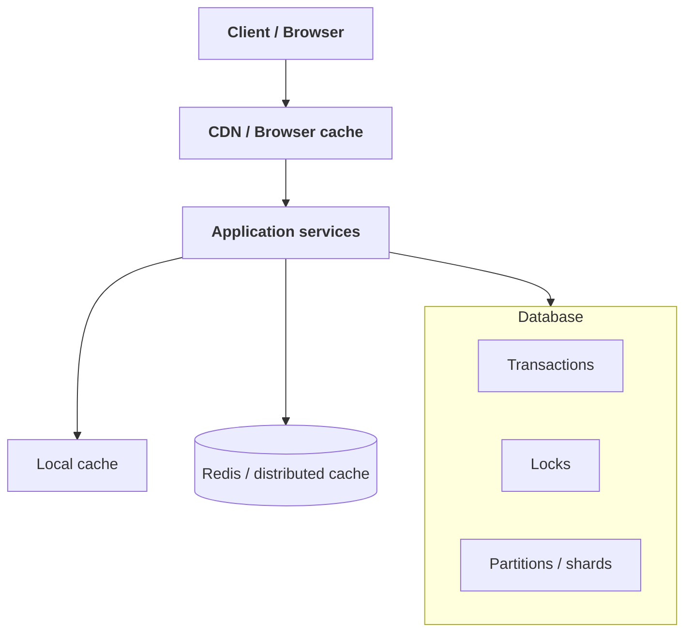
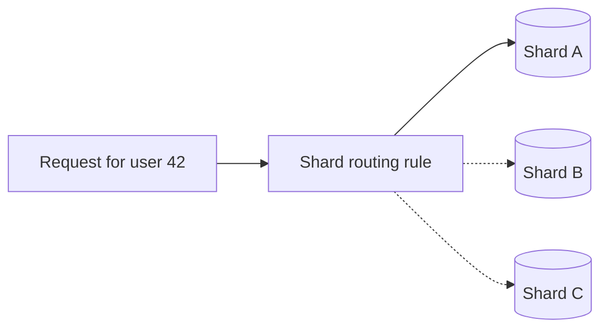
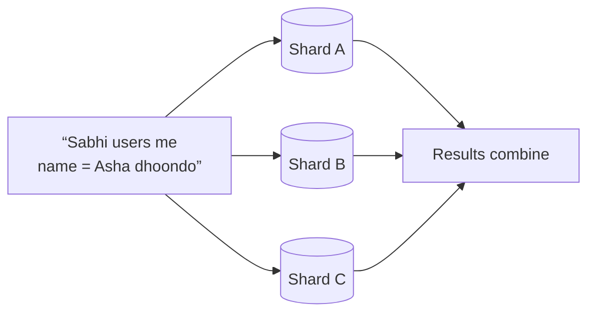
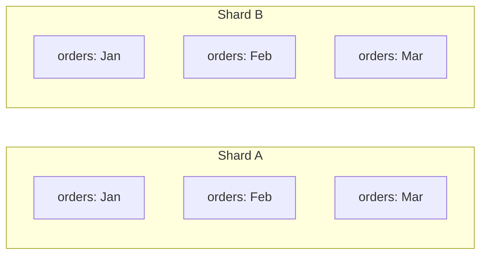
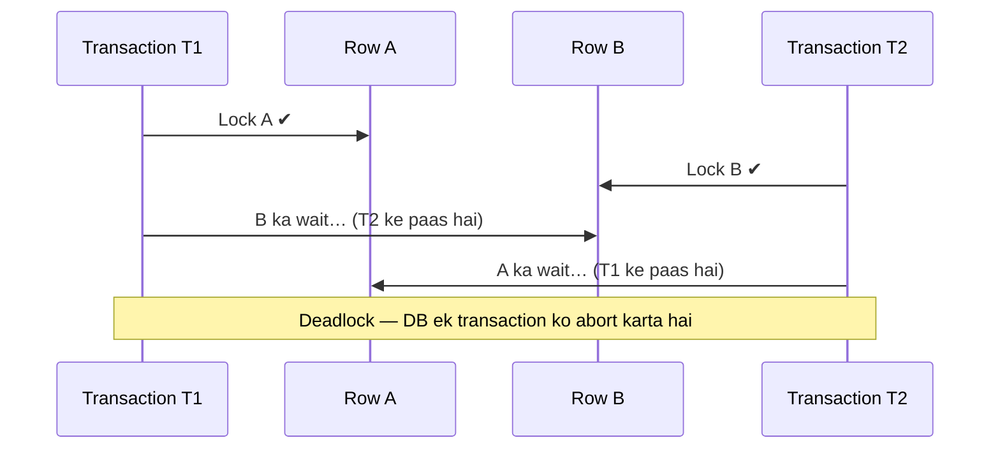
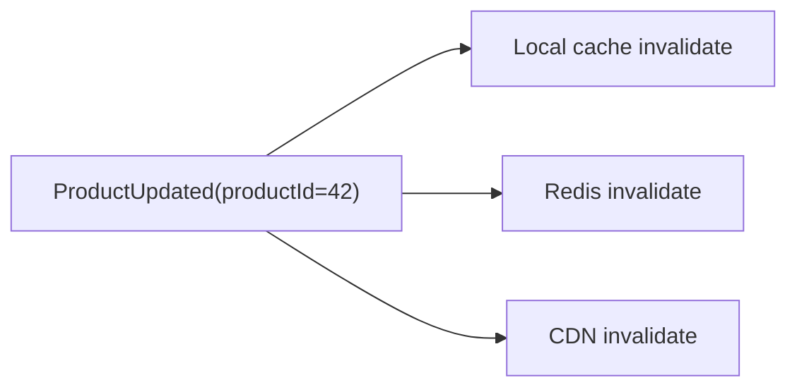
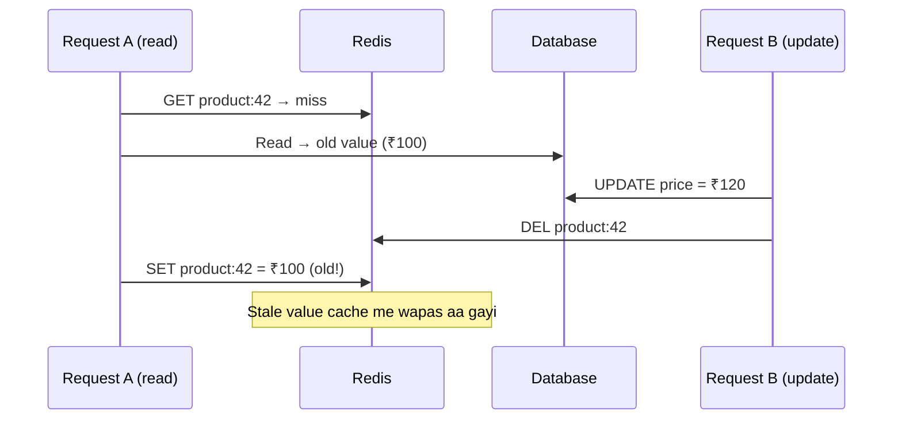
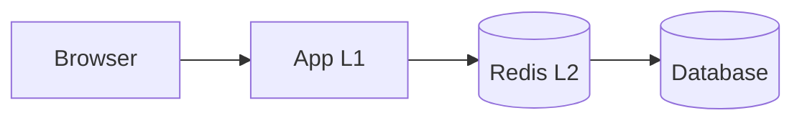
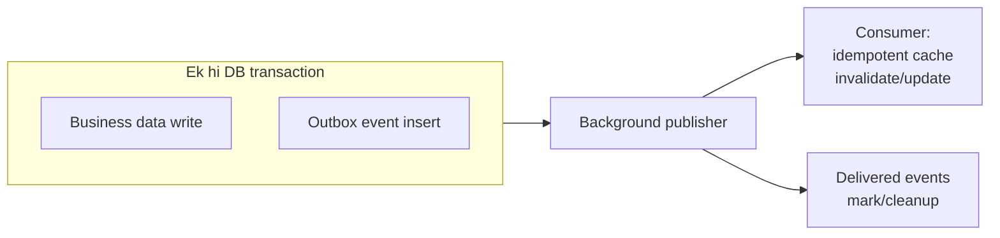
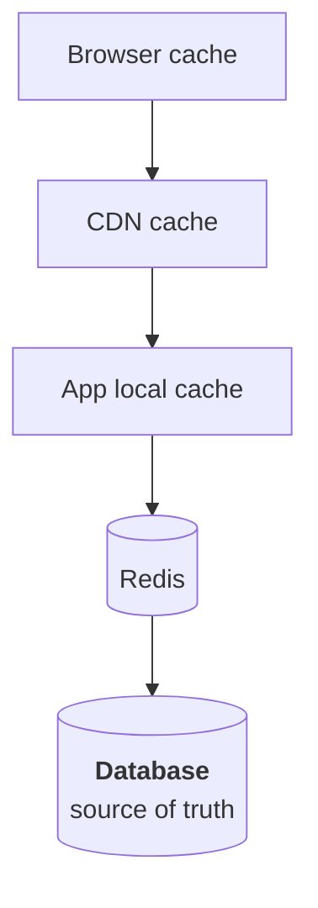

# Database architecture: sharding, transactions, partitioning, locking aur cache invalidation

In topics ko ek hi system ke parts ki tarah samjho:



- **Sharding/partitioning** data ko kaise divide aur place karna hai, yeh decide karte hain.
- **Transactions/locks** concurrent reads-writes ko safe banate hain.
- **Caches** data ki copies rakhkar speed badhate hain.
- **Cache invalidation** batata hai ki source data badalne par un copies ko kaise fresh rakhein.

---

## 1. DB sharding kya hai?

**Sharding** ek bade logical database ko multiple independent database servers me baantna hai. Har server ko **shard** kehte hain.

Maan lo users ke records bahut badh gaye:

```text
Shard A → users 1–1,000,000
Shard B → users 1,000,001–2,000,000
Shard C → users 2,000,001–3,000,000
```

Application ko pehle decide karna hota hai ki kisi user ka data kis shard par hai.



### Sharding kyun karte hain?

Ek single database ki limits aa sakti hain:

- storage capacity
- write throughput
- CPU, memory, connections
- maintenance window ya failover impact

Sharding data aur workload ko multiple machines me distribute karke capacity aur throughput scale kar sakti hai.

### Shard key kya hoti hai?

**Shard key** woh field hoti hai jiske basis par record ka shard decide hota hai.

Examples:

- `user_id`
- `tenant_id`
- `region_id`
- `account_id`

Shard key ka choice bahut important hai. Achhi shard key:

1. Data ko reasonably balanced distribute kare.
2. Common queries me available ho.
3. Related data ko ek shard par rakh sake, jab local joins/transactions important hon.
4. Ek shard ko hot spot na banaye.

#### Example: `tenant_id`

Agar har tenant ka data tenant ke andar hi query hota hai, `tenant_id` use karna natural ho sakta hai:

```text
tenant-1 → Shard A
tenant-2 → Shard B
tenant-3 → Shard C
```

Faayda: ek tenant ka data aksar local shard se serve ho sakta hai. Risk: agar ek tenant bahut bada ya popular ho, uska shard hot spot ban sakta hai.

### Shard routing ke tareeqe

| Tareeqa | Kaise | Faayda | Risk |
|---|---|---|---|
| **Range-based** | `user_id 1–1M → Shard A` | Range queries aasaan | Increasing IDs latest shard ko hot kar sakte hain |
| **Hash-based** | `hash(user_id) % shard_count` | Records spread hote hain | Shard count badalne par bahut remapping |
| **Directory-based** | Routing map: `tenant-42 → Shard C` | Placement flexible | Directory highly available aur consistent rakhni padti hai |
| **Consistent hashing** | Hashing ring / virtual nodes | Shard add/remove par remapping limited | Benefit implementation par depend |

#### Range-based

```text
user_id 1–1M → Shard A
user_id 1M–2M → Shard B
```

**Faayda:** range queries samajhna aasaan.
**Risk:** naye ya increasing IDs ek hi latest shard ko hot kar sakte hain.

#### Hash-based

```text
shard = hash(user_id) % shard_count
```

**Faayda:** records generally spread hote hain.
**Risk:** shard count badalne par bahut records ka mapping change ho sakta hai.

#### Directory-based

Ek routing map batata hai ki key ya tenant kis shard par hai:

```text
tenant-42 → Shard C
```

**Faayda:** shard placement zyada flexible.
**Risk:** routing directory ko highly available aur consistent rakhna padta hai.

#### Consistent hashing / virtual nodes

Kuch systems hashing ring ya virtual nodes se shard addition/removal ke baad remapping ko limit karte hain. Iska exact benefit implementation aur topology par depend karta hai.

### Sharding ke architectural trade-offs

Sharding sirf “database ko divide karna” nahi; yeh application architecture badal deti hai.

#### Cross-shard query

Agar query ke paas shard key nahi hai, to har shard ko query karna pad sakta hai:



Isse latency aur resource use badh sakta hai. Aise query ke liye alag search/indexing system ya replicated read model useful ho sakta hai.

#### Cross-shard transaction

Ek transaction agar multiple shards ko modify karti hai, to atomicity maintain karna mushkil hota hai. Distributed transaction possible ho sakti hai, lekin operational complexity aur failure modes badhte hain. Kai architectures iske badle:

- operations ko ek shard tak limit karti hain
- saga/workflow use karti hain
- idempotent steps aur compensating actions rakhti hain

#### Rebalancing

Naya shard add karna sirf server add karna nahi. Data migrate, routing update, load balance aur migration ke dauran reads/writes manage karne padte hain.

#### Joins aur global constraints

Different shards ke records par join, unique constraint ya global transaction expensive/complex ho sakte hain. Pehle data ko is tarah model karo ki common operations shard-local rahen.

### Sharding kab karni chahiye?

Jab single database ko tune, scale-up, index, query optimize aur connection/load manage karne ke baad bhi capacity bottleneck ho—tab sharding consider karo.

Sharding ko early adopt karna avoidable complexity create kar sakta hai. Pehle metrics se bottleneck identify karo: CPU, I/O, storage, locks, slow queries, connection count ya hot tables.

---

## 2. DB transaction kya hoti hai?

**Transaction** related database operations ka logical group hai, jise database ek unit ki tarah process karne ki koshish karta hai.

Example: bank account A se B me ₹500 transfer:

```text
1. A se ₹500 subtract
2. B me ₹500 add
```

Sirf pehla step ho aur doosra fail ho jaaye, to paisa “gayab” dikh sakta hai. Transaction ka goal hai ki dono operations consistent tareeqe se saath complete hon ya fail hon.

```sql
BEGIN;

UPDATE accounts
SET balance = balance - 500
WHERE id = 'A';

UPDATE accounts
SET balance = balance + 500
WHERE id = 'B';

COMMIT;
```

Agar error aaye to `ROLLBACK` se transaction ke changes undo kiye ja sakte hain.

### ACID properties

| Property | Matlab | Example |
|---|---|---|
| **Atomicity** | Operations ek unit ki tarah — all-or-nothing | Transfer ke dono steps ya koi nahi |
| **Consistency** | Transaction ke baad constraints/business invariants valid | Balance negative nahi, agar rule yahi hai |
| **Isolation** | Concurrent transactions ek doosre ko kis had tak dekh sakti hain | Isolation level par depend |
| **Durability** | Commit ke baad crash par bhi data preserve | Durability configuration par depend |

ACID ki exact guarantees database engine, isolation level, storage configuration aur deployment par depend karti hain.

### Isolation levels aur anomalies

Concurrent transactions ke beech kuch undesirable behaviors ho sakte hain:

| Anomaly | Kya hota hai |
|---|---|
| **Dirty read** | Doosri transaction ka uncommitted data padhna |
| **Non-repeatable read** | Same row ko dobara padhne par value badal jana |
| **Phantom read** | Same condition dobara query karne par rows ka set badal jana |
| **Lost update** | Do writers ek doosre ka update overwrite kar dena |
| **Write skew** | Alag rows par writes milkar business invariant tod dein |

Isolation level jitni strong hoti hai, correctness improve ho sakti hai, magar contention/latency bhi badh sakti hai. Har database me isolation level ka exact behavior thoda alag ho sakta hai; apne engine ki semantics verify karo.

### Transaction ko chhota kyun rakhein?

Long-running transaction:

- locks zyada der hold kar sakti hai
- doosri transactions ko block kar sakti hai
- deadlock ka chance badha sakti hai
- database cleanup/maintenance ko impact kar sakti hai
- connection pool occupy kar sakti hai

Network call, user input ya slow external API ke dauran transaction khuli rakhna usually risky design hai.

### Transaction boundary kaise choose karein?

Ek business operation me jo state ek saath correct rehni chahiye, us boundary ko transaction me rakho.

Example: order create karte waqt:

```text
Create order row
Reserve inventory
Record payment intent
```

Lekin agar inventory aur payment alag services/databases me hain, to ek normal single-database transaction un sab ko atomic nahi bana sakti. Wahan saga, outbox, idempotency aur compensating actions jaise distributed workflow patterns ki zaroorat ho sakti hai.

---

## 3. Partition vs sharding

Ye terms log kabhi-kabhi interchangeably use karte hain, lekin architecture me useful distinction yeh hai:

- **Partitioning:** ek table/dataset ko logical ya physical pieces me todna.
- **Sharding:** data ko multiple independent database servers/nodes me distribute karna.

Sharding ko **horizontal partitioning across nodes** bhi kaha ja sakta hai. Har partition alag server par ho, to woh sharded architecture hai.

### Partitioning ke common types

#### Horizontal partitioning

Rows ko groups me baantna:

```text
Orders 2025 → Partition A
Orders 2026 → Partition B
```

Har partition me same columns/schema, lekin rows alag.

#### Vertical partitioning

Columns ya functional data ko alag karna:

```text
Users table:
  profile fields → one table/database
  analytics fields → another table/database
```

Isse frequently used columns ko alag optimize kiya ja sakta hai; yeh row-based sharding ke barabar nahi.

### Table partitioning vs sharding

| Table partitioning | Sharding |
|---|---|
| Aksar ek database instance ke andar hoti hai | Multiple database nodes/instances par |
| Query planner relevant partitions skip kar sakta hai | Application/router ko correct shard tak pahunchna pad sakta hai |
| Maintenance, pruning, large-table management me help | Capacity/throughput ko multiple machines tak scale kar sakti hai |
| Database engine zyada routing handle karta hai | Distributed query, migration aur cross-shard behavior app design ka hissa banta hai |
| Ek node ka CPU/write limit phir bhi bottleneck ho sakta hai | Nodes ke beech workload distribute ho sakta hai |

#### Example: date partitioning

```text
orders_2025_01
orders_2025_02
orders_2025_03
```

Agar query January ka data maangti hai, database baaki partitions skip kar sakta hai. Yeh large table ko manage karne me madad karta hai, par agar sab partitions ek hi machine par hain to woh machine ab bhi compute bottleneck ho sakti hai.

#### Example: sharding by customer

```text
customer 1–100k → DB node A
customer 100k–200k → DB node B
```

Ab storage aur requests multiple DB nodes par bant sakti hain, lekin application ko customer key se shard locate karna hota hai.

### Dono saath bhi ho sakte hain



Pehle rows shards par distribute hain, aur har shard ke andar table time ke hisaab se partitioned hai.

---

## 4. DB locking kya hai?

Jab multiple transactions same data ko saath read/update karti hain, database ko correctness protect karni hoti hai. **Locking** database ka ek mechanism hai jisse conflicting operations ko coordinate kiya jata hai.

### Shared aur exclusive lock

Conceptually:

- **Shared/read lock:** multiple readers allow ho sakte hain.
- **Exclusive/write lock:** conflicting writes ya reads ko block kar sakta hai, depending on engine/isolation.

Exact lock types aur behavior database engine par depend karte hain.

### Row, page aur table locks

Lock ka scope alag ho sakta hai:

- **Row-level:** specific row par contention.
- **Page/block-level:** storage page par multiple rows.
- **Table-level:** poori table ya large scope.

Narrow lock concurrency improve kar sakta hai, par bookkeeping overhead hota hai. Broad lock simple ho sakta hai, magar zyada operations block karta hai.

### Pessimistic aur optimistic concurrency

#### Pessimistic locking

Assume karo conflict ho sakta hai, isliye pehle lock le lo.

```sql
SELECT ... FOR UPDATE
```

Useful jab conflicting update ka risk high ho aur operation ko exclusive control chahiye. Risk: blocking aur deadlock.

#### Optimistic concurrency

Lock ko minimum rakho; update ke waqt version/check condition se detect karo ki data beech me badla ya nahi.

```text
Read value + version 7
Update only if version is still 7
```

Agar version badal chuki ho, app conflict handle karke retry ya error de sakti hai.

Useful jab conflicts rare hon aur reads zyada hon.

| | Pessimistic | Optimistic |
|---|---|---|
| Soch | Conflict hoga, pehle lock lo | Conflict rare hai, update par check karo |
| Kaise | `SELECT ... FOR UPDATE` | Version number / condition check |
| Kab useful | Conflict risk high | Conflicts rare, reads zyada |
| Risk | Blocking aur deadlock | Conflict par retry/error handle karna |

### Deadlock

Do transactions ek doosre ke locks ka wait kar rahi hon:



Database deadlock detect karke kisi ek transaction ko abort kar sakta hai.

Deadlock kam karne ke tareeqe:

- rows ko consistent order me lock karo
- transactions chhoti rakho
- indexes sahi rakho, taaki query unnecessary rows lock na kare
- bounded retry karo, kyunki deadlock victim transaction retryable ho sakti hai
- transaction ke andar slow external calls avoid karo

### MVCC aur locking

Kai relational databases **MVCC** (Multi-Version Concurrency Control) use karte hain. Isme readers ko data ka ek version/snapshot dikhaya ja sakta hai, jisse readers aur writers ka blocking kam hota hai.

Lekin MVCC ka matlab “locks nahi hote” nahi hai. Writes, constraints, schema changes aur certain queries me locks phir bhi ho sakte hain. Old versions ko clean karne ka overhead bhi ho sakta hai.

---

## 5. Cache invalidation kya hai?

Cache me source data ki copy hoti hai. Jab source badalta hai, to cache me purani copy **stale** ho sakti hai.

**Cache invalidation** ka matlab hai stale copy ko delete, refresh, ya unusable mark karna.

```text
Database: price = ₹100
Redis:    price = ₹100
Browser:  price = ₹100

Database update → price = ₹120
Ab Redis/browser me purani value reh sakti hai
```

Cache invalidation ko distributed system ki mushkil problems me se ek maana jata hai, kyunki ek hi data ki copies multiple layers par ho sakti hain.

---

## 6. Invalidation ke common patterns

| Pattern | Kaise | Faayda | Risk |
|---|---|---|---|
| **TTL** | Har value ke saath expiry | Simple; stale entry hamesha nahi rehti | TTL ke andar stale; expiry par load spike |
| **Write-through** | Source write ke saath cache update | Cache fresh rakhne ki koshish | DB aur cache me ek fail ho sakta hai |
| **Cache-aside invalidation** | DB update, phir key delete | Common, simple | Update aur delete ke beech race/failure |
| **Event-driven** | Change event, consumers invalidate | Multiple caches decoupled | Event delay/duplicate/lost |
| **Versioned keys** | `product:42:v7` → `v8` | Purani key delete karna kam | Version pointer consistent rakhna |
| **Stale-while-revalidate** | Stale serve, background me refresh | Latency/availability | Sensitive decisions me unsafe |

### A. TTL / time-based expiration

Har cached value ke saath expiry time rakho.

```text
product:42 → value, expires in 5 minutes
```

**Faayda:** purani entry hamesha ke liye nahi rahegi; implementation simple.
**Trade-off:** TTL ke andar data stale ho sakta hai; expiry ke waqt cache miss/load spike ho sakta hai.

TTL data freshness ka upper bound define kar sakti hai, magar source update hote hi immediate freshness guarantee nahi karti.

### B. Write-through/update cache

Application source write ke saath cache ko bhi update karti hai.

**Faayda:** cache fresh rakhne ki koshish.
**Risk:** DB write successful, cache update fail—ya ulta. Dono stores ko atomic banana mushkil ho sakta hai.

### C. Cache-aside invalidation

App pehle database update karti hai, phir cache key delete karti hai:

1. DB update
2. Redis key delete
3. Next read: cache miss
4. DB se fresh value
5. Redis refill

Yeh common pattern hai. Phir bhi DB update aur cache delete ke beech failure/race ho sakti hai. TTL, retry/outbox event ya versioned keys is gap ko mitigate kar sakte hain.

### D. Event-driven invalidation

Database/domain change ke baad event publish hota hai:



**Faayda:** multiple caches ko update/invalidate karne ka decoupled tareeqa.
**Risk:** event delivery delay, duplicate delivery, order change ya lost event. Consumers idempotent hone chahiye; event reliability ke liye transactional outbox jaise patterns use kiye ja sakte hain.

### E. Versioned keys

Key me data version shamil karo:

```text
product:42:v7
```

Update par current version ko `v8` karo. Purana cache entry apne TTL tak reh sakta hai, magar naye reads `v8` maangengi.

**Faayda:** old key ko delete karne ki zaroorat kam ho sakti hai.
**Risk:** version pointer ko consistent rakhna aur purane entries clean karna hoga.

### F. Stale-while-revalidate

Stale value ko temporarily serve karo aur background me fresh value load karo.

Useful jab availability/latency important ho aur thoda purana data acceptable ho. Security, authorization, price confirmation ya inventory reservation jaise sensitive decisions me stale value unsafe ho sakti hai.

---

## 7. Redis cache invalidation

Redis app-level distributed cache ke roop me use ho sakta hai.

Example key:

```text
product:42 → JSON value + TTL
```

Product update ke baad options:

1. `product:42` delete karna.
2. Updated value Redis me set karna.
3. Versioned key par move karna.
4. DB event ke through invalidation karna.
5. TTL ko fallback freshness limit ke roop me rakhna.

### Redis invalidation ke tricky cases

#### Race condition



Ab stale value cache me aa gayi.

Possible mitigations:

- write order aur cache fill ko carefully coordinate karna
- version check karke hi value cache karna
- short TTL aur delayed refill strategy
- update events/version numbers
- per-key request coalescing
- stale data tolerate karne ki explicit policy

#### Delete fail ho jaana

Database update commit ho gaya, lekin Redis delete command fail ho gayi. Outbox/event retry ya bounded TTL stale duration ko control kar sakta hai.

#### Local L1 + Redis L2

Agar app instance ke andar local cache bhi hai:



Redis key delete karne se har app instance ka local cache automatically delete nahi hota. Local caches ko invalidation event, short TTL, versioning ya doosre coordination mechanism ki zaroorat ho sakti hai.

---

## 8. Browser, CDN aur HTTP cache invalidation

Browser aur CDN caches aksar HTTP response headers ke basis par kaam karte hain.

### `Cache-Control`

Server batata hai response kitni der aur kahan cache ho sakta hai.

Conceptual examples:

```http
Cache-Control: public, max-age=300
```

Publicly cacheable response, limited time tak.

```http
Cache-Control: private, max-age=60
```

User-specific response ko shared public cache me rakhne se bachata hai; browser jaisi private cache me limited time tak rakh sakta hai.

```http
Cache-Control: no-store
```

Response ko store na karne ka instruction, sensitive responses ke liye use ho sakta hai.

`no-cache` ka naam confusing hai: aam taur par iska matlab cache store hi na karein nahi; iska matlab reuse se pehle validation karna hota hai. Header semantics ko exact HTTP behavior ke mutabiq set karo.

| Header | Matlab |
|---|---|
| `public, max-age=300` | Shared caches bhi 300 sec tak rakh sakte hain |
| `private, max-age=60` | Sirf browser jaisi private cache, 60 sec |
| `no-store` | Store hi mat karo |
| `no-cache` | Store ho sakta hai, par reuse se pehle validate karo |

### ETag revalidation

Server response ke saath entity tag bhej sakta hai:

```http
ETag: "product-42-v8"
```

Browser agle request me:

```http
If-None-Match: "product-42-v8"
```

Agar representation nahi badli, server `304 Not Modified` return kar sakta hai. Body dobara bhejne ki zaroorat nahi.

### CDN invalidation/purge

CDN me cached object ko:

- TTL khatam hone dena
- URL/path purge karna
- tag/surrogate key ke basis par purge karna
- content-addressed/versioned URL use karna

Versioned static assets, jaise `app.a82f3.js`, common approach hain. Naya content naya URL paata hai, isliye old cached object ko naya content samajhne ka risk kam hota hai.

#### Browser cache par limitation

Browser ke paas server-side app jaisa direct “har user ke browser ko abhi purge karo” control aam taur par nahi hota. Isliye asset URLs version/hash se badalna aur sahi cache headers lagana reliable strategy hai.

---

## 9. “Any type of cache” me invalidation kaise sochen?

Har cache layer ko ek hi strategy se manage nahi kiya ja sakta.

| Cache layer | Common control |
|---|---|
| Browser cache | HTTP cache headers, ETag, versioned URL |
| CDN/reverse proxy | TTL, purge, tags, versioned URLs |
| App ke andar local memory | TTL, explicit remove, event/versioning |
| Redis/distributed cache | Delete/update, TTL, versioned keys, events |
| ORM/query cache | Framework invalidation, transaction-aware policy, TTL |
| Database buffer/page cache | Database engine khud manage karta hai; generally application manually invalidate nahi karti |
| Search index/read model | Change events, reindex/update pipeline, version tracking |

### DB buffer cache ka important distinction

Database ke internal buffer/page cache ko app-level Redis cache ke jaisa treat nahi karte. Database engine apni writes aur storage pages ke consistency rules ke mutabiq us cache ko manage karta hai. Application usually `UPDATE` ke baad database buffer cache manually clear nahi karti.

Search index ya analytics read model bhi “cache-like copy” ho sakta hai, magar uska update asynchronous pipeline se hota hai. Wahan freshness delay ko system requirement ka hissa banana padta hai.

---

## 10. Cache consistency ke design patterns

| Pattern | Kaise | Trade-off |
|---|---|---|
| **Cache-aside** | Read par cache check; miss par source se load | Simple, lekin miss storm aur invalidation race |
| **Write-through** | Write path source aur cache ko coordinated update | Cache fresh, magar partial failures |
| **Write-behind / write-back** | Cache pehle, durable store baad me | Throughput badhe, crash/retry se data loss ya reordering risk |
| **Read-through** | Cache layer khud miss par load karti hai | App code simple, magar loader/concurrency/failure design phir bhi |

### Cache-aside

Application read par cache check karti hai; miss par source se load.

**Trade-off:** simple, lekin miss storm aur invalidation race handle karne padte hain.

### Write-through

Write path source aur cache ko coordinated tareeqe se update karta hai.

**Trade-off:** cache fresh rakhne me help, magar partial failures handle karne hote hain.

### Write-behind/write-back

Cache pehle update hota hai; durable store baad me.

**Trade-off:** throughput badh sakta hai, magar crash/retry se data loss ya reordering ka risk.

### Read-through

Client cache layer se read karti hai; cache miss loading ko abstraction handle karti hai.

**Trade-off:** application code simple ho sakta hai, magar loader, concurrency aur failure behavior phir bhi design karna hota hai.

---

## 11. Invalidation aur distributed failure

Database update ke baad cache invalidation event bhejna ek dual-write problem create kar sakta hai:

```text
1. DB commit
2. Event publish
```

Agar app step 1 ke baad crash ho jaaye, DB updated hai lekin event publish nahi hua. Isse cache stale reh sakti hai.

**Transactional outbox** ek common solution hai:



1. Business data aur outbox event ko same database transaction me write karo.
2. Background publisher outbox se event bheje.
3. Consumer idempotently cache invalidate/update kare.
4. Delivered events ko mark/cleanup karo.

Yeh exactly-once magic nahi deta; duplicate delivery possible ho sakti hai. Isliye consumers ko duplicate event safely handle karna chahiye.

---

## 12. Combined example: product price update

Maan lo product `42` ka price ₹100 se ₹120 karna hai.



Ek possible workflow:

1. API request validate aur authorize karti hai.
2. Database transaction me price update hota hai.
3. Transaction ke andar `ProductUpdated(42, version=8)` outbox event insert hota hai.
4. Background publisher event bhejta hai.
5. Consumers Redis key invalidate karte hain.
6. App instances apna local cache invalidate ya version advance karte hain.
7. CDN purge hota hai, ya response TTL tak purana reh sakta hai.
8. Browser revalidate karta hai ya versioned resource naya URL use karta hai.
9. Update API response successful state/version return karti hai.

Ab design ka core sawaal hai:

> Price change ke baad kaunse users ko kitni der tak purana price dikhna acceptable hai?

Product detail page par thodi staleness shayad acceptable ho, lekin final checkout/charge se pehle authoritative current price database/service se verify karna safer ho sakta hai.

---

## 13. In topics ko ek saath jodo

### Sharding + transactions

Transaction ek shard ke andar straightforward ho sakti hai. Multiple shards me transaction ka scope distributed ho jata hai, aur coordination complexity badhti hai. Isliye shard key ko common transaction boundaries ke mutabiq choose karo.

### Locking + transactions

Transaction ke andar database concurrency control/locks use kar sakta hai. Long transaction locks ko zyada der hold karke throughput kam kar sakti hai.

### Sharding + cache

Cache key me shard identity/tenant identity zaroori ho sakti hai. Shard migration ke waqt cache entries galat shard ya purane data ko represent kar sakti hain; versioning/invalidation plan chahiye.

### Transactions + cache invalidation

Database transaction commit aur cache update ek hi atomic transaction me tabhi ho sakte hain jab dono ek transactional system me hon—jo aam Redis + relational DB setup me generally true nahi. Isi liye outbox, TTL, versioning aur idempotent consumers use hote hain.

### Locking + cache

Distributed cache ka lock, database row lock ka replacement automatically nahi. Dono ke failure behavior aur guarantees alag hain. Business invariant ko authoritative database me enforce karna zyada reliable ho sakta hai.

---

## 14. Quick recap

- **Sharding:** rows/data ko multiple database nodes par distribute karna; scale kar sakti hai, par routing aur cross-shard operations complex banati hai.
- **Transaction:** related database changes ko ek logical unit ki tarah execute karna; ACID aur isolation level matter karte hain.
- **Partitioning:** data/table ko pieces me baantna; ek database ke andar bhi ho sakta hai. Sharding multi-node distribution hai.
- **Locking:** concurrent operations ko coordinate karta hai; narrow/short transactions contention kam karti hain.
- **Cache invalidation:** source update ke baad copies ko delete/update/version/expire karna.
- **Har cache layer alag hai:** browser, CDN, local memory, Redis, search index aur DB buffer cache ke controls ek jaise nahi.
- **Distributed invalidation me failure expected hai:** TTL, versioning, outbox, idempotency aur freshness requirements ko saath design karo.
