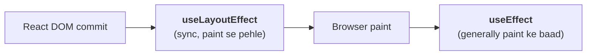
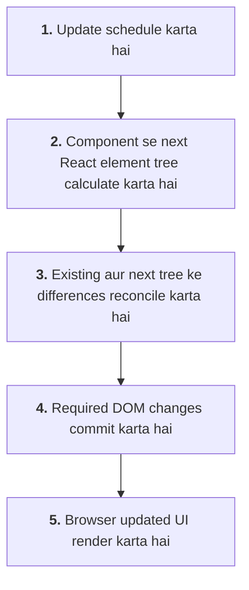
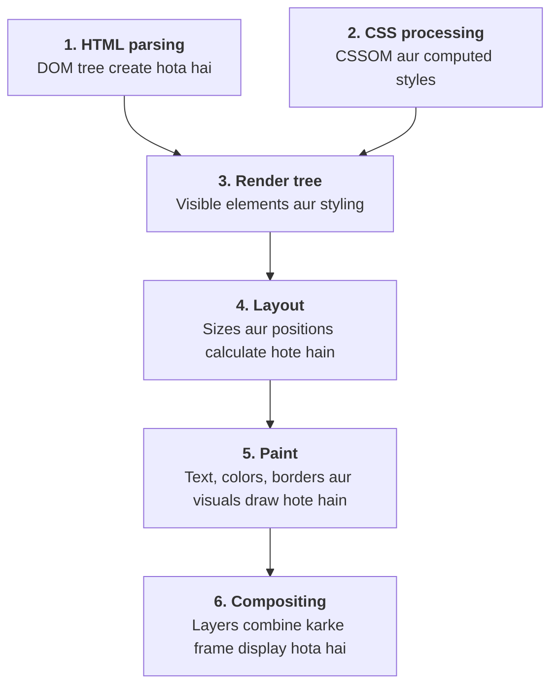

# Frontend Engineering Interview Guide — Part 2

## 1. How do you optimize a large React application for performance?

Maan lo tumhari ek learning application hai jisme course listing, video player, dashboard aur payment pages hain. Application slow ho rahi hai, to sirf `React.memo` lagana solution nahi hai. Pehle identify karna hoga ki actual bottleneck kya hai.

### Step 1: Unnecessary re-renders reduce karo

```jsx
import { memo, useMemo, useState } from "react";

const CourseList = memo(function CourseList({ courses }) {
  return courses.map(course => (
    <p key={course.id}>{course.title}</p>
  ));
});

function Dashboard({ courses }) {
  const [count, setCount] = useState(0);

  const sortedCourses = useMemo(() => {
    return [...courses].sort((a, b) =>
      a.title.localeCompare(b.title)
    );
  }, [courses]);

  return (
    <>
      <button onClick={() => setCount(c => c + 1)}>
        Count: {count}
      </button>

      <CourseList courses={sortedCourses} />
    </>
  );
}
```

Yahan `useMemo` sorted array ko reuse kar sakta hai jab tak `courses` reference change nahi hota. `React.memo` unchanged props ke saath list component ka render skip kar sakta hai.

### Step 2: Code splitting use karo

```jsx
import { lazy, Suspense } from "react";

const VideoPlayer = lazy(() => import("./VideoPlayer"));

function CoursePage() {
  return (
    <Suspense fallback={<p>Loading video player...</p>}>
      <VideoPlayer />
    </Suspense>
  );
}
```

### Step 3: Large lists virtualize karo

Agar 10,000 courses hain, to saare DOM elements ek saath render karna expensive ho sakta hai. Virtualization sirf visible items aur unke aas-paas ke items render karti hai.

### Step 4: Network aur images optimize karo

- API requests ko parallelize karo, jab possible ho.
- Images ke suitable dimensions aur modern formats use karo.
- Caching aur pagination implement karo.
- Unnecessary dependencies remove karo.

### Step 5: Measure karo

React Profiler, Chrome DevTools Performance, Network panel aur Lighthouse se bottlenecks identify karo.

Interview answer: Main pehle profile karke bottleneck identify karunga, phir component rendering, bundle size, network requests aur DOM rendering ko optimize karunga. Uske baad performance measurements compare karke verify karunga ki improvement actual hai.

## 2. Controlled vs uncontrolled components in React

Ye question forms aur input handling se related hai.

### Controlled component

Input ki value React state control karti hai.

```jsx
import { useState } from "react";

function LoginForm() {
  const [email, setEmail] = useState("");

  return (
    <input
      value={email}
      onChange={e => setEmail(e.target.value)}
      placeholder="Enter email"
    />
  );
}
```

Jab user type karta hai, state update hoti hai aur input ki value React se synchronize rehti hai.

Use cases: Live validation, conditional UI, search filters aur dynamic forms.

### Uncontrolled component

Input apni value DOM mein maintain karta hai. React ko value read karne ke liye ref use kar sakte hain.

```jsx
import { useRef } from "react";

function LoginForm() {
  const emailRef = useRef(null);

  function handleSubmit(e) {
    e.preventDefault();
    console.log(emailRef.current.value);
  }

  return (
    <form onSubmit={handleSubmit}>
      <input ref={emailRef} defaultValue="" />
      <button type="submit">Submit</button>
    </form>
  );
}
```

| Controlled | Uncontrolled |
|---|---|
| Value React state mein | Value DOM mein |
| Live validation easy | Simple forms mein convenient |
| State updates frequent ho sakte hain | Ref se value read hoti hai |
| UI behavior par direct control | DOM value primary source |

Interview point: Dono valid approaches hain. Choice form ki complexity aur requirements ke basis par karni chahiye.

## 3. What are the benefits of TypeScript in frontend projects?

TypeScript JavaScript ke upar static type system add karta hai. Isse kai programming errors code execute karne se pehle identify kiye ja sakte hain.

JavaScript example:

```js
function add(a, b) {
  return a + b;
}

add(10, "20"); // "1020"
```

TypeScript:

```ts
function add(a: number, b: number): number {
  return a + b;
}

add(10, 20);    // Valid
add(10, "20");  // Type error
```

### React props mein TypeScript

```tsx
type Course = {
  id: number;
  title: string;
  price: number;
};

type CourseCardProps = {
  course: Course;
  onSelect: (id: number) => void;
};

function CourseCard({
  course,
  onSelect
}: CourseCardProps) {
  return (
    <button onClick={() => onSelect(course.id)}>
      {course.title} — ₹{course.price}
    </button>
  );
}
```

Is example mein TypeScript ensure karta hai ki `course` ke expected fields hon aur `onSelect` ko numeric ID mile.

### Major benefits

- Compile-time type checking.
- Better autocomplete aur IDE support.
- Refactoring safer hoti hai.
- Component contracts clear hote hain.
- API response models aur shared types organize kiye ja sakte hain.

Important: TypeScript runtime security ya API validation ka replacement nahi hai. External API se aane wale data ko runtime par bhi validate karna chahiye, kyunki TypeScript types compile hone ke baad erase ho jaate hain.

## 4. How would you implement lazy loading and code splitting in React?

Dono ka purpose initial page load ka unnecessary work reduce karna hai, lekin meaning alag hai.

- **Code splitting:** JavaScript bundle ko multiple chunks mein divide karna.
- **Lazy loading:** Code ya resource ko zaroorat padne par load karna.

Example:

```jsx
import { lazy, Suspense } from "react";

const AdminPanel = lazy(() => import("./AdminPanel"));

function App() {
  return (
    <Suspense fallback={<p>Loading admin panel...</p>}>
      <AdminPanel />
    </Suspense>
  );
}
```

Jab `AdminPanel` render hota hai, React uska dynamic import load kar sakta hai.

Route-level code splitting ke liye React Router ya framework ki route-based loading capabilities use kar sakte ho.

Images ke liye:

```html

```

Interview point: Lazy loading har jagah apply nahi karni chahiye. Main heading ya LCP image ko late load karne se perceived performance kharab ho sakti hai.

## 5. What is the difference between `useEffect` and `useLayoutEffect`?

Dono React hooks side effects handle karte hain, lekin unki timing alag hai.

### `useEffect`

React ke commit ke baad effect run hota hai. Non-visual synchronization, subscriptions aur network-related effects ke liye commonly use hota hai. React generally browser paint ko block kiye bina effect run karne ki koshish karta hai.

```jsx
import { useEffect, useState } from "react";

function UserProfile() {
  const [user, setUser] = useState(null);

  useEffect(() => {
    fetch("/api/user")
      .then(response => response.json())
      .then(setUser);
  }, []);

  return <p>{user ? user.name : "Loading..."}</p>;
}
```

### `useLayoutEffect`

Ye DOM mutations commit hone ke baad, browser repaint se pehle synchronously run hota hai. Iska use tab hota hai jab layout measure karna ya paint se pehle visual correction karna zaroori ho.

```jsx
import { useLayoutEffect, useRef, useState } from "react";

function Tooltip() {
  const ref = useRef(null);
  const [height, setHeight] = useState(0);

  useLayoutEffect(() => {
    setHeight(ref.current.getBoundingClientRect().height);
  }, []);

  return (
    <div ref={ref}>
      Tooltip height: {height}px
    </div>
  );
}
```



| `useEffect` | `useLayoutEffect` |
|---|---|
| General side effects | Layout measurement/correction |
| Paint ko usually block nahi karta | Paint ko block kar sakta hai |
| Most effects ke liye preferred | Specific visual cases ke liye |

Interview point: `useLayoutEffect` ko unnecessarily use mat karo, kyunki expensive synchronous work rendering ko delay kar sakta hai. Server rendering mein DOM layout available nahi hota, isliye is hook ke server-side behavior ko bhi consider karna chahiye.

## 6. How does the virtual DOM work internally?

Virtual DOM React UI ka in-memory representation hai. React components execute hone par React elements create hote hain, jinse React next UI tree determine karta hai.

Example:

```jsx
function App() {
  return <h1>Hello</h1>;
}
```

Is JSX ka conceptual representation:

```js
{
  type: "h1",
  props: {
    children: "Hello"
  }
}
```

Ye simplified illustration hai; actual React element ka internal structure isse zyada detailed hota hai.

Jab state update hoti hai:

```jsx
function Counter() {
  const [count, setCount] = useState(0);

  return (
    <button onClick={() => setCount(c => c + 1)}>
      Count: {count}
    </button>
  );
}
```

React broadly:



**Virtual DOM ka benefit:** React declarative programming model provide karta hai aur UI updates ko coordinate karta hai. Lekin virtual DOM har situation mein manual DOM operations se faster ho, aisi guarantee nahi hai.

Virtual DOM aur Fiber ko confuse mat karna: virtual DOM UI representation ke concept se related hai, jabki Fiber React ke internal work organization aur reconciliation architecture se related hai.

## 7. How do you manage state across complex React applications?

Sabse pehle decide karna chahiye ki state local hai, shared UI state hai ya server se aane wala data hai.

### Context API

Theme ya authentication information jaise shared values ke liye useful ho sakta hai.

```jsx
import { createContext, useContext } from "react";

const ThemeContext = createContext("light");

function ThemeLabel() {
  const theme = useContext(ThemeContext);
  return <p>Current theme: {theme}</p>;
}

function App() {
  return (
    <ThemeContext.Provider value="dark">
      <ThemeLabel />
    </ThemeContext.Provider>
  );
}
```

### Redux Toolkit

Complex shared state, predictable update patterns aur centralized state transitions ke liye useful hai.

```js
import { configureStore, createSlice } from "@reduxjs/toolkit";

const cartSlice = createSlice({
  name: "cart",
  initialState: { quantity: 0 },
  reducers: {
    addItem(state) {
      state.quantity += 1;
    }
  }
});

export const { addItem } = cartSlice.actions;

export const store = configureStore({
  reducer: {
    cart: cartSlice.reducer
  }
});
```

Redux Toolkit reducers mein mutation jaisa syntax use karne deta hai, lekin internally Immer immutable updates produce karta hai.

### Recoil

Recoil historically atom/selector-based state management provide karta tha. Lekin naye projects mein ise choose karne se pehle uski current maintenance aur compatibility evaluate karni chahiye; ise React ka built-in solution mat samjho.

### Practical comparison

| Tool | Suitable use |
|---|---|
| `useState` / `useReducer` | Local component state |
| Context API | Shared values, relatively simple state |
| Redux Toolkit | Complex shared client state |
| TanStack Query | Server data, caching, refetching |
| URL search params | Filters, sorting, pagination |

Interview point: Har state ko Redux mein rakhna zaroori nahi. Server state aur client UI state alag concerns hain.

## 8. Explain how browsers render a webpage

Browser ko HTML, CSS, JavaScript aur resources process karke final pixels display karne hote hain.



Example HTML:

```html
<h1>Hello World</h1>
```

Browser isse DOM node banata hai. CSS heading ki appearance define karti hai. Layout engine dimensions aur positions calculate karta hai, paint visual content draw karta hai aur compositor final frame assemble karta hai.

Real browser mein resource discovery, JavaScript execution aur rendering ke kuch phases overlap kar sakte hain.

Interview point: Long-running JavaScript main thread ko block kare to rendering aur input response delay ho sakta hai. Isi wajah se performance optimization sirf network speed ke baare mein nahi hoti.

## 9. What are common causes of memory leaks in React and how do you fix them?

Memory leak tab hota hai jab unnecessary resources ya objects expected lifetime ke baad bhi memory mein retained rehte hain.

### Cause 1: Event listener cleanup missing

```jsx
useEffect(() => {
  function handleResize() {
    console.log(window.innerWidth);
  }

  window.addEventListener("resize", handleResize);

  return () => {
    window.removeEventListener("resize", handleResize);
  };
}, []);
```

### Cause 2: Timer cleanup missing

```jsx
useEffect(() => {
  const timer = setInterval(() => {
    console.log("Polling");
  }, 5000);

  return () => clearInterval(timer);
}, []);
```

### Cause 3: Subscription cleanup missing

```jsx
useEffect(() => {
  const unsubscribe = subscribeToUpdates(data => {
    console.log(data);
  });

  return () => unsubscribe();
}, []);
```

### Cause 4: Unnecessary retained references

Large objects ko long-lived caches, global variables ya closures mein retain karne se memory usage grow kar sakta hai.

Debugging ke liye Chrome DevTools Memory panel, heap snapshots aur allocation timelines use karo.

Interview point: Har asynchronous request ya unmounted component automatically memory leak nahi hota. Real issue unnecessary retention aur resources ka expected cleanup na hona hai.

## 10. How do you secure a frontend application against XSS and CSRF attacks?

### XSS — Cross-Site Scripting

XSS mein attacker malicious JavaScript ko application ke trusted origin par execute karwane ki koshish karta hai.

Unsafe example:

```jsx
<div dangerouslySetInnerHTML={{ __html: userInput }} />
```

Agar `userInput` untrusted HTML hai, to ye dangerous ho sakta hai.

Safer approach:

```jsx
<p>{userInput}</p>
```

Agar rich HTML render karna zaroori hai, to trusted sanitization library aur suitable Content Security Policy consider karo.

### CSRF — Cross-Site Request Forgery

CSRF mein attacker user ke browser se unwanted authenticated request bhejne ki koshish karta hai, commonly cookie-based authentication ke context mein.

Protection:

- CSRF tokens.
- Appropriate `SameSite` cookie settings.
- Origin/Referer validation where appropriate.
- Sensitive operations ke liye server-side request validation.

Example cookie:

```http
Set-Cookie: session=...; HttpOnly; Secure; SameSite=Lax
```

Ye cookie XSS se complete protection nahi deti aur CSRF protection ka universal replacement bhi nahi hai.

| | XSS | CSRF |
|---|---|---|
| Kya hota hai | Malicious script trusted origin par execute hoti hai | Victim ke credentials se unwanted request trigger hoti hai |
| Main protection | Output encoding, sanitization, CSP | CSRF tokens, `SameSite` cookies, origin validation |

Interview point: XSS aur CSRF alag attacks hain. XSS mein malicious script execute hoti hai; CSRF mein victim ke credentials ka misuse karke unwanted request trigger ki ja sakti hai.

## 11. How do you handle API errors and retries in frontend applications?

Production API handling mein loading, success, error aur retry states clear honi chahiye.

```jsx
import { useEffect, useState } from "react";

function Courses() {
  const [courses, setCourses] = useState([]);
  const [loading, setLoading] = useState(true);
  const [error, setError] = useState("");

  async function loadCourses() {
    setLoading(true);
    setError("");

    try {
      const response = await fetch("/api/courses");

      if (!response.ok) {
        throw new Error(`Request failed: ${response.status}`);
      }

      setCourses(await response.json());
    } catch {
      setError("Courses load nahi ho paaye.");
    } finally {
      setLoading(false);
    }
  }

  useEffect(() => {
    loadCourses();
  }, []);

  if (loading) return <p>Loading courses...</p>;

  if (error) {
    return (
      <div>
        <p>{error}</p>
        <button onClick={loadCourses}>Try again</button>
      </div>
    );
  }

  return courses.map(course => (
    <p key={course.id}>{course.title}</p>
  ));
}
```

Ye basic pattern hai; effect se load ki gayi async operation mein cancellation aur stale responses bhi handle karne chahiye.

### Retry strategy

- Network errors aur temporary `5xx` responses par limited retries consider karo.
- Exponential backoff aur jitter use karo.
- `429` response ka `Retry-After` respect karo.
- Permanent validation errors ko blindly retry mat karo.
- Payment jaise mutating operations ko idempotency ke bina blindly repeat mat karo.

Interview point: Retry policy API ki semantics par depend karti hai. Har failure retryable nahi hota.

## 12. Explain React's reconciliation algorithm (diffing)

Reconciliation woh process hai jisme React existing UI tree aur new UI tree ko compare karke required updates determine karta hai.

Example:

```jsx
function Counter() {
  const [count, setCount] = useState(0);

  return (
    <div>
      <h1>Counter</h1>
      <p>{count}</p>
      <button onClick={() => setCount(c => c + 1)}>
        Increment
      </button>
    </div>
  );
}
```

Jab `count` zero se one hota hai, React next tree calculate karta hai aur changed text ko DOM mein update karta hai. Unchanged heading ko unnecessarily replace karne ki zaroorat nahi hoti.

### React kaun se rules use karta hai?

#### Rule 1: Different element types

```jsx
<div>Hello</div>
```

Agar next render mein:

```jsx
<section>Hello</section>
```

React different element type dekhkar relevant subtree ko replace kar sakta hai.

#### Rule 2: Same element type

```jsx
<p>{name}</p>
```

Same type ke element mein changed props ya children ke according updates apply kiye ja sakte hain.

#### Rule 3: Keys in lists

```jsx
{courses.map(course => (
  <CourseCard key={course.id} course={course} />
))}
```

Stable keys React ko list items ki identity track karne mein help karti hain.

#### Rule 4: State identity

Same component position aur identity maintain rehne par state preserve ho sakti hai. Different `key` dene par React component ko naya instance treat kar sakta hai.

```jsx
<CourseForm key={selectedCourseId} />
```

Course ID change hone par form ki previous component state reset karne ke liye ye useful ho sakta hai.

Interview point: Reconciliation aur DOM commit alag phases hain. React pehle required changes determine karta hai, phir commit phase mein DOM updates apply karta hai.

## 13. How do you improve Lighthouse performance scores?

Lighthouse web pages ki performance aur doosre quality aspects audit karta hai.

Main focus karunga ki real bottleneck kya hai, sirf score ko artificially improve karne par nahi.

### Important Core Web Vitals

| Metric | Kya measure karta hai? | Good target |
|---|---|---|
| LCP | Main content kitni jaldi load hota hai | ≤ 2.5 seconds |
| INP | Interactions kitni responsive hain | ≤ 200 ms |
| CLS | Unexpected layout shifts | ≤ 0.1 |

Ye targets real-user experience ke liye 75th percentile par assess kiye jaate hain.

### Example: LCP image optimize karna

```html

```

Ye tab useful ho sakta hai jab image actual LCP element ho. Har image ko high priority dena sahi nahi hai.

### Practical improvements

- Render-blocking CSS aur unnecessary JavaScript reduce karo.
- Critical images ko appropriately prioritize karo.
- Images ke dimensions reserve karo.
- Fonts aur static assets ko optimize karo.
- Heavy JavaScript tasks ko reduce karo.
- Proper caching headers configure karo.
- Slow API requests aur layout shifts fix karo.

Interview point: Lighthouse lab test hai. Real-user performance ke liye field data aur Core Web Vitals monitoring bhi important hai.

## 14. What's the difference between SSR and CSR?

### CSR — Client-Side Rendering

Browser JavaScript execute karke UI render karta hai.

```jsx
import { createRoot } from "react-dom/client";

createRoot(document.getElementById("root"))
  .render(<App />);
```

CSR interactive dashboards aur client-heavy applications ke liye suitable ho sakta hai.

### SSR — Server-Side Rendering

Server request ke waqt HTML generate karta hai.

Next.js example:

```jsx
// app/courses/page.jsx

export default async function CoursesPage() {
  const response = await fetch(
    "https://example.com/api/courses",
    { cache: "no-store" }
  );

  if (!response.ok) {
    throw new Error("Unable to load courses");
  }

  const courses = await response.json();

  return (
    <main>
      <h1>Available Courses</h1>

      {courses.map(course => (
        <p key={course.id}>{course.title}</p>
      ))}
    </main>
  );
}
```

Ye Next.js App Router mein request-time data fetching ka example hai. Actual rendering behavior route configuration aur caching par depend karta hai.

| CSR | SSR |
|---|---|
| Rendering browser par | HTML server par generate hota hai |
| Initial content JavaScript par depend kar sakta hai | Initial HTML mein content available ho sakta hai |
| Server rendering cost kam | Request-time server work |
| Client-side navigation common | Client aur server rendering combine ho sakte hain |

Interview point: SSR automatically har application ko faster nahi banata. Server latency, hydration cost, JavaScript size aur caching bhi matter karte hain.

## 15. How do you handle environment variables and secrets in frontend builds?

Ye security ke liye bahut important interview question hai.

Environment variables configuration store karne ke liye use hote hain, jaise API base URL, feature flags aur third-party public configuration.

Lekin frontend bundle mein expose ki gayi koi bhi value secret nahi rehti.

### Vite example

`.env`:

```bash
VITE_API_BASE_URL=https://api.example.com
```

React code:

```js
const API_URL = import.meta.env.VITE_API_BASE_URL;

fetch(`${API_URL}/courses`);
```

Vite mein `VITE_` prefix wali variables client bundle mein expose ki ja sakti hain.

### Next.js example

`.env.local`:

```bash
NEXT_PUBLIC_API_URL=https://api.example.com
PAYMENT_SECRET_KEY=server-only-secret
```

Client code mein:

```js
const API_URL = process.env.NEXT_PUBLIC_API_URL;
```

`NEXT_PUBLIC_` prefix wali variables browser bundle mein expose ki ja sakti hain.

Server-side code mein:

```js
const secret = process.env.PAYMENT_SECRET_KEY;
```

Secret ko server-side API route ya server-only module mein use karo. Use client component ke code mein import ya expose nahi karna chahiye.

| Framework | Browser mein expose hone wala prefix | Server-only |
|---|---|---|
| Vite | `VITE_` | Bina prefix wali variables client code ko nahi milti |
| Next.js | `NEXT_PUBLIC_` | Bina prefix wali variables sirf server code mein |

### Correct practices

- API URLs aur public configuration frontend mein rakh sakte ho.
- Private API keys, database passwords aur payment secret keys server par rakho.
- `.env.local` ko version control mein commit mat karo.
- Production secrets deployment platform ke secret manager/environment configuration mein rakho.
- Yaad rakho ki build-time public variables bundle mein permanently embed ho sakti hain.

Interview point: Environment variable ka naam ya `.env` file mein hona security guarantee nahi hai. Secret ki security uske exposure aur usage location par depend karti hai.
