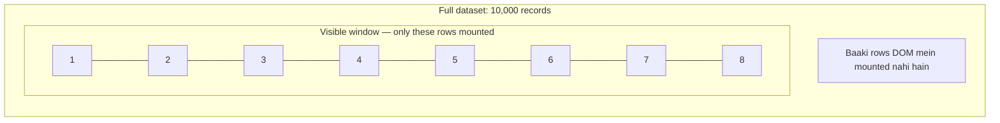

# 1. Round 1 — Technical Coding

## Q1. Debounce an API call and integrate it into a React search component

### Debouncing kya hai?

Debouncing ka matlab hai function ko tab execute karna jab repeated calls ke beech specified time tak koi naya call na aaye.

Example: User search box mein `r`, `re`, `rea`, `react` type karta hai. Har keystroke par API call karne ke bajaye, typing rukne ke 300 ms baad request bhejni hai.

### Step 1: Debounce function

```js
function debounce(callback, delay) {
  let timerId;

  return function (...args) {
    clearTimeout(timerId);

    timerId = setTimeout(() => {
      callback.apply(this, args);
    }, delay);
  };
}
```

Is function mein closure ke through `timerId` preserve hota hai. Har naye call par previous timer clear ho jata hai.

Lekin React mein is function ko har render par directly create karne se timer state reset ho sakti hai. Isliye reusable React solution mein stable reference ya Effect-based timer cleanup use karna chahiye.

### Step 2: React search component with debounce and cancellation

Is example mein Effect-based debounce use karenge. Isse component cleanup, request cancellation aur stale responses ko handle karna straightforward hota hai.

```jsx
import { useEffect, useState } from "react";

export default function SearchUsers() {
  const [query, setQuery] = useState("");
  const [users, setUsers] = useState([]);
  const [loading, setLoading] = useState(false);
  const [error, setError] = useState("");

  useEffect(() => {
    const trimmedQuery = query.trim();

    if (!trimmedQuery) {
      setUsers([]);
      setLoading(false);
      setError("");
      return;
    }

    const controller = new AbortController();

    const timerId = setTimeout(async () => {
      setLoading(true);
      setError("");

      try {
        const response = await fetch(
          `/api/users?q=${encodeURIComponent(trimmedQuery)}`,
          { signal: controller.signal }
        );

        if (!response.ok) {
          throw new Error("Failed to fetch users");
        }

        const data = await response.json();
        setUsers(data);
      } catch (err) {
        if (err.name !== "AbortError") {
          setError(err.message || "Something went wrong");
        }
      } finally {
        if (!controller.signal.aborted) {
          setLoading(false);
        }
      }
    }, 300);

    return () => {
      clearTimeout(timerId);
      controller.abort();
    };
  }, [query]);

  return (
    <section>
      <input
        value={query}
        onChange={event => setQuery(event.target.value)}
        placeholder="Search users..."
      />

      {loading && <p>Loading...</p>}
      {error && <p role="alert">{error}</p>}

      <ul>
        {users.map(user => (
          <li key={user.id}>{user.name}</li>
        ))}
      </ul>
    </section>
  );
}
```

### Is implementation mein kya important hai?

- `setTimeout` API call ko debounce karta hai.
- `clearTimeout` purana pending timer cancel karta hai.
- `AbortController` purani in-flight request cancel karne mein help karta hai.
- Effect cleanup query change hone aur component unmount hone par run hota hai.
- `response.ok` HTTP errors ko handle karta hai.

Interview follow-up: Sirf request abort karna har situation mein enough nahi hota, especially jab API client cancellation support na karta ho. Aise cases mein request ID ya sequence number se stale responses ignore kar sakte hain.

## Q2. Build a custom `useFetch` Hook with `AbortController`

Custom Hook ka purpose reusable fetching logic provide karna hai, taaki har component mein loading, error aur cancellation logic repeat na karna pade.

```jsx
import { useEffect, useState } from "react";

function useFetch(url) {
  const [data, setData] = useState(null);
  const [loading, setLoading] = useState(Boolean(url));
  const [error, setError] = useState(null);

  useEffect(() => {
    if (!url) {
      setData(null);
      setLoading(false);
      setError(null);
      return;
    }

    const controller = new AbortController();

    async function fetchData() {
      setLoading(true);
      setError(null);

      try {
        const response = await fetch(url, {
          signal: controller.signal
        });

        if (!response.ok) {
          throw new Error(`HTTP error: ${response.status}`);
        }

        const result = await response.json();

        if (!controller.signal.aborted) {
          setData(result);
        }
      } catch (err) {
        if (err.name !== "AbortError") {
          setError(err);
        }
      } finally {
        if (!controller.signal.aborted) {
          setLoading(false);
        }
      }
    }

    fetchData();

    return () => controller.abort();
  }, [url]);

  return { data, loading, error };
}
```

Usage:

```jsx
function Users() {
  const { data, loading, error } = useFetch("/api/users");

  if (loading) return <p>Loading users...</p>;
  if (error) return <p>Unable to load users.</p>;

  return (
    <ul>
      {data?.map(user => (
        <li key={user.id}>{user.name}</li>
      ))}
    </ul>
  );
}
```

### Interview mein kya explain karna hai?

1. Hook reusable logic encapsulate karta hai.
2. `AbortController` unnecessary requests ko cancel karta hai.
3. Cleanup race conditions ke risk ko reduce karta hai.
4. Loading, success aur error states separately manage hote hain.

Yeh ek basic learning implementation hai. Production mein caching, retries, deduplication, request freshness aur invalidation ke liye TanStack Query ya RTK Query jaisi library useful ho sakti hai.

## Q3. Implement a dynamic table with sorting and pagination — without libraries

Yeh question DOM, JavaScript aur data manipulation test karta hai.

Approach:

1. Data array se table rows generate karo.
2. Column header click par sorting toggle karo.
3. Current page aur page size maintain karo.
4. Sorted data par pagination apply karo.
5. Empty data aur invalid page states handle karo.

Complete runnable example:

```html
<div>
  <input id="search" placeholder="Search users..." />

  <table border="1" cellpadding="8">
    <thead>
      <tr>
        <th><button data-sort="name">Name ↕</button></th>
        <th><button data-sort="age">Age ↕</button></th>
        <th><button data-sort="city">City ↕</button></th>
      </tr>
    </thead>
    <tbody id="rows"></tbody>
  </table>

  <p id="status"></p>
  <button id="prev">Previous</button>
  <button id="next">Next</button>
</div>

<script>
const users = [
  { id: 1, name: "Rahul", age: 25, city: "Delhi" },
  { id: 2, name: "Aman", age: 21, city: "Mumbai" },
  { id: 3, name: "Priya", age: 28, city: "Pune" },
  { id: 4, name: "Neha", age: 23, city: "Delhi" },
  { id: 5, name: "Vikas", age: 31, city: "Jaipur" }
];

let sortKey = "name";
let direction = 1;
let page = 1;
const pageSize = 2;

const rows = document.querySelector("#rows");
const status = document.querySelector("#status");
const search = document.querySelector("#search");

function renderTable() {
  const query = search.value.toLowerCase();

  const filtered = users.filter(user =>
    Object.values(user).some(value =>
      String(value).toLowerCase().includes(query)
    )
  );

  filtered.sort((a, b) => {
    const x = a[sortKey];
    const y = b[sortKey];

    const comparison =
      typeof x === "number" && typeof y === "number"
        ? x - y
        : String(x).localeCompare(String(y));

    return comparison * direction;
  });

  const totalPages = Math.max(
    1, Math.ceil(filtered.length / pageSize)
  );

  page = Math.min(page, totalPages);

  const start = (page - 1) * pageSize;
  const visible = filtered.slice(start, start + pageSize);

  rows.replaceChildren();

  visible.forEach(user => {
    const tr = document.createElement("tr");

    [user.name, user.age, user.city].forEach(value => {
      const td = document.createElement("td");
      td.textContent = String(value);
      tr.appendChild(td);
    });

    rows.appendChild(tr);
  });

  status.textContent = filtered.length
    ? `Page ${page} of ${totalPages} (${filtered.length} results)`
    : "No results found";

  document.querySelector("#prev").disabled = page <= 1;
  document.querySelector("#next").disabled =
    page >= totalPages;
}

document.querySelectorAll("[data-sort]").forEach(button => {
  button.addEventListener("click", () => {
    const key = button.dataset.sort;

    if (sortKey === key) {
      direction *= -1;
    } else {
      sortKey = key;
      direction = 1;
    }

    page = 1;
    renderTable();
  });
});

search.addEventListener("input", () => {
  page = 1;
  renderTable();
});

document.querySelector("#prev").addEventListener("click", () => {
  page--;
  renderTable();
});

document.querySelector("#next").addEventListener("click", () => {
  page++;
  renderTable();
});

renderTable();
</script>
```

### Complexity

| Step | Complexity |
|---|---|
| Filtering | `O(n)` |
| Sorting | `O(n log n)` |
| Pagination slice | `O(k)`, jahan `k` page size hai |
| Rendering | `O(k)` rows |

Yeh example client-side dataset ke liye hai. Large datasets mein sorting aur pagination server-side karna zyada practical ho sakta hai.

# 2. Round 1 — React internals aur JavaScript

## Q4. Explain React Fiber and rendering phases

React rendering ko do major phases mein samjho:

| Render phase | Commit phase |
|---|---|
| Component functions execute hote hain | Required DOM mutations apply hoti hain |
| Next UI tree calculate hoti hai | Relevant refs aur layout effects process hote hain |
| Reconciliation decide karta hai ki kya change hoga | Passive Effects baad mein execute hote hain |
| Work repeat ya abandon ho sakta hai | |

Fiber React ka internal architecture hai jo rendering work ko schedule aur prioritize karne mein help karta hai.

Follow-up: Component render hona aur DOM update hona alag events hain. Agar component dobara render hota hai, to zaroori nahi ki browser DOM mein bhi changes hon.

## Q5. Virtual DOM diffing aur reconciliation

Reconciliation mein React previous aur next React element trees ko compare karke decide karta hai ki existing component/DOM structure ko reuse, update ya replace karna hai.

Example:

```jsx
// Before
<h1>Hello</h1>

// After
<h1>Welcome</h1>
```

Same element type hone par React existing DOM node reuse karke text update kar sakta hai.

Lekin:

```jsx
// Before
<h1>Hello</h1>

// After
<p>Hello</p>
```

Element type change hone par React subtree ko replace kar sakta hai.

Keys list items ki identity track karne mein help karti hain. Isliye stable keys aur correct component structure performance aur state preservation dono ke liye important hain.

## Q6. Optimize re-renders with memoization

Teen tools yaad rakho:

- **`React.memo`:** Component props ke basis par re-render skip karne mein help karta hai.
- **`useMemo`:** Computed value reuse karta hai.
- **`useCallback`:** Function reference reuse karta hai.

Example:

```jsx
const visibleProducts = useMemo(
  () => products.filter(p => p.active),
  [products]
);

const handleSelect = useCallback(id => {
  setSelectedId(id);
}, []);
```

Inhe blindly use mat karo. Pehle React Profiler se bottleneck identify karo, phir memoization apply karke verify karo ki actual improvement hui hai.

## Q7. Event Loop — microtasks vs macrotasks

JavaScript synchronous code ko call stack par execute karta hai. Asynchronous operations ke callbacks baad mein event loop ke through execute hote hain.

```js
console.log("A");

setTimeout(() => console.log("B"), 0);

Promise.resolve().then(() => console.log("C"));

console.log("D");
```

Output:

```text
A
D
C
B
```

Explanation:

1. `A` synchronous execute hota hai.
2. Timer schedule hota hai.
3. Promise callback microtask queue mein jata hai.
4. `D` synchronous execute hota hai.
5. Current stack finish hone par promise microtask `C` execute hota hai.
6. Uske baad timer callback `B` execute hota hai.

Promises ke `.then()` callbacks microtasks hain; `setTimeout` callbacks tasks (commonly macrotasks) hain.

Node.js mein `process.nextTick()` ki scheduling priority aur phases browser ke event loop se different hain, isliye browser aur Node.js ke behavior ko automatically identical mat samajhna.

# 3. Round 2 — Tech Lead Discussion

Is round mein interviewer dekhna chahega ki tum sirf code likhte ho ya complete frontend system ke decisions bhi le sakte ho.

## Q1. Design a complex UI project architecture

Maan lo tumhe ek learning platform ka dashboard banana hai jisme courses, payments, progress, notifications aur user roles hain.

Possible folder structure:

```text
src/
├── app/
│   ├── router.jsx
│   └── providers.jsx
├── components/
│   ├── ui/
│   └── layout/
├── features/
│   ├── courses/
│   │   ├── components/
│   │   ├── hooks/
│   │   ├── services/
│   │   └── utils/
│   ├── payments/
│   └── progress/
├── store/
├── services/
├── hooks/
└── utils/
```

### Architecture decisions kaise explain karoge?

- **Feature-based folders:** Related code ek jagah rahe.
- **Reusable UI components:** Buttons, modals aur tables share ho sakein.
- **API layer:** Network calls components se separate rakho.
- **State strategy:** Local, shared client aur server state ko alag treat karo.
- **Performance:** Route-based code splitting, pagination aur virtualization.
- **Testing:** Components, hooks aur business logic ki appropriate tests.
- **Accessibility:** Keyboard support, semantic HTML aur focus management.

Interview mein: Sirf folder structure mat sunao. Explain karo ki structure team size, feature boundaries aur maintenance ko kaise support karta hai.

## Q2. Redux vs Context vs Recoil

| Approach | Suitable use |
|---|---|
| Local React state | Component-specific state |
| Context API | Theme, locale, relatively simple shared values |
| Redux Toolkit | Structured shared client state, predictable updates, middleware |
| Recoil | Atom-based state graph; existing projects mein mil sakta hai |

Recoil ka maintenance status aur ecosystem adoption evaluate karna chahiye before selecting it for a new production project. New projects mein React state, Context, Redux Toolkit ya other actively maintained libraries ko current project needs ke according compare karo.

Ek important distinction: Server state (API responses, caching, refetching) aur client state (selected tab, open modal, cart UI) alag concerns hain.

## Q3. Render 10,000+ records efficiently using virtualization

Agar 10,000 rows ko ek saath DOM mein render karoge, to layout, paint aur DOM management costly ho sakte hain.

Virtualization mein viewport ke visible rows aur ek chhote overscan region ke rows hi render hote hain.

Conceptual example: 10,000 rows



Popular tools mein `react-window` aur `@tanstack/react-virtual` shamil hain. Exact choice library version, dynamic row heights aur project requirements par depend karegi.

Virtualization DOM workload reduce karti hai, lekin large API payload ya expensive sorting ko automatically solve nahi karti. Unke liye pagination, server-side filtering aur efficient data processing bhi consider karo.

## Q4. Build a dashboard widget showing the top 5 performing items

Maan lo backend har item ke liye `name` aur `score` return karta hai.

```js
function getTopFive(items) {
  return [...items]
    .sort((a, b) => b.score - a.score)
    .slice(0, 5);
}
```

Yahan `[...]` original array ko mutate hone se bachata hai.

API polling ke liye:

```jsx
useEffect(() => {
  let active = true;
  let timerId;
  const controller = new AbortController();

  async function load() {
    try {
      const response = await fetch("/api/performance", {
        signal: controller.signal
      });

      if (!response.ok) {
        throw new Error("Request failed");
      }

      const items = await response.json();

      if (active) {
        setItems(getTopFive(items));
        setError(null);
      }
    } catch (err) {
      if (active && err.name !== "AbortError") {
        setError(err.message);
      }
    } finally {
      if (active && !controller.signal.aborted) {
        timerId = setTimeout(load, 30000);
      }
    }
  }

  load();

  return () => {
    active = false;
    clearTimeout(timerId);
    controller.abort();
  };
}, []);
```

Yeh polling har completed request ke baad next request schedule karti hai, isliye previous request slow hone par requests overlap nahi hoti.

Production mein retry backoff, visibility-based polling, authentication, stale data display aur server load consider karna chahiye.

## Q5. Webpack optimization, tree-shaking, code splitting aur lazy loading

- **Tree-shaking:** Unused exports ko production bundle se eliminate karne ki koshish.
- **Code splitting:** JavaScript ko multiple chunks mein divide karna.
- **Lazy loading:** Code ya resource ko zaroorat padne par load karna.
- **Bundle analysis:** Identify karna ki kaunse packages bundle size badha rahe hain.

Example:

```jsx
import { lazy, Suspense } from "react";

const ReportsPage = lazy(() => import("./ReportsPage"));

function App() {
  return (
    <Suspense fallback={<p>Loading reports...</p>}>
      <ReportsPage />
    </Suspense>
  );
}
```

Isse Reports page ka code separate chunk mein load ho sakta hai aur zaroorat ke waqt fetch hota hai.

Interview answer: Main bundle analyzer se expensive dependencies identify karunga, route-level code splitting use karunga, unused code remove karunga aur loading experience measure karunga. Optimization ko build size aur real user performance metrics se validate karunga.

# 4. Managerial Round — Real-world Scenarios

Is round mein correct technical answer ke saath tumhara ownership, communication aur decision-making bhi evaluate hota hai.

## Q1. How do you collaborate with backend developers, designers and QA?

Interview mein ek real example STAR format mein explain karo:

- **S — Situation:** Project mein kya problem thi?
- **T — Task:** Tumhari responsibility kya thi?
- **A — Action:** Tumne team ke saath kya steps liye?
- **R — Result:** Outcome kya raha?

Example answer structure:

> “Ek dashboard feature par kaam karte waqt API response aur design specification mein mismatch tha. Maine backend developer ke saath response contract clarify kiya, designer se loading aur empty states confirm kiye, aur QA ke saath error scenarios define kiye. Isse implementation aur testing expectations aligned rahe.”

Is example ko apne actual project aur real results ke according modify karna.

## Q2. How do you handle performance and accessibility issues in production?

Ek structured approach follow karo:

1. Issue reproduce karo.
2. DevTools, React Profiler aur performance traces se root cause identify karo.
3. Real user impact aur severity assess karo.
4. Fix implement karo aur regression tests add karo.
5. Lighthouse, browser testing aur accessibility checks se validate karo.
6. Deployment ke baad relevant metrics monitor karo.

Accessibility ke liye keyboard navigation, focus visibility, semantic HTML, accessible names aur screen-reader behavior verify karo.

## Q3. How do you deliver UI features under tight deadlines?

Interviewer ko dikhana hai ki tum speed aur quality ke beech sensible trade-offs kar sakte ho.

- Requirements aur acceptance criteria clarify karo.
- Critical functionality ko prioritize karo.
- Existing reusable components ka use karo.
- Loading, error aur empty states ignore mat karo.
- Risky changes ko identify karo.
- Necessary tests aur code review maintain karo.
- Scope trade-offs ko team ke saath communicate karo.

Strong interview answer:

> “Main deadline meet karne ke liye scope ko prioritize karta hoon, lekin correctness, accessibility aur critical error handling ko sacrifice nahi karta. Agar timeline unrealistic ho, to risks aur alternatives early communicate karta hoon.”
