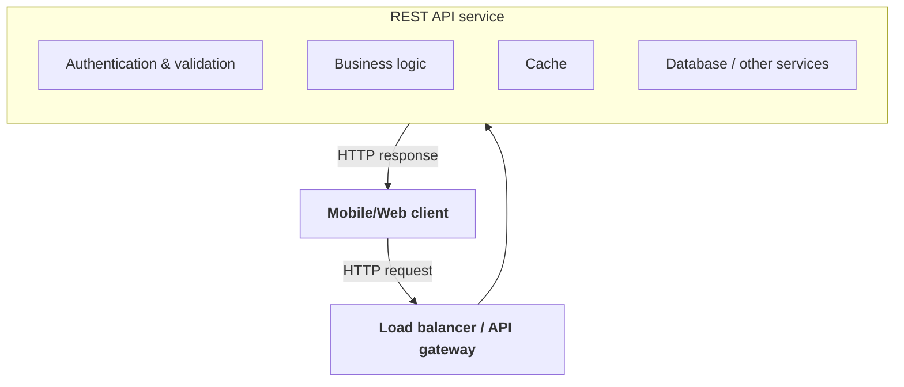
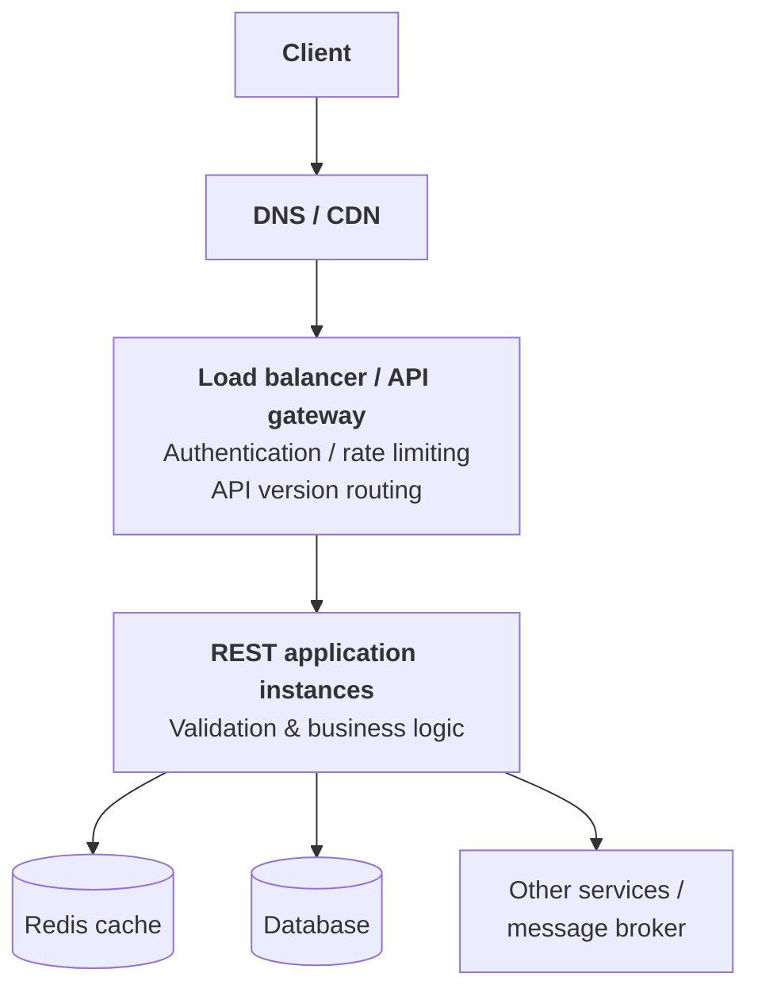
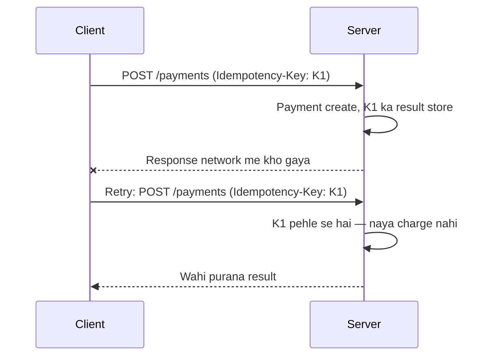
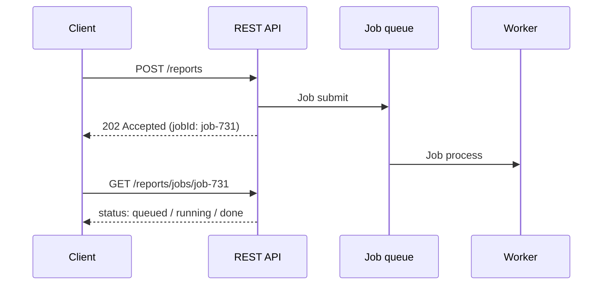

# System design me REST

REST ek architectural style hai jisse network par services apna data aur actions expose karti hain. Web APIs me aksar REST ke ideas follow kiye jaate hain.

Simple mental model:

> **Client kisi resource ko URL se address karta hai, HTTP method se batata hai ki kya karna hai, aur server response me result ya error deta hai.**



---

## 1. Resource kya hota hai?

REST me aksar system ki cheezon ko **resources** ke roop me model kiya jata hai.

Online store ke resources:

```text
/users
/products
/orders
/orders/123
```

Resource ka URL us cheez ko identify karta hai:

- `/products` — products collection
- `/products/42` — product 42
- `/orders/123` — order 123

URLs ko generally nouns ke roop me rakhte hain. Action batane ka kaam HTTP method karta hai.

---

## 2. HTTP methods: client kya karna chahta hai?

| Method | Meaning | Example |
|---|---|---|
| `GET` | Data read karo | `GET /products/42` |
| `POST` | Naya resource banao ya operation submit karo | `POST /orders` |
| `PUT` | Resource ko complete replace/update karo | `PUT /users/42` |
| `PATCH` | Resource ka kuch hissa update karo | `PATCH /users/42` |
| `DELETE` | Resource delete karo | `DELETE /carts/42/items/8` |

Example: naya order banane ke liye:

```http
POST /orders
Content-Type: application/json

{
  "productId": 42,
  "quantity": 2
}
```

Response:

```http
HTTP/1.1 201 Created
Content-Type: application/json
Location: /orders/981

{
  "id": 981,
  "status": "pending"
}
```

`201 Created` batata hai ki resource create hua. `Location` header naye resource ka URL de sakta hai.

---

## 3. Request aur response me kya hota hai?

### Request

```http
GET /products/42?currency=INR
Authorization: Bearer <token>
Accept: application/json
```

Request me yeh parts ho sakte hain:

- **Method**: operation
- **Path**: resource ka address
- **Query parameters**: filtering, sorting, pagination ya options
- **Headers**: authentication, content type, caching hints
- **Body**: create/update ke liye data

### Response

```http
HTTP/1.1 200 OK
Content-Type: application/json

{
  "id": 42,
  "name": "Wireless Headphones",
  "price": 2499
}
```

Response me status code, headers aur optional body hoti hai.

---

## 4. Status codes: request ka result

| Code | Meaning | Common use |
|---|---|---|
| `200 OK` | Request successful | Successful read/update |
| `201 Created` | Naya resource bana | Successful create |
| `204 No Content` | Success, response body nahi | Delete ya body-less update |
| `400 Bad Request` | Request format/data invalid | Validation error |
| `401 Unauthorized` | Authentication missing/invalid | Token problem |
| `403 Forbidden` | User authenticated hai, par allowed nahi | Permission denied |
| `404 Not Found` | Resource nahi mila | Unknown ID |
| `409 Conflict` | Current state se conflict | Duplicate/version conflict |
| `429 Too Many Requests` | Rate limit hit | Retry later |
| `500 Internal Server Error` | Server-side unexpected error | Generic failure |
| `503 Service Unavailable` | Service temporarily unavailable | Overload/maintenance |

Yaad rakhne ki trick: **2xx** = success, **4xx** = client ki galti, **5xx** = server ki galti.

API errors ka response consistent rakho. Example:

```json
{
  "error": {
    "code": "OUT_OF_STOCK",
    "message": "Requested quantity is unavailable",
    "requestId": "req-abc123"
  }
}
```

Error response me sensitive internal details, stack trace ya secrets expose nahi karne chahiye.

---

## 5. REST ka important idea: stateless requests

REST me **stateless** ka matlab hai ki har request ko process karne ke liye server ko pehle ki request ka hidden conversation state zaroori na ho.

Misaal:

```http
GET /orders/981
Authorization: Bearer <token>
```

Server token se client/user identify kar sakta hai. Request ko kisi specific in-memory server session par depend nahi rehna padta.

Iska system-design benefit:

- Request ko kisi bhi healthy server par route kiya ja sakta hai.
- Horizontal scaling aasaan hoti hai.
- Server restart hone par per-client in-memory conversation state ka dependency kam hota hai.

**Stateless ka matlab yeh nahi ki server ke paas koi data nahi hota.** User, order aur permissions ka data database/cache me ho sakta hai. Matlab har HTTP request apni zaroori context carry kare, ya server ko shared storage se mil jaaye.

---

## 6. REST API ka common system architecture

Ek production API aksar is tarah dikhti hai:



### Har layer ka role

- **CDN**: static ya cacheable responses ko user ke paas serve kar sakta hai.
- **Load balancer**: requests ko multiple app instances me distribute karta hai.
- **API gateway**: routing, authentication integration, rate limiting, request-size limits jaise concerns handle kar sakta hai.
- **Application service**: business rules aur API behavior implement karti hai.
- **Redis**: frequently accessed data ya short-lived state cache kar sakta hai.
- **Database**: durable source of truth ho sakta hai.
- **Message broker**: long-running/asynchronous work ke liye.

Har system me alag gateway ya cache zaroori nahi. Architecture scale, risk aur product needs ke hisaab se banti hai.

---

## 7. Idempotency: retry safely kaise karein?

Network failure me client ko response nahi mil sakta, bhale server ne request process kar li ho. Client retry kare aur duplicate order/payment ban jaaye, to problem hogi.

**Idempotent operation** ko same request dobara bhejne par unintended duplicate effect nahi hona chahiye.

| Method | Idempotent? |
|---|---|
| `GET` | Generally safe/idempotent |
| `PUT` | Same final state set karne ke liye design kiya ja sakta hai |
| `DELETE` | Repeat par resource pehle se absent ho sakta hai; behavior define karo |
| `POST` | Aksar non-idempotent — **idempotency key** se safe retry |

Example:

```http
POST /payments
Idempotency-Key: checkout-981-attempt-1
```

Server key ko store karke repeat request par wahi existing result return kar sakta hai, instead of doosra charge create karne ke.



Payment/order APIs me idempotency key ki expiry, storage, concurrent duplicate requests aur payload mismatch ka behavior define karna hota hai.

---

## 8. Pagination, filtering aur sorting

Collection endpoint:

```http
GET /products?category=audio&sort=price&page=2&pageSize=20
```

Basic page-number pagination simple hai, lekin bahut bade ya frequently changing datasets par page boundaries shift ho sakti hain.

Cursor pagination:

```http
GET /products?limit=20&cursor=eyJpZCI6...
```

Cursor server ko batata hai ki agla page kahan se continue karna hai. High-volume collections me yeh useful ho sakta hai, magar API ko cursor format aur ordering stable rakhni hoti hai.

| | Page-number | Cursor |
|---|---|---|
| Example | `?page=2&pageSize=20` | `?limit=20&cursor=...` |
| Simplicity | Simple | Cursor format aur stable ordering chahiye |
| Badalte data par | Page boundaries shift ho sakti hain | Zyada stable |

Pagination me define karo:

- maximum page size
- stable sort order
- next-page/cursor response
- deleted/updated records ke beech expected behavior

---

## 9. Caching aur HTTP behavior

REST responses ko cache karne ke liye HTTP headers ka use ho sakta hai:

- `Cache-Control`
- `ETag`
- `Last-Modified`

`ETag` ke saath client server se pooch sakta hai ki representation badli hai ya nahi:

```http
If-None-Match: "product-v42"
```

Agar data same hai to server `304 Not Modified` return kar sakta hai, jisse body dobara bhejne ki zaroorat nahi.

Sensitive user-specific response ko galat tarah public cache karna data leak kar sakta hai. Cache key me authorization/context ka effect aur `Cache-Control` directives carefully design karo.

Application-level Redis caching aur HTTP/CDN caching ek hi cheez nahi:

- **HTTP cache** protocol headers aur intermediaries ke through kaam karta hai.
- **Redis cache** app ke andar data lookup/store pattern hai.

Dono saath use ho sakte hain, lekin invalidation aur freshness rules consistent hone chahiye.

---

## 10. Versioning aur API compatibility

API change karte waqt existing clients break ho sakte hain.

Common approaches:

```text
/v1/orders
/v2/orders
```

Ya headers/media types ke through versioning. Path versioning samajhna aasaan hai; kisi bhi method me consistent compatibility policy zaroori hai.

| Backward-compatible (safe) | Breaking (version chahiye) |
|---|---|
| Optional response field add karna | Field remove/rename karna |
| Naya endpoint add karna | Type badalna |
| Existing field ka meaning na badalna | Required input add karna |
| | Existing status/error behavior badalna |

Versioning ke saath deprecation period, client adoption tracking aur old version retirement plan rakho.

---

## 11. Validation, authentication aur authorization

API layer par:

1. Request body/query/path ko parse karo.
2. Schema aur business validation karo.
3. User ki identity verify karo.
4. Resource par user ka permission check karo.
5. Business operation execute karo.
6. Safe response return karo.

**Authentication:** Kaun ho?
**Authorization:** Tumhe yeh karne ki permission hai?

Sirf object ID ko difficult-to-guess banana authorization ka substitute nahi. Har resource operation par ownership/permission check chahiye, warna IDOR-style access issue ho sakta hai.

Security design me request-size limits, rate limiting, input validation, secrets handling, TLS aur audit logging bhi include hote hain.

---

## 12. Database aur asynchronous work

Har request ko HTTP response dene se pehle saara kaam complete karna zaroori nahi.

Misaal: report generate karna lamba process hai.

```http
POST /reports
```

Response:

```http
HTTP/1.1 202 Accepted

{
  "jobId": "job-731",
  "status": "queued"
}
```

Client baad me:

```http
GET /reports/jobs/job-731
```



Is pattern me API request job queue me kaam submit karti hai. Worker kaam karta hai, aur client status poll kar sakta hai ya notification receive kar sakta hai.

`202 Accepted` ka matlab kaam accept hua; yeh apne aap completion guarantee nahi karta.

---

## 13. Common REST design mistakes

- URLs me har action ko verb bana dena, jaise `/getAllProducts`
- Har success ke liye `200` use karna, chahe resource create hua ho
- Error formats endpoint-to-endpoint alag rakhna
- Unlimited page size allow karna
- `POST` retries se duplicate payments/orders banana
- User-specific data ko public cache kar dena
- API version ke bina breaking changes ship karna
- API gateway ko business authorization ka akela source bana dena
- Request timeout ya maximum body size define na karna
- Logs me password, token ya sensitive personal data rakhna
- Har endpoint ko synchronous banana, chahe kaam long-running ho

---

## 14. Ek end-to-end example: order create karna

1. Client `POST /orders` bhejta hai.
2. Load balancer healthy API instance choose karta hai.
3. API token verify karti hai.
4. Request fields validate hote hain.
5. Idempotency key check hoti hai.
6. Inventory/price rules apply hote hain.
7. Database transaction me order create hota hai.
8. Zaroorat ho to event/queue me follow-up work publish hota hai.
9. API `201 Created` aur order URL return karti hai.
10. Logs/metrics me request ID aur result record hote hain.

Agar client ko response se pehle timeout mil jaaye, idempotency key retry ko duplicate order banane se bacha sakti hai. Agar order process asynchronous hai, `202 Accepted` ke saath job/status resource return karna zyada sahi ho sakta hai.

---

## 15. REST kab sahi fit hai?

REST achha fit hota hai jab:

- client-server interaction standard HTTP par chahiye
- resources ko URLs se address karna useful ho
- browsers, mobile apps aur third-party integrations support karni hon
- HTTP caching, authentication aur tooling ka ecosystem use karna ho

Har problem REST se hi solve karni zaroori nahi. Ek system me inka combination bhi ho sakta hai:

| Need | Technology |
|---|---|
| Standard client-server, resources, third-party integrations | REST |
| Real-time bidirectional communication | WebSocket |
| Internal high-performance RPC | gRPC |
| Event-driven asynchronous communication | Message broker |

## Mental model

```text
URL       = kaunsa resource?
HTTP verb = kya operation?
Status    = operation ka result?
Headers   = metadata, auth, caching, content rules
Body      = request/response data
```

System design me REST sirf endpoint naming nahi hai. Isme **API contract, statelessness, retries, idempotency, pagination, caching, security, compatibility, database workflow aur failure handling** sab aate hain.
