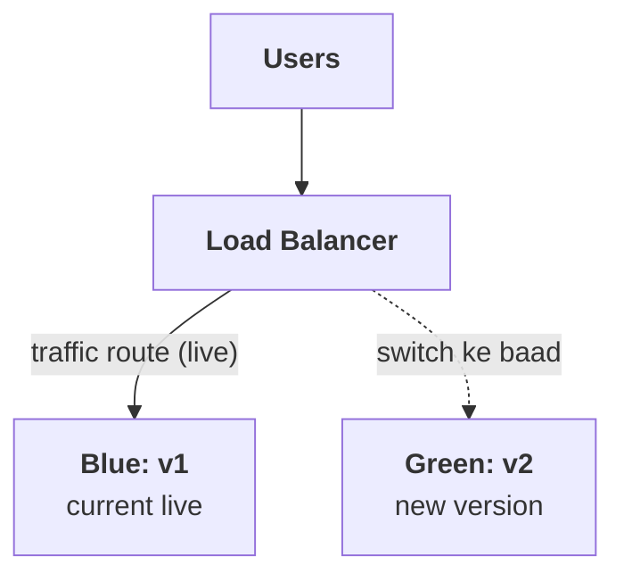
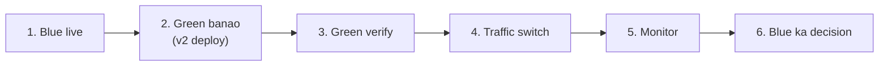
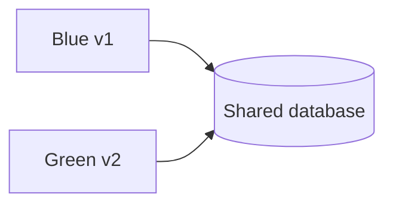
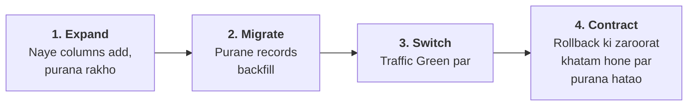
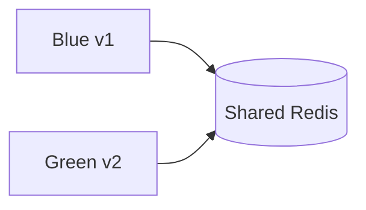

# Blue-Green Deployment

Simple idea yeh hai: application ke **do production-ready environments** rakho—**Blue** aur **Green**. Ek environment users ka live traffic serve karta hai, aur doosre me naya version deploy karke verify karte ho. Sab theek ho to traffic naye environment par switch kar dete ho.



Blue aur Green colors bas labels hain. Kaunsa color current live hai, deployment ke baad badal sakta hai.

---

## 1. Iska main purpose kya hai?

Traditional deployment me running servers ko ek-ek karke update karte hain. Is dauran:

- kuch servers old version par hote hain
- kuch new version par
- update me dikkat aaye to rollback mushkil ho sakta hai
- deployment ke waqt interruption ka risk hota hai

Blue-Green me naya version **alag environment** me tayyar hota hai. Naye environment ko test karne ke baad traffic switch hota hai.

Isse deployment ke dauran live environment ko directly replace nahi karna padta, aur rollback ke liye purane environment ka option reh sakta hai.

---

## 2. Blue-Green deployment ka workflow

Maan lo Blue par application `v1` live hai aur `v2` deploy karna hai.



### Step 1: Blue live hai

```text
Users → Load Balancer → Blue (v1)
                         Green (empty/idle)
```

Load balancer, ingress, gateway ya DNS users ko Blue bhej raha hai.

### Step 2: Green environment banao

Green par `v2` deploy karo:

```text
Users → Load Balancer → Blue (v1)
                         Green (v2, abhi users nahi)
```

Green me app servers/containers, configuration, secrets, network access aur dependencies ready honi chahiye.

### Step 3: Green ko verify karo

User traffic bhejne se pehle checks:

- process/container healthy hai?
- app ready hai?
- database aur Redis tak connection hai?
- required config/secrets load hue?
- health checks pass hain?
- smoke tests sahi response de rahe hain?
- logs aur error rates normal hain?

**Liveness check** batata hai process zinda hai ya nahi.
**Readiness check** batata hai instance traffic serve karne ke liye ready hai ya nahi.

Sirf process start hona readiness ka proof nahi hai.

### Step 4: Traffic switch karo

Verification ke baad router/ingress/load balancer ki configuration Blue se Green par badlo:

```text
Before: Users → Blue (v1)
After:  Users → Green (v2)
```

Traffic switch instant ya near-instant lag sakta hai, lekin practically connections, in-flight requests, load balancer updates aur cache warm-up ka effect ho sakta hai.

### Step 5: Green par monitor karo

Switch ke baad dekho:

- error rate
- latency
- CPU/memory
- request volume
- database connection count
- business metrics, jaise checkout success
- logs aur traces

Agar problem mile aur database/data compatibility allow kare, traffic wapas Blue par bhej sakte ho.

### Step 6: Purane environment ka decision

Kuch samay tak Blue ko rollback option ke roop me rakho. Jab Green stable ho aur rollback ki zaroorat na lage, Blue ko update karke agle deployment ke liye standby bana sakte ho.

---

## 3. Traffic switch kaun karta hai?

Yeh tumhare infrastructure par depend karta hai:

| Switch method | Kaise | Note |
|---|---|---|
| **Load balancer / ingress** | Backend target group/endpoint badlo | Aksar controlled aur relatively fast |
| **API gateway / service router** | Gateway route ko Green ki taraf update | Service-specific routing ke liye useful |
| **DNS switch** | DNS record Green ke address par update | Clients/resolvers purana result cache kar sakte hain — instant nahi |

### Load balancer ya ingress

Traffic ko backend target group/endpoint ke hisaab se switch karte ho.

```text
Users → Load Balancer → Green target group
```

App deployments me yeh aksar controlled aur relatively fast option hota hai.

### API gateway ya service router

Gateway route ko Green ki taraf update karta hai. Yeh service-specific routing ke liye useful ho sakta hai.

### DNS switch

DNS record Blue se Green ke address par update karte hain.

DNS switch simple lagta hai, magar clients aur resolvers purana DNS result cache kar sakte hain. Isliye traffic ek hi pal me sab clients par shift ho, yeh guaranteed nahi.

---

## 4. Sabse important challenge: database changes

App ke do environments alag ho sakte hain, lekin database aam taur par shared hota hai:



Yahi Blue-Green ka sabse sensitive hissa hai. Traffic Green par switch karna aasaan ho sakta hai; database schema ko reverse-compatible rakhna mushkil hota hai.

### Safe pattern: Expand → Migrate → Contract

Maan lo `users.full_name` ko `first_name` aur `last_name` me todna hai.



#### 1. Expand

Pehle schema ko is tarah badlo ki old aur new dono app versions chal saken.

- naye columns add karo
- purana column abhi mat hatao
- zarurat ho to temporary dual write lagao

#### 2. Migrate

Purane records ko naye format me backfill karo. Migration complete aur verified honi chahiye.

#### 3. Switch

Green version par traffic bhejo. Green naye schema ko use kare, lekin zarurat padne par Blue ke saath compatibility bana rahe.

#### 4. Contract

Jab old version ko rollback ke liye rakhna zaroori na ho, tab purana column/code remove karo.

### Yeh kyun zaroori hai?

Traffic switch ke baad rollback ka matlab aksar **old application code** par lautna hota hai. Agar Green ne database ko aise format me badal diya jo Blue samajh nahi sakta, to Blue ko wapas route karna fail ho sakta hai.

> Application rollback tabhi safe hai jab old version naye database state ke saath compatible ho.

### Dual-write ka risk

Agar Blue aur Green dono ek hi data ko different formats me write karte hain, to:

- writes race kar sakti hain
- values mismatch ho sakti hain
- ek write successful aur doosri fail ho sakti hai

Dual-write temporary bridge ho sakta hai, lekin uske reconciliation, monitoring aur removal ka clear plan chahiye. Har migration me dual-write zaroori nahi.

---

## 5. Redis aur cache ka role

Agar Blue aur Green Redis share karte hain, to key format aur serialized value compatible honi chahiye.



Risk examples:

- `v1` cache value ka format `v2` ke code se parse na ho
- Green ne incompatible key format likha, phir Blue par rollback hua
- cache cold hone se database par sudden load aa gaya
- cache invalidation dono versions me alag behavior kare

Possible design:

- cache key me version namespace: `user:v2:42`
- backward-compatible serialization
- deployment ke waqt cache warm-up
- cache miss/stampede protection
- rollback ke dauran old namespace preserve karna

Cache aksar rebuild ho sakta hai, magar uska miss pattern database ko overload kar sakta hai. “Cache disposable hai” ka matlab “cache ka impact zero hai” nahi.

---

## 6. Background jobs aur message consumers

HTTP traffic switch ho gaya, iska matlab poora system Green par nahi chala gaya. Blue aur Green dono me background workers chal rahe hon to:

- same queue message do baar process ho sakta hai
- dono versions conflicting writes kar sakte hain
- scheduled job dono environments me duplicate run ho sakta hai
- old worker naye message format ko samajh na sake

Design options:

- sirf active environment me workers run karna
- worker deployment ko web traffic se alag control karna
- messages ko backward-compatible rakhna
- idempotent handlers banana
- scheduler/leader election se duplicate jobs rokna
- cutover ke dauran consumers ko drain/pause karna

Blue-Green ke rollout plan me APIs ke saath **workers, cron jobs, event consumers aur scheduled tasks** bhi include karo.

---

## 7. Connections aur in-flight requests

Traffic switch karne ke waqt bhi kuch requests purane environment me chal rahi ho sakti hain.

Graceful cutover ke liye:

1. naye requests Green ki taraf route karo
2. Blue ko draining mode me daalo
3. in-flight requests ko complete hone do, ya controlled shutdown karo
4. old connections aur background work ko monitor karo

Long-lived WebSocket connections, streaming requests aur persistent client connections ke liye switch turant complete nahi hota. In users ko reconnect karna pad sakta hai ya purane connections kuch waqt tak Blue par reh sakte hain.

---

## 8. Rollback kaise hota hai?

Basic rollback:

```text
Before issue: Users → Green (v2)
Rollback:     Users → Blue (v1)
```

Lekin rollback plan sirf routing toggle nahi hai. Yeh verify hona chahiye:

- Blue environment abhi healthy hai?
- Blue ko current database schema samajh aata hai?
- Green ke writes Blue ke format ko tod nahi rahe?
- cache keys/values backward-compatible hain?
- message consumers compatible hain?
- secrets/config Blue ke liye available hain?
- Blue ka capacity traffic dobara lene ke liye kaafi hai?

Rollback **application code** ko jaldi wapas kar sakta hai. Database migration ya external side effects ko automatically reverse nahi karta.

---

## 9. Blue-Green aur rolling/canary deployment ka farq

| Strategy | Traffic kaise move hota hai? | Kahan useful |
|---|---|---|
| **Blue-Green** | Pura traffic ek environment se doosre par switch | Fast cutover aur straightforward rollback |
| **Rolling** | Instances ko dheere-dheere update karte hain | Resource efficient deployment |
| **Canary** | Chhota traffic hissa pehle new version ko, phir gradually zyada | Risk ko gradual exposure se control karna |

Blue-Green me dono environments ek saath ready rakhne se infrastructure cost badh sakti hai. Canary me full duplicate environment zaroori nahi, lekin routing aur metrics-based rollout zyada nuanced ho sakta hai.

Hybrid bhi possible hai: Green me naya version deploy karke pehle 1% traffic, phir 10%, phir 100% bhejo. Yeh strict full-switch Blue-Green se zyada canary-style rollout hai.

---

## 10. Capacity aur cost planning

Agar production ko serve karne ke liye 20 instances chahiye, Blue-Green me cutover ke waqt roughly 20 Blue + 20 Green instances ki capacity chahiye ho sakti hai.

Saath me yeh bhi dekho:

- dono environments ek shared DB par load na badha dein
- Green smoke tests production DB ko mutate na karein
- autoscaling rules dono pools ko independently scale karein
- failover ke baad Blue ko full traffic lene ki capacity ho
- idle environment ka minimum footprint kitna hai

Blue ko zero instances tak scale down karna cost bachata hai, lekin rollback me cold start aur scale-up delay aa sakta hai.

---

## 11. Configuration aur secrets

Green ko Blue se alag release karne ka matlab configuration bhi verify karni hogi:

- correct database endpoint
- Redis endpoint aur key namespace
- feature flags
- secrets/certificates
- third-party API credentials
- network policies/firewall rules
- logging aur tracing
- region/zone configuration

Green ko production traffic milne se pehle uski config ko validate karo. Ek healthy process galat database ya galat credentials ke saath phir bhi production failure de sakta hai.

---

## 12. Feature flags ka use

Deployment aur feature release alag decisions hain.

- **Deployment**: naya code environment me install karna.
- **Feature release**: user ke liye behavior enable karna.

Green par code deploy karke feature flag off rakh sakte ho. Pehle technical health verify karo, phir limited users/traffic ke liye feature enable karo. Agar feature me problem ho, code redeploy kiye bina flag off karna possible ho sakta hai—lekin flag ko deployment/rollback ka replacement mat samjho.

---

## 13. Common mistakes

- **Database ko pehle destructive tareeqe se badal dena:** rollback old code par ho, par schema incompatible ho.
- **Sirf health endpoint check karna:** process alive hai, par real user flow fail ho sakta hai.
- **Cutover ke baad metrics na dekhna:** error rate ya business failures unnoticed reh sakte hain.
- **Blue ko jaldi delete kar dena:** rollback option khatam.
- **Workers ko bhool jana:** duplicate jobs ya incompatible message processing.
- **Shared cache formats ko ignore karna:** old/new versions ek doosre ka data parse na kar saken.
- **DNS switch ko instant samajhna:** clients purana address use kar sakte hain.
- **Green ko test karte waqt production data mutate kar dena:** smoke tests side effects create kar dete hain.
- **Rollback ko sirf load balancer switch samajhna:** database, cache aur external side effects bhi matter karte hain.

---

## 14. Production checklist

### Cutover se pehle

- [ ] Green deployment complete
- [ ] Readiness/health checks pass
- [ ] Smoke tests pass
- [ ] Database schema old aur new version ke compatible
- [ ] Cache format/key strategy verified
- [ ] Workers aur scheduled jobs ka plan tay
- [ ] Secrets/config/network verify
- [ ] Monitoring dashboard aur rollback owner clear
- [ ] Green traffic lene ke liye capacity ready

### Switch ke waqt

- [ ] Traffic route update
- [ ] In-flight requests ka behavior monitor
- [ ] Error rate, latency, saturation aur business metrics dekhna
- [ ] Zarurat par cutover rokne/rollback ka clear trigger

### Switch ke baad

- [ ] Green ko observe karna
- [ ] Background jobs aur queue lag verify
- [ ] Blue ko rollback window me preserve karna
- [ ] Stability ke baad old environment retire/update karna
- [ ] Temporary compatibility code/schema ko planned time par remove karna

---

## Ek short example

Maan lo shopping app `v1` Blue par live hai aur `v2` Green par deploy karna hai.

1. Database me naya optional column add karo; purana column abhi rakho.
2. Green `v2` deploy karo.
3. Green health checks aur read-only smoke tests chalao.
4. Cache keys ko versioned ya backward-compatible rakho.
5. Queue workers ko duplicate processing se bachao.
6. Load balancer traffic Green par switch kare.
7. Checkout success, API error rate aur latency monitor karo.
8. Problem ho to Blue par route wapas karo—agar `v2` ke writes old schema/code ke saath compatible hain.
9. Stable hone ke baad hi old schema/code aur Blue environment retire karo.

---

## Mental model

```text
Blue-Green = do ready environments
Deploy      = inactive environment me naya version install
Verify      = health + smoke + dependency checks
Switch      = router/load balancer se traffic move
Observe     = technical aur business metrics monitor
Rollback    = traffic old environment par wapas
```

Blue-Green tab achha fit hai jab tumhe controlled cutover aur quick application rollback chahiye. Iska sabse bada design challenge traffic switch nahi, balki **database compatibility, shared cache, background jobs aur side effects ko dono versions ke beech safe rakhna** hai.