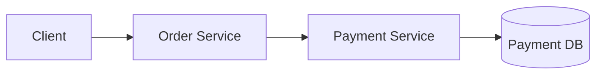
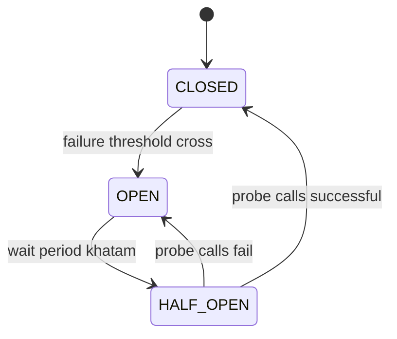
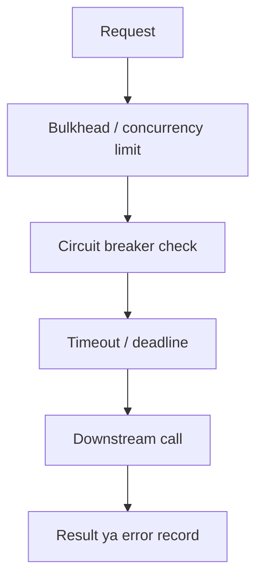
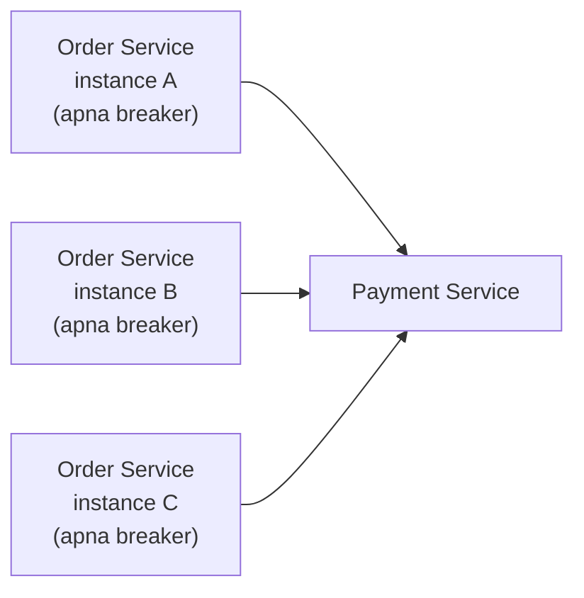
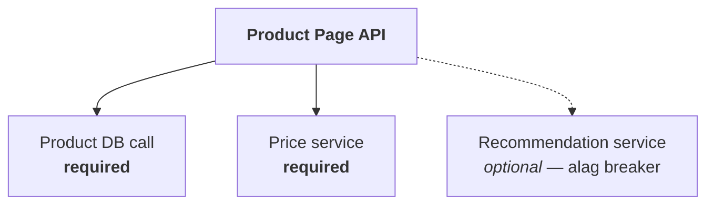

# Circuit breaker: system design

Circuit breaker ka naam electrical circuit breaker se aaya hai. Ghar me overload ya short circuit ho to breaker current rok deta hai, taaki wiring aur devices ko aur nuksaan na ho.

Distributed systems me bhi ek service doosri service par call karti hai. Agar downstream service slow ya unavailable ho, to caller baar-baar request bhej kar problem ko badha sakta hai. **Circuit breaker repeated failing calls ko temporarily rokta hai**, aur application ko fail fast ya fallback ka mauka deta hai.

> Circuit breaker failed dependency ko repair nahi karta. Yeh cascading failures aur unnecessary waiting ko limit karta hai.

---

## 1. Circuit breaker ki zaroorat kyun hoti hai?

Maan lo `Order Service` har order ke liye `Payment Service` ko call karti hai.



Agar `Payment Service` slow ho gayi, to:

1. Order Service ke requests Payment Service ka wait karne lagte hain.
2. Order Service ke threads/connections busy ho jaate hain.
3. Nayi requests ke liye resources kam padte hain.
4. Order Service bhi slow ya unavailable ho sakti hai.
5. Payment ke alawa Order Service ki doosri functionality bhi impact ho sakti hai.

Is chain reaction ko **cascading failure** kehte hain.

Circuit breaker ka goal hai ki failure ka signal milne par caller kuch waqt ke liye dependency ko call karna band kare.

---

## 2. Teen states

Circuit breaker ko aam taur par teen states ke through samjha jata hai:



| State | Calls | Kya hota hai |
|---|---|---|
| **CLOSED** | Allowed | Normal traffic; success/failure record hota hai |
| **OPEN** | Blocked | Fail fast ya fallback; wait period ke baad HALF-OPEN |
| **HALF-OPEN** | Limited probes | Success par CLOSED, failure par wapas OPEN |

### CLOSED: normal traffic

Circuit “closed” hai, yani calls allowed hain.

- Requests downstream service ko jaati hain.
- Breaker success/failure record karta hai.
- Agar configured failure condition threshold cross kare, breaker `OPEN` me chala jata hai.

Circuit `CLOSED` ka matlab service healthy hone ki guarantee nahi. Iska matlab hai ki breaker calls ko rok nahi raha.

### OPEN: calls rok do

Circuit “open” hai, yani calls rok di jaati hain.

- Caller downstream ko request nahi bhejta.
- Caller ko jaldi error mil sakta hai, ya configured fallback chal sakta hai.
- Ek wait period ke baad breaker test karne ke liye `HALF-OPEN` me ja sakta hai.

Isse failing service par load kam hota hai aur caller apne resources bachata hai.

### HALF-OPEN: controlled test

`HALF-OPEN` me breaker kuch limited calls ko jaane deta hai.

- Agar probes successful hon, circuit `CLOSED` ho sakta hai.
- Agar probes fail hon, circuit wapas `OPEN` ho sakta hai.
- Kaafi implementations probes ki sankhya limit karti hain, taaki recovery test karte waqt traffic ka naya flood na ban jaaye.

---

## 3. Breaker failure kaise pehchanta hai?

Breaker ko define karna padta hai ki kis event ko failure ginna hai.

### Common failure signals

- Connection refused ya timeout
- HTTP `5xx`
- Connection pool exhaustion
- Dependency se specific error responses
- Call ka configured latency threshold se zyada lamba chalna
- Dependency health check ka failure

### Har error ko breaker failure nahi maanna chahiye

Misaal ke taur par:

| Response | Matlab | Breaker failure? |
|---|---|---|
| `400 Bad Request` | Client ne invalid request bheji; downstream unhealthy nahi | Nahi |
| `401 Unauthorized` | Authentication problem ho sakti hai | Nahi |
| `404 Not Found` | Business/data outcome ho sakta hai | Nahi |
| `429 Too Many Requests` | Rate limiting; policy ke mutabiq handle karo | Policy par depend |
| `500` ya timeout | Dependency health issue ka signal | Haan, ho sakta hai |

Agar har non-2xx response breaker ko trip karaye, to malformed user requests bhi circuit khol sakti hain. Failure classification **dependency aur operation ke hisaab se** honi chahiye.

---

## 4. Threshold kaise decide hota hai?

Ek simple design me breaker failure count rakhta hai:

```text
Last 10 calls me 6 failures
→ threshold cross
→ OPEN
```

Lekin sirf absolute count har traffic pattern par sahi nahi hota. Isliye systems aksar rolling window ka use karte hain:

### Count-based window

Pichhli N calls dekho.

```text
Last 20 calls:
15 success, 5 failure
Failure rate = 25%
```

### Time-based window

Pichhle kuch seconds/minutes ka traffic dekho.

```text
Last 30 seconds:
200 calls, 60 failures
Failure rate = 30%
```

Threshold ke examples:

- **Minimum request volume:** window me itni calls honi chahiye.
- **Failure-rate threshold:** failures ka percentage limit paar kare.
- **Slow-call threshold:** bahut calls configured duration se zyada le rahi hon.
- **Minimum number of slow calls:** slow percentage ko meaningful sample ke baad hi use karo.

Thresholds ko blindly copy nahi karna chahiye. Kam traffic wali service me chhota sample misleading ho sakta hai; high traffic me bahut high threshold breaker ko der se khol sakta hai.

---

## 5. Timeout aur circuit breaker ka relationship

Circuit breaker aur timeout alag protections hain.

- **Timeout**: ek request ko kitni der wait karna hai?
- **Circuit breaker**: repeatedly failing/slow requests ke baad naye calls ko kab rokna hai?

Agar timeout hi nahi hai, to slow calls bahut der tak resources hold kar sakti hain. Breaker ko failure detect karne me bhi der ho sakti hai.

Typical call path:



Actual ordering library aur design par depend karti hai. Important baat: call ke paas bounded deadline ho aur breaker ko result sahi tarah record ho.

### End-to-end deadline

Agar user request ka total budget 1 second hai, to downstream call ko 5 seconds timeout dena system ke liye useful nahi. Har layer ko ek hi deadline ke andar kaam karna chahiye:

```text
API total budget: 1000 ms
  ├─ Auth: 100 ms
  ├─ Order DB: 250 ms
  └─ Payment call: remaining budget ka hissa
```

Deadlines propagate karna better hota hai, taaki har downstream service apni taraf se extra wait add na kare.

---

## 6. Fallback kya hai?

Circuit open hone par fallback chal sakta hai. Fallback ka matlab alternate response ya degraded behavior hai.

Examples:

- **Product recommendation service down:** recommendations chhodo, product page phir bhi dikhao.
- **Profile service down:** recently cached profile dikhao, agar stale data acceptable ho.
- **Optional analytics call fail:** request ko successful rehne do, analytics event baad me retry/queue karo.
- **Payment service down:** payment ko successful pretend **mat** karo. User ko clear retryable error ya pending state do.

Fallback tabhi use karo jab woh business semantics ke liye safe ho.

### Fallback ke risks

- **Stale data**: cache se purana jawab.
- **Silent data loss**: event ko discard kar dena.
- **False success**: operation complete dikhana jab asal me complete nahi hua.
- **Fallback dependency bhi fail**: cache ya alternate service unavailable.
- **Fallback overload**: sab requests fallback path par jaane se fallback system bhi bottleneck ban sakta hai.

Fallback ko “har haal me success return karo” samajhna galat hai. Kuch operations fail-closed honi chahiye; jaise authorization ya payment confirmation.

---

## 7. Circuit breaker aur retry saath kaise kaam karte hain?

Retries transient failure me madad kar sakti hain. Lekin retries aur circuit breaker ek doosre ko affect karte hain.

Maan lo ek request par 3 retries hain aur upstream service 1,000 requests/sec bhej rahi hai. Downstream par attempts 3,000/sec tak pahunch sakte hain. Isse overload aur badh sakta hai.

### Retry ke liye achhe rules

- Sirf retryable failures par retry.
- Limited attempts.
- Exponential backoff.
- Jitter, taaki clients ek saath retry na karein.
- Idempotency ka khayal, khaaskar writes/payments me.
- Overall deadline ke andar retry.
- Open circuit par retries ko rokna ya sharply limit karna.

Ek common approach: **retry chhoti, bounded transient failure ke liye; circuit breaker persistent failure ke liye**.

Retries ko breaker ke andar/baahar kaise place kiya gaya hai, usse breaker ko visible attempts ki count badal sakti hai. Is behavior ko chosen library ke model ke mutabiq verify karna zaroori hai.

---

## 8. Circuit breaker, bulkhead aur rate limiter ka farq

In teeno ka kaam related hai, magar alag:

| Pattern | Kya control karta hai? | Example |
|---|---|---|
| **Circuit breaker** | Failing dependency ko call karna temporarily rokta hai | Payment API fail ho rahi, ab requests fail-fast |
| **Bulkhead** | Ek dependency ke liye parallel resource usage limit karta hai | Payment calls ke liye max 30 concurrent slots |
| **Rate limiter** | Time ke andar request rate limit karta hai | 100 requests/second tak |
| **Timeout** | Ek call ka maximum wait limit karta hai | 300 ms ke baad cancel/fail |
| **Retry** | Selected failures par dobara attempt karta hai | 1 short retry with jitter |
| **Load shedding** | Capacity kam hone par low-priority requests reject karta hai | Optional report request reject |

Circuit breaker ke saath **bulkhead** bahut useful hai. Breaker failure detect hone se pehle concurrent calls accumulate ho sakti hain. Bulkhead un calls ke resource usage ko bound karta hai.

---

## 9. Distributed system me breaker kahan rehta hai?

Aksar breaker caller/service instance me hota hai:



Har instance apne calls ke basis par state maintain kar sakta hai.

### Per-instance breaker

**Fayda:** local, fast, distributed coordination ki zaroorat nahi.

**Trade-off:** Instance A ka circuit open ho sakta hai, jabki B ka closed rahe. Har instance ko alag sample milta hai. Low traffic par samples kam ho sakte hain.

### Shared breaker state

Kabhi state shared/distributed rakhne ka idea aata hai. Isse complexity badhti hai: state coordination, latency, consistency aur central component par dependency. Har use case ko globally shared breaker ki zaroorat nahi hoti.

### Breaker ko kis key ke basis par alag rakhein?

Aksar breaker ko downstream dependency/operation ke scope me rakhte hain:

```text
payment-authorize
payment-refund
inventory-reserve
recommendations-fetch
```

Agar ek hi breaker me unrelated operations combine kar doge, to ek failing operation doosre healthy operation ko bhi block kar sakti hai. Bahut zyada granular breaker banane se har breaker ko meaningful traffic/sample nahi milega. Scope ko dependency ki failure boundary ke mutabiq chuno.

---

## 10. Half-open recovery ka tricky hissa

Service jab recover ho rahi hoti hai, us waqt sab callers ek hi waqt me probe bhej sakte hain. Yeh **thundering herd** bana sakta hai.

Possible protections:

- Half-open probes limit karo.
- Probe requests ko concurrency-limited rakho.
- Reopen hone ke baad agla retry delay badhao.
- Jitter use karo.
- Recovery ke baad normal traffic gradual tareeqe se allow karo.
- Dependency health signals ko request success ke saath interpret karo.

Ek successful probe ka matlab hamesha service poori tarah recover nahi hui. Probe simple ho sakta hai jabki real workload heavy ya specific endpoint par failing ho. Probe ko representative, safe aur lightweight rakhna chahiye.

---

## 11. Idempotency aur writes

Read request retry karna aksar comparatively safe hota hai. Write request me retry se duplicate side effects ho sakte hain.

Example: payment request timeout ho gayi. Caller ko response nahi mila, lekin payment provider ne charge kar diya. Blind retry se customer ko do baar charge kiya ja sakta hai.

Write workflows ke liye:

- Idempotency key use karo, agar downstream support karti ho.
- Operation status query/ reconciliation ka design rakho.
- Unknown outcome ko explicit state me represent karo, jaise `PENDING` ya `UNKNOWN`.
- Circuit open hone ka matlab operation complete hua ya fail hua, yeh assume mat karo.

Circuit breaker call ko rok sakta hai; woh pehle se bheji hui request ka outcome nahi bata sakta.

---

## 12. Observability: kya dekhna chahiye?

Breaker lagane ke baad sirf “service up/down” mat dekho. Yeh metrics useful hote hain:

- Breaker state: `CLOSED`, `OPEN`, `HALF-OPEN`
- Open transitions ki count
- Open rehne ka duration
- Rejected/short-circuited calls
- Downstream call success/failure rate
- Timeout aur slow-call rate
- Retry attempts aur retry success
- Fallback invocation rate
- Dependency latency percentiles
- Bulkhead rejected calls / concurrency usage

Logs me state transition aur dependency/operation ka naam hona chahiye. Har rejected request ko high-cardinality labels ke saath metrics me daalne se monitoring system par load aa sakta hai; metric labels carefully choose karo.

Alerts ko sirf breaker open hone par nahi, balki user impact, sustained error rate, fallback growth aur dependency latency ke saath interpret karo.

---

## 13. Common failure modes

| Galti | Kya hota hai | Nateeja |
|---|---|---|
| Threshold bahut sensitive | Ek chhoti transient error burst par circuit open | Service recover hone ke bawajood calls block |
| Threshold bahut loose | Dependency der tak fail, caller resources khaali nahi karta | Breaker late react karta hai |
| Wrong failures count karna | Client-side `4xx` ko dependency outage ginna | Circuit galat wajah se open |
| Timeout set nahi karna | Slow calls latak kar threads/connections occupy karti hain | Breaker hone ke bawajood resource exhaustion |
| Fallback me same failing dependency | Fallback path bhi original service par depend | Fallback bhi fail |
| Retry storm | Bahut callers aggressive retry karte hain | Unhealthy dependency par aur load |
| Ek global breaker | Unrelated endpoints ek hi breaker me | Ek operation ki problem healthy operations ko rok deti hai |
| “Circuit closed” = healthy samajhna | Closed sirf itna batata hai ki breaker ne traffic block nahi kiya | Galat confidence |
| Open hote hi operation ko failed samajhna | Write request downstream tak pahunch chuki ho sakti hai | Outcome unknown, duplicate/lost operation ka risk |

---

## 14. Ek example: product page me recommendations optional hain



Design:

1. Recommendation call par bounded timeout.
2. Recommendation dependency ke liye alag breaker.
3. Limited concurrency/bulkhead.
4. Failure par recommendations omit ya cached results show.
5. Price/product data par recommendations breaker ka asar nahi.
6. Retry sirf transient errors par, bounded deadline ke andar.
7. Breaker state, timeout, fallback aur latency monitor.

Is design me recommendations service unavailable hone par product page degrade ho sakta hai, lekin poora product page fail karna zaroori nahi.

---

## 15. Design karte waqt checklist

- [ ] **Failure boundary:** Kaunsi dependency/operation ke liye breaker chahiye?
- [ ] **Failure classification:** Kaunse errors dependency failure hain, kaunse business/client errors?
- [ ] **Timeout/deadline:** Har call kitni der tak wait karegi?
- [ ] **Threshold/window:** Count-based ya time-based data? Minimum sample kya hai?
- [ ] **Open duration:** Kitni der baad probe allow hoga?
- [ ] **Half-open limit:** Recovery probes kitni hongi?
- [ ] **Fallback:** Safe degraded behavior kya hai? Kya operation ko fail hi hona chahiye?
- [ ] **Retry policy:** Retry allowed hai? Idempotency hai? Deadline ke andar hai?
- [ ] **Bulkhead:** Max concurrent calls kitni?
- [ ] **State scope:** Per instance, per endpoint, ya per dependency?
- [ ] **Observability:** Open state aur user impact ka pata kaise chalega?
- [ ] **Recovery testing:** Dependency slow, timeout aur partial failure me behavior verify hua?

---

## Short mental model

```text
Timeout   = ek call ko kitna wait karna hai
Retry     = transient error par dobara try karna hai ya nahi
Breaker   = repeated failures par calls kab temporarily rokni hain
Bulkhead  = ek dependency kitne resources consume kar sakti hai
Fallback  = call fail/blocked ho to user ko kya response dena hai
```

System design me circuit breaker tab sabse useful hota hai jab uske saath **timeouts, bounded retries, bulkheads, safe fallbacks aur monitoring** bhi hon. Breaker akela resilience strategy nahi hai; woh dependency failure ko contain karne ka ek hissa hai.
