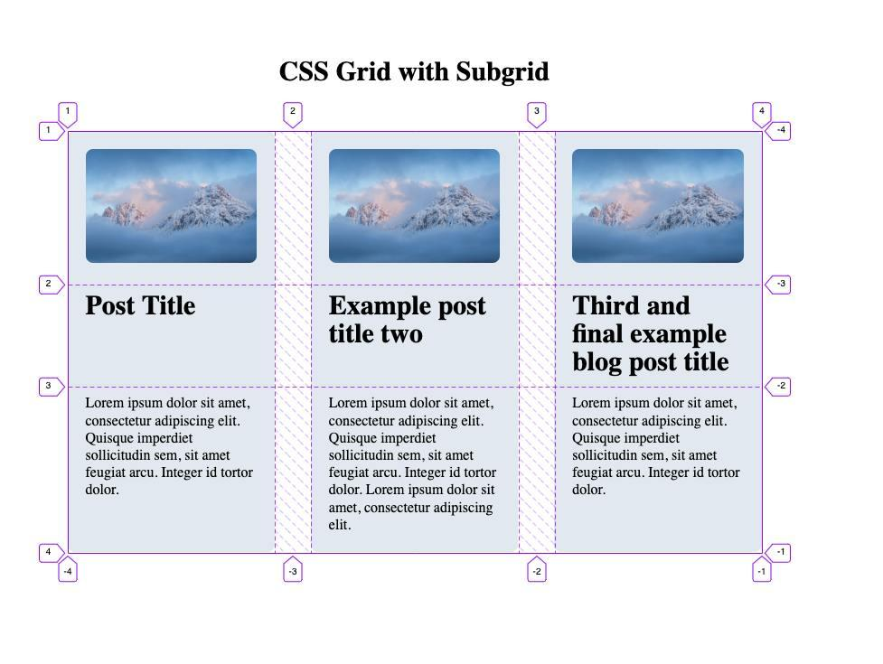
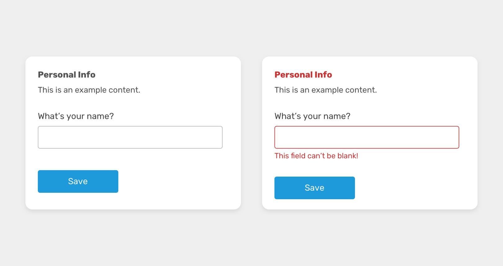
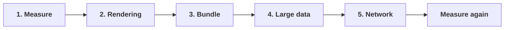
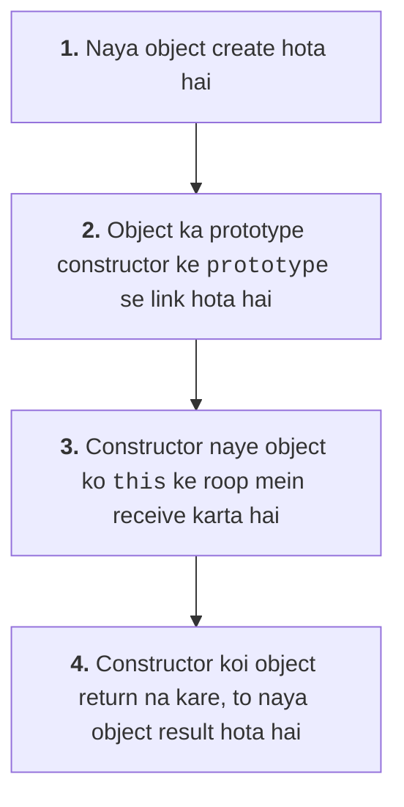

# 1. Frontend & CSS

## Q1. What tech stack are you currently using in frontend development?

Interviewer yeh check karna chahta hai ki tum apne current project ki technology aur uske selection ke reasons samajhte ho ya nahi.

Ek typical frontend stack mein yeh technologies ho sakti hain:

| Technology | Purpose |
|---|---|
| HTML5 | Page structure |
| CSS3 | Styling aur responsive layouts |
| JavaScript / TypeScript | Application logic |
| React | Component-based UI |
| Next.js | Routing, rendering aur full-stack web features |
| Redux Toolkit / Context | Shared client state |
| Tailwind CSS / CSS Modules | Styling |
| Jest / Vitest, React Testing Library | Testing |
| Git | Version control |

Sample interview answer:

> "Currently, I work with React and Next.js for building component-based user interfaces. I use JavaScript/TypeScript for application logic, CSS or Tailwind CSS for styling, and REST APIs for backend integration. For shared state, I choose Context API or Redux Toolkit depending on the complexity. I also use Git and appropriate testing tools to maintain code quality."

Apne actual project mein jo technologies use karte ho, sirf wahi mention karna.

## Q2. What is CSS and what is its purpose?

CSS ka full form Cascading Style Sheets hai. Yeh HTML elements ki presentation aur layout control karta hai.

```html
<h1 class="heading">Hello World</h1>
```

```css
.heading {
  color: blue;
  font-size: 32px;
  margin-bottom: 16px;
}
```

CSS se tum control kar sakte ho:

- Colors, fonts aur typography.
- Spacing, borders aur backgrounds.
- Flexbox aur Grid layouts.
- Responsive design.
- Animations aur transitions.
- Hover, focus aur other interaction states.

### CSS mein "Cascading" ka kya matlab hai?

Jab ek element par multiple CSS rules apply hote hain, browser cascade rules ke through decide karta hai ki kaunsi declaration apply hogi. Ismein origin, importance, cascade layers, specificity aur source order jaise factors relevant hote hain.

Example:

```css
p {
  color: blue;
}

.text {
  color: red;
}
```

```html
<p class="text">Hello</p>
```

Yahan text red hoga, kyunki `.text` ki specificity `p` selector se higher hai.

## Q3. Which libraries or frameworks have you used for writing CSS?

Yahan interviewer CSS styling approaches ke practical experience ke baare mein pooch raha hai.

- **Plain CSS:** Small projects aur custom styling.
- **Sass/SCSS:** Variables, nesting, mixins aur reusable styles.
- **CSS Modules:** Component-scoped CSS.
- **Tailwind CSS:** Utility classes ke through styling.
- **Bootstrap:** Ready-made components aur responsive grid.
- **Styled Components:** JavaScript ke through component-based styling.

Example using CSS Modules:

```jsx
import styles from "./Button.module.css";

function Button() {
  return (
    <button className={styles.primary}>
      Submit
    </button>
  );
}
```

```css
/* Button.module.css */
.primary {
  background: royalblue;
  color: white;
  padding: 10px 16px;
  border-radius: 6px;
}
```

Interview tip: Sirf library ka naam mat batao. Yeh bhi batao ki tumne use kyun choose kiya aur uske trade-offs kya hain.

## Q4. What are some modern CSS features?

Interview mein sirf naye features ki list nahi, unka practical use bhi explain karo.

### 1. Container Queries


Component apne parent container ki width ke according style change kar sakta hai, sirf viewport ke according nahi.

```css
.card-wrapper {
  container-type: inline-size;
}

@container (min-width: 400px) {
  .card {
    display: grid;
    grid-template-columns: 1fr 2fr;
  }
}
```

### 2. Subgrid



Nested grid ko parent grid ki rows ya columns share karne deta hai.

Useful jab multiple cards ke titles, descriptions aur buttons ko aligned rakhna ho.

### 3. `clamp()`


Responsive font size ko minimum aur maximum ke beech control karta hai.

```css
h1 {
  font-size: clamp(2rem, 4vw, 4rem);
}
```

### 4. `:has()` selector



Parent ya ancestor ko uske matching descendant ke basis par style kar sakte ho.

```css
.form-group:has(input:invalid) {
  border-color: red;
}
```

Other useful features: `aspect-ratio`, logical properties, `color-mix()`, CSS nesting aur `@layer`.

Note: CSS features ki availability target browsers par depend karti hai, isliye production mein browser support check karna chahiye.

## Q5. Amazon ya Myntra jaisi website banani ho, Flexbox use karoge ya Grid?

Best answer: Dono. Flexbox aur Grid ek doosre ke alternatives nahi hain; alag layout problems solve karte hain.

| Flexbox | CSS Grid |
|---|---|
| One-dimensional layout: row ya column | Two-dimensional layout: rows aur columns |
| Navbar | Product listing |
| Buttons aur toolbars | Dashboard layouts |
| Product card ke andar alignment | Sidebar aur main content |
| Search bar | Image galleries |

**Flexbox** — card ke andar ka alignment:


**CSS Grid** — poori product listing ki rows aur columns:


Example: responsive product listing.

```css
.product-grid {
  display: grid;
  grid-template-columns: repeat(
    auto-fit,
    minmax(min(100%, 220px), 1fr)
  );
  gap: 20px;
}
```

Yeh available width ke according columns adjust karega.

Navbar ke liye:

```css
.navbar {
  display: flex;
  align-items: center;
  justify-content: space-between;
  gap: 16px;
}
```

Interview answer:

> "For an e-commerce application, I would use Grid for the main product listing because I need control over rows and columns. I would use Flexbox for navigation, card internals and smaller one-dimensional layouts. I would combine both based on the component's layout requirements."

## Q6. Website ko different devices par responsive kaise banaoge?

Responsive design ka matlab website ko mobile, tablet, laptop aur large screens par usable aur readable banana hai.

### Important techniques

#### 1. Viewport meta tag

```html
<meta
  name="viewport"
  content="width=device-width, initial-scale=1.0"
/>
```

#### 2. Mobile-first CSS

Pehle small screens ke liye styles likho, phir larger screens ke liye enhancements add karo.

```css
.product-grid {
  display: grid;
  grid-template-columns: 1fr;
  gap: 16px;
}

@media (min-width: 600px) {
  .product-grid {
    grid-template-columns: repeat(2, 1fr);
  }
}

@media (min-width: 1024px) {
  .product-grid {
    grid-template-columns: repeat(4, 1fr);
  }
}
```

#### 3. Flexible units

- `%` for relative sizing.
- `rem` for scalable typography and spacing.
- `fr` for Grid tracks.
- `minmax()` for flexible constraints.
- `clamp()` for responsive sizing.

#### 4. Images aur content

- Images ko container ke andar fit karo.
- Long text aur buttons ko test karo.
- Fixed widths aur unnecessary fixed heights avoid karo.
- Touch targets aur keyboard navigation check karo.

#### 5. Testing

Browser DevTools ke responsive mode se alag viewport sizes test karo. Real devices par bhi important interactions verify karo.

## Q7. Agar image 2 MB ki ho, to sabhi responsive devices par efficiently kaise display karoge?

Yeh question sirf CSS ka nahi hai. Ismein image optimization, responsive delivery aur loading performance tino check hote hain.

### Step 1: Image ko optimize karo

- JPEG/PNG ke alternatives mein WebP ya AVIF consider karo.
- Image dimensions ko actual display requirements ke according resize karo.
- Appropriate compression use karo.
- Unnecessarily large source image download mat karvao.

2 MB file ko sirf CSS se chhota dikhane par downloaded file size reduce nahi hota.

### Step 2: Responsive images use karo

```html

```

Browser viewport aur device conditions ke according suitable candidate choose kar sakta hai.

- `srcset`: Available image versions.
- `sizes`: Image ki expected rendered width.
- `width` and `height`: Layout space reserve karne mein help karte hain.
- `loading="lazy"`: Off-screen images ki loading defer kar sakta hai.

Important: Above-the-fold hero ya LCP image ke liye blindly `loading="lazy"` use mat karna; isse initial loading slow ho sakti hai. Zaroorat ho to suitable preload ya high fetch priority use karo.

# 2. HTML5 & Browser Concepts

## Q8. Which HTML5 APIs have you worked with?

HTML5 aur modern browser APIs browser capabilities access karne deti hain, bina har functionality ke liye third-party library ki zaroorat ke.

| API | Use case |
|---|---|
| Fetch API | HTTP requests |
| Geolocation API | User ki location, permission ke saath |
| Web Storage | `localStorage` aur `sessionStorage` |
| Canvas API | Drawing, charts aur image processing |
| Drag and Drop API | Drag-and-drop interactions |
| Web Workers | Background JavaScript computation |
| History API | Browser session history manage karna |
| MediaDevices API | Camera aur microphone access |
| Intersection Observer | Visibility aur lazy loading |
| ResizeObserver | Element dimensions observe karna |

Example: Fetch API.

```js
async function getUsers() {
  const response = await fetch("/api/users");

  if (!response.ok) {
    throw new Error(`HTTP ${response.status}`);
  }

  return response.json();
}
```

`fetch()` network failures par reject hota hai, lekin HTTP `404` ya `500` response par automatically reject nahi hota. Isliye `response.ok` check karna important hai.

Interview tip: Apne project ka actual example batao, jaise Intersection Observer se lazy loading, Fetch API se data fetching ya MediaDevices se webcam access.

## Q9. JWT token web application mein kahan store karoge?

JWT (JSON Web Token) ek format hai jo claims carry karta hai aur commonly authentication ya authorization flows mein use hota hai.

JWT storage ka answer security requirements aur authentication architecture par depend karta hai.

### Option 1: `localStorage`

```js
localStorage.setItem("token", token);
```

- Page reload ke baad value persist karti hai.
- JavaScript se accessible hai.
- Agar XSS vulnerability ho, to malicious script token read kar sakti hai.

### Option 2: `sessionStorage`

```js
sessionStorage.setItem("token", token);
```

- Usually current tab ke session tak persist karta hai.
- JavaScript se accessible hone ke karan XSS risk yahan bhi hai.

### Option 3: `HttpOnly` cookie

Server cookie set kar sakta hai:

```http
Set-Cookie: session=...; HttpOnly; Secure; SameSite=Lax; Path=/
```

- `HttpOnly`: Client-side JavaScript cookie read nahi kar sakta.
- `Secure`: HTTPS par hi cookie send hoti hai.
- `SameSite`: Cross-site cookie sending ko restrict karne mein help karta hai.
- `Path`: Cookie ka applicable path define karta hai.

Cookies automatically requests ke saath send ho sakti hain, isliye CSRF protection aur appropriate `SameSite` configuration important hain.

### Comparison

| Storage | JS se readable? | XSS risk | Reload ke baad |
|---|---|---|---|
| `localStorage` | Haan | Token chori ho sakta hai | Persist karta hai |
| `sessionStorage` | Haan | Token chori ho sakta hai | Usually tab band hone tak |
| `HttpOnly` cookie | Nahi | Token directly read nahi hota (CSRF ka dhyan rakhna) | Cookie expiry ke according |

### Interview mein best answer

> "Main token storage ko authentication architecture aur threat model ke according choose karunga. Browser-based applications mein server-managed `HttpOnly`, `Secure` cookies often strong option hoti hain. Lekin cookies bhi CSRF aur session-management concerns ko automatically eliminate nahi karti. `localStorage` mein long-lived sensitive tokens rakhne se bachunga, kyunki XSS ke case mein woh accessible hote hain."

Yaad rakho: JWT ko decode kar pana aur uski signature verify hona alag cheezein hain. Frontend par JWT decode karna uski authenticity prove nahi karta.

## Q10. What is XSS and how can you prevent it?

XSS ka full form Cross-Site Scripting hai. Jab attacker-controlled input page mein executable script ke roop mein run ho jata hai, to user session ya application data risk mein aa sakta hai.

### XSS ke main types

- **Stored XSS:** Malicious content database ya kisi persistent storage mein save hota hai aur users ko serve kiya jata hai.
- **Reflected XSS:** Malicious input request ke response mein reflect hota hai.
- **DOM-based XSS:** Client-side JavaScript unsafe DOM operations ke through vulnerability create karta hai.

Example of unsafe DOM handling:

```js
element.innerHTML = userInput;
```

Agar `userInput` untrusted HTML hai, to dangerous markup ya scripts execute hone ka risk ho sakta hai.

Safer text-only rendering:

```js
element.textContent = userInput;
```

React mein bhi:

```jsx
<p>{userInput}</p>
```

React normal text children ko escape karta hai. Lekin `dangerouslySetInnerHTML`, unsafe URLs aur third-party scripts jaise cases mein extra care chahiye.

### Prevention checklist

1. Context-appropriate output encoding.
2. Untrusted HTML ko render karne par trusted HTML sanitizer.
3. Content Security Policy (CSP).
4. `HttpOnly` cookies for sensitive session credentials.
5. Dangerous DOM APIs aur unsafe URL schemes se bachna.
6. Dependencies aur third-party scripts ko review karna.

Interview follow-up: CSP useful defense-in-depth hai, lekin input/output handling ki jagah nahi leti.

# 3. ReactJS

## Q11. How would you optimize a React application?

Interviewer dekhna chahta hai ki tum performance problem identify karna aur uska solution select karna jaante ho ya nahi.



### Step 1: Measure the problem

- React DevTools Profiler se component renders inspect karo.
- Chrome Performance panel se long tasks aur rendering bottlenecks dekho.
- Bundle analyzer se large JavaScript dependencies identify karo.
- Core Web Vitals se real-world loading aur responsiveness monitor karo.

### Step 2: Optimize rendering

```jsx
const ProductCard = React.memo(function ProductCard({ product }) {
  return <div>{product.name}</div>;
});
```

`React.memo` same props hone par unnecessary renders skip karne mein help karta hai.

Expensive calculation ke liye:

```jsx
const filteredProducts = useMemo(() => {
  return products.filter(product =>
    product.name.toLowerCase().includes(query.toLowerCase())
  );
}, [products, query]);
```

### Step 3: Reduce initial bundle

```jsx
const AnalyticsPage = React.lazy(
  () => import("./AnalyticsPage")
);
```

Isse page ka code demand par load ho sakta hai.

### Step 4: Handle large datasets

- Pagination.
- Virtualization.
- Server-side filtering.
- Debounced search.
- Efficient data structures.

### Step 5: Optimize network requests

- Caching.
- Request deduplication.
- Appropriate API payload size.
- Parallel requests where dependencies permit.
- Cancellation of obsolete requests.

Interview answer:

> "I would first profile the application to identify the bottleneck. Depending on the results, I would optimize rendering, reduce bundle size, virtualize large lists, and improve network requests. I would then measure the improvement rather than assuming the optimization worked."

## Q12. What happens when you pass a function as a prop?

Parent component child ko function pass karta hai, jisse child parent-defined behavior trigger kar sakta hai. Is pattern ko callback prop bhi kehte hain.

```jsx
function Parent() {
  const [count, setCount] = useState(0);

  function handleIncrement() {
    setCount(prev => prev + 1);
  }

  return <Child onIncrement={handleIncrement} />;
}

function Child({ onIncrement }) {
  return (
    <button onClick={onIncrement}>
      Increment
    </button>
  );
}
```

Button click hone par child parent ka callback call karta hai.

### Common mistake

```jsx
<Child onIncrement={handleIncrement()} />
```

Is code mein function render ke waqt execute ho jata hai, aur uska return value prop ko pass hota hai.

Normally callback reference pass karna chahiye:

```jsx
<Child onIncrement={handleIncrement} />
```

### Kya function prop se re-render hota hai?

Agar parent har render par naya function create karta hai, to function reference change hota hai. Is wajah se `React.memo` ke through optimized child bhi re-render kar sakta hai.

```jsx
const handleClick = useCallback(() => {
  console.log("Clicked");
}, []);
```

Lekin `useCallback` tabhi use karo jab stable function reference ka actual benefit ho.

## Q13. How would you avoid memory leaks in a React application?

Memory leak tab hota hai jab resources ya references unnecessary taur par retain hote rehte hain. Har state update after unmount automatically memory leak nahi hota.

Common causes:

- Event listeners remove na karna.
- Timers clear na karna.
- WebSocket subscriptions close na karna.
- Observers disconnect na karna.
- Long-lived references mein unnecessary objects retain karna.

Example:

```jsx
useEffect(() => {
  const controller = new AbortController();

  async function loadData() {
    try {
      const response = await fetch("/api/data", {
        signal: controller.signal
      });

      if (!response.ok) {
        throw new Error("Request failed");
      }

      const result = await response.json();
      setData(result);
    } catch (error) {
      if (error.name !== "AbortError") {
        setError(error.message);
      }
    }
  }

  loadData();

  return () => {
    controller.abort();
  };
}, []);
```

Event listener ke liye:

```jsx
useEffect(() => {
  function handleResize() {
    console.log(window.innerWidth);
  }

  window.addEventListener("resize", handleResize);

  return () => {
    window.removeEventListener("resize", handleResize);
  };
}, []);
```

Interview answer: Main Effects ke andar timers, listeners, subscriptions aur requests ko proper cleanup deta hoon. Memory issues investigate karne ke liye browser memory profiler aur heap snapshots bhi use karta hoon.

## Q14. Have you used Context API? When would you choose Context or Redux?

Context API React ke component tree mein shared values distribute karne ka built-in mechanism hai.

Example:

```jsx
const ThemeContext = createContext("light");

function App() {
  return (
    <ThemeContext.Provider value="dark">
      <Dashboard />
    </ThemeContext.Provider>
  );
}
```

Descendant component:

```jsx
function Dashboard() {
  const theme = useContext(ThemeContext);

  return <div className={theme}>Dashboard</div>;
}
```

### Context kab use karoge?

- Theme.
- Locale/language.
- Simple authentication context.
- Relatively simple shared configuration.

### Redux Toolkit kab use karoge?

- Complex shared client state.
- Multiple features ke beech coordinated updates.
- Predictable actions aur reducers.
- Middleware aur structured debugging ki requirements.

Redux Toolkit ka example:

```js
const cartSlice = createSlice({
  name: "cart",
  initialState: { items: [] },
  reducers: {
    addItem(state, action) {
      state.items.push(action.payload);
    }
  }
});
```

Redux Toolkit mein reducers ke andar mutation-style code likhna allowed hota hai, kyunki Redux Toolkit internally Immer ke through immutable updates manage karta hai.

Important: Context automatically Redux ka replacement nahi hai, aur Redux har application ke liye necessary bhi nahi. State complexity aur team requirements ke according choose karo.

# 4. Testing

## Q15. Do you write unit test cases?

Unit tests small, isolated pieces of code ka expected behavior verify karte hain.

Example:

```js
function add(a, b) {
  return a + b;
}
```

Vitest test:

```js
import { describe, it, expect } from "vitest";

describe("add", () => {
  it("adds two numbers", () => {
    expect(add(2, 3)).toBe(5);
  });
});
```

Yeh test verify karta hai ki `add(2, 3)` ka result `5` hai.

React components ke liye React Testing Library use kar sakte ho, jisse user-visible behavior test karna easy hota hai.

## Q16. Where do you write unit tests in a React application?

Do common approaches hain:

### 1. Co-located tests

```text
Button/
├── Button.jsx
├── Button.test.jsx
└── Button.css
```

### 2. Separate tests directory

```text
src/
├── components/
├── features/
└── tests/
    ├── components/
    └── utils/
```

Dono valid hain. Project ki conventions follow karni chahiye.

Example React component test:

```jsx
import { render, screen } from "@testing-library/react";
import userEvent from "@testing-library/user-event";
import { expect, it } from "vitest";

function Counter() {
  const [count, setCount] = useState(0);

  return (
    <>
      <p>Count: {count}</p>
      <button onClick={() => setCount(c => c + 1)}>
        Increment
      </button>
    </>
  );
}

it("increments the counter", async () => {
  const user = userEvent.setup();

  render(<Counter />);

  await user.click(
    screen.getByRole("button", { name: "Increment" })
  );

  expect(screen.getByText("Count: 1")).toBeTruthy();
});
```

Is example mein `useState` ko React se import karna hoga:

```js
import { useState } from "react";
```

Testing ke liye sirf implementation details nahi, user-visible behavior assert karna preferred hai.

### Testing ke levels

- **Unit testing:** Individual functions.
- **Component testing:** UI behavior.
- **Integration testing:** Components aur services ka interaction.
- **End-to-end testing:** Complete user flows, jaise login ya checkout.

# 5. JavaScript Coding Questions

## Q17. Write code to create an object in different ways

JavaScript mein object key-value pairs ka collection hota hai. Object create karne ke multiple methods hain.

### Method 1: Object literal — most common

```js
const user = {
  name: "Rahul",
  age: 25,
  greet() {
    return `Hello, ${this.name}`;
  }
};

console.log(user.name);     // Rahul
console.log(user.greet());  // Hello, Rahul
```

Simple objects ke liye yeh sabse readable aur common approach hai.

### Method 2: `new Object()`

```js
const user = new Object();

user.name = "Rahul";
user.age = 25;

console.log(user);
```

Yeh bhi valid hai, lekin ordinary objects ke liye object literal generally preferred hai.

### Method 3: `Object.create()`

Is method se specified prototype ke saath object create kar sakte ho.

```js
const userPrototype = {
  greet() {
    return `Hello, ${this.name}`;
  }
};

const user = Object.create(userPrototype);

user.name = "Rahul";

console.log(user.greet()); // Hello, Rahul
```

Yahan `greet()` directly `user` ki own property nahi hai; woh uske prototype se access hota hai.

### Method 4: Constructor function

```js
function User(name, age) {
  this.name = name;
  this.age = age;
}

const user1 = new User("Rahul", 25);
const user2 = new User("Priya", 28);

console.log(user1);
console.log(user2);
```

`new User(...)` call karne par naya object create hota hai aur constructor function ke andar `this` us object ko refer karta hai.

### Method 5: ES6 Class

```js
class User {
  constructor(name, age) {
    this.name = name;
    this.age = age;
  }

  greet() {
    return `Hello, ${this.name}`;
  }
}

const user = new User("Rahul", 25);

console.log(user.greet());
```

Classes JavaScript ke prototype-based object model ke upar cleaner syntax provide karti hain.

### Comparison

| Method | Typical use |
|---|---|
| Object literal | Simple data objects |
| `new Object()` | Object constructor approach; rarely needed |
| `Object.create()` | Specific prototype ke saath object |
| Constructor function | Repeated object initialization |
| `class` | Structured object creation aur methods |

## Q18. Write a constructor function

Constructor function ek regular JavaScript function hai jise conventionally `new` ke saath call karke objects initialize kiye jaate hain.

```js
function Employee(name, salary, department) {
  this.name = name;
  this.salary = salary;
  this.department = department;
}

Employee.prototype.getDetails = function () {
  return `${this.name} works in ${this.department}`;
};

const employee1 = new Employee(
  "Amit",
  50000,
  "Engineering"
);

const employee2 = new Employee(
  "Neha",
  65000,
  "Design"
);

console.log(employee1.getDetails());
console.log(employee2.getDetails());
```

### `new` keyword internally kya karta hai?

Conceptually:



1. Naya object create hota hai.
2. Us object ka prototype constructor ke `prototype` se link hota hai.
3. Constructor function naye object ko `this` ke roop mein receive karta hai.
4. Agar constructor explicitly koi object return nahi karta, to naya object result hota hai.

`getDetails()` ko prototype par define karne se method har instance mein separately create nahi hota.

Interview follow-up: Arrow functions ko ordinary constructor functions ki tarah `new` ke saath use nahi kar sakte, kyunki arrows ke paas apna constructor behavior aur `prototype` property nahi hoti.
