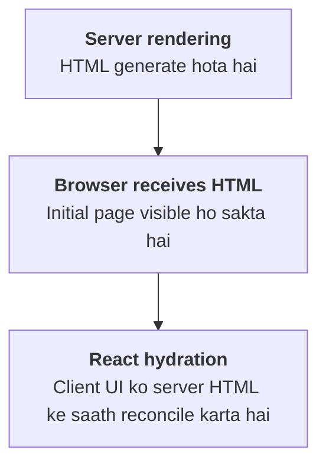
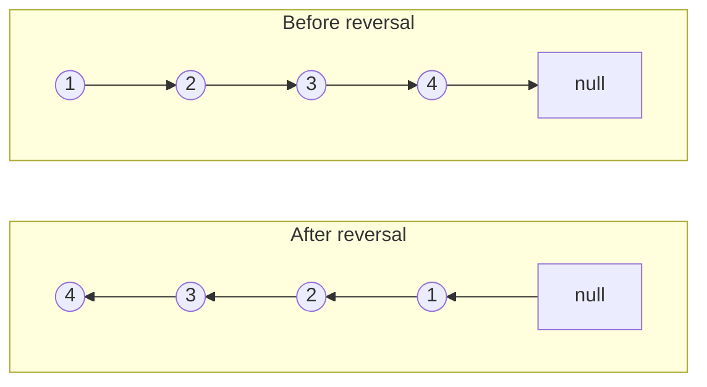

# Round 1 — Machine Coding (90 minutes)

## Build a Shopping Cart using Vanilla JavaScript

HTML + CSS + JavaScript — React ka use nahi karna hai.

Is round mein interviewer check karega ki tum bina framework ke complete working feature bana sakte ho ya nahi.

## Q1. Add and remove products

Sabse pehle product data aur cart state ko alag rakho.

```
const products = [
  { id: 1, title: "React Course", price: 499 },
  { id: 2, title: "Node.js Course", price: 799 },
];

const cart = [];
```

Product ko cart mein add karne ke liye:

```
function addToCart(productId) {
  const product = products.find(
    item => item.id === productId
  );

  if (!product) return;

  const existingItem = cart.find(
    item => item.productId === productId
  );

  if (existingItem) {
    existingItem.quantity += 1;
  } else {
    cart.push({
      productId: product.id,
      title: product.title,
      price: product.price,
      quantity: 1,
    });
  }

  renderCart();
}
```

Is implementation mein `cart` array ko mutate kiya gaya hai, jo simple vanilla JavaScript application mein acceptable ho sakta hai, agar yahi tumhara chosen state-management approach hai.

### Remove product

```
function removeFromCart(productId) {
  const index = cart.findIndex(
    item => item.productId === productId
  );

  if (index === -1) return;

  cart.splice(index, 1);
  renderCart();
}
```

Interviewer kya check karega?

- Product ID correctly identify karna.
- Duplicate cart entries avoid karna.
- Invalid product ID handle karna.
- State update hone ke baad UI refresh karna.

## Q2. Increase/decrease quantity

```
function updateQuantity(productId, change) {
  const item = cart.find(
    item => item.productId === productId
  );

  if (!item) return;

  item.quantity += change;

  if (item.quantity <= 0) {
    removeFromCart(productId);
    return;
  }

  renderCart();
}
```

Example:

- Quantity `1` hai aur user `+` click karta hai, to quantity `2` ho jayegi.
- Quantity `2` hai aur user `-` click karta hai, to quantity `1` ho jayegi.
- Quantity `1` par `-` click karne par is implementation mein item remove ho jayega.

Yeh behavior requirement par depend karta hai. Kuch applications mein quantity ko `1` par hi minimum rakha jata hai.

## Q3. Calculate totals dynamically

Total calculate karne ke liye har product ka `price × quantity` sum karenge.

```
function calculateTotal() {
  return cart.reduce(
    (total, item) =>
      total + item.price * item.quantity,
    0
  );
}
```

Maan lo cart mein:

| Product        | Price | Quantity | Subtotal |
| -------------- | ----- | -------- | -------- |
| React Course   | ₹499  | 2        | ₹998     |
| Node.js Course | ₹799  | 1        | ₹799     |
| Total          |       |          | ₹1,797   |

Agar cart mein item ki quantity change hoti hai, to total dobara calculate hona chahiye.

## Q4. Keep UI and application state consistent

Yeh machine-coding round ka sabse important concept hai.

Maan lo tumne cart ka total update kiya, lekin product quantity UI mein purani hi dikh rahi hai. Iska matlab UI aur state synchronized nahi hain.

Ek simple solution hai ki cart state ko source of truth rakho aur UI ko usi state se render karo.

```
function renderCart() {
  const cartContainer =
    document.getElementById("cart-items");

  cartContainer.innerHTML = cart.map(item => `
    <div class="cart-item">
      <h3>${item.title}</h3>
      <p>₹${item.price}</p>
      <p>Quantity: ${item.quantity}</p>

      <button data-id="${item.productId}"
              data-action="decrease">-</button>

      <button data-id="${item.productId}"
              data-action="increase">+</button>

      <button data-id="${item.productId}"
              data-action="remove">Remove</button>
    </div>
  `).join("");

  document.getElementById("cart-total").textContent =
    `₹${calculateTotal()}`;
}
```

Yeh illustrative rendering example hai. Production mein user-provided strings ko directly `innerHTML` mein insert nahi karna chahiye, kyunki isse XSS vulnerability ho sakti hai. DOM APIs aur `textContent` use karna safer approach hai.

### Edge cases jo interviewer expect karega

- Empty cart.
- Invalid product ID.
- Duplicate product.
- Quantity zero ya negative.
- Decimal ya invalid price.
- Rapidly repeated button clicks.
- Cart total aur displayed quantity ka mismatch.

## Q5. Write modular, maintainable code

Code ko responsibilities ke according divide karo:

- `addToCart()` — product add karna.
- `removeFromCart()` — product remove karna.
- `updateQuantity()` — quantity change karna.
- `calculateTotal()` — total calculate karna.
- `renderCart()` — UI render karna.
- Event handlers — user interactions handle karna.

Interview tip: Har click ke andar poori cart logic likhne ke bajaye functions reuse karo. Isse code test karna aur bugs fix karna easier hota hai.

90-minute round mein pehle working functionality complete karo, phir styling aur edge cases improve karo. Sirf attractive UI banane se marks nahi milenge agar cart logic incorrect hai.

# Round 2 — Technical Interview (60 minutes)

Is round mein JavaScript fundamentals, React internals aur DSA test kiye jayenge.

## Q1. Explain or model the behavior of `useMemo` and `useCallback`

Yeh React Hooks ke advanced interview questions hain.

### A. `useMemo` kya hai?

`useMemo` kisi calculation ke result ko renders ke beech cache karne ke liye use hota hai, jab tak uski dependencies change na hon.

Example:

```
import { useMemo, useState } from "react";

function ProductList({ products }) {
  const [search, setSearch] = useState("");

  const filteredProducts = useMemo(() => {
    console.log("Filtering products");

    return products.filter(product =>
      product.title
        .toLowerCase()
        .includes(search.toLowerCase())
    );
  }, [products, search]);

  return (
    <div>
      <input
        value={search}
        onChange={e => setSearch(e.target.value)}
      />

      {filteredProducts.map(product => (
        <p key={product.id}>{product.title}</p>
      ))}
    </div>
  );
}
```

Yahan filtering calculation tab dobara hogi jab `products` ya `search` change honge.

### B. `useCallback` kya hai?

`useCallback` function reference ko renders ke beech cache karne ke liye use hota hai.

```
import { useCallback, useState } from "react";

function Cart() {
  const [count, setCount] = useState(0);

  const increase = useCallback(() => {
    setCount(previous => previous + 1);
  }, []);

  return (
    <button onClick={increase}>
      Items: {count}
    </button>
  );
}
```

Yahan `increase` function ka reference same reh sakta hai jab tak dependencies change nahi hoti.

### Dono mein difference

| `useMemo`                             | `useCallback`                            |
| ------------------------------------- | ---------------------------------------- |
| Calculation ka result cache karta hai | Function reference cache karta hai       |
| `useMemo(() => value, deps)`          | `useCallback(() => {}, deps)`            |
| Expensive calculations ke liye useful | Stable callback reference ke liye useful |

### Kya `useCallback` function ko execute karta hai?

Nahi. Yeh function ko execute nahi karta; function reference cache karta hai.

### Kab use nahi karna chahiye?

Har calculation aur har function par Hooks lagana zaroori nahi hai. Memoization ka apna overhead hota hai. Pehle identify karo ki actual performance issue hai ya stable reference ki requirement hai.

Interview-ready answer: `useMemo` computed values ko memoize karta hai, jabki `useCallback` function references ko memoize karta hai. Dono unnecessary work reduce karne mein help kar sakte hain, lekin inka use measured performance needs ke according karna chahiye.

## Q2. Implement `Array.prototype.flat()` with configurable depth

Yeh question JavaScript prototypes aur recursion ko test karta hai.

### `flat()` kya karta hai?

JavaScript ka `flat()` nested arrays ko specified depth tak flatten karta hai.

```
const numbers = [1, [2, [3, [4]]]];

console.log(numbers.flat());
// [1, 2, [3, [4]]]

console.log(numbers.flat(2));
// [1, 2, 3, [4]]

console.log(numbers.flat(Infinity));
// [1, 2, 3, 4]
```

Depth `1` default hoti hai.

### Custom implementation

```
function flattenArray(array, depth = 1) {
  if (depth < 0) {
    throw new RangeError("Depth must be non-negative");
  }

  const result = [];

  for (const item of array) {
    if (Array.isArray(item) && depth > 0) {
      result.push(...flattenArray(item, depth - 1));
    } else {
      result.push(item);
    }
  }

  return result;
}
```

Example:

```
const input = [1, [2, [3, 4]], 5];

console.log(flattenArray(input, 1));
// [1, 2, [3, 4], 5]

console.log(flattenArray(input, 2));
// [1, 2, 3, 4, 5]

console.log(flattenArray(input, 0));
// [1, [2, [3, 4]], 5]
```

### Logic samjho

1. Ek empty result array banao.
2. Input array ke har element par loop chalao.
3. Agar element array hai aur depth positive hai, to recursively flatten karo.
4. Agar element normal value hai, ya depth zero ho gayi hai, to result mein add karo.
5. Final array return karo.

### Time complexity

Agar \\(n\\) total visited elements hain, to is straightforward implementation ki expected time complexity \\(O(n)\\) hai, assuming array operations aur element processing constant-time hain. Output storage \\(O(n)\\) hoti hai, aur recursion stack nested depth par depend karta hai.

### Interviewer ka follow-up

Kya recursion ke bina bhi implement kar sakte hain?

Haan. Explicit stack ya iterative traversal use kar sakte hain. Bahut deeply nested arrays mein recursion call-stack limit hit kar sakti hai.

Note: Yeh implementation basic dense arrays ke liye hai. Native `flat()` sparse array holes ko skip karta hai; exact native behavior reproduce karne ke liye additional handling chahiye.

## Q3. What is hydration in React, and what causes hydration mismatches?

Yeh Next.js aur server-side rendering interviews mein bahut important question hai.

### Hydration kya hai?

Jab React application server par HTML generate karti hai aur browser mein woh HTML load hota hai, tab React client-side JavaScript ke through us existing HTML ko interactive banata hai. Is process ko hydration kehte hain.

Example: Next.js server se page HTML milta hai. Browser page display kar sakta hai, aur React hydration ke baad buttons, event handlers aur interactive state ko connect karta hai.



### Hydration mismatch kya hai?

Jab server-generated HTML aur client ki initial render output mein unexpected difference hota hai, to hydration mismatch ho sakta hai.

Example:

```
function App() {
  return <p>{Math.random()}</p>;
}
```

Server aur browser alag random numbers generate kar sakte hain. Isliye initial output match nahi karega.

### Common causes

- `Date.now()` ya `Math.random()` se render-time values.
- Server aur browser ke timezone ya locale differences.
- `window` ya `localStorage` par initial render mein depend karna.
- Invalid HTML nesting.
- Server aur client ke beech different data.
- Browser extensions se HTML modification.

### Correct approach

Agar value browser par hi available hai, to use client-side effect mein load kar sakte ho.

```
"use client";

import { useEffect, useState } from "react";

function Clock() {
  const [time, setTime] = useState(null);

  useEffect(() => {
    setTime(new Date().toLocaleTimeString());
  }, []);

  return <p>{time ?? "Loading time..."}</p>;
}
```

Server aur initial client render dono `"Loading time..."` show kar sakte hain. Hydration ke baad effect current time set karta hai.

Interview-ready answer: Hydration server-rendered HTML ko React ke saath interactive banane ka process hai. Hydration mismatch tab hota hai jab server aur client ki initial rendered output match nahi karti. Isse avoid karne ke liye deterministic initial rendering aur consistent data use karna chahiye.

## Q4. Reverse a linked list in O(n) time and O(1) extra space

Yeh DSA ka classic interview question hai.

### Linked list kya hoti hai?

Linked list nodes se bani hoti hai. Har node mein data aur next node ka reference hota hai.

Example:



### Iterative solution

```
function reverseList(head) {
  let previous = null;
  let current = head;

  while (current !== null) {
    const nextNode = current.next;

    current.next = previous;
    previous = current;
    current = nextNode;
  }

  return previous;
}
```

### Dry run

Initially:

- `previous = null`
- `current = node 1`

Har iteration mein:

1. `nextNode` mein next node save karo.
2. Current node ka `next` reverse karke previous node ki taraf point karao.
3. `previous` ko current node par move karo.
4. `current` ko saved next node par move karo.

Jab `current` null ho jata hai, `previous` new head hota hai.

### Complexity

- Time complexity: \\(O(n)\\), kyunki har node ek baar process hota hai.
- Auxiliary space: \\(O(1)\\), kyunki sirf constant number of pointers use hote hain.

Important edge cases: Empty list, single-node list aur already reversed list. Yeh solution in sabko correctly handle karta hai.

# Round 3 — Hiring Manager Interview (45 minutes)

Is round mein tumhari technical knowledge ke saath ownership, decision-making, communication aur team collaboration check ki jaati hai.

Yahan answers ko apne actual experience se support karna sabse important hai.

## Q1. Describe a difficult production bug you resolved

Interviewer yeh samajhna chahta hai ki production issue aane par tum investigation aur resolution kaise karte ho.

### Answer dene ka best structure: STAR

- S — Situation: Problem kya thi?
- T — Task: Tumhari responsibility kya thi?
- A — Action: Tumne investigate aur fix kaise kiya?
- R — Result: Kya outcome aaya?

### Example answer — sirf tab use karo jab tumhare actual experience se match kare

In one of my projects, we faced an issue where the cart total was not updating correctly after users changed product quantities.

My responsibility was to identify the root cause and ensure that the cart UI remained consistent with the application state.

I reproduced the issue, inspected the event handlers, and found that the total was being updated separately from the cart data. This caused the displayed total and item quantities to become inconsistent in certain scenarios.

I refactored the logic so that the cart state became the single source of truth and the total was recalculated from the current items. I also tested edge cases such as removing items, empty carts, and repeated quantity updates.

As a result, the cart behavior became more predictable and easier to maintain. I also learned the importance of reproducing bugs and testing edge cases before shipping a fix.

Dhyan do: Agar tumne actual production bug solve kiya hai, to real issue, actual root cause aur measurable outcome batao. Invented metrics ya incidents mat use karna.

## Q2. When would you refactor legacy code instead of rewriting it?

Legacy code woh existing code hai jo purana, difficult to maintain ya current requirements ke liye awkward ho sakta hai.

### Refactoring kab karni chahiye?

- Existing functionality mostly sahi kaam kar rahi ho.
- Changes limited modules mein kiye ja sakte hon.
- Business rules complex hon aur rewrite mein lose hone ka risk ho.
- Time aur budget limited ho.
- Existing tests aur behavior ko preserve karna important ho.

### Rewrite kab consider karna chahiye?

- Existing architecture major requirements ko support nahi kar sakti.
- Dependencies unsupported ya security ke liye risky hon.
- Incremental refactoring ki cost aur risk rewrite se zyada ho.
- Team ke paas migration aur testing ka practical plan ho.

| Refactoring                                | Rewrite                                           |
| ------------------------------------------ | ------------------------------------------------- |
| Existing system ko gradually improve karna | System ka significant part dobara implement karna |
| Behavior usually preserve karte hain       | Behavior regressions ka risk higher ho sakta hai  |
| Incremental delivery possible              | Migration aur feature parity ka extra effort      |

Interview-ready answer:

"I would prefer incremental refactoring when the existing system is functional and can be improved safely. I would consider a rewrite only when the current architecture creates significant limitations and we can justify the migration cost, risk, and testing effort."

## Q3. Tell me about a professional disagreement and how you handled it

Is question se interviewer tumhari communication aur conflict-resolution skills check karta hai.

### Example scenario

Tum aur tumhara teammate decide nahi kar pa rahe ki kisi feature ke liye existing monolith ko extend karna chahiye ya nayi service banani chahiye.

Ek taraf rapid delivery important hai, doosri taraf future scaling ki concern hai.

### Answer ka structure

1. Disagreement kis technical ya business decision par tha?
2. Dono approaches ke benefits aur risks kya the?
3. Tumne evidence, metrics ya requirements kaise compare ki?
4. Team ke saath decision kaise liya?
5. Outcome aur learning kya thi?

In a project, I had a professional disagreement with a teammate about the implementation approach for a feature.

Instead of arguing for my preferred solution, I discussed the requirements, delivery timeline, maintainability, and potential performance implications with them.

We compared the available options and evaluated which approach best satisfied the current requirements without introducing unnecessary complexity. Once we agreed on a direction, I supported the team decision and focused on implementing it properly.

The experience reinforced that technical disagreements should be resolved through evidence, respectful communication, and shared project goals rather than personal preferences.

Is answer ko apne real example ke saath customize karna. Interviewer follow-up mein pooch sakta hai ki tumhara actual disagreement kya tha aur final decision kis basis par liya gaya.

## Q4. Why do you want to join Flipkart?

Yeh company-specific question hai. Interviewer dekhna chahta hai ki tumne company aur role ke baare mein research ki hai aur tumhara motivation genuine hai.

Answer mein 3 cheezein connect karo:

- Company ke products aur business challenges.
- Tumhari technical interests aur experience.
- Role mein tum kya contribute kar sakte ho aur kya seekhna chahte ho.

I am interested in joining Flipkart because building large-scale e-commerce experiences involves interesting engineering challenges, including performance, reliability, user experience, and handling high traffic.

My frontend and JavaScript experience has made me interested in building responsive, maintainable applications, and I would like to apply those skills to products used by a large number of customers.

I am also looking forward to learning from experienced engineers, contributing to real-world product challenges, and growing as a software engineer.

Is answer ko company aur specific job description ki research ke basis par personalize karna. Agar tumne Flipkart ke kisi product, engineering initiative ya specific team ke baare mein research ki hai, to uska relevant example add kar sakte ho.


# miscellaneous topic

## 1. Build complete features without a framework

Vanilla JavaScript se practice karo:

- Shopping cart.
- Search and filtering.
- Pagination.
- Form validation.
- Modal and dropdown.
- Debouncing search.
- API calls with loading, error and success states.

Goal hai ki tum bina React ke bhi DOM, events aur application state ko correctly manage kar sako.

## 2. Closures, callbacks, prototypes and polyfills

| Topic      | Kya samajhna hai                                                  |
| ---------- | ----------------------------------------------------------------- |
| Closures   | Function outer scope ke variables ko kaise access karta hai       |
| Callbacks  | Function ko doosre function mein argument ke roop mein pass karna |
| Prototypes | JavaScript objects mein inheritance aur property lookup           |
| Polyfills  | Missing functionality ka compatible implementation provide karna  |

Polyfill practice ke liye `map()`, `filter()`, `reduce()` aur `bind()` ke simplified implementations likho. Native methods ke exact edge cases aur specifications ko bhi samjho.

## 3. React Hooks beyond syntax

Sirf Hooks ka syntax yaad karna enough nahi hai. In questions ke answers bhi ready rakho:

- `useEffect` mein cleanup kyun hota hai?
- Stale closures kya hain?
- Dependency array kaise work karti hai?
- `useMemo` aur `useCallback` mein difference kya hai?
- State updates kab batch hoti hain?
- React component re-render kab hota hai?

## 4. Core DSA problems

In problems ko code karke practice karo:

- Reverse linked list.
- Detect cycle in linked list.
- Two Sum.
- Valid parentheses.
- Binary search.
- Merge sorted arrays.
- Remove duplicates.
- Flatten nested arrays.
- Frequency counting with hash maps.

Har solution ke saath time complexity, space complexity aur edge cases explain karna seekho.

## 5. Real stories about debugging and technical decisions

Apne experience se kam se kam 3 examples prepare karo:

- Ek difficult bug jo tumne solve kiya.
- Ek technical decision jahan tumne trade-offs consider kiye.
- Ek disagreement ya challenging collaboration.

Agar tumhare paas production experience nahi hai, to apne personal projects ke genuine examples use kar sakte ho.
