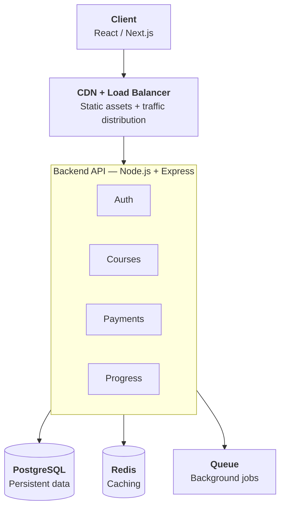
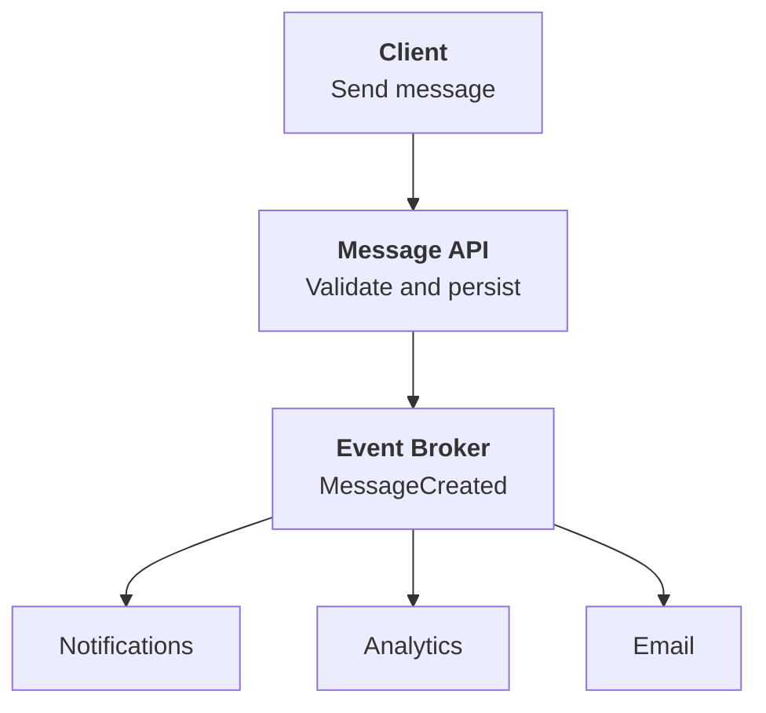
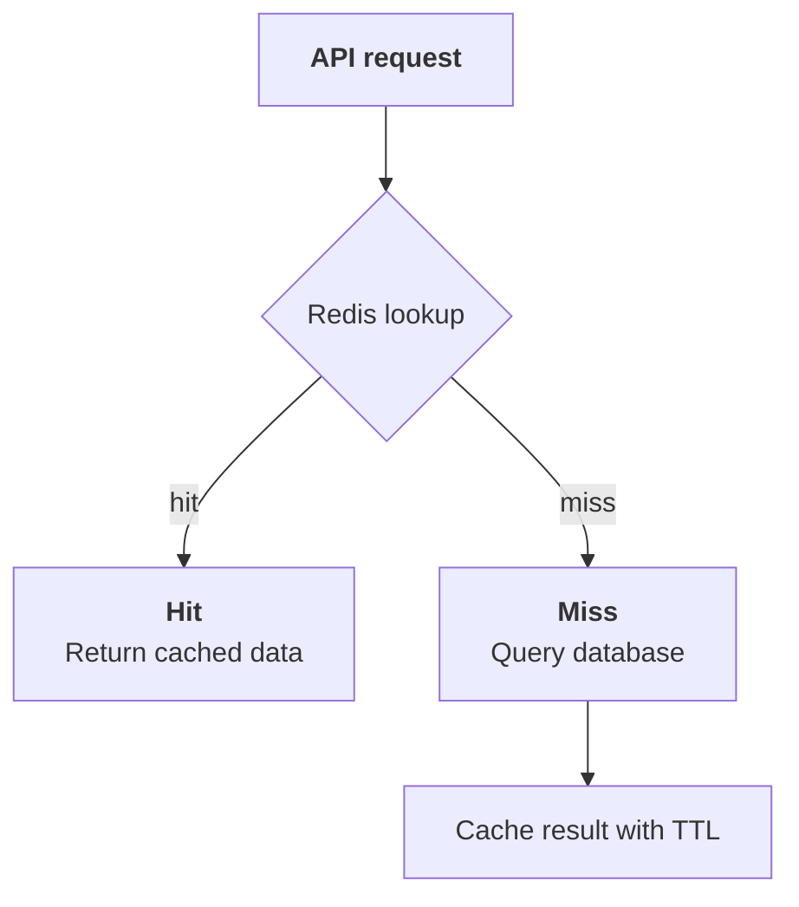
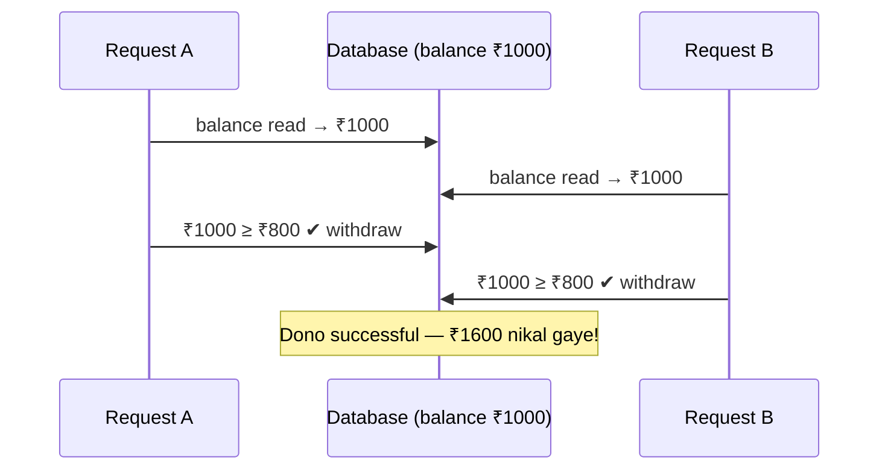
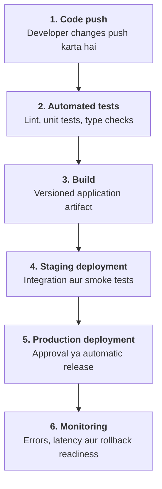
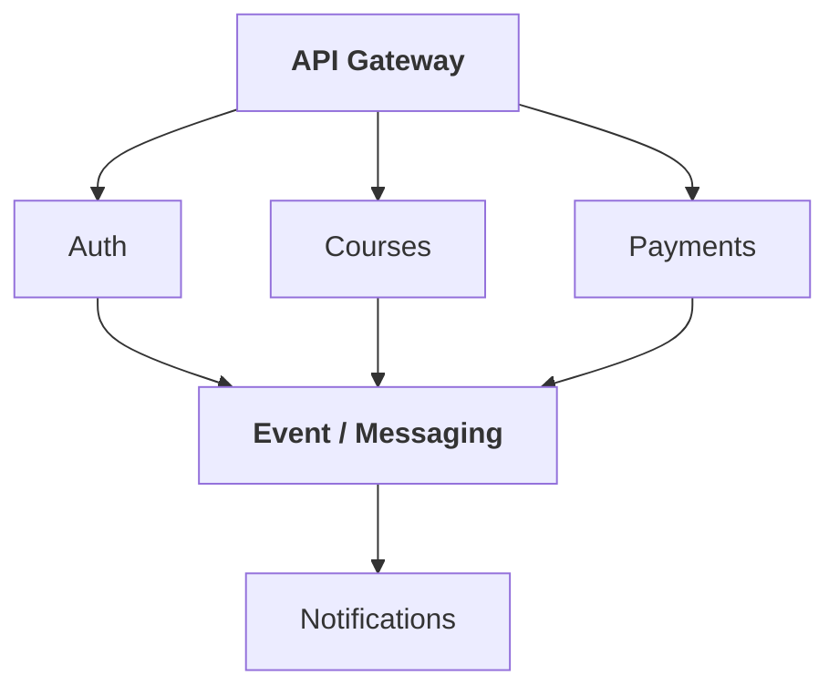
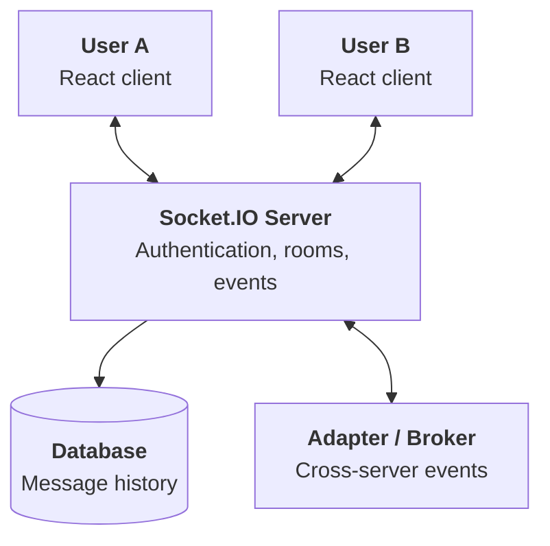
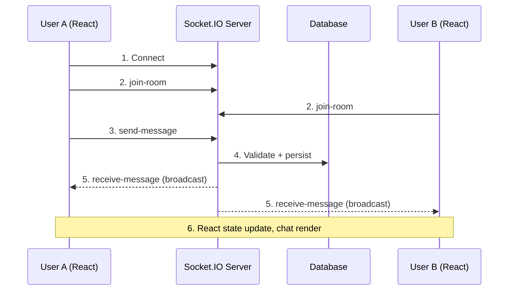

# Part 1: Architecture, React aur Backend

## 1. Explain how you designed the architecture for a large-scale web application

Maan lo hum ek online learning platform bana rahe hain jahan lakhs of users courses browse karte hain, videos dekhte hain aur payments karte hain.

Aisi application mein sirf frontend aur backend banana enough nahi hai. Hume traffic, caching, database, reliability aur scalability bhi plan karni hoti hai.

### High-level architecture



### Har component ka role

- **CDN:** Images, CSS aur JavaScript files ko users ke paas ke edge locations se serve karta hai.
- **Load balancer:** Requests ko multiple backend instances mein distribute karta hai.
- **Backend:** Authentication, authorization aur business logic handle karta hai.
- **PostgreSQL:** Users, orders, payments aur course data store karta hai.
- **Redis:** Frequently accessed data ko cache karta hai.
- **Message queue:** Emails, notifications aur background processing handle karti hai.

### Example: Course API

```js
app.get("/api/courses", async (req, res, next) => {
  try {
    const page = Math.max(1, Number(req.query.page) || 1);

    const courses = await courseService.getCourses({
      page,
      limit: 20
    });

    res.json({ data: courses });
  } catch (error) {
    next(error);
  }
});
```

Interview mein bolo: Main modular architecture se start karunga, database queries aur caching optimize karunga, aur traffic badhne par horizontal scaling introduce karunga. Microservices tab use karunga jab independent scaling, deployment ya team ownership ki actual requirement ho.

## 2. How would you optimize a React application that's rendering slowly?

Maan lo tumhare page par 2,000 course cards hain aur search karte waqt UI lag kar rahi hai.

Sabse pehle React DevTools Profiler aur browser Performance panel se identify karna hoga ki problem unnecessary re-renders, expensive calculations, network requests ya browser layout mein hai.

### A. Unnecessary re-renders reduce karo

```jsx
import { memo } from "react";

const CourseCard = memo(function CourseCard({ course }) {
  return <div>{course.title}</div>;
});
```

`React.memo` unchanged props ke case mein component ka render skip kar sakta hai.

### B. Expensive calculation cache karo

```jsx
const filteredCourses = useMemo(() => {
  return courses.filter(course =>
    course.title.toLowerCase().includes(query.toLowerCase())
  );
}, [courses, query]);
```

Ab filtering tabhi dobara calculate hogi jab `courses` ya `query` change ho.

### C. Large lists virtualize karo

Agar 10,000 items hain, to saare DOM elements render karne ke bajaye `react-window` jaise tool se visible items render karo.

### D. Code splitting karo

```jsx
import { lazy, Suspense } from "react";

const Reports = lazy(() => import("./Reports"));

function Dashboard() {
  return (
    <Suspense fallback={<p>Loading reports...</p>}>
      <Reports />
    </Suspense>
  );
}
```

Reports component ka code separate chunk mein load ho sakta hai.

Interview answer: Measure first, bottleneck identify karo, targeted optimization apply karo aur profiling repeat karo. Har component par `useMemo`, `useCallback` aur `memo` lagana automatically performance improve nahi karta.

## 3. How do you manage state efficiently across multiple React components? Redux vs Context API

Maan lo application mein cart, theme, logged-in user, course listing aur filters hain.

Har state ko Redux mein rakhna zaroori nahi hai.

| State type | Example | Suitable approach |
|---|---|---|
| Local UI state | Modal open/close | `useState` |
| Shared state | Theme | Context API |
| Complex client state | Shopping cart | Redux Toolkit |
| Server state | API se courses | TanStack Query |
| URL state | Search/filter/page | URL search params |

### Context API example

```jsx
const ThemeContext = createContext(null);

function ThemeProvider({ children }) {
  const [theme, setTheme] = useState("light");

  return (
    <ThemeContext.Provider value={{ theme, setTheme }}>
      {children}
    </ThemeContext.Provider>
  );
}
```

Context shared values ko component tree mein accessible banata hai.

### Redux Toolkit example

```js
import { configureStore, createSlice } from "@reduxjs/toolkit";

const cartSlice = createSlice({
  name: "cart",
  initialState: { items: [] },

  reducers: {
    addItem(state, action) {
      state.items.push(action.payload);
    }
  }
});

export const { addItem } = cartSlice.actions;

export const store = configureStore({
  reducer: {
    cart: cartSlice.reducer
  }
});
```

Redux Toolkit predictable updates, middleware aur debugging tools provide karta hai.

Interview answer: Simple shared state ke liye Context use karunga. Complex client state ke liye Redux Toolkit aur server data fetching, caching aur synchronization ke liye TanStack Query ya framework-provided data APIs consider karunga.

## 4. How would you design a RESTful API for a social media feed using Node.js and Express?

Maan lo application mein users posts create karte hain, doosre users ko follow karte hain aur personalized feed dekhte hain.

### API endpoints

| Method | Endpoint | Purpose |
|---|---|---|
| `POST` | `/api/posts` | Post create |
| `GET` | `/api/posts/:id` | Post fetch |
| `DELETE` | `/api/posts/:id` | Post delete |
| `POST` | `/api/users/:id/follow` | User follow |
| `GET` | `/api/feed?cursor=...` | Feed fetch |
| `POST` | `/api/posts/:id/likes` | Like post |

### Express example

```js
app.post("/api/posts", requireAuth, async (req, res, next) => {
  try {
    const { content } = req.body;

    if (typeof content !== "string" || !content.trim()) {
      return res.status(400).json({
        error: "Content is required"
      });
    }

    const post = await postService.create({
      userId: req.user.id,
      content: content.trim()
    });

    res.status(201).json({ data: post });
  } catch (error) {
    next(error);
  }
});
```

Yahan `requireAuth` authentication handle karta hai aur service layer business logic.

### Feed ko scalable kaise banayenge?

Do common strategies hain:

- **Fan-out on read:** Request ke waqt followed users ke posts fetch karna.
- **Fan-out on write:** Naya post create hote hi background workers followers ke feeds prepare karte hain.

| | Fan-out on read | Fan-out on write |
|---|---|---|
| Kaam kab hota hai | Feed padhte waqt | Post likhte waqt |
| Reads | Slow ho sakte hain | Fast |
| Writes aur storage | Kam | Zyada |

Fan-out on write reads fast kar sakta hai, lekin writes aur storage increase karta hai. Large social platforms hybrid approach bhi use kar sakte hain.

Interview answer: RESTful endpoints ke saath authentication, authorization, validation, pagination, indexing, rate limiting aur suitable feed-generation strategy implement karunga.

## 5. How does Docker help in deploying full-stack applications in a scalable way?

Docker application aur uski dependencies ko ek image mein package karta hai, jisse different environments mein application consistently run karna easier hota hai.

Maan lo tumhare paas React frontend, Node.js backend aur PostgreSQL database hai.

### Backend Dockerfile

```dockerfile
FROM node:22-alpine

WORKDIR /app

COPY package*.json ./
RUN npm ci

COPY . .

EXPOSE 3000

CMD ["npm", "start"]
```

### Docker Compose example

```yaml
services:
  api:
    build: ./backend
    ports:
      - "3000:3000"
    environment:
      DATABASE_URL: ${DATABASE_URL}

  db:
    image: postgres:16
    volumes:
      - postgres_data:/var/lib/postgresql/data

volumes:
  postgres_data:
```

Local development mein `.env` se `DATABASE_URL` provide kar sakte ho. Production credentials ko proper secrets manager se provide karna chahiye.

### Docker scaling mein kaise help karta hai?

- Same image ke multiple instances run kar sakte hain.
- Development aur production environments ke beech differences reduce hote hain.
- CI/CD mein reproducible deployment possible hota hai.
- Kubernetes jaise orchestration platforms containers ko schedule aur scale kar sakte hain.

Interview answer: Docker packaging aur environment consistency provide karta hai. Actual scalability ke liye load balancing, stateless backend design, database scaling aur container orchestration bhi chahiye.

## 6. Design an event-driven architecture for a notification system like Slack or Discord

Maan lo user channel mein message send karta hai. Uske baad notification bhejni hai, unread count update karna hai aur message history maintain karni hai.

Agar ye saare operations main API request ke andar synchronously karenge, to response slow ho sakta hai.

### Architecture



### Event ka example

```js
const event = {
  eventId: crypto.randomUUID(),
  type: "MessageCreated",
  messageId: "msg-123",
  channelId: "channel-456",
  senderId: "user-10",
  createdAt: new Date().toISOString()
};
```

Backend ye event message persist hone ke baad publish kar sakta hai.

### Production mein kya handle karna hoga?

- **Reliable publishing:** Database save hone ke baad event publish fail ho sakta hai. Transactional outbox pattern is gap ko address karta hai.
- **Duplicate events:** Consumers ko idempotent banana chahiye.
- **Retries:** Temporary failures par retry aur repeated failures par dead-letter queue.
- **Ordering:** Channel ke messages ko required order mein process karna.
- **Real-time delivery:** WebSocket gateway se online users ko notify karna.

Interview answer: Event-driven architecture services ko decouple karti hai. Lekin reliability, duplicate processing, ordering aur monitoring ko explicitly design karna hota hai.

## 7. How would you implement caching using Redis to reduce API response time?

Maan lo popular course listing API har request par database query karti hai. Same data baar-baar fetch hone par Redis caching database load reduce kar sakti hai.

Is pattern ko cache-aside kehte hain.

### Data flow



### Node.js code

```js
async function getCourses() {
  const key = "courses:popular";

  const cached = await redis.get(key);

  if (cached !== null) {
    return JSON.parse(cached);
  }

  const courses = await db.course.findMany({
    where: { published: true }
  });

  await redis.set(key, JSON.stringify(courses), {
    EX: 60
  });

  return courses;
}
```

Yahan cache ki expiry 60 seconds hai.

### Cache invalidation

Course update hone par purani cached value remove kar sakte hain:

```js
async function updateCourse(id, changes) {
  const course = await db.course.update({
    where: { id },
    data: changes
  });

  await redis.del("courses:popular");

  return course;
}
```

### Important interview concepts

- **Cache hit:** Data Redis mein mil gaya.
- **Cache miss:** Database se fetch karna padega.
- **TTL:** Cache entry kitni der valid rahegi.
- **Cache stampede:** Ek key expire hone par bahut saari requests database hit kar dein.
- **Hot key:** Ek Redis key par disproportionate traffic aaye.

Interview answer: Main cache-aside pattern se start karunga, TTL aur invalidation define karunga, cache hit rate monitor karunga aur Redis failure ke liye controlled fallback design karunga.

## 8. What's the difference between SSR and CSR, and when would you use each?

**CSR — Client-Side Rendering:** Browser JavaScript execute karke UI render karta hai.

**SSR — Server-Side Rendering:** Server request ke waqt HTML generate karke browser ko bhejta hai.

| Feature | CSR | SSR |
|---|---|---|
| Initial HTML | Often app shell | Server-generated content |
| Initial JavaScript | UI ke liye important | Hydration ke liye required ho sakta hai |
| Server rendering work | Usually nahi | Haan |
| SEO | Proper setup important | Content HTML mein available ho sakta hai |
| Common use | Interactive dashboards | Product pages, dynamic content |

### CSR example

```jsx
function Dashboard() {
  return <h1>My Dashboard</h1>;
}
```

Client-side React application mein browser component ko render karta hai.

### SSR example in Next.js

```jsx
export default async function ProductsPage() {
  const response = await fetch(
    "https://example.com/api/products",
    { cache: "no-store" }
  );

  if (!response.ok) {
    throw new Error("Failed to fetch products");
  }

  const products = await response.json();

  return (
    <main>
      <h1>Products</h1>

      {products.map(product => (
        <p key={product.id}>{product.name}</p>
      ))}
    </main>
  );
}
```

Next.js App Router mein ye server component request-time data fetch karta hai.

### Hydration kya hai?

SSR se HTML pehle browser mein aa sakta hai. React client-side JavaScript load karke existing HTML ke saath event handlers aur interactivity connect karta hai. Is process ko hydration kehte hain.

Interview answer: Public pages ke liye SSR ya static rendering consider karunga, highly interactive dashboards ke liye CSR, aur project ki requirements ke according hybrid rendering choose karunga.

## 9. (Original image mein missing)

> Original image mein numbering 8 se directly 10 par jaati hai, isliye question 9 available nahi hai.

## 10. Explain how React's reconciliation process and Virtual DOM improve performance

Maan lo tumhare component mein counter hai.

```jsx
import { useState } from "react";

function Counter() {
  const [count, setCount] = useState(0);

  return (
    <div>
      <h2>My Course</h2>
      <p>{count}</p>

      <button onClick={() => setCount(c => c + 1)}>
        Increment
      </button>
    </div>
  );
}
```

Button click par state update hoti hai. React next UI representation calculate karta hai aur existing UI ke comparison mein required changes determine karta hai.

Is process ko reconciliation kehte hain.

### Virtual DOM kya hai?

Virtual DOM React elements ki form mein UI ka lightweight representation hai. React state aur props ke basis par next representation calculate karta hai.

### Diffing kya hai?

React previous aur next tree ko compare karta hai aur identify karta hai ki kaun se parts ko update karna hai.

### Keys kyon important hain?

```jsx
{courses.map(course => (
  <CourseCard key={course.id} course={course} />
))}
```

Stable keys React ko list items ki identity track karne mein help karti hain. Unstable keys, jaise random values, unnecessary remounts cause kar sakti hain.

### Fiber kya hai?

React Fiber architecture rendering work ko organize aur schedule karta hai. Supported rendering modes mein React work ko prioritize kar sakta hai.

Interview answer: Virtual DOM UI ko declaratively represent karta hai, reconciliation changes identify karti hai aur Fiber rendering work ko organize karta hai. Isse har update par poora DOM recreate karna zaroori nahi hota, lekin actual performance component complexity aur browser work par depend karti hai.

# Part 2: Backend, Databases aur Deployment

## 11. How would you handle race conditions and concurrency issues in Node.js when multiple requests modify shared data?

Maan lo user ke account mein ₹1,000 hain. Do requests ek saath ₹800 withdraw karne ki koshish karti hain.

Agar dono requests balance read karne ke baad update karti hain, to dono withdrawal successful samajh sakti hain. Isse incorrect data ya overspending ho sakta hai.

Is problem ko race condition kehte hain.



### Solution 1: Atomic database update

PostgreSQL mein:

```sql
UPDATE accounts
SET balance = balance - 800
WHERE id = 123
  AND balance >= 800
RETURNING balance;
```

Is query mein balance check aur deduction ek atomic operation hai.

- Row return hui: withdrawal successful.
- Koi row return nahi hui: account missing hai ya balance insufficient hai.

### Solution 2: Database transaction

Jab multiple related records update karne hon, transaction use karo.

```js
await db.transaction(async tx => {
  const account = await tx.accounts.findUnique({
    where: { id: accountId }
  });

  if (!account || account.balance < amount) {
    throw new Error("Insufficient balance");
  }

  await tx.accounts.update({
    where: { id: accountId },
    data: { balance: { decrement: amount } }
  });

  await tx.transactions.create({
    data: {
      accountId,
      amount,
      type: "withdrawal"
    }
  });
});
```

Ye ORM-style illustration hai. Correctness ke liye transaction isolation, row locking ya conditional updates bhi required ho sakte hain, depending on database aur concurrent workload.

### Node.js mein race condition kyon hoti hai?

JavaScript ka event loop callbacks execute karta hai, lekin multiple requests concurrently progress kar sakti hain. Ek request ke `await` par pause hone ke dauran doosri request shared data modify kar sakti hai.

Interview answer: Main database-level atomic operations, transactions aur optimistic ya pessimistic locking use karunga. Multiple servers ke environment mein sirf in-memory locks par depend nahi karunga.

## 12. (Original image mein missing)

> Original image mein numbering 11 ke baad directly 13 hai, isliye question 12 available nahi hai.

## 13. Compare SQL and NoSQL databases — when to use each in a full-stack project

SQL databases relational data aur structured constraints ke liye useful hain. NoSQL databases mein document, key-value, graph jaise different data models aate hain.

| Feature | SQL | NoSQL |
|---|---|---|
| Data model | Tables and relations | Document, key-value, graph, etc. |
| Schema | Generally predefined | Model ke according flexible |
| Relationships | Joins and foreign keys | Embedding, references, ya model-specific |
| Transactions | Strong transactional support common | Capabilities database par depend karti hain |
| Examples | PostgreSQL, MySQL | MongoDB, DynamoDB |

### SQL example

```sql
CREATE TABLE courses (
  id BIGSERIAL PRIMARY KEY,
  title TEXT NOT NULL,
  price NUMERIC(10, 2) NOT NULL
);
```

### MongoDB example

```js
const course = {
  title: "React Fundamentals",
  price: 4999,
  tags: ["react", "frontend"],
  metadata: {
    level: "beginner",
    language: "Hindi"
  }
};

await db.collection("courses").insertOne(course);
```

### Learning platform mein kya choose karenge?

- **PostgreSQL:** Orders, payments aur enrollments.
- **Redis:** Caching, rate limiting aur temporary shared data.
- **MongoDB:** Flexible document data ke liye, agar access patterns uske saath fit hote hain.

Interview answer: Database choice data relationships, transaction requirements, queries, indexing aur scaling needs par depend karti hai. NoSQL automatically faster nahi hota aur SQL automatically unscalable nahi hota.

## 14. Explain how you'd integrate a CI/CD pipeline using GitHub Actions or Jenkins

CI/CD code ko automatically test, build aur deploy karne ki process hai.

- **CI:** Code changes par automated checks.
- **Continuous Delivery:** Deployment ke liye tested build ready.
- **Continuous Deployment:** Configured checks pass hone par automatic production release.

### GitHub Actions example

File: `.github/workflows/ci.yml`

```yaml
name: Frontend CI

on:
  pull_request:
  push:
    branches: [main]

jobs:
  test:
    runs-on: ubuntu-latest

    steps:
      - uses: actions/checkout@v4

      - uses: actions/setup-node@v4
        with:
          node-version: 22
          cache: npm

      - run: npm ci
      - run: npm run lint
      - run: npm test -- --run
      - run: npm run build
```

Ye example assume karta hai ki project mein `lint`, `test` aur `build` scripts available hain.

### Pipeline ka flow



### Security considerations

- Secrets ko repository mein hardcode nahi karna.
- Dependencies aur container images scan karna.
- Production deployment permissions restrict karna.
- Database migrations aur rollback strategy plan karna.

Interview answer: Main automated testing, reproducible builds, security checks, staging validation, controlled deployment aur post-deployment monitoring implement karunga.

## 15. How do you monitor and log performance issues in production using Prometheus or ELK Stack?

Production mein application slow ho, errors aa rahe hon ya database overloaded ho, to monitoring se root cause identify karna hota hai.

### Prometheus

Prometheus metrics collect karta hai, jaise:

- Request rate.
- Error rate.
- API response latency.
- CPU aur memory usage.
- Database connection pool saturation.

### ELK Stack

ELK ka matlab Elasticsearch, Logstash aur Kibana hai.

- **Elasticsearch** logs ko index aur search karta hai.
- **Logstash** logs ko ingest aur transform kar sakta hai.
- **Kibana** logs explore karne aur dashboards banane mein help karta hai.

| | Prometheus | ELK Stack |
|---|---|---|
| Kya store karta hai | Numeric metrics (time series) | Logs (text events) |
| Best for | Alerts, latency/error-rate dashboards | Specific error ya request ki detail dhoondhna |

### Node.js metrics example

```js
import express from "express";
import {
  Registry,
  Histogram
} from "prom-client";

const app = express();
const register = new Registry();

const requestDuration = new Histogram({
  name: "http_request_duration_seconds",
  help: "HTTP request duration in seconds",
  labelNames: ["method", "route", "status"],
  registers: [register]
});

app.use((req, res, next) => {
  const start = process.hrtime.bigint();

  res.on("finish", () => {
    const duration =
      Number(process.hrtime.bigint() - start) / 1e9;

    requestDuration.observe(
      {
        method: req.method,
        route: req.route?.path ?? "unmatched",
        status: String(res.statusCode)
      },
      duration
    );
  });

  next();
});

app.get("/metrics", async (req, res) => {
  res.set("Content-Type", register.contentType);
  res.end(await register.metrics());
});
```

Ye basic instrumentation hai; production mein low-cardinality labels, secure metrics access aur suitable error handling zaroori hain.

Interview answer: Prometheus metrics aur alerts ke liye, ELK centralized log analysis ke liye aur distributed tracing multiple services ke beech latency diagnose karne ke liye use karunga.

# Part 3: Architecture Decisions aur Real-Time Applications

## 16. What's the difference between monolithic and microservices architecture, and how do you decide between them?

### Monolithic architecture

Application ek deployable unit hoti hai. Code modules mein divided ho sakta hai, lekin deployment commonly ek application ke roop mein hota hai.

```text
learning-platform/
├── auth/
├── courses/
├── payments/
├── notifications/
└── server.js
```

Advantages:

- Initial development simple.
- Debugging aur local testing easier.
- Infrastructure overhead comparatively kam.
- Related database operations manage karna easier ho sakta hai.

Disadvantages:

- Poorly separated modules tightly coupled ho sakte hain.
- Independent deployment limited ho sakti hai.
- Large teams mein coordination difficult ho sakta hai.

### Microservices architecture

Application multiple independently deployable services mein divided hoti hai.



Services HTTP APIs ya events se communicate kar sakti hain.

Advantages:

- Independent deployment.
- Workload ke according independent scaling.
- Service ownership clear ho sakti hai.
- Failure isolation improve ki ja sakti hai.

Disadvantages:

- Network latency aur failures.
- Distributed tracing aur debugging complexity.
- Data consistency challenges.
- Deployment aur monitoring overhead.

| | Monolith | Microservices |
|---|---|---|
| Deployment | Ek unit | Har service alag |
| Scaling | Poori app ek saath | Har service apne workload ke hisaab se |
| Debugging | Easier | Distributed tracing chahiye |
| Infra overhead | Kam | Zyada |
| Best for | Chhoti team, naya product | Badi teams, alag-alag scaling needs |

### Kab kya choose karenge?

Agar chhoti team new product build kar rahi hai, to modular monolith sensible starting point hai.

Agar video processing ka workload baaki system se bahut different hai, to usko separate worker/service bana kar independently scale kar sakte hain.

Interview answer: Main microservices sirf application ke large hone ki wajah se choose nahi karunga. Independent scaling, deployment frequency, team ownership aur operational maturity evaluate karunga.

## 17. Can you design a real-time chat application using WebSockets or Socket.IO? Explain the data flow

Maan lo Slack ya Discord jaisa chat application banana hai, jahan ek user message send kare aur doosre users ko bina refresh kiye message mil jaye.

WebSocket persistent, bidirectional connection provide karta hai. Socket.IO event-based communication, reconnection aur additional features provide karta hai.

### Architecture



### Backend code — `server.js`

```js
import express from "express";
import { createServer } from "node:http";
import { Server } from "socket.io";
import cors from "cors";
import crypto from "node:crypto";

const app = express();
app.use(cors());

const httpServer = createServer(app);

const io = new Server(httpServer, {
  cors: {
    origin: "http://localhost:5173"
  }
});

io.on("connection", socket => {
  console.log("Connected:", socket.id);

  socket.on("join-room", roomId => {
    socket.join(roomId);
  });

  socket.on("send-message", data => {
    if (
      typeof data.text !== "string" ||
      !data.text.trim() ||
      data.text.length > 2000
    ) {
      return;
    }

    const message = {
      id: crypto.randomUUID(),
      sender: data.sender,
      text: data.text.trim(),
      time: new Date().toISOString()
    };

    io.to(data.roomId).emit("receive-message", message);
  });

  socket.on("disconnect", () => {
    console.log("Disconnected:", socket.id);
  });
});

httpServer.listen(3000, () => {
  console.log("Chat server running on port 3000");
});
```

Install dependencies:

```bash
npm install express socket.io cors
```

Ye learning example hai. Production mein `sender` aur `roomId` par client ke claims trust nahi karne chahiye. Authenticated identity server se leni chahiye aur room membership verify karni chahiye.

### Frontend code — `Chat.jsx`

```jsx
import { useEffect, useState } from "react";
import { io } from "socket.io-client";

const socket = io("http://localhost:3000");

export default function Chat() {
  const [message, setMessage] = useState("");
  const [messages, setMessages] = useState([]);

  const roomId = "course-discussion";
  const sender = "User A";

  useEffect(() => {
    socket.emit("join-room", roomId);

    function handleMessage(data) {
      setMessages(previous => [...previous, data]);
    }

    socket.on("receive-message", handleMessage);

    return () => {
      socket.off("receive-message", handleMessage);
    };
  }, []);

  function sendMessage(event) {
    event.preventDefault();

    if (!message.trim()) return;

    socket.emit("send-message", {
      roomId,
      sender,
      text: message
    });

    setMessage("");
  }

  return (
    <div>
      <h2>Real-time Chat</h2>

      {messages.map(item => (
        <p key={item.id}>
          <b>{item.sender}:</b> {item.text}
        </p>
      ))}

      <form onSubmit={sendMessage}>
        <input
          value={message}
          onChange={event => setMessage(event.target.value)}
          placeholder="Type a message..."
        />
        <button type="submit">Send</button>
      </form>
    </div>
  );
}
```

Frontend mein install karo:

```bash
npm install socket.io-client
```

### Message ka data flow



1. **Connection:** Client Socket.IO server se connect karta hai.
2. **Join room:** Server user ko authorized chat room mein add karta hai.
3. **Send event:** Client `send-message` event emit karta hai.
4. **Process message:** Server validate karke message persist karta hai.
5. **Broadcast:** Server `receive-message` event room ke users ko bhejta hai.
6. **Update UI:** React state update hoti hai aur chat render hoti hai.

### Production mein aur kya chahiye?

- Authentication aur room authorization.
- Database mein persistent message history.
- Duplicate message prevention aur acknowledgements.
- Offline users ke liye reconnect synchronization.
- Multiple Socket.IO servers ke beech event distribution.
- Rate limiting, payload validation aur monitoring.

Interview answer: Socket.IO real-time event delivery ko simplify karta hai, lekin durable chat system banane ke liye database persistence, authorization, reconnect handling aur horizontal scaling bhi design karna hota hai.
