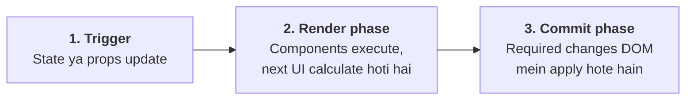
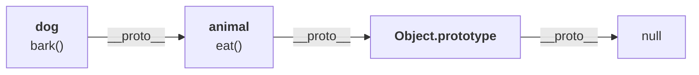
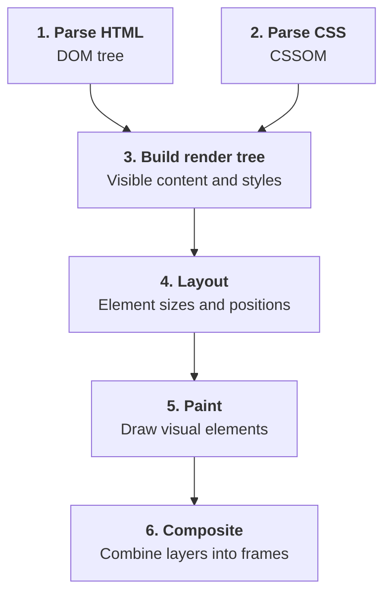
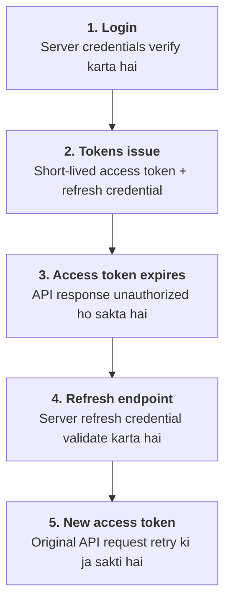
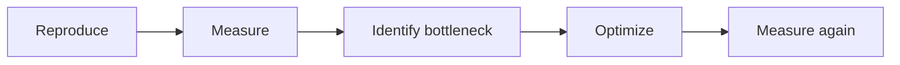
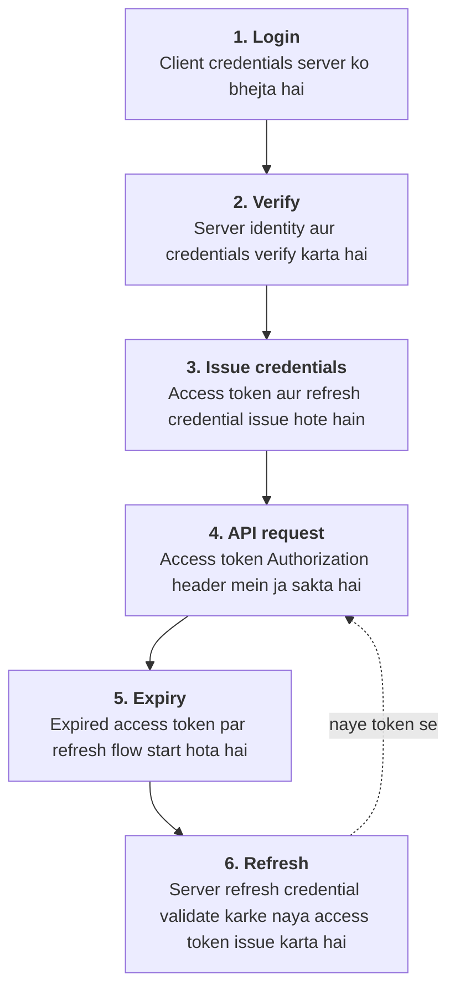
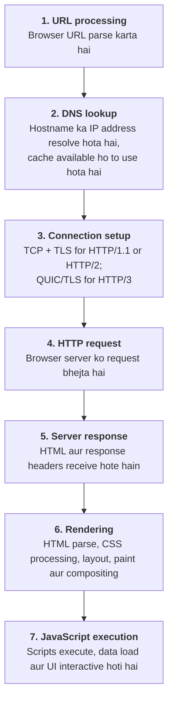

# Complete Frontend Interview Preparation Guide

## 1. What is hoisting in JavaScript?

Hoisting JavaScript ke execution context ka behavior hai, jisme declarations execution se pehle process hoti hain.

```js
console.log(a); // undefined
var a = 10;

sayHello(); // Hello

function sayHello() {
  console.log("Hello");
}
```

`var` declaration ki initial value `undefined` hoti hai, jabki function declaration ko uski definition se pehle call kar sakte hain.

`let` aur `const` bhi scope mein register hote hain, lekin initialization se pehle access karne par error aata hai.

```js
console.log(x); // ReferenceError
let x = 20;
```

Is period ko Temporal Dead Zone (TDZ) kehte hain.

Interview point: Hoisting ka matlab actual code ko physically upar move karna nahi hai. Ye JavaScript ke declaration processing aur execution behavior ko describe karne ka ek conceptual model hai.

## 2. What are closures?

Closure tab hota hai jab function apne surrounding lexical scope ke variables ko access kar sakta hai, even after outer function finish ho chuka ho.

```js
function createCounter() {
  let count = 0;

  return function () {
    count++;
    return count;
  };
}

const counter = createCounter();

console.log(counter()); // 1
console.log(counter()); // 2
console.log(counter()); // 3
```

Yahan `createCounter()` finish ho gaya, lekin returned function `count` ko access kar raha hai.

Real-world uses:

- Debounce aur throttle.
- Event handlers.
- Private variables.
- React mein event handlers aur stale closures ko samajhna.

Closure variable ki independent copy nahi banata; woh apne lexical environment ke variables ko access karta hai.

## 3. Explain React Fiber

React Fiber React ke reconciliation system ka internal architecture hai. Iska purpose UI updates ko manageable work units mein organize karna hai.

Maan lo ek page par 1,000 components hain aur user input type kar raha hai. React ko updates calculate karni hain, lekin user interactions responsive rehni chahiye.

Fiber architecture React ko rendering work ko prioritize karne, interruptible work ko pause karne aur zaroorat padne par higher-priority work ko pehle process karne ki capability deta hai.



Example:

```jsx
import { useState, useTransition } from "react";

function Search() {
  const [query, setQuery] = useState("");
  const [filter, setFilter] = useState("");
  const [isPending, startTransition] = useTransition();

  function handleChange(e) {
    const value = e.target.value;

    setQuery(value); // urgent update

    startTransition(() => {
      setFilter(value); // non-urgent update
    });
  }

  return (
    <>
      <input value={query} onChange={handleChange} />
      {isPending && <p>Updating results...</p>}
      <ExpensiveList filter={filter} />
    </>
  );
}
```

Yahan React non-urgent rendering work ko lower priority par schedule kar sakta hai. Fiber iska internal foundation hai; `useTransition` us capability ko use karne ka public API hai.

Interview point: Fiber aur reconciliation related hain, lekin same term nahi hain. Fiber architecture hai; reconciliation next UI tree aur existing tree ke differences determine karne ki process hai.

## 4. What is code splitting?

Code splitting ka matlab application ke JavaScript bundle ko chhote chunks mein divide karna, taaki user ko starting mein poora application code download na karna pade.

Example: tumhari learning application mein dashboard, video player aur admin panel hain. Student ko admin panel ka JavaScript initial page load par zaroori nahi hai.

```jsx
import { lazy, Suspense } from "react";

const VideoPlayer = lazy(
  () => import("./VideoPlayer")
);

function CoursePage() {
  return (
    <Suspense fallback={<p>Loading player...</p>}>
      <VideoPlayer />
    </Suspense>
  );
}
```

Bundler `VideoPlayer` ko separate chunk mein rakh sakta hai, jo zaroorat padne par load hota hai.

Benefits:

- Initial JavaScript kam ho sakta hai.
- Initial page load improve ho sakta hai.
- Unused routes ka code initially download karne ki zaroorat nahi hoti.

## 5. Explain lazy loading

Lazy loading mein resource ko tab load kiya jata hai jab uski zaroorat ho.

React component:

```jsx
import { lazy, Suspense } from "react";

const AdminPanel = lazy(
  () => import("./AdminPanel")
);

function App() {
  return (
    <Suspense fallback={<p>Loading...</p>}>
      <AdminPanel />
    </Suspense>
  );
}
```

Image lazy loading:

```html

```

Difference: Code splitting code ko chunks mein divide karta hai; lazy loading un chunks ya resources ko demand par load karne ki strategy hai. Dono aksar saath use hote hain.

Har resource ko lazy load nahi karna chahiye. Above-the-fold ya LCP image ko lazy load karne se page performance kharab bhi ho sakti hai.

## 6. What is tree shaking?

Tree shaking bundler ka optimization hai jo statically analyzable modules mein unused exports ko production bundle se remove kar sakta hai.

```js
// utils.js
export function add(a, b) {
  return a + b;
}

export function multiply(a, b) {
  return a * b;
}
```

```js
// app.js
import { add } from "./utils.js";

console.log(add(2, 3));
```

Agar bundler module ko analyze kar sakta hai aur `multiply` kahin use nahi hota, to production build mein uska code remove ho sakta hai.

Tree shaking ke liye ES modules aur suitable bundler configuration helpful hain. Side effects, dynamic patterns aur library configuration removal ko limit kar sakte hain.

## 7. Explain CORS in simple terms

CORS ka full form hai Cross-Origin Resource Sharing.

Browser ka same-origin policy restrict karta hai ki ek origin ka JavaScript doosre origin ke resources ko kaise access kar sakta hai.

Origin teen cheezon se milkar banta hai:

- Protocol
- Hostname
- Port

Example:

```text
Frontend: http://localhost:3000
Backend:  http://localhost:5000
```

Dono origins alag hain, kyunki ports different hain.

Backend ko appropriate response headers bhejne honge:

```js
import express from "express";
import cors from "cors";

const app = express();

app.use(cors({
  origin: "http://localhost:3000",
  methods: ["GET", "POST"],
  credentials: true
}));
```

Agar credentials use ho rahe hain, to server ko explicit allowed origin return karna hota hai; wildcard `*` credentials ke saath valid nahi hai.

Important: CORS browser-enforced security mechanism hai, authentication ka replacement nahi. Sirf frontend mein CORS disable ya `mode: "no-cors"` set karke normal API response access nahi kar sakte.

## 8. What causes UI jank?

UI jank tab hota hai jab interface expected smoothness maintain nahi kar pata — scrolling lag karti hai, animations rukti hain ya typing delay hoti hai.

60 Hz display par ek frame ke liye lagbhag 16.7 ms available hote hain. Agar main thread bahut busy hai, browser time par frame render nahi kar pata.

Common causes:

- Long-running JavaScript.
- Bahut saare DOM elements.
- Repeated layout calculations.
- Expensive React renders.
- Large synchronous JSON processing.
- Heavy images ya poorly optimized animations.

Problematic example:

```js
// Main thread ko kaafi der busy kar sakta hai
const start = performance.now();

while (performance.now() - start < 300) {
  // Blocking work
}
```

Is duration mein main thread ke doosre tasks delay ho sakte hain.

Improvements:

- Large work ko smaller tasks mein divide karo.
- Long lists virtualize karo.
- Expensive calculations optimize karo.
- Animations mein suitable cases par `transform` aur `opacity` use karo.
- Chrome DevTools Performance panel se bottleneck identify karo.

## 9. What are stale closures in React?

Stale closure tab hota hai jab function kisi purane render ki state ya props ko read karta hai.

```jsx
import { useState } from "react";

function Counter() {
  const [count, setCount] = useState(0);

  function handleClick() {
    setTimeout(() => {
      console.log(count);
    }, 2000);
  }

  return (
    <>
      <p>{count}</p>
      <button onClick={handleClick}>Log count</button>
      <button onClick={() => setCount(c => c + 1)}>
        Increment
      </button>
    </>
  );
}
```

Agar timer start karte waqt `count` zero tha, to baad mein count increment hone ke bawajood timer zero log kar sakta hai.

Agar latest state par update perform karna hai:

```jsx
setCount(previous => previous + 1);
```

Agar timer ko hamesha latest state read karni hai, to `useRef` ya appropriate effect pattern use kiya ja sakta hai.

Interview point: Har purani value bug nahi hai. React ke har render ke event handlers us render ki state snapshot se associated hote hain. Problem tab hai jab logic ko latest value chahiye, lekin woh old snapshot use kar raha ho.

## 10. Explain optimistic UI updates

Optimistic UI mein application server response aane se pehle UI ko successful update assume karke update kar deti hai.

Example: user kisi comment ko like karta hai. UI immediately liked state dikhati hai; API fail hone par previous state restore kar sakte hain.

```jsx
import { useState } from "react";

function LikeButton() {
  const [liked, setLiked] = useState(false);
  const [loading, setLoading] = useState(false);

  async function handleLike() {
    const previous = liked;

    setLiked(!previous);
    setLoading(true);

    try {
      const response = await fetch("/api/like", {
        method: "POST",
        headers: {
          "Content-Type": "application/json"
        },
        body: JSON.stringify({ liked: !previous })
      });

      if (!response.ok) {
        throw new Error("Request failed");
      }
    } catch {
      setLiked(previous);
    } finally {
      setLoading(false);
    }
  }

  return (
    <button disabled={loading} onClick={handleLike}>
      {liked ? "Liked" : "Like"}
    </button>
  );
}
```

Ye simplified example hai. Multiple rapid requests ke liye request ordering, rollback correctness aur server response reconciliation bhi handle karni hoti hai.

Use cases: Likes, bookmarks, comments, cart quantity updates.

## 11. Difference between CSR and SSR

**CSR — Client-Side Rendering:** Browser JavaScript download aur execute karke UI render karta hai.

**SSR — Server-Side Rendering:** Server request ke waqt HTML generate karke browser ko bhejta hai.

| Feature | CSR | SSR |
|---|---|---|
| Initial HTML | Often limited app shell | Server-rendered content ho sakta hai |
| Initial JavaScript | Important dependency | Interactivity ke liye phir bhi required ho sakta hai |
| SEO | Correct setup zaroori | Content discoverability mein help kar sakta hai |
| Server workload | Relatively less rendering work | Request-time rendering cost |
| Personalization | Client par easy | Server request data se bhi possible |

CSR example:

```jsx
import { createRoot } from "react-dom/client";

createRoot(document.getElementById("root"))
  .render(<App />);
```

SSR ka Next.js example:

```jsx
// app/courses/page.jsx
export default async function CoursesPage() {
  const response = await fetch(
    "https://example.com/api/courses",
    { cache: "no-store" }
  );

  const courses = await response.json();

  return (
    <main>
      <h1>Courses</h1>
      {courses.map(course => (
        <p key={course.id}>{course.title}</p>
      ))}
    </main>
  );
}
```

Next.js App Router mein is tarah ka server-side data fetching request ke waqt render ho sakta hai, depending on route configuration and caching.

Important: SSR aur hydration same cheez nahi hain. SSR HTML generate karta hai; hydration client JavaScript ko server-rendered HTML ke saath attach karke interactive banati hai.

## 12. Explain prototype inheritance

JavaScript mein ek object doosre object ki properties aur methods ko apne prototype ke through access kar sakta hai.

```js
const animal = {
  eat() {
    console.log("Eating");
  }
};

const dog = {
  bark() {
    console.log("Barking");
  }
};

Object.setPrototypeOf(dog, animal);

dog.bark(); // Barking
dog.eat();  // Eating
```

Jab `dog.eat()` call hota hai, JavaScript pehle `dog` par `eat` search karta hai. Property nahi milne par prototype chain mein search karta hai.



Constructor function ka example:

```js
function Person(name) {
  this.name = name;
}

Person.prototype.sayHello = function () {
  console.log(`Hello ${this.name}`);
};

const p1 = new Person("Aman");
const p2 = new Person("Rahul");

p1.sayHello();
p2.sayHello();
```

Dono instances same prototype method share karte hain.

Use cases: Shared methods, inheritance, JavaScript classes aur built-in objects ke behavior ko samajhna.

## 13. Difference between shallow copy and deep copy

Shallow copy top-level properties copy karti hai, lekin nested objects ke references share ho sakte hain.

```js
const original = {
  name: "Aman",
  address: { city: "Delhi" }
};

const copy = { ...original };

copy.name = "Rahul";
copy.address.city = "Mumbai";

console.log(original.name);         // Aman
console.log(original.address.city); // Mumbai
```

Deep copy mein supported nested objects bhi independently copy hote hain.

```js
const original = {
  name: "Aman",
  address: { city: "Delhi" }
};

const copy = structuredClone(original);

copy.address.city = "Mumbai";

console.log(original.address.city); // Delhi
```

React mein nested state update karte waqt:

```jsx
setUser(previous => ({
  ...previous,
  address: {
    ...previous.address,
    city: "Mumbai"
  }
}));
```

Interview point: Spread operator deep copy nahi karta. `structuredClone()` circular references aur kai built-in data types ko support karta hai, lekin functions aur kuch special values clone nahi ki ja sakti.

## 14. What causes memory leaks in React apps?

Memory leak tab hota hai jab aise resources ya references unnecessarily alive rehte hain jo ab use nahi hone chahiye.

Common causes:

- Unremoved event listeners.
- Uncancelled timers.
- Subscriptions ko unsubscribe na karna.
- Long-lived references mein unnecessary data retain karna.
- Components unmount hone ke baad bhi unnecessary asynchronous work.

Problematic example:

```jsx
useEffect(() => {
  window.addEventListener("resize", handleResize);

  // Cleanup missing!
}, []);
```

Correct approach:

```jsx
useEffect(() => {
  function handleResize() {
    console.log(window.innerWidth);
  }

  window.addEventListener("resize", handleResize);

  return () => {
    window.removeEventListener("resize", handleResize);
  };
}, []);
```

Timer cleanup:

```jsx
useEffect(() => {
  const timer = setInterval(() => {
    console.log("Polling");
  }, 5000);

  return () => clearInterval(timer);
}, []);
```

Interview point: Har unmounted component ya completed promise automatically memory leak nahi banata. Actual leak tab hota hai jab resources ya objects unwanted lifetime tak retained rehte hain.

## 15. Explain repaint vs reflow vs compositing

Browser webpage ko screen par dikhane ke liye layout calculate karta hai, pixels paint karta hai aur layers composite karta hai.

| Step | Kya hota hai | Example |
|---|---|---|
| **Reflow / Layout** | Browser elements ki positions aur dimensions recalculate karta hai | width, height, font size change |
| **Repaint** | Element ke visual pixels dobara draw hote hain | background color change |
| **Compositing** | Browser rendered layers ko combine karke final frame banata hai | suitable transform animation |

Example:

```css
/* Layout change ho sakta hai */
.box {
  width: 200px;
}

/* Repaint ho sakta hai */
.box {
  background: blue;
}

/* Suitable circumstances mein compositor handle kar sakta hai */
.box {
  transform: translateX(20px);
}
```

`transform` aur `opacity` animations often efficient hoti hain, lekin har transform automatically separate GPU layer nahi banata.

Interview point: Layout thrashing se bacho. DOM measurements aur style changes ko repeatedly interleave karna expensive ho sakta hai.

## 16. How does React batching improve rendering?

Batching mein React multiple state updates ko group karke fewer renders/commits kar sakta hai.

```jsx
function Counter() {
  const [count, setCount] = useState(0);
  const [name, setName] = useState("Aman");

  function handleClick() {
    setCount(c => c + 1);
    setName("Rahul");
  }

  return (
    <button onClick={handleClick}>
      {name}: {count}
    </button>
  );
}
```

React modern versions mein automatic batching common cases mein event handlers, promises aur timers se hui updates ko bhi batch kar sakti hai.

Bina batching ke do independent updates se multiple render cycles ho sakte hain; batching unnecessary rendering work reduce kar sakti hai.

Functional updates:

```jsx
setCount(c => c + 1);
setCount(c => c + 1);
setCount(c => c + 1);
```

Yeh count ko 3 se increment karega, kyunki har updater ko previous queued result milta hai.

Interview point: Batching ka matlab har state update merge hokar ek variable ban jana nahi hai. State updates alag rehti hain; React unke rendering work ko coordinate karta hai.

## 17. Explain debounce and throttle with examples

Debounce function ko tab run karta hai jab events aana ruk jaayein. Throttle repeated execution ko time interval ke hisaab se limit karta hai.

Debounce:

```js
function debounce(fn, delay) {
  let timer;

  return (...args) => {
    clearTimeout(timer);

    timer = setTimeout(() => {
      fn(...args);
    }, delay);
  };
}

const search = debounce(query => {
  console.log("Searching:", query);
}, 500);
```

Throttle:

```js
function throttle(fn, delay) {
  let lastRun = 0;

  return (...args) => {
    const now = Date.now();

    if (now - lastRun >= delay) {
      lastRun = now;
      fn(...args);
    }
  };
}

const trackScroll = throttle(() => {
  console.log("Scroll position:", window.scrollY);
}, 200);
```

| Debounce | Throttle |
|---|---|
| Events rukne ke baad run | Fixed interval mein limited runs |
| Search box, autosave | Scroll tracking, periodic event handling |
| Continuous input par execution delay hota rehta hai | Continuous input par bhi regular updates possible |

Yeh implementations basic versions hain. Production use mein trailing execution, cancellation, component cleanup aur `this` handling requirements ke hisaab se add ki ja sakti hain.

## 18. How does browser rendering work internally?

Browser HTML, CSS aur JavaScript process karke pixels screen par dikhata hai.



Example:

```html
<h1>Hello World</h1>
```

Browser HTML parse karke DOM node banata hai. CSS styles determine karti hain ki heading kaise dikhegi. Layout engine geometry calculate karta hai, painting visual content draw karti hai aur compositor final frame assemble karta hai.

Real browsers optimizations karte hain; ye stages hamesha ek strict, complete pipeline ke roop mein repeat nahi hoti.

Interview point: Long JavaScript tasks main thread ko busy rakh sakte hain, jis se rendering aur user input delay ho sakta hai.

## 19. How do you optimize bundle size in React?

Bundle size kam karne se download, parse aur execute karne ka cost reduce ho sakta hai.

Practical techniques:

1. Route-level code splitting.
2. Lazy loading.
3. Tree shaking.
4. Unnecessary dependencies remove karna.
5. Heavy libraries ke lighter alternatives consider karna.
6. Production build aur bundle analyzer use karna.
7. Large images aur fonts ko JavaScript bundle se separate optimize karna.

Example:

```jsx
import { lazy, Suspense } from "react";

const Reports = lazy(() => import("./Reports"));

function Dashboard() {
  return (
    <Suspense fallback={<p>Loading reports...</p>}>
      <Reports />
    </Suspense>
  );
}
```

Agar reports module initial page ke liye required nahi hai, to uska code baad mein load ho sakta hai.

Bundle analyze karne ke liye apne bundler ka analyzer use karo. Next.js, Vite aur Webpack ke tooling options alag ho sakte hain.

Interview point: Bundle size optimize karne se pehle measure karo. Total bundle size ke saath initial route ka JavaScript, compressed size aur execution time bhi important hain.

## 20. How do you avoid unnecessary re-renders?

React component state, props ya context change hone par render ho sakta hai. Har render expensive nahi hota, lekin unnecessary renders performance impact kar sakte hain.

### `React.memo`

```jsx
import React from "react";

const UserCard = React.memo(function UserCard({ user }) {
  console.log("UserCard rendered");

  return <p>{user.name}</p>;
});
```

Agar props shallowly equal hain, to React component ka re-render skip kar sakta hai.

### `useMemo`

```jsx
const filteredCourses = useMemo(() => {
  return courses.filter(course =>
    course.title.includes(query)
  );
}, [courses, query]);
```

Expensive calculation ko dependencies unchanged hone par reuse kar sakte ho.

### `useCallback`

```jsx
const handleSelect = useCallback((id) => {
  setSelectedId(id);
}, []);
```

Function reference ko renders ke beech stable rakh sakta hai.

Lekin in hooks ka excessive use khud complexity aur overhead badha sakta hai. Pehle React Profiler se identify karo ki kaunsa render actual performance issue hai.

## 21. Controlled vs uncontrolled components

React form inputs do common patterns follow karte hain.

**Controlled input:** React state input ki value control karti hai.

```jsx
function LoginForm() {
  const [email, setEmail] = useState("");

  return (
    <input
      value={email}
      onChange={e => setEmail(e.target.value)}
    />
  );
}
```

Har change par state update hoti hai aur React value render karta hai.

**Uncontrolled input:** Input ki current value DOM mein maintain hoti hai.

```jsx
function LoginForm() {
  const emailRef = useRef(null);

  function handleSubmit(e) {
    e.preventDefault();
    console.log(emailRef.current.value);
  }

  return (
    <form onSubmit={handleSubmit}>
      <input ref={emailRef} defaultValue="" />
      <button type="submit">Submit</button>
    </form>
  );
}
```

| Controlled | Uncontrolled |
|---|---|
| Value React state se aati hai | Value DOM maintain karta hai |
| Live validation aur conditional UI easy | Simple forms mein convenient |
| State update har change par ho sakta hai | Value ref se read kar sakte hain |

Controlled inputs tab useful hain jab UI ko har keystroke ke saath synchronize karna ho.

## 22. Difference between localStorage and sessionStorage

Dono Web Storage API ka part hain aur strings store karte hain.

| Feature | `localStorage` | `sessionStorage` |
|---|---|---|
| Lifetime | Usually browser data clear hone tak | Current page session tak |
| Scope | Same origin | Same origin aur tab's page session |
| Page reload | Data rehta hai | Data rehta hai |
| Tab close | Usually data rehta hai | Session storage generally clear hota hai |
| Data format | Strings | Strings |

Example:

```js
localStorage.setItem("theme", "dark");
console.log(localStorage.getItem("theme"));

sessionStorage.setItem("step", "2");
console.log(sessionStorage.getItem("step"));
```

Objects store karne ke liye:

```js
localStorage.setItem(
  "preferences",
  JSON.stringify({ theme: "dark" })
);

const preferences = JSON.parse(
  localStorage.getItem("preferences") || "{}"
);
```

Security point: Sensitive authentication tokens ko Web Storage mein rakhne se XSS ke case mein JavaScript unhe read kar sakta hai. Storage choice security model ko dhyan mein rakhkar karo.

## 23. Explain authentication vs authorization

**Authentication:** User kaun hai, ye verify karna.

**Authorization:** Verified user ko kya karne ki permission hai, ye decide karna.

Example:

```js
// Authentication: user ki identity verify karne ke baad
const user = {
  id: 10,
  role: "student"
};

// Authorization: action ki permission check
function canAccessAdmin(user) {
  return user.role === "admin";
}

console.log(canAccessAdmin(user)); // false
```

Real application mein authorization backend par bhi enforce honi chahiye.

Frontend par admin button hide karna sirf UI behavior hai; security boundary nahi.

Interview example: Login successful hone ka matlab user authenticated hai. Lekin woh admin dashboard access kar sakta hai ya nahi, ye authorization decide karti hai.

## 24. How do refresh tokens work internally?

Access token short-lived credential hota hai jo protected APIs access karne ke liye use hota hai. Refresh token ka purpose naya access token obtain karna hai.

Typical flow:



Refresh token ko protect karna important hai. Production systems mein expiry, rotation, revocation aur reuse detection jaise controls use ho sakte hain.

## 25. How do you securely store tokens in frontend apps?

Koi bhi browser storage option completely safe nahi hai agar malicious JavaScript page par execute ho raha ho.

### Option A: HttpOnly cookie

Backend cookie set kar sakta hai:

```http
Set-Cookie: refreshToken=...; HttpOnly; Secure; SameSite=Lax; Path=/api/auth
```

- `HttpOnly`: JavaScript cookie ko directly read nahi kar sakta.
- `Secure`: HTTPS par hi send hoti hai.
- `SameSite`: Cross-site cookie behavior ko restrict karne mein help karta hai.

Cookie-based authentication mein CSRF risk aur cookie configuration ko properly handle karna zaroori hai.

### Option B: In-memory access token

```js
let accessToken = null;

export function setAccessToken(token) {
  accessToken = token;
}

export function getAccessToken() {
  return accessToken;
}
```

In-memory token reload par generally lose ho jaata hai, aur XSS se fully protected nahi hota.

Practical recommendation: Browser application mein refresh credentials ke liye carefully configured HttpOnly cookies common approach hain. Access token storage aur renewal design tumhare threat model aur backend architecture par depend karega.

## 26. Explain race conditions in frontend applications

Race condition tab hoti hai jab asynchronous operations ka completion order result ko affect karta hai.

Example: user pehle `"React"` search karta hai, phir `"Next.js"`. Agar pehli request late complete hui, to purane React results latest results ko overwrite kar sakte hain.

```jsx
useEffect(() => {
  async function loadResults() {
    const response = await fetch(
      `/api/search?q=${encodeURIComponent(query)}`
    );

    const data = await response.json();
    setResults(data);
  }

  loadResults();
}, [query]);
```

Is code mein old response latest state ko overwrite kar sakta hai.

Solution: previous request cancel karo.

```jsx
useEffect(() => {
  const controller = new AbortController();

  async function loadResults() {
    try {
      const response = await fetch(
        `/api/search?q=${encodeURIComponent(query)}`,
        { signal: controller.signal }
      );

      const data = await response.json();
      setResults(data);
    } catch (error) {
      if (error.name !== "AbortError") {
        console.error(error);
      }
    }
  }

  loadResults();

  return () => controller.abort();
}, [query]);
```

Har API client cancellation support nahi karta, isliye kabhi-kabhi request IDs ya stale-response guards use karne padte hain.

## 27. How do you cancel ongoing API requests in React?

`AbortController` fetch requests cancel karne ka standard browser mechanism hai.

```jsx
function Courses() {
  const [courses, setCourses] = useState([]);

  useEffect(() => {
    const controller = new AbortController();

    async function fetchCourses() {
      try {
        const response = await fetch("/api/courses", {
          signal: controller.signal
        });

        if (!response.ok) {
          throw new Error("Failed to fetch courses");
        }

        setCourses(await response.json());
      } catch (error) {
        if (error.name !== "AbortError") {
          console.error(error);
        }
      }
    }

    fetchCourses();

    return () => controller.abort();
  }, []);

  return <CourseList courses={courses} />;
}
```

Jab effect cleanup hota hai, request abort ki ja sakti hai.

Use cases: Component unmount, search query change, route change aur obsolete requests.

Important: Request cancel karne ka matlab ye guarantee nahi ki server ne already-started operation undo kar diya. Server-side mutations ke liye idempotency aur backend safeguards alag se important hain.

## 28. What is hydration mismatch and why does it happen?

Hydration mein React server-rendered HTML ko client-side React tree ke saath synchronize karke interactive banata hai.

Hydration mismatch tab hota hai jab server ka generated HTML aur initial client render ka output match nahi karta.

Problematic Next.js example:

```jsx
"use client";

export default function Clock() {
  return <p>{Date.now()}</p>;
}
```

Server aur client different timestamps generate kar sakte hain.

Another common example:

```jsx
<p>{Math.random()}</p>
```

Har render mein different value aa sakti hai.

Safer approach:

```jsx
"use client";

import { useEffect, useState } from "react";

export default function Clock() {
  const [time, setTime] = useState(null);

  useEffect(() => {
    setTime(new Date().toLocaleTimeString());
  }, []);

  return <p>{time ?? "Loading time..."}</p>;
}
```

Initial render server aur client par same placeholder produce karta hai. Effect baad mein local time set karta hai.

Common causes:

- Random values ya current time.
- Browser-only APIs ka initial render mein use.
- Invalid HTML nesting.
- Server aur client par different data.
- Locale-dependent formatting differences.

## 29. How does React reconciliation work internally?

Reconciliation mein React current UI tree aur next UI tree ko compare karke determine karta hai ki kya changes required hain.

Example:

```jsx
function User({ name }) {
  return <h1>{name}</h1>;
}
```

Agar prop `"Aman"` se `"Rahul"` hota hai, React new output calculate karta hai aur required DOM update apply karta hai.

Lists mein keys important hain:

```jsx
const courses = [
  { id: 1, title: "React" },
  { id: 2, title: "Node.js" }
];

function CourseList() {
  return courses.map(course => (
    <p key={course.id}>{course.title}</p>
  ));
}
```

Stable keys React ko identify karne mein help karti hain ki kaunsa item same hai, insert hua hai, delete hua hai ya move hua hai.

Index keys dynamic lists mein problems cause kar sakti hain, especially jab items reorder ya delete hote hain.

Interview point: React poore DOM ko blindly recreate nahi karta. Reconciliation aur commit process ke through required changes determine aur apply karta hai. Fiber is work ko organize karne mein help karta hai.

## 30. Explain browser caching strategies with examples

Caching frequently used resources ko dobara download ya recompute karne ki need reduce karti hai.

### Strategy 1: Cache-Control

```http
Cache-Control: public, max-age=31536000, immutable
```

Ye long-lived caching un assets ke liye suitable hai jinke URLs content change hone par change hote hain, jaise hashed JavaScript bundles.

### Strategy 2: Revalidation

```http
Cache-Control: no-cache
ETag: "v123"
```

`no-cache` ka matlab resource store hi nahi hoga, aisa nahi hai. Browser reuse karne se pehle revalidate kar sakta hai. `ETag` ke saath server `304 Not Modified` return kar sakta hai.

### Strategy 3: HTML versus static assets

```text
/index.html              -> revalidate or short-lived cache
/assets/app.a82f31.js    -> long-lived immutable cache
/assets/style.b92110.css -> long-lived immutable cache
```

Hashed filenames content change hone par change hote hain, isliye stale asset risk reduce hota hai.

### Strategy 4: Service worker

Service worker selected assets ko Cache Storage mein store karke offline ya network-resilient experience provide kar sakta hai.

Important: `no-store` aur `no-cache` alag hain. `no-store` storage prevent karta hai; `no-cache` reuse se pehle validation require karta hai.

| Header | Matlab |
|---|---|
| `no-store` | Response store hi nahi hota |
| `no-cache` | Store ho sakta hai, lekin reuse se pehle server se validate karna padta hai |
| `max-age=N` | N seconds tak bina validation reuse |
| `immutable` | Freshness period mein revalidate karne ki zaroorat nahi |

## 31. How do you debug frontend performance bottlenecks?

Sabse pehle problem ko measure karna chahiye, phir bottleneck identify karke fix validate karna chahiye.

Chrome DevTools mein useful tools:

- **Performance:** Long tasks, scripting, layout aur rendering.
- **Network:** Slow API requests, large assets, waterfalls.
- **React Profiler:** Expensive components aur unnecessary renders.
- **Lighthouse:** Loading, accessibility aur performance audits.
- **Memory:** Heap usage aur possible memory leaks.

Example:

```js
performance.mark("calculation-start");

const result = expensiveCalculation();

performance.mark("calculation-end");

performance.measure(
  "calculation",
  "calculation-start",
  "calculation-end"
);

console.log(result);
```

Performance measure ko DevTools ke Performance panel mein inspect kar sakte ho.

Production mein Core Web Vitals bhi track karo:

- **LCP:** Main content kitni jaldi visible hota hai.
- **INP:** User interaction ke response mein kitni delay hoti hai.
- **CLS:** Page layout kitna unexpectedly shift hota hai.

Interview answer:



## 32. How would you optimize a slow-loading React application?

Maan lo tumhari course-listing application first load par 8 seconds leti hai.

Main is tarah investigate karunga:

1. Network panel se pata karunga ki delay API, JavaScript, images ya server response ki wajah se hai.
2. Bundle analyzer se large dependencies identify karunga.
3. Route-level code splitting aur lazy loading implement karunga.
4. Images ko WebP/AVIF jaise suitable formats mein optimize karunga.
5. API calls ko parallelize karunga jab dependencies allow karti hain.
6. Long lists ke liye virtualization use karunga.
7. Appropriate server rendering aur caching strategy choose karunga.
8. Real-user metrics se improvement validate karunga.

Parallel requests ka example:

```js
async function loadDashboard() {
  const [coursesResponse, userResponse] = await Promise.all([
    fetch("/api/courses"),
    fetch("/api/user")
  ]);

  if (!coursesResponse.ok || !userResponse.ok) {
    throw new Error("Dashboard data loading failed");
  }

  return Promise.all([
    coursesResponse.json(),
    userResponse.json()
  ]);
}
```

Agar dono requests independent hain, to sequential fetching ke comparison mein total waiting time reduce ho sakta hai.

Interview point: Har application ke liye SSR automatically best nahi hai. Rendering strategy, bundle size, network behavior aur actual user requirements ke basis par choose karo.

## 33. Explain the JavaScript event loop step by step

JavaScript ka browser execution model synchronous execution, tasks aur microtasks ko coordinate karta hai.

```js
console.log("A");

setTimeout(() => console.log("B"), 0);

Promise.resolve().then(() => console.log("C"));

console.log("D");
```

Output:

```text
A
D
C
B
```

Step-by-step:

1. `A` synchronously print hota hai.
2. Timer callback schedule hota hai.
3. Promise callback microtask queue mein schedule hota hai.
4. `D` synchronously print hota hai.
5. Current stack complete hone par pending microtasks process hoti hain, isliye `C` print hota hai.
6. Uske baad eligible timer task execute hota hai aur `B` print hota hai.

Interview point: `setTimeout(fn, 0)` ka matlab ye nahi ki `fn` immediately execute hoga. Callback ko scheduling rules aur current execution ke baad process kiya jaata hai.

## 34. Difference between synchronous and asynchronous JavaScript

Synchronous operations current execution mein sequence ke according complete hote hain. Asynchronous operations ka result baad mein handle ho sakta hai.

```js
console.log("Start");

const promise = fetch("/api/courses");

console.log("Request initiated");

promise
  .then(response => response.json())
  .then(data => console.log(data))
  .catch(error => console.error(error));
```

`fetch()` promise return karta hai. Network response ka wait karte waqt JavaScript caller aage execute kar sakta hai.

Ek important distinction: CPU-intensive synchronous JavaScript main thread ko block kar sakti hai, chahe application mein doosri async requests chal rahi hon.

`async/await` example:

```js
async function getData() {
  try {
    const response = await fetch("/api/courses");

    if (!response.ok) {
      throw new Error("Request failed");
    }

    return await response.json();
  } catch (error) {
    console.error(error);
    throw error;
  }
}
```

`await` async function ko suspend karta hai; poore browser ko block nahi karta.

## 35. How do you handle API retries and failures gracefully?

Production application mein har failed request ko immediately retry karna sahi nahi hai.

Recommended practices:

- Network failures aur temporary server errors par retry consider karo.
- Exponential backoff aur jitter use karo.
- `400` jaise permanent client errors ko blindly retry mat karo.
- `429` par `Retry-After` header respect karo.
- Mutating requests ke liye idempotency consider karo.
- Maximum retry limit rakho.
- User ko meaningful error aur retry option do.

Example:

```js
const sleep = ms =>
  new Promise(resolve => setTimeout(resolve, ms));

async function fetchWithRetry(url, maxRetries = 3) {
  for (let attempt = 0; ; attempt++) {
    try {
      const response = await fetch(url);

      if (response.ok) {
        return response;
      }

      const retryable =
        response.status === 429 ||
        response.status >= 500;

      if (!retryable || attempt >= maxRetries) {
        throw new Error(`HTTP ${response.status}`);
      }
    } catch (error) {
      if (
        error.name === "AbortError" ||
        attempt >= maxRetries
      ) {
        throw error;
      }
    }

    const backoff = Math.min(500 * 2 ** attempt, 8000);
    const jitter = Math.random() * 300;

    await sleep(backoff + jitter);
  }
}
```

Yeh basic example hai. Production implementation mein `Retry-After`, request cancellation, network errors aur retry eligibility ko explicitly handle karna chahiye. Mutating requests ko blindly repeat karna duplicate operations create kar sakta hai.

## 36. Explain JWT authentication end-to-end with refresh flow

JWT ka full form hai JSON Web Token. Ye claims carry karne wala token format hai, jise server cryptographically verify kar sakta hai.

Typical flow:



Example API request:

```js
const response = await fetch("/api/profile", {
  headers: {
    Authorization: `Bearer ${accessToken}`
  }
});
```

Refresh example:

```js
async function refreshAccessToken() {
  const response = await fetch("/api/auth/refresh", {
    method: "POST",
    credentials: "include"
  });

  if (!response.ok) {
    throw new Error("Session expired");
  }

  return response.json();
}
```

Yahan assume kiya hai ki refresh credential backend-managed HttpOnly cookie mein stored hai.

Security considerations:

- JWT payload generally encoded hota hai, encrypted nahi.
- Signature verification backend par honi chahiye.
- Token expiry, issuer aur audience validate karo.
- Refresh tokens ko securely store, rotate aur revoke karo.
- Concurrent refresh requests ko coordinate karo.
- Logout par server-side refresh session invalidate karo.

Interview point: JWT authentication ka complete solution nahi hai; token issue, storage, verification, refresh, revocation aur authorization milkar authentication system banate hain.

## 37. How do service workers improve frontend applications?

Service worker browser ke background context mein execute hone wala JavaScript worker hai. Ye webpage se separate hota hai aur supported browsers mein network requests intercept kar sakta hai.

Common use cases:

- Offline support.
- Static asset caching.
- Faster repeat visits.
- Background synchronization, where supported.
- Push notifications, with permission.

Example:

```js
// sw.js
self.addEventListener("install", event => {
  event.waitUntil(
    caches.open("app-v1").then(cache =>
      cache.addAll([
        "/offline.html",
        "/logo.png"
      ])
    )
  );
});

self.addEventListener("fetch", event => {
  if (event.request.mode === "navigate") {
    event.respondWith(
      fetch(event.request).catch(async () => {
        const cache = await caches.open("app-v1");
        return cache.match("/offline.html");
      })
    );
  }
});
```

Register karna:

```js
if ("serviceWorker" in navigator) {
  navigator.serviceWorker.register("/sw.js");
}
```

Yeh basic offline fallback example hai. Production service workers mein cache versioning, stale content invalidation aur navigation/API requests ki separate strategies important hain.

Service workers usually secure contexts (HTTPS, with localhost development exception) mein work karte hain.

## 38. How would you design state management for large applications?

Sabse pehle state ko category ke according divide karunga.

| State type | Example | Possible solution |
|---|---|---|
| Local UI state | Modal open/closed | `useState` |
| Shared UI state | Selected course tab | Context or shared store |
| Server state | Courses, profile, API data | TanStack Query or framework data APIs |
| URL state | Search query, page number | URL search parameters |
| Form state | Form values and errors | React state or form library |

Example: course listing.

```jsx
function CourseFilters() {
  const [category, setCategory] = useState("all");
  const [sortBy, setSortBy] = useState("popular");

  return (
    <>
      <select
        value={category}
        onChange={e => setCategory(e.target.value)}
      >
        <option value="all">All</option>
        <option value="react">React</option>
      </select>

      <select
        value={sortBy}
        onChange={e => setSortBy(e.target.value)}
      >
        <option value="popular">Popular</option>
        <option value="newest">Newest</option>
      </select>
    </>
  );
}
```

Large application mein Redux Toolkit, Zustand, Context ya server-state libraries choose kar sakte ho, depending on complexity.

Important principle: Har state ko global mat banao. State ko uske smallest appropriate owner ke paas rakho. Server data ko manually duplicate karne se stale data aur synchronization bugs ho sakte hain.

## 39. Explain accessibility best practices in frontend development

Accessibility ka goal application ko disabilities ke saath bhi usable banana hai.

Important practices:

- Semantic HTML use karo.
- Har meaningful image ko appropriate `alt` do.
- Form inputs ko labels se associate karo.
- Keyboard se saare important controls usable hone chahiye.
- Visible focus indicator rakho.
- Sufficient color contrast rakho.
- Error messages ko users aur assistive technology ke liye clear banao.
- Dialogs mein focus management implement karo.
- Screen readers ke saath critical workflows test karo.

Example:

```jsx
function SearchForm() {
  const [query, setQuery] = useState("");

  return (
    <form onSubmit={e => {
      e.preventDefault();
      console.log(query);
    }}>
      <label htmlFor="course-search">
        Search courses
      </label>

      <input
        id="course-search"
        value={query}
        onChange={e => setQuery(e.target.value)}
      />

      <button type="submit">Search</button>
    </form>
  );
}
```

Yahan proper label aur native form elements keyboard aur assistive technologies ko meaningful information dete hain.

Interview point: Accessibility sirf ARIA attributes add karne ka naam nahi hai. Native semantic HTML generally first choice honi chahiye. Automated tools ke saath manual keyboard testing bhi zaroori hai.

## 40. Difference between SSR, CSR, SSG, ISR and hydration

Ye concepts related hain, lekin different problems solve karte hain.

| Concept | Meaning | Typical use case |
|---|---|---|
| CSR | Browser JavaScript UI render karti hai | Highly interactive dashboards |
| SSR | Request ke waqt server HTML generate karta hai | Request-specific pages |
| SSG | Build time par HTML generate hota hai | Documentation, static content |
| ISR | Static pages ko later regenerate/revalidate kar sakte hain | Frequently updated product pages |
| Hydration | Client React server HTML ko interactive banata hai | SSR/SSG React pages |

Next.js App Router mein examples:

Static generation:

```jsx
export default function AboutPage() {
  return <h1>About Us</h1>;
}
```

Suitable route configuration mein page static output ho sakta hai.

Request-time rendering:

```jsx
export default async function ProfilePage() {
  const response = await fetch(
    "https://example.com/api/profile",
    { cache: "no-store" }
  );

  const profile = await response.json();

  return <h1>{profile.name}</h1>;
}
```

Revalidation:

```js
const response = await fetch(
  "https://example.com/api/products",
  { next: { revalidate: 60 } }
);
```

Yeh supported Next.js caching configuration mein data ko revalidate karne ka example hai. Exact rendering behavior route configuration, framework version aur doosre dynamic APIs par bhi depend kar sakta hai.

Interview point: Hydration rendering strategy nahi, balki server-generated HTML ke saath client-side React ko initialize karne ka process hai.

## 41. How do you implement infinite scrolling efficiently?

Infinite scrolling mein user bottom ke paas aata hai to next page load hota hai.

Efficient approach mein `IntersectionObserver`, pagination aur loading guards use kar sakte hain.

```jsx
import { useEffect, useRef, useState } from "react";

function InfiniteCourses() {
  const [courses, setCourses] = useState([]);
  const [page, setPage] = useState(1);
  const [hasMore, setHasMore] = useState(true);
  const [loading, setLoading] = useState(false);
  const sentinelRef = useRef(null);

  useEffect(() => {
    const controller = new AbortController();

    async function loadPage() {
      setLoading(true);

      try {
        const response = await fetch(
          `/api/courses?page=${page}`,
          { signal: controller.signal }
        );

        if (!response.ok) throw new Error("Load failed");

        const data = await response.json();

        setCourses(previous => [
          ...previous,
          ...data.items
        ]);

        setHasMore(data.hasMore);
      } catch (error) {
        if (error.name !== "AbortError") {
          console.error(error);
        }
      } finally {
        if (!controller.signal.aborted) {
          setLoading(false);
        }
      }
    }

    loadPage();

    return () => controller.abort();
  }, [page]);

  useEffect(() => {
    const node = sentinelRef.current;
    if (!node || loading || !hasMore) return;

    const observer = new IntersectionObserver(entries => {
      if (entries[0].isIntersecting) {
        setPage(previous => previous + 1);
      }
    });

    observer.observe(node);

    return () => observer.disconnect();
  }, [loading, hasMore]);

  return (
    <>
      {courses.map(course => (
        <div key={course.id}>{course.title}</div>
      ))}

      {hasMore && <div ref={sentinelRef} />}

      {loading && <p>Loading more...</p>}
    </>
  );
}
```

Yeh illustrative example hai. Production version mein duplicate page requests, retry handling, stale responses aur rapid observer triggers ko carefully handle karna chahiye.

Bahut lambi list ke liye virtualization use karo, warna DOM elements aur React rendering cost badhti rahegi.

## 42. What happens internally when a user types a URL in the browser?

Example: user `https://example.com/courses` enter karta hai.



Real-world mein caching, service workers, redirects aur existing connections ki wajah se kuch steps skip ya overlap ho sakte hain.

Interview point: Browser network request ka wait karte hue hi kuch resources discover aur download kar sakta hai. Rendering aur resource loading often parallel progress karte hain.

## 43. Explain frontend security vulnerabilities developers should know

### XSS — Cross-Site Scripting

Attacker malicious JavaScript execute karwane ki koshish karta hai.

Unsafe React example:

```jsx
<div dangerouslySetInnerHTML={{ __html: userInput }} />
```

Untrusted HTML ko sanitize kiye bina render karna dangerous ho sakta hai. Plain text render karne ke liye normal JSX interpolation prefer karo:

```jsx
<p>{userInput}</p>
```

### CSRF — Cross-Site Request Forgery

Browser automatically attached credentials, jaise cookies, ka misuse karke unwanted requests trigger ki ja sakti hain.

Protection: CSRF tokens, SameSite cookies, origin validation aur appropriate backend controls.

### Broken authorization / IDOR

```js
fetch(`/api/users/${userId}/private-data`);
```

Frontend mein `userId` change karna possible hai. Backend ko har request par verify karna chahiye ki current user ko us resource ka access hai.

### Sensitive data exposure

- Secrets frontend bundle mein mat rakho.
- Passwords ya tokens logs mein mat print karo.
- Sensitive tokens ko unprotected Web Storage mein rakhne ke risks samjho.
- HTTPS use karo.
- Content Security Policy jaise defense-in-depth controls consider karo.

### Other risks

- Open redirects.
- Clickjacking.
- Unsafe URL handling.
- Vulnerable dependencies.
- Third-party scripts par excessive trust.

| Vulnerability | Kya hota hai | Main protection |
|---|---|---|
| XSS | Malicious script page par execute hoti hai | Output encoding, sanitizer, CSP |
| CSRF | Cookies ke saath unwanted request trigger hoti hai | CSRF tokens, SameSite cookies, origin check |
| IDOR | User doosre ka resource access karta hai | Har request par backend authorization |
| Data exposure | Secrets/tokens leak hote hain | Bundle mein secrets nahi, HTTPS, safe logging |

Interview point: Frontend validation UX improve karti hai, lekin authorization aur business-rule validation server par enforce honi chahiye.

## 44. How do you monitor frontend applications in production?

Production monitoring ka goal hai actual users ke errors aur performance problems ko detect karna.

Main chaar categories monitor karunga:

1. **Errors:** JavaScript exceptions, unhandled promise rejections.
2. **Performance:** LCP, INP, CLS, API latency.
3. **Business metrics:** Checkout failures, signup conversion, payment success.
4. **Release health:** New deployment ke baad errors ya latency mein increase.

Basic error reporting:

```js
window.addEventListener("error", event => {
  reportError({
    message: event.message,
    source: event.filename,
    line: event.lineno
  });
});

window.addEventListener("unhandledrejection", event => {
  reportError({
    message: String(event.reason)
  });
});
```

Yahan `reportError` tumhare monitoring service ka integration function hoga.

Production mein Sentry, Datadog RUM ya OpenTelemetry-compatible tooling use ki ja sakti hai.

Important practices:

- Source maps ko securely configure karo.
- User consent aur privacy requirements follow karo.
- Passwords, tokens aur sensitive form data report mat karo.
- Releases ko error rates ke saath correlate karo.
- Alert thresholds actionable rakho.

## 45. How would you optimize an eCommerce product listing page?

Maan lo page par 500 products, filters, sorting aur images hain.

Main optimization ko multiple layers mein divide karunga.

### 1. Network and API

- Pagination ya cursor-based loading.
- Filters ko backend query mein apply karna.
- Duplicate requests avoid karna.
- Search/filter results ke liye suitable caching.

### 2. Images

- Responsive image sizes.
- WebP/AVIF where appropriate.
- Above-the-fold images prioritize karna.
- Below-the-fold images lazy load karna.
- Width aur height reserve karke layout shifts reduce karna.

### 3. React performance

- Large product lists virtualize karna.
- Expensive filtering ko profile karna.
- Stable keys use karna.
- Unnecessary re-renders reduce karna.

### 4. Rendering and UX

- Product cards ke skeletons.
- URL mein filter aur sorting state preserve karna.
- Empty/error states.
- Accessible filter controls.
- Mobile-first layout.

Example:

```jsx
function ProductImage({ product }) {
  return (
    
  );
}
```

Yeh below-the-fold products ke liye useful ho sakta hai. First visible product ki LCP image ko blindly lazy load nahi karna chahiye.

Interview point: Sirf React re-renders optimize karna enough nahi hai. Backend query time, image transfer, layout stability aur real-user interaction latency bhi measure karni hogi.

## 46. Tell me about a difficult production bug you solved recently

Ye behavioral interview question hai. Iska answer tumhare actual experience par based hona chahiye.

STAR method use karo:

- **S — Situation:** Problem kya thi?
- **T — Task:** Tumhari responsibility kya thi?
- **A — Action:** Tumne investigate aur fix kaise kiya?
- **R — Result:** Measurable impact kya hua?

Example template, jise apne real experience se fill kar sakte ho:

> **Situation:** Production mein users report kar rahe the ki search results kabhi-kabhi purani query ke results show karte hain.
>
> **Task:** Mujhe issue reproduce karke incorrect results ka root cause identify karna tha.
>
> **Action:** Maine network requests aur React state updates inspect kiye. Pata chala ki multiple API requests different order mein complete ho rahi thi. Maine obsolete requests cancel karne aur stale responses ko ignore karne ka mechanism implement kiya. Iske baad rapid search inputs ke saath testing ki.
>
> **Result:** Search results consistent ho gaye aur issue reproduce nahi hua in the tested scenarios. Maine regression test add kiya taaki future changes se problem dobara introduce na ho.

Is example ko tabhi use karna jab tumne aisa incident actually solve kiya ho. Apne real project, root cause aur measured result ko mention karna answer ko much stronger banayega.

Interviewer follow-up pooch sakta hai: Bug reproduce kaise kiya? Logs kya the? Root cause kaise prove kiya? Fix ke side effects kaise test kiye?

## 47. How would you architect a scalable frontend application?

Scalable frontend architecture ka matlab code ko maintainable, testable aur growing requirements ke liye manageable banana hai.

Maan lo hum ek learning platform bana rahe hain jisme courses, payments, video player, dashboard aur admin panel hain.

Possible folder structure:

```text
src/
├── app/
│   ├── routes/
│   └── providers/
├── features/
│   ├── auth/
│   │   ├── components/
│   │   ├── hooks/
│   │   ├── api/
│   │   └── types/
│   ├── courses/
│   │   ├── components/
│   │   ├── hooks/
│   │   ├── api/
│   │   └── types/
│   ├── payments/
│   └── video-player/
├── shared/
│   ├── components/
│   ├── hooks/
│   ├── utils/
│   └── constants/
└── tests/
```

### Architecture ke major principles

- **Feature-based organization:** Course-related code `courses` feature ke andar rahe, payment code `payments` mein.
- **Clear boundaries:** UI components, API layer aur business logic ko unnecessarily tightly coupled mat rakho.
- **State management:** Local UI state, server state aur URL state ke liye appropriate solutions use karo.
- **Performance:** Route-level code splitting, caching aur expensive lists ki virtualization consider karo.
- **Quality:** Unit tests, integration tests, end-to-end tests, linting aur CI/CD add karo.
- **Security:** Authorization server par enforce karo. Frontend route guards sirf UX ke liye hain.
- **Observability:** Production errors, performance aur release health monitor karo.
- **Type safety:** TypeScript, shared API contracts aur validation se integration mistakes reduce ki ja sakti hain.

Example API layer:

```js
export async function getCourses(signal) {
  const response = await fetch("/api/courses", {
    signal
  });

  if (!response.ok) {
    throw new Error("Unable to load courses");
  }

  return response.json();
}
```

Component API details ko directly manage karne ke bajaye reusable API function use kar sakta hai.

Interview point: Scalable architecture ka matlab sabse zyada folders ya libraries add karna nahi hai. Architecture ko team size, product complexity, testing needs aur expected growth ke according evolve karna chahiye.
