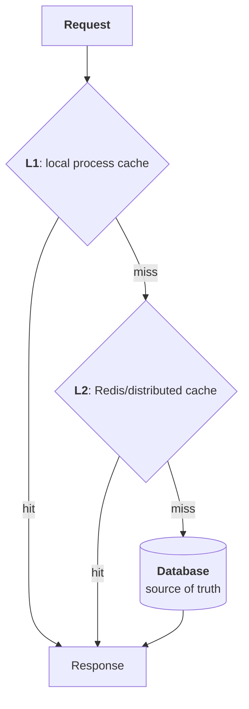

# LRU, LFU aur eviction: cache architecture

Maan lo tumhari application baar-baar database se user profile mangti hai. Database se har baar read karna slow aur costly ho sakta hai, isliye application profile ki copy **cache** me rakhti hai. Agli baar wahi request aaye, to app pehle cache check karti hai.

Cache ka basic goal hai: **kam latency, kam backend load**. Lekin cache ki memory limited hoti hai. Jab jagah kam padti hai, system ko decide karna padta hai ki kaunsa data hataaye. Isi decision ko **eviction** kehte hain.

> Cache me entry hatne ka matlab aksar original data delete hona nahi hota. Cache miss hone par app data ko dobara database ya kisi source se la sakti hai.

---

## 1. Cache request kaise handle karta hai?

Ek typical request flow:

```mermaid
flowchart TB
    C["<b>Client</b>"] --> A["<b>Application</b>"]
    A --> K{"Cache me key check"}
    K -- Hit --> V["Value return"]
    K -- Miss --> DB["Database/source se value lao"]
    DB --> S["Cache me store karo"]
    V --> R["<b>Response</b>"]
    S --> R
```



Misaal ke taur par:

```text
Key: user:42
Value: {name: "Asha", plan: "pro"}
```

1. App `user:42` ko cache me dhoondhti hai.
2. Key mil gayi to **cache hit**: value jaldi return.
3. Key nahi mili to **cache miss**: database se data fetch.
4. App result cache me rakhti hai aur phir response deti hai.

Yeh pattern **cache-aside** ya **lazy loading** ke naam se jana jata hai: application cache ko khud check karti hai aur miss par cache fill karti hai.

---

## 2. Cache me kaun-kaun se decisions hote hain?

Cache architecture ko samajhne ke liye chaar alag concepts ko separate rakho:

| Concept | Sawaal | Example |
|---|---|---|
| **Admission** | Kya naya item cache me rakhna chahiye? | Ek baar dekha gaya page cache karein ya nahi? |
| **Eviction** | Jagah kam ho to existing item kaunsa hataayein? | LRU ya LFU |
| **Expiration** | Data kab tak valid rahega? | 10 minute baad entry expire |
| **Invalidation** | Source data badalne par cache copy kaise hataayen/update karein? | User ka plan badla, cached profile invalidate |

Yeh same cheez nahi hain.

- **Eviction** usually memory pressure ke waqt hota hai.
- **Expiration** time/validity ke basis par hota hai.
- **Invalidation** data consistency ke liye hota hai.
- **Admission** decide karta hai ki data cache me aaye bhi ya nahi.

Ek entry TTL se expire ho sakti hai, bina memory full hue. Aur ek entry ka TTL baaki ho sakta hai, phir bhi memory pressure me evict ho sakti hai.

---

## 3. LRU kya hai?

**LRU = Least Recently Used**.

Jis key ko sabse purane waqt par access kiya gaya tha, woh eviction ke liye pehli candidate hoti hai. LRU yeh maan kar chalta hai:

> “Jo cheez abhi recent past me use hui, uske near future me dobara use hone ke chances zyada hain.”

### Example

Capacity sirf 3 entries ki hai. Access sequence:

```text
A, B, C, A, D
```

`A` ko dobara access kiya gaya, isliye woh recent ho gayi. `D` add karne par cache full hai. Approximate order:

```text
Oldest → B, C, A ← Newest
```

`B` sabse pehle evict hogi.

### Exact LRU ke liye data structures

Ek common exact implementation do structures rakhti hai:

1. **Hash map**: key se entry tak direct lookup.
2. **Doubly linked list**: entries ko oldest se newest order me rakhti hai.

```text
Hash map:
A → node A
B → node B

Doubly linked list:
LRU ← A ↔ C ↔ B → MRU
```

- **Get(key)**: hash map se node dhoondo; list me us node ko newest end par le jao.
- **Put(key, value)**: nayi entry newest par add karo.
- Capacity exceed ho to oldest node hatao.

Hash lookup aur list update average **O(1)** ho sakte hain. Lekin har read par list update karna padta hai. Ek highly concurrent cache me yeh shared metadata contention create kar sakta hai: bahut saare threads same list/lock/cache line ko modify karte hain.

### LRU ke strengths aur weaknesses

**Achha tab kaam karta hai jab:**

- Recent access future demand ka achha signal ho.
- Workload me “hot set” ho, yani kuch data baar-baar use hota ho.

**Problem tab aati hai jab:**

- App ek bahut badi list ko ek baar scan karti hai. Is **scan pollution** me one-time entries purane useful items ko bahar kar sakti hain.
- Item pehle bahut popular tha, magar ab access band ho gaya. Basic LRU recentness dekhta hai, lifetime popularity nahi.
- Reads bahut concurrent hain aur exact recency tracking mehngi padti hai.

---

## 4. LFU kya hai?

**LFU = Least Frequently Used**.

Jis key ka access count comparatively kam hai, woh eviction ki candidate banti hai. LFU yeh maan kar chalta hai:

> “Jo cheez history me zyada baar use hui hai, use future ke liye rakhna useful ho sakta hai.”

### Example

| Key | Access count |
|---|---:|
| A | 50 |
| B | 8 |
| C | 2 |
| D | 1 |

Memory full hone par basic LFU me `D` pehle candidate hogi.

### LFU implement karna

Ek straightforward implementation har entry ke saath frequency counter rakhti hai. Har hit par counter increment hota hai. Eviction ke liye lowest count wali entry dhoondhni padti hai.

Agar efficiently implement karna ho, to frequency ke hisaab se buckets rakhe ja sakte hain:

```text
frequency 1 → [keys]
frequency 2 → [keys]
frequency 3 → [keys]
```

Saath me minimum frequency track karne se updates aur eviction efficient ho sakte hain, lekin bookkeeping LRU se zyada complex ho sakti hai. Real systems aksar exact lifetime count maintain nahi karte, kyunki purani popularity hamesha future demand ka sahi predictor nahi hoti.

### LFU ka bada risk: stale popularity

Maan lo `A` pehle ek campaign ki wajah se 10,000 baar read hui. Campaign khatam ho gaya. `B` nayi hot key ban gayi.

Agar LFU ka counter kabhi kam na ho, to purani popular `A` cache me bani rahegi aur nayi useful `B` ko jagah milna mushkil hoga.

Isliye practical LFU me aksar **decay/aging** hoti hai: waqt ya maintenance ke saath old counts ka influence kam kiya jata hai.

### LFU aur LRU ka short comparison

| LRU | LFU |
|---|---|
| “Aakhri baar kab use hua?” | “Kitni baar use hua?” |
| Naye hot patterns ko jaldi pakadta hai | Stable popular keys ko protect karta hai |
| One-time scan se pollution ho sakti hai | Lifetime counters old popularity me atak sakte hain |
| Recentness-focused | Frequency-focused |
| Access order record karna padta hai | Frequency estimate/update karni padti hai |

Koi policy universal winner nahi hai. Result workload, key popularity, burstiness, item size aur access pattern par depend karta hai.

---

## 5. Eviction ke aur tareeqe

LRU aur LFU important hain, par yehi options nahi.

- **Random**: randomly key hatao. Simple; kabhi uniform access workloads me kaafi ho sakta hai.
- **TTL-based**: shortest remaining TTL wali entry pehle hatao. Redis me `volatile-ttl` policy isi tarah ka option hai.
- **FIFO**: jo sabse pehle add hui, woh pehle niklegi; beech ke reads order ko refresh nahi karte.
- **No eviction**: existing entries na hatao; memory limit ke baad writes reject/error ho sakte hain.
- **Hybrid/adaptive policies**: recentness aur frequency dono ko use karte hain.

Kuch caches **admission policy** bhi lagate hain. Matlab miss par nayi entry ko seedha andar daalna zaroori nahi. Agar nayi entry ki estimated popularity existing candidate se kam hai, cache use reject kar sakta hai. Yeh one-time scans se cache ko bachane me madad karta hai.

---

## 6. Redis me eviction architecture

Redis ko cache ke roop me use karte hue key-value data memory me hota hai. Redis me **`maxmemory`** memory limit set karta hai aur **`maxmemory-policy`** batata hai ki limit hit hone par kya kiya jaaye.

Redis docs ke mutabiq, nayi data-writing command ke baad memory limit cross ho to Redis policy ke hisaab se keys evict karta hai. Ek large command ki wajah se limit temporary taur par kaafi exceed bhi ho sakti hai. [Redis eviction documentation](https://redis.io/docs/latest/develop/reference/eviction/)

### Redis policies ko naam se samjho

Policy ke naam me do parts samjho:

- `allkeys-*`: sab keys eligible ho sakti hain.
- `volatile-*`: sirf TTL/expiration set wali keys eligible hoti hain.

Redis me documented policies me yeh shamil hain: [Redis policy list](https://redis.io/docs/latest/develop/reference/eviction/)

| Policy | Kya hota hai? |
|---|---|
| `allkeys-lru` | Sab keys me se LRU candidate |
| `allkeys-lfu` | Sab keys me se LFU candidate |
| `allkeys-random` | Kisi bhi key ko random hatana |
| `volatile-lru` | TTL wali keys me se LRU candidate |
| `volatile-lfu` | TTL wali keys me se LFU candidate |
| `volatile-random` | TTL wali keys me se random candidate |
| `volatile-ttl` | TTL wali keys me se shortest remaining TTL candidate |
| `noeviction` | Keys evict nahi hoti; memory limit ke baad naye writes fail ho sakte hain |

#### `volatile-*` ko dhyaan se samjho

Agar `volatile-lru` laga hua hai, lekin **kisi key par TTL set hi nahi hai**, to Redis ke paas eligible key nahi hogi. Redis docs ke mutabiq `volatile-*` policies us situation me `noeviction` jaisa behave karti hain.

Iska matlab: “TTL wale items hi evict karo” tabhi kaam karega jab application waqai relevant keys par TTL set karti ho.

### Redis ka LRU exact LRU nahi hai

Redis theoretical global LRU list maintain karke har key access par exact ordering update nahi karta. Woh keys sample karta hai aur unme se purani access wali candidates dhoondhta hai; Redis docs isse **approximate LRU** kehte hain. Redis 3.0 se candidate pool bhi use hota hai, jisse selection improve hota hai. Sample count tune karne se approximation aur CPU cost dono par asar ho sakta hai. [Redis approximate LRU details](https://redis.io/docs/latest/develop/reference/eviction/)

Practical takeaway:

- Policy ka naam `allkeys-lru` ho to bhi eviction mathematically exact global LRU hona zaroori nahi.
- Approximation ka fayda: har read par heavyweight exact ordering maintain nahi karni.
- Sample size badhane se candidate selection behtar ho sakti hai, lekin CPU work badhta hai.

### Redis LFU kaise sochta hai?

Redis me LFU bhi approximate hai. Redis docs ke hisaab se, yeh ek small probabilistic counter aur decay/aging use karta hai. Isliye Redis ka LFU “server start hone se ab tak exact access count” nahi hai. Iska maksad kam metadata me popularity ka useful estimate rakhna hai, aur purani frequency ko waqt ke saath kam relevant banana hai. Iske tuning parameters me `lfu-log-factor` aur `lfu-decay-time` shamil hain. [Redis LFU documentation](https://redis.io/docs/latest/develop/reference/eviction/)

### Expiration aur eviction Redis me alag hain

- **Expiration**: key ka TTL khatam hua, key apni validity ke hisaab se expire ho sakti hai.
- **Eviction**: memory limit/pressure ki wajah se key hatayi gayi.
- **TTL candidate hona** `volatile-*` policy ke liye eligibility define karta hai; TTL set hone ka matlab yeh nahi ki key expiry tak guaranteed cache me rahegi.

### Redis me kaunsi policy chunni chahiye?

- **Pure cache** jahan sab keys disposable hain: `allkeys-lru` ya workload ko dekhkar `allkeys-lfu`.
- **Read pattern popularity-driven ho** aur purane hot items ko preserve karna useful lage: `allkeys-lfu` ko workload par measure karo.
- **Same Redis me TTL wali cache keys aur non-TTL keys** dono hain: `volatile-*` ko carefully samjho. TTL wali hi keys evictable hongi.
- **Data ko evict karna unsafe hai**: `noeviction` writes ko fail kar sakti hai; application ko error handling aur capacity planning chahiye. Redis docs mixed persistent/cache data ke liye separate instances par bhi vichaar karne ko kehte hain. [Redis policy guidance](https://redis.io/docs/latest/develop/reference/eviction/)

---

## 7. Memcached aur Caffeine me kya farq hai?

### Memcached

Memcached ek distributed in-memory key-value cache hai. ElastiCache ke docs ke mutabiq, Memcached nodes par default **LRU-based eviction** hoti hai. [AWS Memcached eviction guidance](https://docs.aws.amazon.com/AmazonElastiCache/latest/dg/PerformanceEfficiencyPillar.html)

Redis ke saath broad difference:

- Redis ek richer data model aur configurable eviction policies deta hai.
- Memcached ko aksar simple object/string cache ke roop me dekha jata hai.
- Memcached deployments me eviction ko node ke memory behavior aur uski settings ke context me samajhna hota hai; AWS bhi Memcached eviction ko node-level LRU behavior ke roop me describe karta hai.

Exact details engine version aur deployment par depend karti hain, isliye production me apne engine/service ki current settings aur metrics check karna chahiye.

### Caffeine: process ke andar Java cache

Caffeine Redis/Memcached jaisa alag network server nahi; yeh Java application ke andar chalne wali cache library hai.

Iska interesting design **Window TinyLFU** hai:

1. Naye/recently used items ko ek chhote **window** me chance milta hai.
2. Window se bahar hone wale candidate ki estimated frequency compare hoti hai.
3. Candidate aur main cache ke victim me comparison karke decide hota hai kisko rakhna hai.

Yaani Caffeine seedha “sirf LRU” ya “sirf LFU” par depend nahi karta; **recent bursts aur estimated frequency** ko combine karta hai. Is design ka maqsad hit rate behtar karna aur one-time entries se useful cache ko bachana hai. [Caffeine design](https://github.com/ben-manes/caffeine/wiki/Design) Caffeine size-based, time-based aur reference-based eviction/expiration controls bhi deta hai. [Caffeine eviction options](https://github.com/ben-manes/caffeine/wiki/Eviction)

### Local cache vs Redis

| Local cache, jaise Caffeine | Remote cache, jaise Redis |
|---|---|
| App process ke andar | Network ke paar alag service |
| Network round trip nahi | Network latency hoti hai |
| Har app instance ki apni copy ho sakti hai | Instances ek shared cache use kar sakte hain |
| Process restart par local entries ja sakti hain | Service configuration ke hisaab se data shared/persisted ho sakta hai |
| Per-instance memory budget | Server/shard memory budget |

Local cache aksar **L1**, Redis **L2**, aur database/source of truth alag layer hota hai:



Yeh architecture latency kam kar sakta hai, lekin ab data ki multiple copies hain. Update par invalidation, TTL, versioning aur stale-data behavior carefully design karna padta hai.

---

## 8. Capacity limit kis cheez par based hoti hai?

Cache capacity do common tareeqon se define hoti hai:

1. **Entry count**: maximum 10,000 keys.
2. **Memory/weight**: maximum 1 GB, ya application-calculated weight.

Entry count simple hai, magar sab values same size ki nahi hoti:

```text
key A → 100 bytes
key B → 5 MB
```

Dono ko “ek entry” ginna memory usage ko accurately represent nahi karta. Isi liye kuch caches weight/size-based limits support karti hain. Caffeine `maximumSize` aur `maximumWeight` ke examples deta hai; weight ko entry creation/update ke waqt calculate kiya jata hai. [Caffeine size and weight options](https://github.com/ben-manes/caffeine/wiki/Eviction)

Redis me bhi total memory sirf raw value bytes nahi hoti. Keys, values, internal data structures, client buffers aur memory fragmentation ka overhead ho sakta hai. Managed services me application data ke liye advertised RAM ka poora hissa available samajhna theek nahi; AWS ElastiCache reserved memory ko non-data uses aur memory overhead ke liye alag rakhta hai. [ElastiCache reserved memory](https://docs.aws.amazon.com/AmazonElastiCache/latest/dg/redis-memory-management.html)

---

## 9. Real application me cache ko consistent kaise rakhein?

Eviction policy sirf memory management karti hai. Woh **database update aur cache copy ko consistent** nahi banati.

Common write patterns:

### Cache-aside

1. App database update karti hai.
2. Cache key delete/invalidate karti hai.
3. Agli read par app source se fresh value laakar cache fill karti hai.

Yeh simple aur common pattern hai, lekin database update aur cache invalidation ke beech failure/race ka chance hota hai.

### Write-through

App cache layer ke through write karti hai; cache update aur source write ka behavior implementation ke hisaab se coordinate hota hai.

### Write-behind / write-back

App pehle cache ko update karti hai, source ko baad me. Performance benefit ho sakta hai, par crash ya failed background write se data loss/consistency risk aa sakta hai.

| Pattern | Write kahan pehle | Main risk |
|---|---|---|
| Cache-aside | Database, phir cache invalidate | Update aur invalidation ke beech race/failure |
| Write-through | Cache layer ke through, source ke saath coordinate | Write latency badh sakti hai |
| Write-behind | Cache pehle, source baad me | Crash par data loss/consistency risk |

Kisi bhi pattern me yeh sawaal pehle decide karo:

- Cache stale ho to kitni der tak acceptable hai?
- Cache miss par database load spike aa sakta hai?
- Same hot key ke miss par 1,000 requests ek saath database hit karengi?
- Invalidation fail ho to recovery kaise hogi?

---

## 10. Production me kya monitor karna chahiye?

Eviction policy tune karne se pehle workload dekho. Useful metrics:

- **Hit rate / miss rate**: cache waqai backend load kam kar raha hai?
- **Evictions**: memory pressure me entries kitni baar nikli?
- **Expired keys**: TTL ke through kitna data clean ho raha hai?
- **Memory used / maxmemory headroom**: limit kitni paas hai?
- **Backend request rate**: cache miss ya outage se DB par kya asar hai?
- **Latency**: cache aur backend dono ki latency.
- **Item size distribution**: ek-do oversized entries memory consume to nahi kar rahi?
- **Errors on writes**: `noeviction` ya memory limit ke baad writes fail to nahi ho rahi?

Redis docs bhi `INFO` information dekh kar policy ko runtime behavior ke mutabiq evaluate karne ka zikr karte hain. [Redis eviction monitoring guidance](https://redis.io/docs/latest/develop/reference/eviction/)

Evictions ko dekhkar turant “LRU kharab hai” conclude mat karo. High evictions ka matlab ho sakta hai:

- Cache capacity chhoti hai.
- TTL/data volume ka design galat hai.
- Workload me bahut high churn hai.
- Large values memory kha rahi hain.
- Traffic pattern badal gaya hai.

---

## 11. Ek practical decision framework

| Workload ka pattern | Shuru karne layak soch |
|---|---|
| Recent reads sabse achha predictor hain | LRU-based policy evaluate karo |
| Stable, repeatedly popular keys hain | LFU-based policy ko workload par measure karo |
| Har item lagbhag equally useful hai | Random policy bhi viable ho sakti hai |
| TTL wali entries hi disposable hain | `volatile-*` policy, aur ensure karo TTLs set hain |
| Cache me non-evictable data bhi hai | Cache aur critical data alag karne ya no-eviction behavior ki planning karo |
| App ke andar fast per-instance cache chahiye | Caffeine jaise local cache ko L1 ke roop me evaluate karo |
| App instances ko shared cache chahiye | Redis/Memcached jaise remote cache ko L2/shared layer ke roop me evaluate karo |
| One-time scans cache ko pollute karte hain | Admission policy ya frequency-plus-recency design dekho |

Policy choose karne ka final tareeqa theory se guess karna nahi: **real ya representative access pattern par hit rate, eviction rate, memory use aur backend load measure karna** hai.

---

## Quick recap

- **LRU**: sabse purani recent access wali entry candidate.
- **LFU**: kam estimated frequency wali entry candidate; practical systems ko aging/decay ki zarurat ho sakti hai.
- **Eviction**: memory pressure par entry hatana.
- **Expiration**: TTL/validity khatam hona.
- **Invalidation**: source update ke baad stale copy hatana.
- **Redis**: configurable policies; LRU/LFU approximate hain; `allkeys-*` aur `volatile-*` ka scope alag hai.
- **Memcached**: ElastiCache docs ke mutabiq node-level default LRU eviction.
- **Caffeine**: local Java cache; Window TinyLFU frequency aur recency ko combine karta hai.
- **Best policy**: tumhare access pattern aur consistency requirements ke hisaab se, metrics se validate hoti hai.
