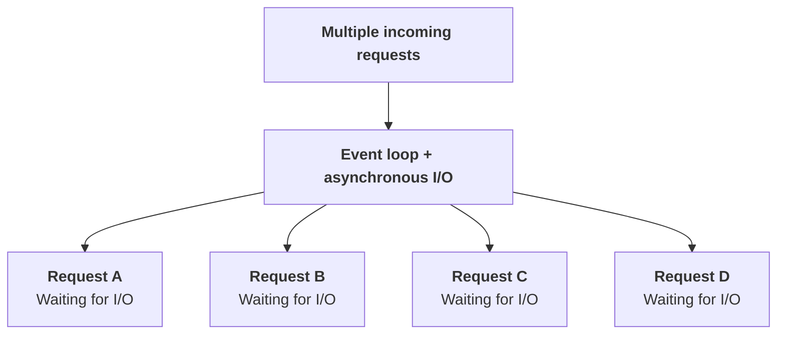
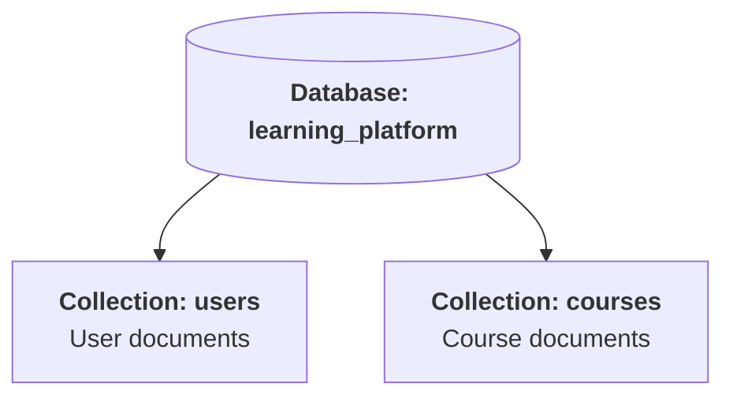
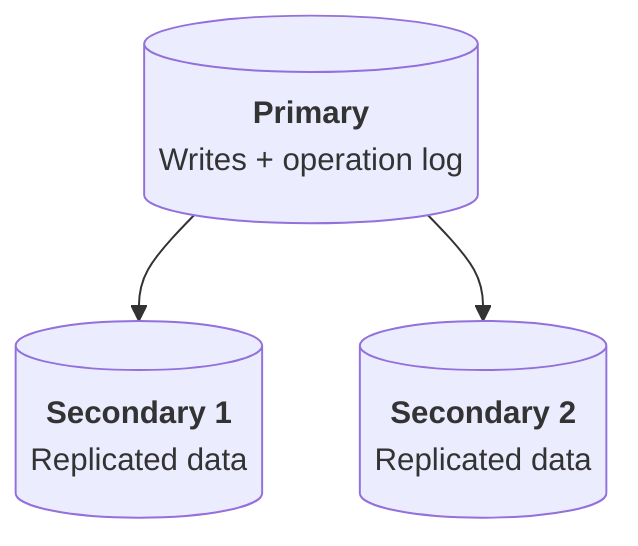
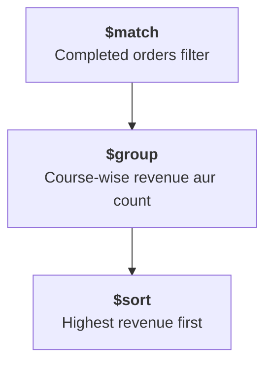
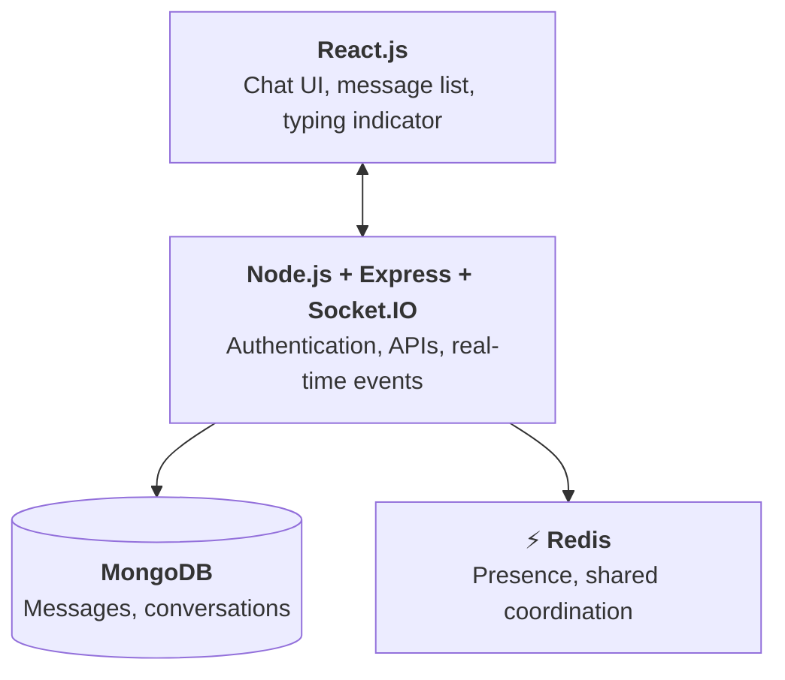
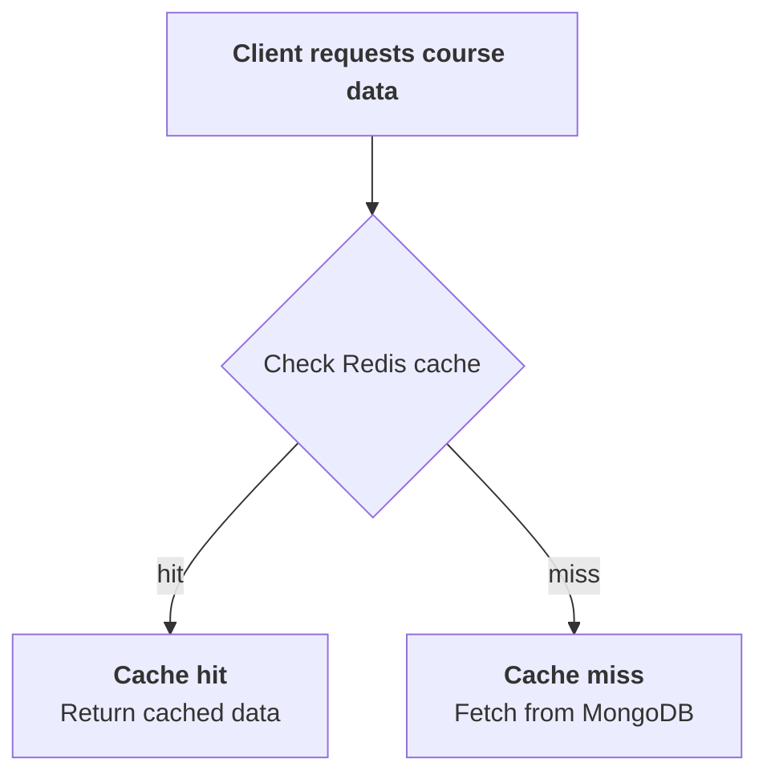
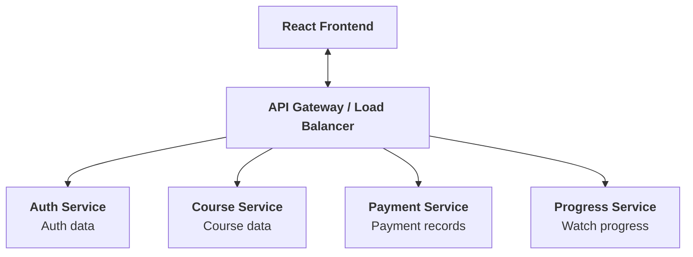
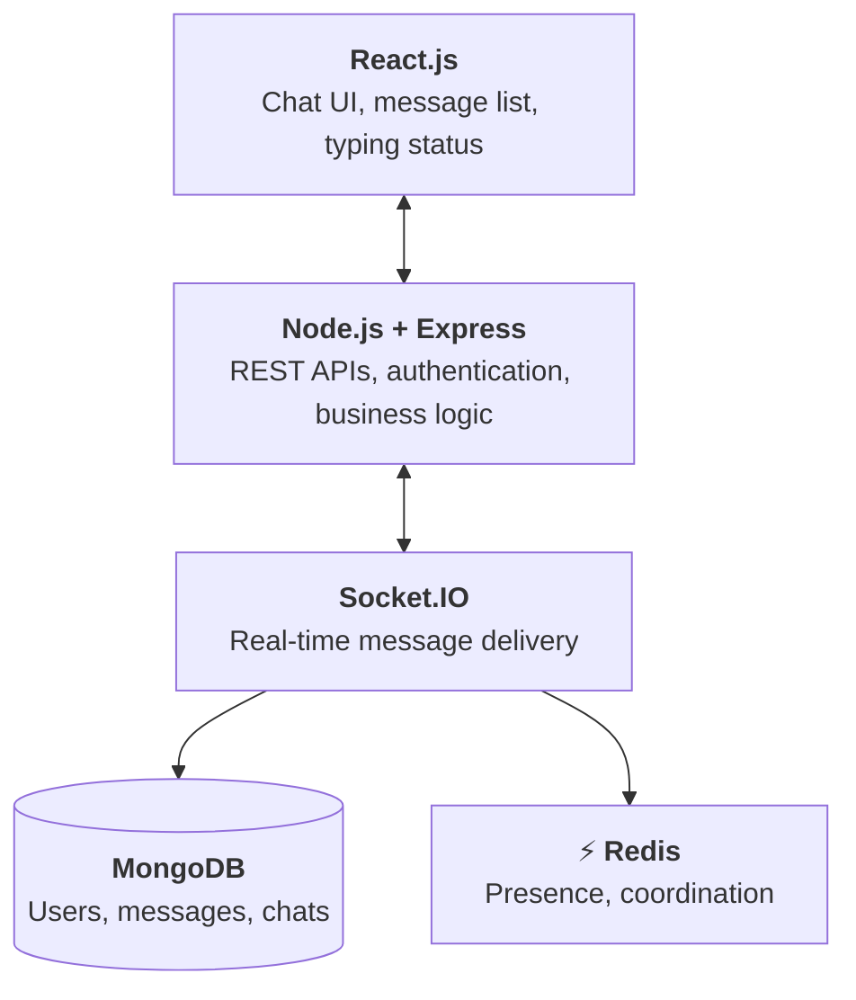
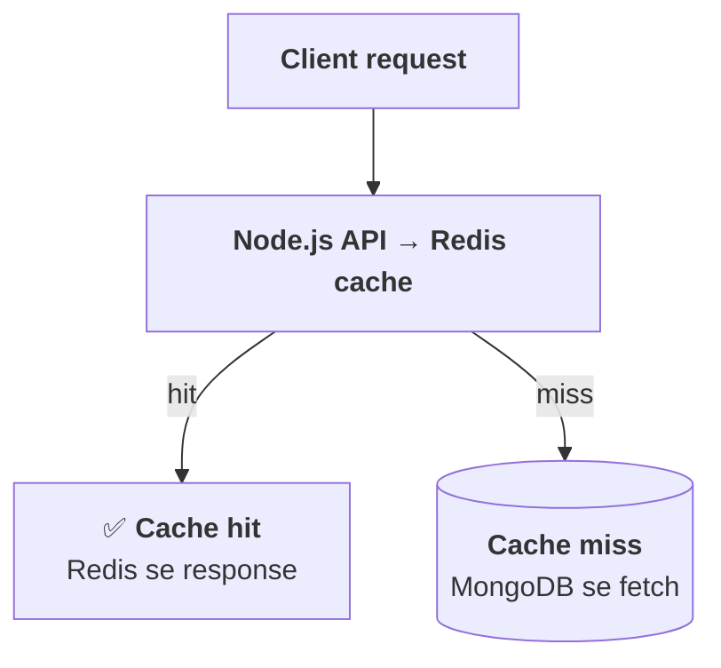
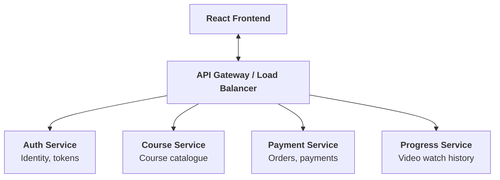

# 1. React.js — Frontend Interview Questions

# Q1. What is React.js and what are its key features?

React.js ek JavaScript library hai jiska use user interfaces (UI) banane ke liye kiya jata hai. Iska use primarily single-page applications aur interactive web applications banane mein hota hai.
Example: Agar tum ek online learning platform bana rahe ho, to React se course listing, video player, login page aur shopping cart jaise UI components bana sakte ho.

## React ki key features

## 1. Component-based architecture
Hum UI ko chhote reusable components mein divide kar sakte hain.

```jsx
function Button() {
  return <button>Enroll Now</button>;
}

function CourseCard() {
  return (
    <div>
      <h2>MERN Stack Course</h2>
      <Button />
    </div>
  );
}
```

Yahan Button ko multiple jagah reuse kar sakte hain.

## 2. Declarative UI

Hum batate hain ki UI kaisa dikhna chahiye, React decide karta hai ki DOM ko kaise update karna hai.

```jsx
function Counter() {
  const [count, setCount] = React.useState(0);

  return (
    <button onClick={() => setCount(count + 1)}>
      Count: {count}
    </button>
  );
}
```

## 3. State management
State mein component ka changing data store hota hai. State change hone par React zarurat ke mutabik component ko re-render karta hai.

## 4. One-way data flow
Parent component se child component ko generally props ke through data pass hota hai. Isse data flow ko understand karna easy hota hai.

## 5. Virtual DOM aur reconciliation
React render ke dauran UI ki nayi representation calculate karta hai aur zaroori DOM changes commit karta hai. Har update mein poora page dobara create karna zaroori nahi hota.

## Interview answer:
"React is a JavaScript library for building reusable, component-based user interfaces. Its major features include declarative rendering, state management, one-way data flow, hooks, and efficient DOM updates through reconciliation."


# Qus2. What is JSX and why do we use it?

JSX ka full form hai JavaScript XML. Yeh JavaScript ki syntax extension hai jo hume JavaScript code ke andar HTML jaisa markup likhne deti hai.

```jsx
const name = "Rahul";

function App() {
  return <h1>Hello, {name}!</h1>;
}
```


JSX mein {} ke andar JavaScript expressions likh sakte hain.

## Kya JSX browser directly samajhta hai?
Modern browsers JSX ko directly execute nahi karte. Build tools ya JSX-aware compilers ise JavaScript mein transform karte hain.
Conceptually, JSX:

```jsx
<h1>Hello</h1>
```


React element create karne wali JavaScript call mein transform ho sakta hai, jaise:

```js
React.createElement("h1", null, "Hello");
```


Modern React toolchains automatic JSX runtime bhi use karti hain, isliye har baar manually React.createElement likhna nahi padta.

## JSX use karne ke benefits:-
- UI aur uski logic ko saath rakh sakte hain.
- Dynamic values render kar sakte hain.
- Components ko easily compose kar sakte hain.
- JavaScript expressions se conditional rendering kar sakte hain.

Example:

```jsx
function Greeting({ isLoggedIn }) {
  return (
    <div>
      {isLoggedIn ? "Welcome back!" : "Please log in"}
    </div>
  );
}
```


Interview answer: JSX ek syntax extension hai jo JavaScript ke andar HTML-like markup likhne deti hai. Isse UI ko read, maintain aur dynamic data ke saath compose karna easy hota hai.


# Qus3. What is the difference between State and Props?

Yeh React ka bahut important interview question hai.

| Props                                                  | State                                                 |
|--------------------------------------------------------|-------------------------------------------------------|
| Parent se component ko data milta hai                  | Component ka changing data manage hota hai            |
| Receiving component ise directly modify nahi karta     | Setter ya state update mechanism se update hoti hai   |
| Configuration ya input pass karne ke liye              | Interactive UI aur changing values ke liye            |
| Parent ki state change hone par props badal sakte hain | State update hone par component re-render ho sakta hai|

Example:

```jsx
function CourseCard({ title }) {
  const [liked, setLiked] = React.useState(false);

  return (
    <div>
      <h2>{title}</h2>

      <button onClick={() => setLiked(!liked)}>
        {liked ? "Liked" : "Like"}
      </button>
    </div>
  );
}
```

Yahan:
- title ek prop hai.
- liked component ki state hai.

Parent ise aise use kar sakta hai:

```jsx
<CourseCard title="React Course" />
```

Important: Props aur state dono immutable values ki tarah treat karni chahiye. State ko directly mutate nahi karna chahiye.

```js
// Incorrect
user.name = "Rahul";

// Correct approach: new object
setUser(prev => ({
  ...prev,
  name: "Rahul"
}));
```


# Qus4. Functional vs Class Components — when to use which?

React mein components define karne ke do traditional approaches hain.

## Functional component
JavaScript function ke through define hota hai.

```jsx
function Counter() {
  const [count, setCount] = React.useState(0);

  return (
    <button onClick={() => setCount(c => c + 1)}>
      {count}
    </button>
  );
}
```


Functional components mein Hooks ke through state aur lifecycle-related behavior handle kar sakte hain.

## Class component
JavaScript class ke through define hota hai.

```jsx
class Counter extends React.Component {
  state = { count: 0 };

  render() {
    return (
      <button
        onClick={() =>
          this.setState(({ count }) => ({
            count: count + 1
          }))
        }
      >
        {this.state.count}
      </button>
    );
  }
}
```


## Main differences
- Functional components Hooks use karte hain, jaise useState, useEffect, useMemo.
- Class components this.state, this.setState() aur lifecycle methods use karte hain.
- Modern React development mein functional components preferred hain.
- Existing applications mein class components abhi bhi mil sakte hain.
- Error boundaries ke liye traditional class-based approach abhi bhi commonly use hoti hai.

Interview answer: Modern React mein functional components prefer kiye jaate hain because Hooks state, side effects aur reusable logic ko simpler banate hain. Class components samajhna bhi zaroori hai, especially legacy codebases ke liye.


# Q5. Explain Virtual DOM and Reconciliation.

## Virtual DOM kya hai?
DOM browser ke page ki structure represent karta hai. React render ke dauran UI ko lightweight JavaScript objects, yani React elements, ke form mein represent karta hai. Is representation ko commonly Virtual DOM kaha jata hai.

## Reconciliation kya hai?
Reconciliation woh process hai jisme React purani aur nayi rendered element trees ko compare karke determine karta hai ki UI ko update karne ke liye kya changes chahiye.

Example: Pehle UI mein:

```html
<h1>Count: 0</h1>
```


Update ke baad:

```html
<h1>Count: 1</h1>
```

React identify kar sakta hai ki text content badla hai aur DOM mein corresponding update commit kar sakta hai.

## React update kaise karta hai?
step 1. State ya props change hote hain
step 2. React component ko render karta hai
step 3. Reconciliation se required changes identify hote hain
step 4. Commit phase mein zaroori DOM changes hote hain

## Kya Virtual DOM hamesha fast hota hai?
Nahi. Virtual DOM ka matlab yeh nahi hai ki har case mein React direct DOM manipulation se faster hoga. React efficient updates, predictable rendering aur declarative programming provide karta hai; actual performance workload aur implementation par depend karti hai.

## Interview mein ek important point
React lists mein key kyun use karte hain?

```jsx
{courses.map(course => (
  <CourseCard key={course.id} title={course.title} />
))}
```

Stable keys React ko list items ki identity samajhne mein help karti hain, especially jab items add, remove ya reorder hote hain.


# Qus6. How does React update the page using the Virtual DOM?

Iska answer previous question se related hai, lekin interviewer update mechanism par focus kar raha hai.
Maan lo tum ek shopping cart bana rahe ho aur cart count 2 se 3 ho jata hai.
1. User button click karta hai.
2. Event handler state update schedule karta hai.
3. React updated UI calculate karta hai.
4. Reconciliation ke through changes identify hote hain.
5. React commit phase mein actual DOM ko update karta hai.
6. Browser required visual changes paint karta hai.

React updates ko batch bhi kar sakta hai, taaki unnecessary rendering work reduce ho.

Yaad rakho: Component ka re-render hona aur DOM ka update hona same cheez nahi hain. Component re-render ho sakta hai, lekin agar rendered output mein koi relevant change nahi hai, to DOM mutation ki zaroorat nahi bhi ho sakti.


# Qus7. How to make a React app faster?

React performance optimize karne ke liye pehle identify karo ki bottleneck kahan hai. Har jagah memoization lagana sahi approach nahi hai.

Important optimization techniques

| Technique | Purpose |
|---|---|
| `React.memo` | Unchanged props wale component ke unnecessary renders ko skip karne mein help |
| `useMemo` | Expensive calculation ka result cache karna |
| `useCallback` | Function reference ko renders ke beech cache karna |
| Code splitting | Initial JavaScript bundle reduce karna |
| Lazy loading | Zaroorat par component ya resource load karna |
| List virtualization | Large lists mein sirf visible items render karna |
| Debouncing | Frequent events par expensive work limit karna |
| Correct state placement | State changes ka unnecessary components tak spread hona reduce karna |

Example: Lazy loading.

```jsx
import { lazy, Suspense } from "react";

const Dashboard = lazy(() => import("./Dashboard"));

function App() {
  return (
    <Suspense fallback={<p>Loading...</p>}>
      <Dashboard />
    </Suspense>
  );
}
```

Example: Expensive calculation.

```js
const total = React.useMemo(() => {
  return products.reduce(
    (sum, product) => sum + product.price,
    0
  );
}, [products]);
```


Real-world approach: Pehle React DevTools Profiler aur browser performance tools se bottleneck identify karo, phir targeted optimization karo.


# 2. Node.js — Backend Interview Questions


# Qus1. What is Node.js and its primary purpose?

Node.js ek JavaScript runtime environment hai jo JavaScript ko browser ke bahar run karne deta hai. Yeh Chrome ke V8 JavaScript engine par based hai.

Simple example:

Browser mein JavaScript se tum button click handle karte ho. Node.js mein JavaScript se tum server bana sakte ho, APIs create kar sakte ho, files read kar sakte ho aur database ke saath interact kar sakte ho.

```js
const http = require("node:http");

const server = http.createServer((req, res) => {
  res.end("Hello from Node.js");
});

server.listen(3000, () => {
  console.log("Server running on port 3000");
});
```


Ab browser ya API client mein http://localhost:3000 open karne par response milega.

## Node.js ke main features
- V8 engine ke through JavaScript execution.
- Non-blocking I/O.
- Event-driven architecture.
- Large package ecosystem through npm.
- HTTP APIs, real-time applications aur backend services ke liye useful.

## Node.js kahan use karna chahiye?
- REST APIs aur GraphQL APIs.
- Chat applications.
- Notification systems.
- Streaming aur I/O-heavy applications.
- Real-time dashboards.

CPU-intensive calculations ke liye Node.js ko carefully design karna padta hai, kyunki event loop par heavy synchronous work doosre requests ko delay kar sakta hai.

Interview answer: Node.js is an open-source JavaScript runtime built on the V8 engine. It is commonly used to build scalable network applications using non-blocking I/O and an event-driven architecture.


# Q2. Explain event-driven, non-blocking I/O.

Yeh Node.js architecture ka core concept hai.

## Blocking I/O kya hai?
Jab program kisi operation ke complete hone tak aage execute nahi kar sakta, to use blocking behavior kehte hain.

Conceptual example:

```js
const fs = require("node:fs");

const data = fs.readFileSync("large.txt", "utf8");

console.log("File read complete");
console.log("Next task");
```


readFileSync() file read hone tak current JavaScript execution ko block karta hai.

## Non-blocking I/O kya hai?

```js
const fs = require("node:fs");

fs.readFile("large.txt", "utf8", (err, data) => {
  if (err) {
    console.error(err);
    return;
  }

  console.log("File read complete");
});

console.log("Next task");
```


Yahan file read hone ke dauran JavaScript aage execute kar sakti hai. Callback baad mein result handle karta hai.

## Event-driven architecture kya hai?
Is architecture mein system events aur unke handlers ke through kaam karta hai.
Example:
1. Client API request bhejta hai.
2. Node.js request process karna start karta hai.
3. File, database ya network operation wait kar raha ho, to Node.js doosra available kaam kar sakta hai.
4. I/O operation complete hone par callback ya promise continuation execute hoti hai.
5. Response client ko bhej diya jata hai.

Important distinction: Non-blocking ka matlab yeh nahi hai ki har operation background thread par chalta hai. JavaScript callbacks normally event loop ke through execute hote hain; kuch I/O operations operating system handle karta hai aur kuch Node.js operations libuv thread pool use karte hain.


# Q3. Why is Node.js single-threaded? How does it achieve concurrency?

Node.js ko single-threaded kehne ka matlab hai ki normal JavaScript execution ka primary event loop ek main thread par chalta hai.

Lekin Node.js poora ka poora single-threaded nahi hai. Iske runtime mein OS asynchronous facilities, libuv thread pool aur optional worker threads bhi ho sakte hain.

## Concurrency kaise achieve hoti hai?
Maan lo 1,000 clients requests bhej rahe hain aur sabhi database ya network responses ka wait kar rahe hain.

Traditional blocking model mein har request ko dedicated thread dena pad sakta hai. Node.js asynchronous I/O ka use karke waiting requests ko handle kar sakta hai bina har request ke liye JavaScript thread dedicate kiye.

## Node.js concurrency flow




I/O complete hone par related callbacks ya promise continuations execute hoti hain.

## Concurrency vs parallelism
- Concurrency: Multiple tasks ki progress overlap hoti hai.
- Parallelism: Multiple tasks literally ek hi time par different CPU cores ya threads par execute hote hain.

Node.js asynchronous I/O ke through concurrency achieve karta hai. CPU-heavy tasks ke liye worker_threads, child processes ya separate services use ki ja sakti hain.


# Qus4. Explain the Event Loop simply.

Event loop Node.js runtime ka mechanism hai jo asynchronous operations complete hone ke baad unke callbacks ko execute karne mein help karta hai.

Example:

```js
console.log("A");

setTimeout(() => {
  console.log("B");
}, 0);

console.log("C");
```


Output:

```text
A
C
B
```

setTimeout(..., 0) ka matlab yeh nahi hai ki callback immediately execute ho jayega. Callback timer conditions satisfy hone ke baad execute hota hai, jab JavaScript execution allow kare.

## Event loop ke important parts
- Call stack: Currently execute ho raha synchronous JavaScript code.
- Timers: setTimeout aur setInterval ke callbacks.
- Poll phase: I/O events aur callbacks handle karne ka important phase.
- Check phase: setImmediate() callbacks.
- Close callbacks: Kuch close-related events ke callbacks.
- Microtask queues: Promise reactions aur queueMicrotask() jaise tasks.
- process.nextTick() queue: Node.js-specific mechanism jo aam taur par normal event-loop phases se pehle process hota hai.

Example:

```js
console.log("Start");

process.nextTick(() => {
  console.log("NextTick");
});

Promise.resolve().then(() => {
  console.log("Promise");
});

console.log("End");
```


Typical Node.js output:

```text
Start
End
NextTick
Promise
```


Interview tip: process.nextTick() aur Promise microtasks ka exact ordering context par depend kar sakta hai. setImmediate() aur setTimeout(..., 0) ka relative order bhi execution context ke hisaab se change ho sakta hai.


# Qus5. Callbacks vs Promises vs async/await

Teeno asynchronous operations handle karne ke approaches hain.

## 1. Callback
Ek function doosre function ko argument ke roop mein pass karte hain.

```js
const fs = require("node:fs");

fs.readFile("data.txt", "utf8", (err, data) => {
  if (err) {
    console.error(err);
    return;
  }

  console.log(data);
});
```

Problem: Multiple dependent callbacks deeply nested ho sakte hain, jise callback hell kehte hain.

## 2. Promise
Promise future mein available hone wale result ko represent karta hai.

Iski states hain:
- Pending
- Fulfilled
- Rejected

```js
fetch("/api/courses")
  .then(response => response.json())
  .then(data => console.log(data))
  .catch(error => console.error(error));
```

## 3. Async/await
Promises ko sequential, readable syntax mein handle karne deta hai.

```js
async function getCourses() {
  try {
    const response = await fetch("/api/courses");

    if (!response.ok) {
      throw new Error("Request failed");
    }

    return await response.json();
  } catch (error) {
    console.error(error);
    throw error;
  }
}
```


| Feature | Callback | Promise | Async/await |
|---|---|---|---|
| Syntax | Function nesting possible | `.then()` / `.catch()` | Synchronous jaisi readable syntax |
| Error handling | Commonly error-first callback | `.catch()` | `try/catch` |
| Chaining | Manual nesting | Promise chaining | Sequential flow readable |
| Underlying concept | Callback-based completion | Asynchronous result object | Promises ke upar syntax |

Important: async/await Promises ka replacement nahi hai; yeh Promises ke saath kaam karne ka syntax hai.


# Qus6. What is npm and why is package.json important?

npm Node.js ecosystem ka package manager hai. Isse third-party libraries install, update aur manage kar sakte hain.

Example:

```bash
npm install express
npm install mongoose
npm install -D nodemon
```

package.json project ka manifest hai. Ismein project metadata, dependencies, scripts aur configuration store ho sakti hai.

Example:

```json
{
  "name": "mern-app",
  "version": "1.0.0",
  "scripts": {
    "start": "node server.js",
    "dev": "nodemon server.js"
  },
  "dependencies": {
    "express": "^5.0.0",
    "mongoose": "^8.0.0"
  },
  "devDependencies": {
    "nodemon": "^3.0.0"
  }
}
```

## package.json vs package-lock.json
- package.json dependency requirements aur scripts define karta hai.
- package-lock.json resolved dependency tree aur exact versions record karta hai, taaki installs reproducible hon.
- dependencies runtime ke liye required packages hain.
- devDependencies development aur testing tools jaise packages hain.

Interview answer: npm packages manage karta hai, aur package.json project ki dependencies, scripts aur metadata define karta hai. package-lock.json dependency resolution ko consistently reproduce karne mein help karta hai.


# Qus7. What are Modules, Streams and the Buffer class?

## A. Modules
Module code ko reusable files ya units mein organize karne ka mechanism hai.
CommonJS example:

```js
// math.js
function add(a, b) {
  return a + b;
}

module.exports = { add };
```


```js
// app.js
const { add } = require("./math");

console.log(add(2, 3));
```


ES Modules mein export aur import use hote hain.

```js
export function add(a, b) {
  return a + b;
}
```

## B. Streams

Streams data ko poora memory mein load karne ke bajaye chunks mein process karne dete hain.

Types:
- Readable — data read karna.
- Writable — data write karna.
- Duplex — read aur write dono.
- Transform — read aur write ke beech data transform karna.

Example:

```js
const fs = require("node:fs");

const readStream = fs.createReadStream("large-video.mp4");
const writeStream = fs.createWriteStream("copy.mp4");

readStream.pipe(writeStream);
```


Badi files ke liye streams memory usage ko control karne mein help karti hain.


## C. Buffer
Buffer binary data ko handle karne ke liye Node.js ka mechanism hai. Yeh file contents, network packets aur raw bytes ke saath kaam aata hai.

```js
const buffer = Buffer.from("Hello");

console.log(buffer);
console.log(buffer.toString());
```


Difference yaad rakho: Module code organize karta hai, Stream data ko chunks mein process karta hai aur Buffer binary data represent karta hai.


# Qus8. Difference between process.nextTick() and setImmediate()

| `process.nextTick()` | `setImmediate()` |
|---|---|
| Node.js ki next-tick queue use karta hai | Event loop ke check phase mein execute hota hai |
| Aam taur par current operation ke baad, next event-loop phase se pehle run hota hai | Event loop ke check phase tak execution defer karta hai |
| Excessive recursive scheduling event loop ko starve kar sakti hai | I/O-oriented scheduling scenarios mein useful ho sakta hai |

Example:

```js
console.log("Start");

setImmediate(() => {
  console.log("Immediate");
});

process.nextTick(() => {
  console.log("NextTick");
});

console.log("End");
```


Typical output:

```text
Start
End
NextTick
Immediate
```


Yeh typical top-level CommonJS execution ka example hai. ESM ya doosre execution contexts mein scheduling details alag ho sakti hain.

Interview tip: In dono ko sirf delay dene ke liye interchangeable mat samjho. Inki scheduling semantics alag hain.


# 3. MongoDB — Database Interview Questions

# Qus1. What is MongoDB and its key features?

MongoDB ek NoSQL document database hai. Yeh data ko JSON-like documents mein store karta hai, internally BSON format ka use karke.

Example document:

```json
{
  "name": "Rahul",
  "email": "rahul@example.com",
  "courses": ["React", "Node.js"],
  "active": true
}
```

## Key features
- Flexible document structure.
- Embedded documents aur arrays.
- Indexes for faster queries.
- Aggregation pipeline.
- Replication through replica sets.
- Sharding for distributing data.
- Multi-document transactions support.

Example: Learning platform mein user profile, course metadata aur progress documents store kiye ja sakte hain.

Lekin flexible schema ka matlab yeh nahi ki validation ki zaroorat nahi hai. Production applications mein validation aur consistent data modeling bahut important hain.


# Qus2. Documents, Collections and Databases explained

MongoDB ke structure ko is tarah samjho:




- Database: Related collections ka group.
- Collection: Related documents ka group.
- Document: Individual record jisme fields aur values hoti hain.

Example:

```js
db.users.insertOne({
  name: "Rahul",
  age: 25
});
```

Yahan users collection hai aur inserted object ek document hai.

SQL terminology se comparison:

| MongoDB | Relational database |
|---|---|
| Database | Database |
| Collection | Table |
| Document | Row/record |
| Field | Column/attribute |

Yeh conceptual comparison hai; document databases aur relational databases ka data model exactly same nahi hai.


# Qus3. BSON vs JSON — why does MongoDB use BSON?

JSON ek text-based data format hai. BSON ka full form Binary JSON hai; yeh JSON-like documents ka binary representation hai.

| JSON | BSON |
|---|---|
| Text format | Binary format |
| Common types: string, number, boolean, array, object, null | Additional types, jaise ObjectId, Date aur binary data |
| Human-readable | Human-readable nahi hota in its stored binary form |
| APIs aur data exchange mein common | MongoDB ke internal document representation ke liye use hota hai |

Example:

```js
{
  _id: ObjectId("..."),
  createdAt: new Date()
}
```

JSON mein dates aur ObjectId ke liye usually explicit serialization conventions ki zaroorat hoti hai. BSON inke liye native type representations provide karta hai.

Interview answer: MongoDB BSON use karta hai kyunki yeh JSON-like structure ke saath additional data types aur binary encoding support karta hai, jo database operations ke liye useful hai.


# Qus4. Difference between MongoDB and relational databases

| MongoDB | Relational DB, jaise PostgreSQL |
|---|---|
| Document-oriented data model | Table-oriented relational model |
| Embedded objects aur arrays natural hain | Related data commonly tables aur relationships mein model hota hai |
| Schema flexibility | Schema generally explicitly defined |
| References ya embedding ke through relationships | Foreign keys aur joins |
| Aggregation pipeline | SQL queries aur aggregate functions |
| Horizontal scaling ke liye sharding support | Horizontal scaling bhi possible, lekin architecture database par depend karta hai |

## Kab kya use karein?
MongoDB useful ho sakta hai jab data document-oriented ho, application structure frequently evolve hota ho ya nested data ko naturally model karna ho.

Relational database strong option hai jab complex relational queries, joins, constraints aur structured relationships central hon.

Important: MongoDB transactions support karta hai aur relational databases bhi horizontally scale kiye ja sakte hain. Isliye "MongoDB mein transactions nahi hote" ya "SQL scale nahi kar sakta" jaise statements galat hain.


# Qus5. Explain CRUD operations in MongoDB

CRUD ka matlab hai Create, Read, Update, Delete.

## Create
```js
db.users.insertOne({
  name: "Rahul",
  age: 25
});
```


## Multiple documents:
```js
db.users.insertMany([
  { name: "Aman", age: 22 },
  { name: "Priya", age: 24 }
]);
```


## Read
```js
db.users.find({ age: { $gte: 23 } });
```


Yeh 23 ya usse zyada age wale users find karega.

```js
db.users.findOne({ name: "Rahul" });
```


## Update
```js
db.users.updateOne(
  { name: "Rahul" },
  { $set: { age: 26 } }
);
```


`$set` specified field update karta hai, poora document replace nahi karta.

## Delete
```js
db.users.deleteOne({ name: "Rahul" });
```


Multiple matches delete karne ke liye deleteMany() use kar sakte hain.

## Real-world example
Course purchase ke baad user ka enrolled course update karna, ya video dekhne ke baad last playback position save karna CRUD operations ke examples hain.


# Qus6. What are Indexes and Covered Queries?

## Index kya hai?
Index database ko specific fields par documents quickly find karne mein help karta hai. Index na ho to MongoDB ko matching documents dhoondhne ke liye collection scan karna pad sakta hai.

Example:
```jsx
db.users.createIndex({ email: 1 });
```

Ab email ke basis par search karna generally faster ho sakta hai, especially large collections mein.
Index direction:
- 1 — ascending.
- -1 — descending.

Unique index:

```jsx
db.users.createIndex(
  { email: 1 },
  { unique: true }
);
```

Yeh duplicate indexed email values ko prevent karta hai, subject to index creation requirements and existing data.

## Indexes ke disadvantages
- Extra storage consume karte hain.
- Insert, update aur delete ke waqt index maintenance hoti hai.
- Har field par index banana optimal nahi hai.

## Covered query kya hai?
Aisi query jiske filter aur returned projection ke liye required data index se hi mil jaye aur collection document fetch karne ki zaroorat na pade, use covered query kehte hain.

Example:
```jsx
db.users.createIndex({ email: 1, name: 1 });

db.users.find(
  { email: "rahul@example.com" },
  { _id: 0, email: 1, name: 1 }
);
```

Is query ko index cover kar sakta hai, assuming query planner us index ko select kare aur query requirements index se satisfy hoti hon.

Interview tip: Index banane ke baad explain("executionStats") se query plan check karo. Sirf index bana dena fast query ki guarantee nahi hai.


# Q7. Replication, Replica Sets and the Oplog

## Replication kya hai?
Replication mein database data ki copies multiple MongoDB servers par maintain karta hai. Isse availability aur redundancy improve hoti hai.

## Replica set
MongoDB replica set mein generally:
- Primary: Writes accept karta hai.
- Secondary: Primary ke operations replicate karta hai.
- Additional members: Redundancy aur election support provide kar sakte hain.





Agar primary unavailable ho jaye, eligible members mein election ke through naya primary select ho sakta hai.

## Oplog kya hai?
Oplog ka full form operation log hai. Replica set mein primary ke data-changing operations record hote hain, jise secondary members replication ke liye use karte hain.

## Kya replication consistency guarantee karti hai?
Replication asynchronous ho sakti hai, isliye secondary par data primary se temporarily behind ho sakta hai. Read preference aur write concern consistency aur durability behavior ko affect karte hain.


# Q8. Aggregation Pipeline explained with examples
Aggregation pipeline ka use documents ko multiple stages se process karke summarize, filter, transform ya group karne ke liye hota hai.

Example: Course sales ka total revenue calculate karna.

```jsx
db.orders.aggregate([
  {
    $match: {
      status: "completed"
    }
  },
  {
    $group: {
      _id: "$courseId",
      totalRevenue: {
        $sum: "$amount"
      },
      totalOrders: {
        $sum: 1
      }
    }
  },
  {
    $sort: {
      totalRevenue: -1
    }
  }
]);
```

## Pipeline ka flow




Common stages:
- $match — filter.
- $group — grouping aur aggregation.
- $project — fields select ya calculate.
- $sort — ordering.
- $limit — results limit.
- $unwind — array elements ko separate documents mein expand karna.
- $lookup — doosri collection se join-like operation.

Performance tip: Jahan logically possible ho, selective $match ko pipeline ke early stage mein rakhna processing reduce kar sakta hai.


# Q9. What is sharding and horizontal scalability?

Sharding ka matlab data ko multiple database servers par distribute karna hai.

Maan lo ek learning platform ke paas 100 million user-progress documents hain. Agar saara data ek hi server par rakhna resource bottleneck create kare, to sharding data ko multiple shards par distribute kar sakti hai.

## Sharding ke components
- Shards: Data store karne wale servers ya replica sets.
- Shard key: Decide karti hai ki document kis shard par jayega.
- mongos: Sharded cluster mein query router.
- Config servers: Cluster metadata maintain karte hain.

## Horizontal vs vertical scaling
- Vertical scaling: Existing server ko more CPU, RAM ya storage dena.
- Horizontal scaling: Multiple servers add karke workload/data distribute karna.

## Shard key important kyun hai?
Poor shard key se hot spots, uneven data distribution ya queries mein unnecessary scatter-gather operations ho sakte hain.

Interview answer: Sharding large datasets aur workloads ko multiple machines par distribute karke horizontal scalability provide karti hai. Shard key ka selection distribution aur query performance ke liye critical hai.


# Q10. Write Concern, Read Preference and Transactions

Yeh teen alag concepts hain.

## A. Write Concern
Write concern define karta hai ki write operation ko successful acknowledge karne se pehle kitni confirmation chahiye.

Example:
```jsx
db.orders.insertOne(
  { item: "Course", amount: 999 },
  { writeConcern: { w: "majority" } }
);
```

w: "majority" ka matlab write ko replica set ke voting members ki majority se acknowledgement milna chahiye, according to MongoDB's write concern semantics.

Higher durability requirements ke liye write concern choose kar sakte hain, lekin latency bhi increase ho sakti hai.

## B. Read Preference

Read preference batati hai ki replica set mein read kis type ke member se serve karna hai.

Common modes:
- primary
- primaryPreferred
- secondary
- secondaryPreferred
- nearest

Example:
```jsx
db.users.find().readPref("secondary");
```

Secondary se read karne par replication lag ke kaaran stale data mil sakta hai.

## C. Transactions

Transaction multiple database operations ko ek logical unit ki tarah execute karne mein help karti hai.

Example: Wallet transfer mein ek account se amount deduct karna aur doosre mein add karna. Dono operations consistent rehne chahiye.

MongoDB multi-document transactions support karta hai:
```jsx
const session = db.getMongo().startSession();

session.startTransaction();

try {
  const users = session.getDatabase("app").users;

  users.updateOne(
    { _id: "A" },
    { $inc: { balance: -100 } }
  );

  users.updateOne(
    { _id: "B" },
    { $inc: { balance: 100 } }
  );

  session.commitTransaction();
} catch (error) {
  session.abortTransaction();
  throw error;
} finally {
  session.endSession();
}
```

Yeh conceptual shell-style example hai; real applications mein driver-specific session APIs aur appropriate validations use karne chahiye.

Interview tip: Har operation ke liye transaction zaroori nahi hai. Data modeling, atomic document updates aur transaction cost ko consider karna chahiye.

## 4. System Design — MERN Stack Interview Questions
System Design section mein interviewer check karta hai ki tum sirf code likh sakte ho ya real-world application ko scalable, reliable aur maintainable bhi bana sakte ho.


# Q1. How would you design a chat application using MERN?

Maan lo tumhe WhatsApp jaisi basic chat application design karni hai.

Requirements:
- User signup aur login kar sake.
- Users ek doosre ko messages bhej sakein.
- Messages real time mein deliver hon.
- Chat history store ho.
- Offline user ko baad mein messages mil sakein.

## Architecture




## Step 1: Database design

Users collection:
```jsx
{
  _id: ObjectId,
  name: "Rahul",
  email: "rahul@example.com"
}
```

Conversations collection:
```jsx
{
  _id: ObjectId,
  participants: [userId1, userId2],
  lastMessageAt: new Date()
}
```

Messages collection:
```jsx
{
  _id: ObjectId,
  conversationId: ObjectId,
  senderId: ObjectId,
  text: "Hello!",
  createdAt: new Date(),
  status: "sent"
}
```

Conversation aur message ko separate collections mein rakhne se large conversations ko paginate karna easy hota hai.

## Step 2: Message send karne ka flow

1. User React UI mein message type karta hai.
2. Socket.IO event ke through server ko message bhejta hai.
3. Server authentication aur conversation membership verify karta hai.
4. Server message ko MongoDB mein persist karta hai.
5. Server recipient ke connected socket ya conversation room ko message emit karta hai.
6. Recipient ke offline hone par message database mein available rehta hai aur reconnect par fetch kiya ja sakta hai.

Example:
```jsx
// Client
socket.emit("send_message", {
  conversationId: "conversation123",
  text: "Hello!"
});
```

```jsx
// Server - simplified example
io.on("connection", socket => {
  socket.on("send_message", async payload => {
    // Authenticate sender and validate membership.
    // Persist message in MongoDB.
    // Emit the saved message to authorized recipients.
  });
});
```

Production code mein sender identity client payload se blindly trust nahi karni chahiye. Use authenticated session se derive karna chahiye.


## Step 3: Scaling

Agar application par millions of users aa jayein:

- Multiple Node.js instances load balancer ke peeche run karo.
- Socket.IO instances ke beech events coordinate karne ke liye suitable adapter, jaise Redis adapter, use karo.
- MongoDB indexes aur pagination implement karo.
- High message volume par durable queue ya event streaming system consider karo.
- Rate limiting, retries, authorization aur observability add karo.

Interview mein main point: Real-time delivery aur persistent message storage alag concerns hain. Socket event bhej dena alone message persistence ki guarantee nahi deta.


# Q2. How would you use caching to improve performance?

Caching ka matlab frequently accessed data ki copy ko faster storage mein rakhna, taaki har request par expensive database ya computation repeat na karni pade.

Example: Ek course website par popular courses ki listing har user request par MongoDB se fetch karne ki jagah Redis mein cache ki ja sakti hai.

## Cache-aside pattern



Cache miss par database se result lekar Redis mein TTL ke saath store kiya ja sakta hai.

Example:

```jsx
async function getCourse(courseId) {
  const key = `course:${courseId}`;

  const cached = await redis.get(key);

  if (cached) {
    return JSON.parse(cached);
  }

  const course = await Course.findById(courseId).lean();

  if (course) {
    await redis.set(key, JSON.stringify(course), {
      EX: 300
    });
  }

  return course;
}
```

Yahan cache entry 300 seconds, yani 5 minutes tak valid rahegi.

## Caching kahan use kar sakte hain?

- Popular course lists.
- Frequently accessed product details.
- Session ya short-lived authentication-related data, suitable security controls ke saath.
- Rate limiting counters.
- Frequently requested configuration.

## Cache invalidation kya hai?
Agar course ka price update ho gaya aur Redis mein purana price pada hai, to stale data return ho sakta hai.

Common approaches:
- TTL expiry.
- Update ke baad cache delete karna.
- Cache ko update karna.
- Versioned cache keys.

Interview answer: Main frequently accessed data ke liye Redis aur cache-aside strategy use karunga, TTL set karunga aur updates ke waqt invalidation implement karunga. Cache ko database ka replacement nahi banaunga.

# Q3. How would you design a MERN app for scaling with microservices?
Microservices architecture mein application ko independently deploy aur scale kiye ja sakne wale services mein divide kiya jata hai.

Maan lo ek learning platform mein ye modules hain:
- Authentication
- Course management
- Payments
- Video progress
- Notifications

Small application mein in sabko ek Express backend mein rakhna simpler ho sakta hai. Lekin complexity aur team requirements badhne par services separate ki ja sakti hain.

### Example architecture




Services ke paas logically separate data ownership ho sakti hai. Asynchronous communication ke liye message broker use kiya ja sakta hai.

### Microservices ke benefits
- Independent deployment.
- Different services ko independently scale karna.
- Team ownership aur code organization.
- Failures ko isolate karne ke opportunities.

### Challenges
- Network latency aur network failures.
- Distributed transactions aur eventual consistency.
- Service discovery aur observability.
- Deployment, testing aur debugging complexity.
- Inter-service authentication aur authorization.


### Monolith vs Microservices

| Monolith | Microservices |
|---|---|
| Ek application ke andar modules | Multiple independently deployed services |
| Simple local calls | Network communication |
| Generally simpler deployment | More operational complexity |
| Small aur medium projects ke liye effective ho sakta hai | Independent scaling aur ownership ki need par useful |

Interview answer: Main pehle modular monolith se start karunga, clear module boundaries banaunga aur actual scaling ya team-ownership requirements aane par services extract karunga. Microservices sirf trend ki wajah se introduce nahi karunga.


# System Design — 3 Important MERN Interview Questions

# Q1. How would you design a chat application using MERN?

Maan lo interviewer tumse poochta hai: “Design a real-time chat application like WhatsApp using the MERN stack.”

## Architecture



### Message ka flow kaise chalega?
1. User login karega aur authentication complete hogi.
2. React application Socket.IO ke through server se connection establish karegi.
3. Sender message bhejega.
4. Server sender ki identity aur conversation permissions verify karega.
5. Message MongoDB mein save hoga.
6. Server recipient ko real time mein message emit karega.
7. Agar recipient offline hai, to message database mein rahega aur reconnect hone par fetch ho sakega.

### Database structure

```jsx
// Message document
{
  conversationId: ObjectId,
  senderId: ObjectId,
  text: "Hello!",
  createdAt: new Date(),
  status: "sent"
}
```
Messages ke liye conversationId aur createdAt par suitable index banana chat history ko efficiently paginate karne mein help kar sakta hai.

### Interviewer pooch sakta hai: Agar 1 million users ho gaye to?
- Multiple Node.js instances load balancer ke peeche deploy karenge.
- Socket.IO ke instances ko coordinate karne ke liye Redis adapter use kar sakte hain.
- MongoDB indexes aur cursor-based pagination use karenge.
- Reliable background processing ke liye message broker consider karenge.
- Reconnection, duplicate messages, retries aur message ordering handle karenge.

Key point: Real-time delivery ke liye Socket.IO aur persistent storage ke liye MongoDB ka role alag hai.


# Q2. How would you use caching to improve performance?

Maan lo tumhari MERN application par daily 5 lakh users aate hain aur sab popular courses ki listing dekhte hain.

Agar har request MongoDB ko hit karegi, to unnecessary database load aur latency badh sakti hai.

## Solution: Redis caching



Cache miss par database result ko Redis mein TTL ke saath store kar sakte hain.

### Example implementation
```jsx
async function getCourses(req, res) {
  const key = "courses:popular";

  const cached = await redis.get(key);

  if (cached) {
    return res.json(JSON.parse(cached));
  }

  const courses = await Course.find({ isPublished: true })
    .sort({ popularity: -1 })
    .limit(20)
    .lean();

  await redis.set(key, JSON.stringify(courses), {
    EX: 300
  });

  return res.json(courses);
}
```

Is example mein cache ka TTL 5 minutes hai.

### Important concepts
- Cache hit: Data cache mein mil gaya.
- Cache miss: Data cache mein nahi mila, database se fetch karna pada.
- TTL: Cache entry kitne time tak valid rahegi.
- Cache invalidation: Data change hone par stale cached value ko expire ya remove karna.
- Cache stampede: Cache expire hote hi bahut saari requests ka ek saath database par aa jana.

### Interviewer pooch sakta hai: Agar course ka price update ho gaya to?

Course update karne ke baad related cache key invalidate karenge, ya appropriate versioning/expiration strategy use karenge. Agar cache invalidate nahi hua, to users ko purana price dikh sakta hai.

Key point: Redis performance improve karta hai, lekin cache consistency aur invalidation design ka bhi part hain.


# Q3. How would you design a MERN app for scaling with microservices?

Maan lo tumhari online learning application mein ye modules hain:
- Authentication
- Course management
- Payments
- Video progress
- Notifications

Shuru mein sabhi modules ek Express backend mein ho sakte hain. Lekin jab application aur teams badi ho jaati hain, to kuch modules ko independently deploy aur scale karne ki zaroorat pad sakti hai.

## Microservices architecture



Services apne data ko own kar sakti hain aur APIs ya asynchronous events se communicate kar sakti hain.

## Is architecture mein kya hoga?
1. Independent services: Har service apni business responsibility handle karegi.
2. Independent scaling: Agar video progress API par traffic zyada hai, to us service ke additional instances deploy kar sakte hain.
3. Communication: Synchronous requests ke liye HTTP/gRPC aur asynchronous workflows ke liye message broker use kar sakte hain.
4. Failure handling: Timeouts, retries, idempotency aur circuit breakers implement karenge, taaki ek service ki failure poore system ko unnecessarily affect na kare.
5. Monitoring: Centralized logs, metrics aur distributed tracing se requests ko services ke across track karenge.

## Microservices vs Monolith

| Monolith | Microservices |
|---|---|
| Ek deployable backend application | Multiple independently deployable services |
| Simpler development aur deployment | Distributed system ki additional complexity |
| Modules ke beech local function calls | Services ke beech network communication |
| Chhote aur medium projects mein effective | Independent scaling ya team ownership ki strong need mein useful |


### Interviewer pooch sakta hai: Kya har service ka separate database hona chahiye?
Microservices mein ideally har service apne data ki ownership rakhti hai. Iska matlab zaroori nahi ki har service ke liye alag physical database server ho; alag logical databases ya collections bhi use ho sakte hain. Lekin services ko doosri service ke data ko directly modify karne ke bajaye uski API ya events use karne chahiye.

Key point: Microservices ko sirf scalability ke liye blindly use nahi karna chahiye. Pehle modular monolith banana aur actual requirements ke according services split karna kai projects ke liye better approach hai.

