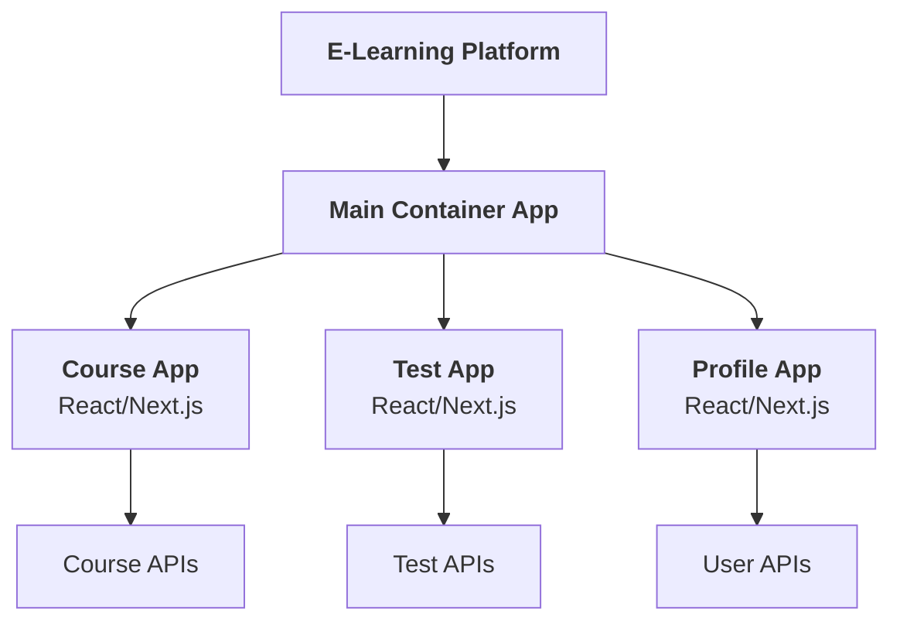
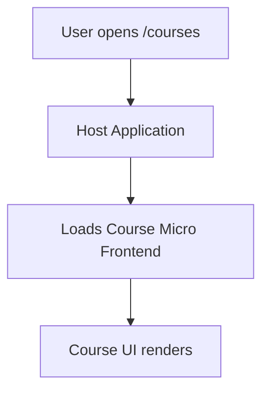
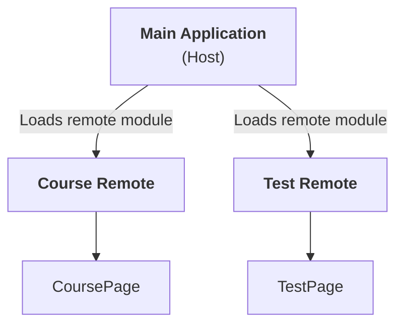
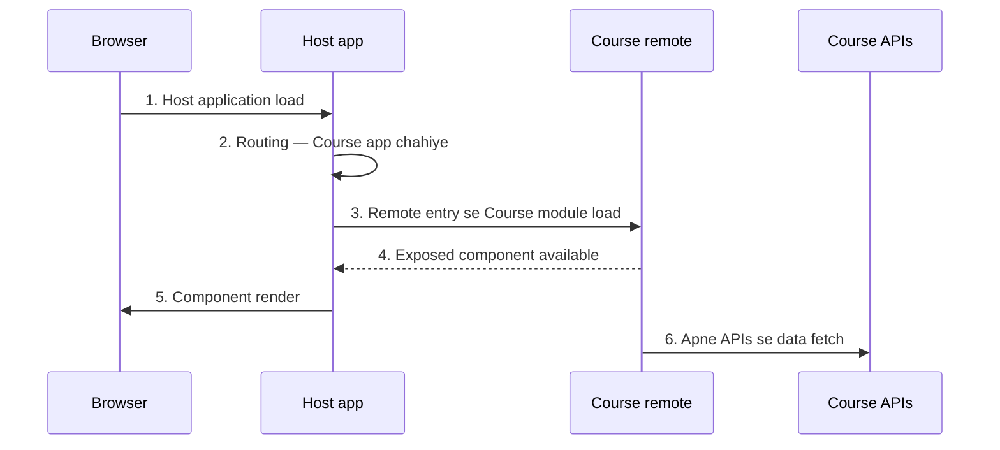
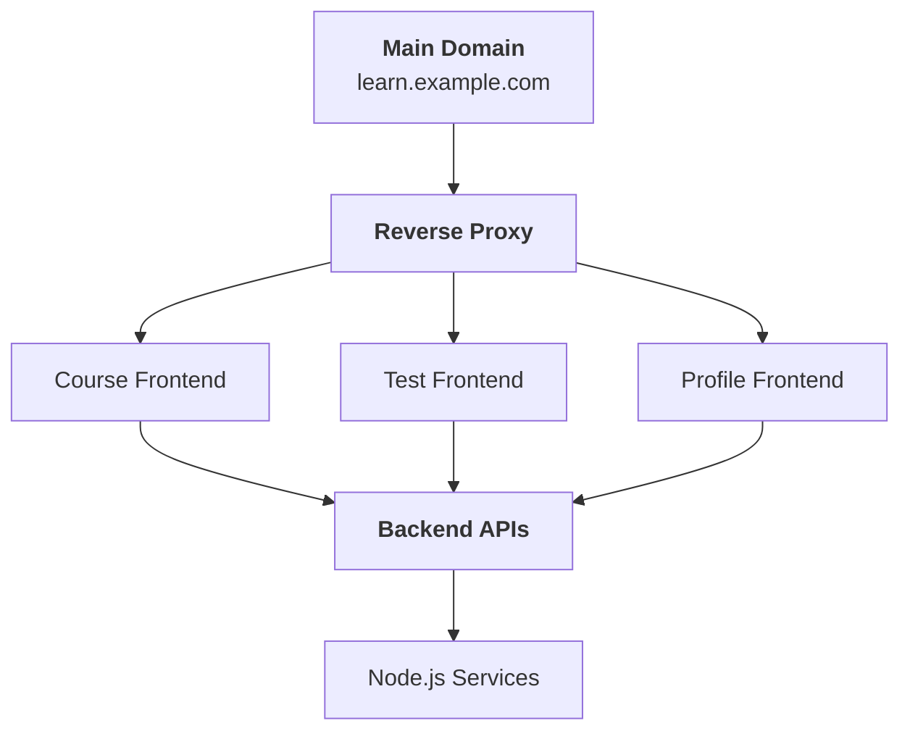
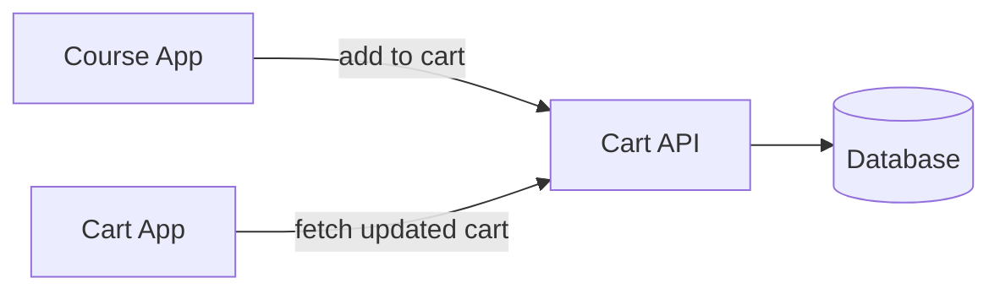
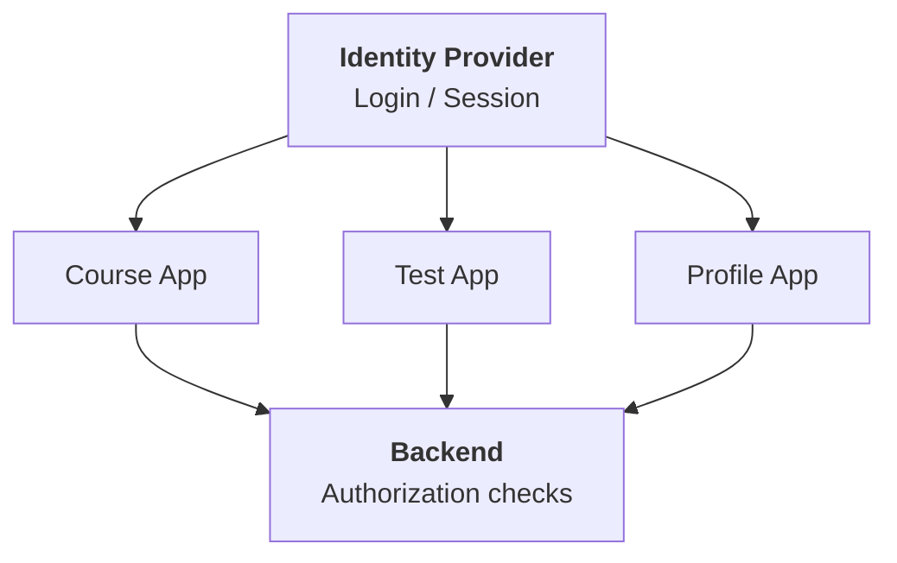
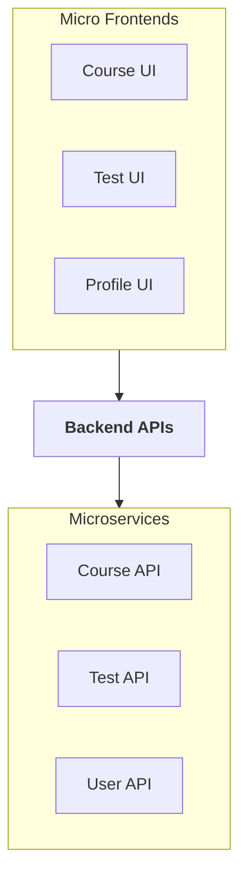

# Micro Frontend Architecture — basic se advanced tak

Micro Frontend Architecture ko basic se advanced level tak — real-world examples, folder structure, implementation, advantages/disadvantages aur interview questions ke saath. Examples React, Next.js aur Node.js ecosystem ko dhyan mein rakh kar hain.

---

## 1. Micro Frontend Architecture kya hai?

**Micro Frontend ek architectural approach hai jisme ek bade frontend application ko multiple chhote, independently developed aur independently maintained applications mein divide kar diya jata hai.**

Jaise backend mein hum microservices use karte hain, waise hi frontend mein Micro Frontends ka concept use kar sakte hain.

Lekin ek important baat: **Micro Frontend ka matlab sirf frontend ko multiple components mein divide karna nahi hai.** React components to hum normal application mein bhi banate hain.

Micro Frontend mein alag-alag teams application ke different parts ko develop, test, deploy aur maintain kar sakti hain.

### Real-world example: E-learning platform

Maan lo tum ek e-learning platform bana rahe ho, jisme ye features hain:

- User authentication
- Courses listing
- Video player
- Test series
- Shopping cart
- Payment
- User profile
- Admin dashboard

Ek traditional frontend architecture mein ye sab ek hi application ka part ho sakte hain.

Micro Frontend architecture mein hum application ko kuch independent frontend applications mein divide kar sakte hain.

Example:



Yahan:

- **Main Container App:** Application ka main shell, navigation aur common layout manage kar sakta hai.
- **Course App:** Courses ki listing aur course details handle karta hai.
- **Test App:** Tests, questions aur results handle karta hai.
- **Profile App:** User profile aur settings handle karta hai.

Har micro frontend ki apni team, codebase aur deployment pipeline ho sakti hai.

Dhyan rahe: har micro frontend ka apna backend hona zaroori nahi hai. Multiple micro frontends ek hi backend ya shared APIs ko use kar sakte hain.

---

## 2. Micro Frontend ki zaroorat kyun padi?

Isko samajhne ke liye pehle monolithic frontend samajhte hain.

### A. Monolithic Frontend Architecture

Maan lo tumhari application ka structure aisa hai:

```text
my-app/
├── src/
│   ├── components/
│   ├── pages/
│   ├── features/
│   │   ├── courses/
│   │   ├── tests/
│   │   ├── payments/
│   │   └── profile/
│   ├── services/
│   └── utils/
├── package.json
└── next.config.js
```

Yahan saare features ek hi application ke andar hain.

Is approach ko monolithic frontend kaha ja sakta hai, halanki modular monolith bhi ek well-structured architecture ho sakta hai.

### Problems kab aati hain?

Jab application aur development teams badi hone lagti hain.

| Problem | Kya hota hai |
|---|---|
| **Deployment dependency** | Payment team ke changes release karne ke liye poori application deploy karni pad sakti hai |
| **Team dependency** | Course aur test team same shared files badalti hain — merge conflicts aur coordination overhead |
| **Development complexity** | Codebase bada hone par build times, testing aur code ownership mushkil |
| **Technology constraints** | Poore frontend ko doosre framework par migrate karna costly |

**Problem 1: Deployment dependency**

Maan lo payment team ne apne feature mein changes kiye.

Agar deployment process poori frontend application ko release karta hai, to payment ke changes release karne ke liye poori application deploy karni pad sakti hai.

**Problem 2: Team dependency**

Course team aur test team ek hi codebase mein kaam kar rahi hain.

Dono teams ke changes same shared files ko affect kar sakte hain. Isse merge conflicts aur coordination overhead badh sakta hai.

**Problem 3: Development complexity**

Jaise-jaise codebase bada hota hai, build times, testing aur code ownership manage karna mushkil ho sakta hai.

**Problem 4: Technology constraints**

Agar ek existing application React mein hai, to poore frontend ko kisi doosre framework par migrate karna costly ho sakta hai.

Micro Frontend architecture in problems ko kuch situations mein reduce kar sakti hai.

Lekin yaad rakhna: Micro Frontends in problems ko automatically solve nahi karte. Galat implementation se architecture aur complex bhi ho sakta hai.

---

## 3. Micro Frontend vs Monolithic Frontend

| Feature | Monolithic Frontend | Micro Frontend |
|---|---|---|
| Codebase | Generally ek main application | Multiple independently managed applications ho sakti hain |
| Deployment | Aksar coordinated release | Independent deployment possible |
| Team ownership | Shared ya feature-based | Feature/domain-based ownership |
| Technology | Usually common stack | Different stacks possible |
| Testing | Application-wide integration kaafi important | Independent tests + integration tests |
| Initial setup | Generally simple | Comparatively complex |
| Infrastructure | Usually simpler | Routing, integration aur monitoring extra |
| Best fit | Small aur medium applications | Large products aur multiple independent teams |

**Interview point:** Micro Frontend har project ke liye best architecture nahi hai.

Agar tumhari team chhoti hai aur application manageable hai, to ek modular React ya Next.js application zyada practical ho sakti hai.

Micro Frontend ka real benefit tab aata hai jab independent team ownership aur independent releases ki actual requirement ho.

---

## 4. Micro Frontend architecture ke main components

Ab samajhte hain ki ek real Micro Frontend application mein kaun-kaun se parts hote hain.

### 4.1 Host / Shell Application

Host application ko shell ya container bhi kaha jata hai.

Ye application ke common structure ko manage karti hai.

Example:

```text
Host Application
│
├── Header
├── Sidebar
├── Navigation
├── Authentication integration
├── Global layout
└── Micro Frontend loading
```

Host application ki responsibilities ho sakti hain:

- Main navigation render karna.
- Different micro frontends ko load karna.
- Common layout maintain karna.
- Routing coordinate karna.
- Shared authentication state integrate karna.
- Error boundaries aur fallback UI provide karna.

Example URL structure:

```text
/courses
/courses/101
/tests
/profile
/payments
```

Host router decide kar sakta hai ki kis URL par kaunsa application render hoga.

Lekin routing ka ownership architecture par depend karta hai. Kabhi host poori routing manage karta hai aur kabhi individual micro frontends apne internal routes manage karte hain.

### 4.2 Remote Applications

Remote applications independently developed frontend modules hoti hain.

Example:

```text
course-app/
test-app/
profile-app/
payment-app/
```

Har application mein apne components, business logic, tests aur API integrations ho sakte hain.

Example:

```text
course-app/
├── src/
│   ├── components/
│   ├── pages/
│   ├── services/
│   └── hooks/
├── package.json
└── build configuration
```

Remote applications ko host ke saath integrate karne ke liye alag-alag techniques use ki ja sakti hain.

---

## 5. Micro Frontend implement karne ke approaches

Micro Frontend implement karne ka ek hi method nahi hai.

Common approaches hain:

1. Build-time integration
2. Runtime integration
3. Web Components
4. Iframe-based integration
5. Server-side composition
6. Route-based independent applications

Inmein se kaunsa choose karna hai, ye tumhari application ki requirements par depend karta hai.

### Approach 1: Build-time Integration

Is approach mein ek frontend application doosre frontend package ko dependency ki tarah install karti hai.

Example:

```bash
npm install @company/course-ui
```

Phir use import kar sakte hain:

```jsx
import { CoursePage } from "@company/course-ui";

export default function App() {
  return <CoursePage />;
}
```

Yahan course UI package ko build time par host application ke saath bundle kiya ja sakta hai.

#### Iska limitation kya hai?

Agar course package update hota hai, to host application ko updated package install karke rebuild aur redeploy karna pad sakta hai.

Isliye build-time integration mein independent development possible hai, lekin independent runtime deployment ka benefit limited ho sakta hai.

**Important:** Ek shared component library aur independently deployed Micro Frontend application same cheez nahi hain.

### Approach 2: Runtime Integration

Runtime integration mein host application running time par doosre frontend application ko load karti hai.

Example:



Agar course application independently deploy hoti hai, to host ko har update ke liye rebuild karna zaroori nahi hota — provided host remote application ko runtime par load karta hai aur uski compatibility maintained hai.

Runtime integration ke liye common options:

- Module Federation
- Web Components
- Runtime JavaScript loading
- Single-spa jaise orchestration frameworks

| | Build-time integration | Runtime integration |
|---|---|---|
| Kaise | Package install karke bundle | Running time par remote load |
| Remote update par | Host ko rebuild + redeploy | Host rebuild zaroori nahi (compatibility ho to) |
| Independent deployment | Limited | Possible |
| Complexity | Kam | Zyada (loading, versions, failures) |

---

## 6. Module Federation kya hai?

**Module Federation ek mechanism hai jiske through independently built JavaScript applications runtime par apne code ke modules doosri applications ke saath share kar sakti hain.**

Ye Micro Frontend architecture implement karne ke liye commonly discussed approaches mein se ek hai.

Module Federation ko Webpack ecosystem mein popular banaya gaya. Iske liye modern tooling mein bhi options hain, lekin exact configuration bundler aur framework ke hisaab se badalti hai.

Iska concept samajhne ke liye teen terms important hain:

- Host
- Remote
- Shared dependencies

### 6.1 Host

Host wo application hai jo remote module ko load karti hai.

Example:

```text
main-app/
```

### 6.2 Remote

Remote wo application hai jo apne modules ko doosri applications ke liye expose karti hai.

Example:

```text
course-app/
```

### 6.3 Exposed Module

Remote application apne kisi component ya module ko expose kar sakti hai.

Example:

```text
CoursePage
```

Host us module ko load karke render kar sakti hai.

#### Architecture



### 6.4 Module Federation ka flow

Maan lo user `/courses` open karta hai.



1. Browser host application load karta hai.
2. Host routing decide karti hai ki Course application chahiye.
3. Host configured remote entry se Course module load karti hai.
4. Remote module ka exposed component available hota hai.
5. Host component ko render karti hai.
6. Course application apne APIs se data fetch kar sakti hai.

Conceptually:

```jsx
const CoursePage = React.lazy(
  () => import("courseApp/CoursePage")
);

function App() {
  return (
    <React.Suspense fallback={<p>Loading courses...</p>}>
      <CoursePage />
    </React.Suspense>
  );
}
```

**Important:** `courseApp/CoursePage` ek conceptual federated import hai. Ye tabhi work karega jab tumhari bundler configuration mein `courseApp` remote aur `CoursePage` exposed module correctly configured hon.

Sirf ye code likhne se Module Federation enable nahi ho jata.

#### Module Federation ke benefits

- Runtime par remote code load karna.
- Independent deployment workflows support karna.
- Selected dependencies share karna.
- Different teams ko separate frontend ownership dena.

#### Challenges

- Remote application unavailable ho sakti hai.
- Remote aur host ke versions incompatible ho sakte hain.
- Shared dependency conflicts aa sakte hain.
- Initial loading aur debugging complex ho sakte hain.
- Security aur runtime compatibility carefully manage karni padti hai.

Ek practical rule: **Remote loading ke saath error handling aur fallback UI zaroor design karo.**

---

## 7. React aur Next.js mein Micro Frontend

### React applications

React mein Micro Frontend architecture ke liye multiple options hain:

- Module Federation
- Web Components
- Single-spa
- Route-based application composition
- Build-time package integration

Har option ki trade-offs alag hain.

### Next.js applications

Next.js application ko Micro Frontend architecture mein use karna possible hai, lekin configuration tumhare Next.js version, router aur bundler par depend karegi.

Next.js App Router, Server Components, SSR aur client-side hydration ki wajah se integration ko carefully design karna hota hai.

Ek important distinction:

**Next.js application ko multiple route groups mein divide karna automatically Micro Frontend nahi hai.**

Example:

```text
app/
├── courses/
├── tests/
├── profile/
└── payments/
```

Ye ek hi Next.js application ke routes hain. Ye modular monolith ho sakti hai.

Agar tum in routes ko independently deploy hone wali applications mein divide karte ho aur runtime ya routing layer par integrate karte ho, tab tum Micro Frontend architecture ki taraf ja rahe ho.

#### Next.js ke liye ek practical architecture



Example route mapping:

```text
learn.example.com/courses/*  -> Course application
learn.example.com/tests/*    -> Test application
learn.example.com/profile/*  -> Profile application
```

Ye reverse proxy ya edge routing se implement kiya ja sakta hai.

Is model mein har frontend ko alag deploy kiya ja sakta hai. Lekin navigation, authentication, shared UI, cookies, API access aur cross-application transitions ko consistently manage karna hoga.

---

## 8. Micro Frontend ka folder structure

Maan lo hum ek e-learning platform bana rahe hain.

```text
learning-platform/
│
├── apps/
│   │
│   ├── shell/
│   │   ├── src/
│   │   ├── package.json
│   │   └── build-config
│   │
│   ├── courses/
│   │   ├── src/
│   │   │   ├── components/
│   │   │   ├── pages/
│   │   │   ├── services/
│   │   │   └── hooks/
│   │   ├── package.json
│   │   └── build-config
│   │
│   ├── tests/
│   │   ├── src/
│   │   ├── package.json
│   │   └── build-config
│   │
│   └── profile/
│       ├── src/
│       ├── package.json
│       └── build-config
│
├── packages/
│   ├── ui/
│   ├── auth-client/
│   ├── shared-types/
│   └── eslint-config/
│
├── package.json
└── README.md
```

Yahan `apps/` ke andar independent applications hain, jabki `packages/` mein shared code ho sakta hai.

Lekin ek important baat:

**Monorepo aur Micro Frontend alag concepts hain.**

- **Monorepo** code ko ek repository mein organize karne ka approach hai.
- **Micro Frontend** frontend architecture ka approach hai.
- **Independent deployment** ek deployment capability hai, jo sahi architecture aur infrastructure se achieve ki ja sakti hai.

Tum Micro Frontends ko monorepo mein bhi rakh sakte ho aur multiple repositories mein bhi.

Monorepo mein code hone ka matlab ye nahi ki saari applications ek saath deploy karni hi padengi.

---

## 9. Micro Frontends ke beech communication kaise hota hai?

Maan lo user Course application mein kisi course ko cart mein add karta hai.

Ab Cart application ko kaise pata chalega ki ek course add hua hai?

Iske multiple solutions hain.

### Method 1: Props ya callbacks

Agar ek micro frontend ko doosre component ke andar embed kiya gaya hai aur integration layer support karti hai, to props ya callbacks pass kar sakte hain.

Conceptual example:

```jsx
<CourseApp
  userId={user.id}
  onAddToCart={handleAddToCart}
/>
```

Yahan host `onAddToCart` callback provide kar raha hai.

Ye tab useful hai jab applications ke beech direct component-level integration ho.

Lekin independently deployed applications ke beech normal React props automatically available nahi hote.

### Method 2: Custom Events

Browser ke native events ka use kar sakte hain.

Course application:

```js
window.dispatchEvent(
  new CustomEvent("cart:add", {
    detail: {
      courseId: 101,
      quantity: 1,
    },
  })
);
```

Host application:

```js
function handleCartAdd(event) {
  console.log("Cart item:", event.detail);
}

window.addEventListener("cart:add", handleCartAdd);
```

Cleanup karna bhi zaroori hai:

```js
window.removeEventListener(
  "cart:add",
  handleCartAdd
);
```

**Important:** Ye example same browser window mein events communicate karne ke liye hai. Alag browser tabs ya separate windows mein communication ke liye alag mechanism chahiye.

Custom events loosely coupled communication provide kar sakte hain, lekin event names, payload schemas aur ownership ke clear contracts hone chahiye.

### Method 3: Shared State

Applications shared state use kar sakti hain, lekin is approach ko carefully design karna chahiye.

Examples:

- Shared state library
- Shared authentication client
- Shared event bus
- Browser storage, specific use cases mein

Har application ko ek hi global store se tightly couple kar dena Micro Frontend architecture ke benefits ko reduce kar sakta hai.

### Method 4: Backend as the source of truth

Kuch data ke liye shared frontend state ki jagah backend ko source of truth banana better hota hai.

Example:



Ye approach multiple tabs, sessions aur devices mein consistency ke liye useful ho sakti hai.

### Communication ke liye kya choose karein?

| Requirement | Possible approach |
|---|---|
| Child component ko host data dena | Props |
| Simple browser-level notification | Custom Events |
| Shared client-side state | Shared state library, with clear ownership |
| Cart, orders ya payment state | Backend APIs |
| Authentication | Shared identity/session strategy |

Har data ko globally share karna zaroori nahi hai.

---

## 10. Authentication aur authorization

Ye production Micro Frontend architecture ka important part hai.

Maan lo user login karta hai aur uske baad Course, Test aur Profile applications access karta hai.

Humein ensure karna hai ki authentication har application mein consistently work kare.

Possible design:



Common approaches:

- Centralized identity provider.
- Secure server-managed sessions.
- Properly configured cookies.
- Token-based authentication, where appropriate.

Important security rules:

1. Sirf frontend par authentication checks depend mat karo.
2. Backend har protected operation par authorization validate kare.
3. Tokens ko unnecessary applications ke saath share mat karo.
4. Browser storage mein sensitive tokens rakhne ke security implications samjho.
5. Different subdomains ke beech cookie scope aur CORS configuration carefully set karo.

Agar saari applications same parent domain par hain, tab bhi cookie sharing aur session behavior automatically safe ya correct nahi ho jata. Configuration aur threat model matter karte hain.

---

## 11. Shared UI aur dependencies

Maan lo har Micro Frontend apna Header banata hai.

```text
Course App  -> Header A
Test App    -> Header B
Profile App -> Header C
```

Ab agar design team Header ka color change karti hai, to multiple applications update karni pad sakti hain.

Isliye teams shared UI library bana sakti hain:

```text
packages/
└── ui/
    ├── Button
    ├── Input
    ├── Modal
    ├── Header
    └── DesignTokens
```

Applications ise dependency ki tarah use kar sakti hain.

Lekin **shared UI library aur shared runtime dependency alag concepts hain.**

Shared UI package build time par consume ho sakta hai, jabki Module Federation jaise systems selected dependencies ko runtime par share kar sakte hain.

### React ko share karna chahiye?

Module Federation mein React jaise dependencies share karna duplicate downloads aur multiple React instances se bachne mein help kar sakta hai.

Lekin versions aur configuration compatible hone chahiye.

Agar incompatible React instances ya rendering assumptions hain, to bugs aa sakte hain.

Isliye shared dependencies ke liye:

- Version compatibility define karo.
- Upgrade strategy rakho.
- Integration tests likho.
- Critical dependencies ke ownership rules set karo.

---

## 12. Routing kaise handle karte hain?

Maan lo application ke URLs hain:

```text
/courses
/courses/101
/tests
/tests/attempt/500
/profile
```

Do common patterns hain.

### Pattern A: Host-level routing

Host application decide karti hai ki kaunsa Micro Frontend load hoga.

```text
/courses/* -> Course App
/tests/*   -> Test App
/profile/* -> Profile App
```

### Pattern B: Route-based application deployment

Reverse proxy ya edge layer URL ke basis par alag application serve karti hai.

```text
/courses/* -> Course frontend server
/tests/*   -> Test frontend server
/profile/* -> Profile frontend server
```

| | Host-level routing | Route-based deployment |
|---|---|---|
| Kaun decide karta hai | Host application (browser me) | Reverse proxy / edge layer |
| Kya serve hota hai | Same page me remote load | Alag frontend server |

Dono approaches mein deep linking, refresh, 404 handling aur browser back/forward navigation test karna zaroori hai.

Agar user directly `/courses/101` open karta hai, to route sahi application tak pahunchna chahiye.

---

## 13. Micro Frontend ke advantages

1. **Independent deployment:** Course application ka update release karne ke liye har situation mein Test application redeploy karna zaroori nahi hota.
2. **Team autonomy:** Course team apne domain ki development aur release manage kar sakti hai.
3. **Clear ownership:** Har team apne business domain ke liye accountable ho sakti hai.
4. **Gradual migration:** Purani application ke kuch parts ko naye frontend se replace kiya ja sakta hai, bina poori application ko ek saath rewrite kiye.
5. **Technology flexibility:** Different teams different technologies use kar sakti hain, agar integration contracts aur maintenance strategy allow karein.

Lekin different frameworks use karna compulsory nahi hai. Multiple React applications bhi Micro Frontend architecture ka part ho sakti hain.

---

## 14. Micro Frontend ke disadvantages

Interview mein sirf benefits batana enough nahi hai. Trade-offs samajhna bhi zaroori hai.

| Disadvantage | Kya hota hai |
|---|---|
| **Operational complexity** | Multiple applications ko build, deploy, monitor aur maintain karna padta hai |
| **Duplicate dependencies** | Same libraries alag bundles me — total JavaScript size badh sakta hai |
| **Performance overhead** | Multiple bundles, network requests aur runtime initialization se loading slow |
| **Inconsistent UI** | Design system aur component versions manage na hon to UI inconsistent |
| **Cross-application communication** | State, navigation aur events ke contracts maintain karna complex |
| **Debugging complexity** | Bug host, remote, shared dependency ya integration layer — kahin bhi ho sakta hai |
| **Security boundaries** | Runtime par remote JavaScript load karna — Micro Frontend automatic sandbox nahi |
| **Testing complexity** | Independent tests ke alawa integration aur end-to-end tests bhi chahiye |

**Conclusion:** Micro Frontends organizational complexity ko manage karne mein help kar sakte hain, lekin technical complexity ko khatam nahi karte.

---

## 15. Micro Frontend vs Microservices

| Feature | Micro Frontend | Microservices |
|---|---|---|
| Layer | Frontend | Backend |
| Unit | Independently managed frontend application | Independently managed backend service |
| Responsibility | UI aur frontend behavior | Business logic, APIs aur data processing |
| Communication | Events, imports, routing, HTTP, etc. | Usually HTTP, messaging, RPC, etc. |
| Deployment | Frontend artifacts/apps | Backend services |
| Example | Course UI, Test UI | Course service, Payment service |

Example:



Frontend aur backend boundaries ka one-to-one mapping zaroori nahi hai.

Ek Course Micro Frontend multiple backend services ko call kar sakta hai, aur ek backend API multiple micro frontends se use ho sakti hai.

---

## 16. Production architecture mein kya-kya sochna chahiye?

Agar tum real company mein Micro Frontend implement kar rahe ho, to sirf components ko split karna enough nahi hai.

Ye areas plan karne honge:

| Area | Important question |
|---|---|
| Deployment | Kya har app independently deploy ho sakti hai? |
| Routing | Kaun URL aur navigation control karega? |
| Authentication | Login aur session kaise share honge? |
| Shared UI | Design system aur versions kaise maintain honge? |
| Communication | Apps ke beech events aur data ka contract kya hai? |
| Performance | Initial JavaScript aur remote loading kaise optimize honge? |
| Error handling | Agar ek remote fail ho jaye to kya hoga? |
| Monitoring | Frontend errors aur performance ko kaise track karenge? |
| Security | Remote code aur APIs ko kaise secure rakhenge? |
| Testing | Independent aur integration tests kaise run honge? |

### Remote application unavailable ho to?

Maan lo Course remote load nahi ho pa rahi.

Poor implementation mein poori application crash ho sakti hai.

Better design mein:

- Loading indicator show ho.
- Error boundary ya fallback UI render ho.
- Failure log ho.
- Retry mechanism carefully implement kiya jaye.
- Nonessential feature fail hone par baaki application accessible rahe, agar architecture allow karti ho.

Example:

```jsx
function CourseFallback() {
  return (
    <div>
      <h2>Courses are temporarily unavailable</h2>
      <p>Please try again in a moment.</p>
    </div>
  );
}
```

Ye sirf fallback component ka example hai. Actual remote loading ke liye tumhe apne integration mechanism ke according error handling configure karni hogi.

---

## 17. Micro Frontend vs Monorepo vs Turborepo

In concepts ko confuse nahi karna chahiye.

| Concept | Kya hai |
|---|---|
| **Monorepo** | Multiple projects ka source code ek repository mein rakhta hai |
| **Micro Frontend** | Frontend ko independently managed applications ya deployable units mein organize karta hai |
| **Turborepo** | Monorepo workflows ko optimize karne ke liye build system — task orchestration aur caching |

Example:

```text
learning-platform/
├── apps/
│   ├── shell/
│   ├── courses/
│   ├── tests/
│   └── profile/
│
├── packages/
│   ├── ui/
│   ├── eslint-config/
│   └── shared-types/
│
└── turbo.json
```

Yahan:

- `apps/` mein multiple frontend applications hain.
- `packages/` mein reusable packages hain.
- `turbo.json` Turborepo tasks configure kar sakta hai.
- Har application ke liye independent deployment pipeline ho sakti hai.

Lekin Turborepo Micro Frontend runtime integration provide nahi karta. Runtime integration ke liye alag architecture ya tooling chahiye.

Isi tarah, Micro Frontends banane ke liye Turborepo ya Nx mandatory nahi hain.

---

## 18. Kya har frontend application ko Micro Frontend bana dena chahiye?

Nahi. Ye bahut important architectural decision hai.

| Micro Frontend consider karo jab | Modular frontend prefer karo jab |
|---|---|
| Application aur teams ka size kaafi bada ho | Team chhoti ho |
| Teams ke release schedules alag hon | Application abhi manageable ho |
| Clear domain ownership chahiye | Saare features ek release process me comfortably handle ho rahe hon |
| Independent deployments ki actual requirement ho | Independent deployment ka strong business reason na ho |
| Existing frontend ko gradually migrate karna ho | Micro Frontend infrastructure ka overhead benefit se zyada ho |

**Interview-ready conclusion:** Micro Frontend architecture ko sirf codebase bada hone ki wajah se choose nahi karna chahiye. Iska strongest justification usually team autonomy, domain ownership aur independent delivery hota hai.

---

## 19. Interview Questions and Answers

### Q1. What is Micro Frontend architecture?

Micro Frontend is an architectural approach in which a large frontend application is divided into smaller, independently developed and potentially independently deployed frontend applications.

### Q2. What is the difference between Micro Frontend and component-based architecture?

Component-based architecture UI ko reusable components mein divide karti hai. Micro Frontend architecture independently managed applications ya deployable frontend units ko integrate karti hai.

Ek Micro Frontend ke andar bhi React components hote hain.

### Q3. What is Module Federation?

Module Federation ek mechanism hai jo independently built JavaScript applications ko runtime par modules expose aur consume karne deta hai.

### Q4. What is the difference between Host and Remote?

Host remote module ko load karti hai, jabki Remote apne selected modules ko doosri applications ke liye expose karti hai.

### Q5. How do Micro Frontends communicate?

Architecture ke hisaab se props, callbacks, custom browser events, shared state, routing aur backend APIs use kiye ja sakte hain. Communication contracts clearly define karne chahiye.

### Q6. What are the disadvantages of Micro Frontend?

Operational complexity, duplicated dependencies, performance overhead, inconsistent UI, integration issues, debugging complexity aur testing overhead.

### Q7. Is Micro Frontend the same as Microservices?

Nahi. Micro Frontend frontend architecture hai, jabki Microservices backend services ko independently manage karne ka architectural approach hai.

### Q8. Can we implement Micro Frontends without Module Federation?

Haan. Route-based composition, reverse proxy routing, Web Components, iframe-based integration aur doosre runtime composition methods use kiye ja sakte hain.

### Q9. Does Micro Frontend require a monorepo?

Nahi. Micro Frontends ek monorepo mein ya multiple repositories mein organize kiye ja sakte hain.

### Q10. How would you design Micro Frontend architecture for a large e-learning platform?

Main domain-based applications identify karunga, jaise Courses, Tests, Profile aur Payments. Common navigation aur routing ke liye shell ya routing layer design karunga, shared authentication aur design system define karunga, APIs ke contracts establish karunga aur har application ke liye independent build, deployment, monitoring aur integration testing plan karunga.

---

## 20. Kis order mein padhna chahiye?

Micro Frontend ko is sequence mein master karo:

| Phase | Topic | Goal |
|---|---|---|
| 1 | Monolithic vs modular frontend | Architecture ka reason samajhna |
| 2 | Micro Frontend fundamentals | Host, Remote aur application boundaries |
| 3 | Composition strategies | Build-time, runtime, route-based integration |
| 4 | Module Federation | Host, Remote, exposed modules aur shared dependencies |
| 5 | React implementation | Do applications ko integrate karna |
| 6 | Routing | Deep links aur navigation handle karna |
| 7 | Communication | Custom events, props aur backend APIs |
| 8 | Authentication | Shared login aur authorization |
| 9 | Performance | Lazy loading, bundle size aur caching |
| 10 | Production concerns | Error handling, monitoring aur security |
| 11 | Monorepo | Apps, shared packages aur deployment pipelines |
| 12 | System design | Trade-offs aur architecture decisions |

## Final takeaway

Micro Frontend architecture ko samajhne ke liye ye chaar points yaad rakhna:

1. **Micro Frontend = frontend applications ki architectural decomposition.**
2. **Module Federation = runtime par modules share aur consume karne ka ek mechanism.**
3. **Monorepo = code repository organize karne ka approach.**
4. **Independent deployment = architecture aur deployment pipeline se milne wali capability.**

Ye chaar concepts related hain, lekin ek doosre ke synonyms nahi hain.

**Next practical step:** Ek simple project banao jisme do independent React applications hon — `shell-app` aur `course-app`. Pehle unhe route-based integration se samjho, phir Module Federation use karke runtime integration implement karo. Isse theory ke saath actual architecture ka difference bhi clear ho jayega.
