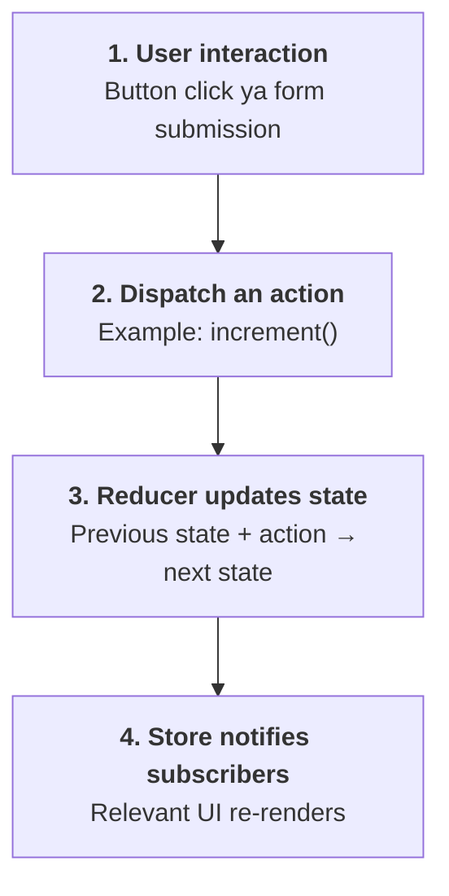
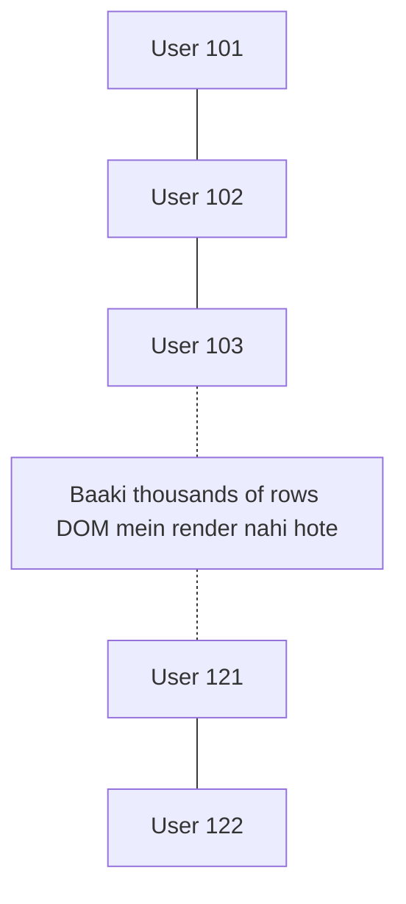

# React/Frontend Interview — Project Architecture, Accessibility, JavaScript, Performance, Testing aur Live Coding

Is topic ka focus hai Project Architecture, Accessibility, JavaScript, React Performance, Browser Testing aur Live Coding par. Har section mein interview-ready answers, code examples aur practical scenarios hain.

# 1. Project & Architecture

## Q1. Can you tell me about your current project and responsibilities?

Interviewer yeh check karna chahta hai ki tum apne project ko kitna deeply samajhte ho aur usmein tumhara actual contribution kya hai.

Answer ko 5 parts mein structure karo:

1. Project kya karta hai?
2. Kaunsi technologies use hoti hain?
3. Tumhari responsibilities kya hain?
4. Tumne kaunsi challenging problem solve ki?
5. Project ya team ko kya benefit mila?

Example answer — apne actual experience ke according customize karna:

> I am working on a web application built using React/Next.js and JavaScript/TypeScript. The application provides users with features such as authentication, content browsing, and interactive user workflows.
>
> My responsibilities include developing reusable UI components, integrating backend APIs, managing application state, handling loading and error states, and optimizing frontend performance.
>
> I also work on debugging issues, maintaining code quality, and collaborating with backend developers to ensure smooth integration between the frontend and backend.
>
> One of my key focuses is building maintainable components and handling edge cases so that the application remains reliable as new features are added.

Interview tip: Apne project ka actual example ready rakho. Interviewer pooch sakta hai: “Tumne khud kya implement kiya?”, “API failure ko kaise handle kiya?” aur “Performance improve kaise ki?”

## Q2. How do you structure a new React/Next.js project?

Project structure ka purpose code ko maintainable, reusable aur easy to navigate banana hai.

Next.js App Router ka example:

```text
my-app/
├── public/
├── src/
│   ├── app/
│   │   ├── layout.tsx
│   │   ├── page.tsx
│   │   └── courses/
│   │       └── page.tsx
│   ├── components/
│   │   ├── ui/
│   │   └── layout/
│   ├── features/
│   │   └── courses/
│   │       ├── components/
│   │       ├── hooks/
│   │       ├── api/
│   │       └── types.ts
│   ├── lib/
│   │   ├── api-client.ts
│   │   └── utils.ts
│   ├── hooks/
│   └── types/
├── package.json
└── tsconfig.json
```

### Important folders

- `app/`: Routes, layouts, pages aur route-level loading/error UI.
- `components/`: Reusable UI components.
- `features/`: Feature-specific components, hooks aur business logic.
- `lib/`: Shared utilities aur infrastructure, jaise API client.
- `hooks/`: Reusable custom Hooks.
- `types/`: Shared TypeScript types.

Next.js mein `app/` directory ki routing conventions follow karni hoti hain. Har project mein itne folders banana zaroori nahi; project ke size ke according structure evolve karna chahiye.

Interview answer: Main feature-based structure prefer karta hoon, jahan related components, API logic aur types ek feature ke paas rehte hain. Shared components aur utilities ko separate rakhta hoon, aur project ko unnecessary abstraction se bachata hoon.

## Q3. How do you manage API calls and state management?

Yahan interviewer dekhna chahta hai ki tum server se aane wale data aur UI state ko kaise manage karte ho.

State ko broadly teen categories mein samajh sakte ho:

| State type | Example | Common approach |
|---|---|---|
| Local UI state | Modal open/close | `useState` |
| Server state | Course list, user profile | Fetching library, framework data APIs |
| Shared client state | Cart, theme, selected filters | Context, Redux Toolkit, Zustand |

### API call ka example

```jsx
import { useEffect, useState } from "react";

function Courses() {
  const [courses, setCourses] = useState([]);
  const [loading, setLoading] = useState(true);
  const [error, setError] = useState("");

  useEffect(() => {
    const controller = new AbortController();

    async function loadCourses() {
      try {
        const response = await fetch("/api/courses", {
          signal: controller.signal
        });

        if (!response.ok) {
          throw new Error("Failed to fetch courses");
        }

        const data = await response.json();
        setCourses(data);
      } catch (err) {
        if (err.name !== "AbortError") {
          setError(err.message);
        }
      } finally {
        if (!controller.signal.aborted) {
          setLoading(false);
        }
      }
    }

    loadCourses();

    return () => controller.abort();
  }, []);

  if (loading) return <p>Loading...</p>;
  if (error) return <p>{error}</p>;

  return courses.map(course => (
    <p key={course.id}>{course.title}</p>
  ));
}
```

Yeh client-side fetching ka basic example hai. Next.js mein initial server data ke liye Server Components ya framework-level data fetching bhi appropriate ho sakti hai.

### API calls manage karte waqt kya dhyan rakhen?

- Loading, error aur empty states.
- Request cancellation aur race conditions.
- Authentication aur authorization.
- Retry strategy, jahan suitable ho.
- Caching aur stale data.
- Duplicate requests ko avoid karna.

Important: API call ka result server state hai. Use bina reason Redux mein copy karna hamesha zaroori nahi hota.

## Q4. Explain Redux data flow.

Redux ek predictable state-management library hai. Redux Toolkit modern Redux applications ke liye recommended approach hai.

Redux ka unidirectional data flow:



Example:

```js
import { createSlice } from "@reduxjs/toolkit";

const counterSlice = createSlice({
  name: "counter",
  initialState: { value: 0 },
  reducers: {
    increment(state) {
      state.value += 1;
    },
    decrement(state) {
      state.value -= 1;
    }
  }
});

export const { increment, decrement } =
  counterSlice.actions;

export default counterSlice.reducer;
```

Redux Toolkit mein reducer ke andar `state.value += 1` likhna allowed hai, kyunki Redux Toolkit Immer ke through immutable update produce karta hai.

Interview answer: Redux flow mein components actions dispatch karte hain, reducers next state calculate karte hain aur store update hone par subscribed components latest state ke according render hote hain.

# 2. HTML & Accessibility

Accessibility ka matlab website ko keyboard, screen reader aur different abilities wale users ke liye usable banana hai.

## Q1. What is the importance of semantic HTML?

Semantic HTML mein elements apne meaning aur purpose ke according use hote hain.

Example:

```html
<header>
  <nav aria-label="Main navigation">
    <a href="/">Home</a>
    <a href="/courses">Courses</a>
  </nav>
</header>

<main>
  <article>
    <h1>Learn React</h1>
    <p>Learn React from basics to advanced.</p>
    <button type="button">Enroll Now</button>
  </article>
</main>

<footer>
  <p>Copyright 2026</p>
</footer>
```

### Semantic HTML kyun important hai?

- Screen readers page structure ko better understand kar sakte hain.
- Keyboard navigation aur native browser behavior better hota hai.
- Code readable aur maintainable hota hai.
- Search engines ko content structure samajhne mein help milti hai.

Compare karo:

```html
<div onclick="submitForm()">Submit</div>
```

Versus:

```html
<button type="button" onclick="submitForm()">
  Submit
</button>
```

Button naturally keyboard-accessible hai, focus receive kar sakta hai aur screen readers ko button ke roop mein identify hota hai.

Interview answer: Semantic HTML elements content ka meaning convey karte hain, assistive technologies ko structure samajhne mein help karte hain aur built-in browser functionality provide karte hain.

## Q2. How do you test keyboard navigation and accessibility?

Har interactive element ko keyboard se operate kar pana chahiye.

Common keys:

- `Tab`: Next focusable element.
- `Shift + Tab`: Previous focusable element.
- `Enter`: Links aur buttons activate karna.
- `Space`: Buttons aur checkboxes activate karna.
- Arrow keys: Kuch composite widgets, jaise radio groups aur menus, mein navigation.

### Practical testing checklist

1. Mouse use kiye bina poori website navigate karo.
2. Check karo focus indicator clearly visible hai.
3. Modal open hone par focus modal ke andar move hota hai.
4. Modal close hone par focus appropriate element par return hota hai.
5. Form inputs ke labels aur error messages accessible hain.
6. Screen reader se headings, links aur controls test karo.

Automated tools jaise axe DevTools aur Lighthouse bhi help karte hain, lekin automated testing saare accessibility issues detect nahi kar sakti.

## Q3. If you assign `role="button"` to a non-button element, how does it behave?

Example:

```html
<div role="button" tabindex="0">
  Submit
</div>
```

`role="button"` assistive technology ko batata hai ki element button ki tarah behave karta hai.

Lekin yeh element automatically native button nahi ban jata.

Ismein khud implement karna padega:

- Keyboard focus.
- `Enter` se activation.
- `Space` se activation.
- Appropriate disabled behavior, agar applicable ho.
- Focus styling aur event handling.

Native button mein yeh behaviors largely built-in hote hain.

## Q4. Why is a native `<button>` preferred over `role="button"`?

```html
<button type="button">Submit</button>
```

Native button automatically:

- Keyboard interaction support karta hai.
- Focusable hota hai.
- Accessibility tree mein button ke roop mein expose hota hai.
- Mouse, keyboard aur assistive technology ke expected behaviors follow karta hai.
- Form ke andar `type="button"` hone par unintended form submission avoid karta hai.

Interview answer: `role="button"` semantics add karta hai, functionality nahi. Native button semantics aur interaction behavior dono provide karta hai, isliye native element preferred hai.

## Q5. How do you manage focus after user interactions?

Focus management single-page applications mein bahut important hai.

### Examples

- **Modal open hone par:** Focus modal ke first appropriate control par move karo.
- **Modal close hone par:** Focus us button par return karo jisne modal open kiya tha.
- **Route change par:** Page heading par focus move karna useful ho sakta hai, especially jab user ko new page context announce karna ho.
- **Form submit hone par:** Error summary ya first invalid field par focus move kiya ja sakta hai.

React example:

```jsx
import { useEffect, useRef } from "react";

function SearchDialog({ open }) {
  const inputRef = useRef(null);

  useEffect(() => {
    if (open) {
      inputRef.current?.focus();
    }
  }, [open]);

  if (!open) return null;

  return (
    <div role="dialog" aria-modal="true"
         aria-labelledby="search-title">
      <h2 id="search-title">Search courses</h2>
      <input ref={inputRef} aria-label="Search courses" />
    </div>
  );
}
```

Yeh sirf focus move karne ka example hai. Production modal mein focus trapping, Escape behavior, background interaction management aur focus restoration bhi handle karna chahiye.

# 3. JavaScript & React

## Q1. What is the difference between `||` and `??`?

Dono default value provide karne ke liye use hote hain, lekin inki conditions alag hain.

### `||` — Logical OR

Left value falsy hone par right value return karta hai.

Falsy values mein `0`, `false`, `""`, `null`, `undefined` aur `NaN` shamil hain.

```js
const quantity = 0 || 10;

console.log(quantity); // 10
```

### `??` — Nullish coalescing

Sirf `null` ya `undefined` hone par right value return karta hai.

```js
const quantity = 0 ?? 10;

console.log(quantity); // 0
```

### Comparison

| Value | `value \|\| 10` | `value ?? 10` |
|---|---:|---:|
| `0` | `10` | `0` |
| `false` | `10` | `false` |
| `""` | `10` | `""` |
| `null` | `10` | `10` |
| `undefined` | `10` | `10` |

Real-world example: Agar cart quantity `0` valid value hai, to `??` use karna better hai. Agar empty string bhi invalid hai aur default chahiye, to `||` suitable ho sakta hai.

## Q2. Explain controlled vs uncontrolled components

Yeh React forms se related question hai.

### Controlled component

Input ki value React state control karti hai.

```jsx
import { useState } from "react";

function LoginForm() {
  const [email, setEmail] = useState("");

  return (
    <input
      value={email}
      onChange={event => setEmail(event.target.value)}
      placeholder="Enter email"
    />
  );
}
```

Yahan input ki value state ke saath synchronized hai.

### Uncontrolled component

Input apni value DOM mein maintain karta hai. Zaroorat par ref se value read kar sakte hain.

```jsx
import { useRef } from "react";

function LoginForm() {
  const emailRef = useRef(null);

  function handleSubmit(event) {
    event.preventDefault();
    console.log(emailRef.current.value);
  }

  return (
    <form onSubmit={handleSubmit}>
      <input ref={emailRef} placeholder="Enter email" />
      <button type="submit">Submit</button>
    </form>
  );
}
```

### Difference

| Controlled | Uncontrolled |
|---|---|
| Value React state mein | Value DOM mein |
| Har relevant change par state update | Value ref se read kar sakte hain |
| Conditional UI aur live validation ke liye useful | Simple forms aur DOM-based integrations mein useful |
| Input state explicitly manage hoti hai | Less state-management code ho sakta hai |

Interview answer: Controlled inputs React state se drive hote hain, jabki uncontrolled inputs apni current value DOM mein maintain karte hain. Main controlled components tab prefer karta hoon jab live validation, dependent fields ya dynamic UI behavior required ho.

## Q3. How do you optimize unnecessary React re-renders?

Pehle ek important distinction: re-render hamesha problem nahi hota. Problem tab hoti hai jab rendering unnecessary expensive ho ya UI performance affect kare.

### Common techniques

1. **State ko appropriate component mein rakho.** Agar modal ki state sirf ek modal ko affect karti hai, to use unnecessarily app ke root par mat rakho.
2. **`React.memo` use karo.** Same props hone par component ka re-render skip karne mein help kar sakta hai.
3. **`useMemo` aur `useCallback`.** Expensive calculations ya memoized child components ke liye stable values/references useful ho sakte hain.
4. **List rendering optimize karo.** Stable keys use karo aur bahut badi lists ko virtualize karo.
5. **Context ko carefully use karo.** Ek frequently changing, large context value ke updates multiple consumers ko re-render karwa sakte hain.

Example:

```jsx
const CourseCard = React.memo(function CourseCard({ course }) {
  return <h3>{course.title}</h3>;
});
```

`React.memo` shallow prop comparison karta hai. Agar har render mein `course` ka naya object reference create hota hai, to memoization expected benefit nahi de sakti.

Interview tip: React Profiler se identify karo ki costly renders kahan ho rahe hain. Sirf har component par `memo` lagana optimization strategy nahi hai.

## Q4. Context API vs Redux Toolkit — when would you use each?

### Context API

React ka built-in mechanism hai values ko component tree mein share karne ke liye.

Useful examples:

- Theme.
- Locale.
- Authentication context.
- Relatively simple shared state.

### Redux Toolkit

Centralized client state, explicit actions/reducers aur complex update flows ke liye useful hai.

Useful examples:

- Complex shopping cart.
- Multiple screens ke across shared workflow.
- Predictable state transitions aur middleware needs.
- Redux DevTools ke through debugging.

| Context API | Redux Toolkit |
|---|---|
| React mein built-in | Separate library |
| Simple shared values ke liye convenient | Complex state transitions ke liye structured |
| Reducers ke saath combine kar sakte hain | Built-in Redux store, slices aur middleware ecosystem |
| Automatic server-state caching provide nahi karta | Khud se server-state caching ka complete replacement nahi hai |

Important: Context aur Redux mutually exclusive nahi hain. Ek app mein dono use ho sakte hain. Server data fetching/caching ke liye TanStack Query ya Next.js data APIs jaise tools bhi consider kiye ja sakte hain.

# 4. Performance

## Q1. How would you optimize a large table?

Maan lo tumhari application mein 50,000 users ki table hai. Har row mein name, email, status aur action buttons hain.

Saare rows ek saath render karne se DOM bahut bada ho sakta hai, jisse scrolling aur interaction slow ho sakte hain.

### Optimization techniques

1. **Pagination:** Ek time par limited records display karo.
2. **Virtualization:** Sirf viewport mein visible rows aur thode overscan rows render karo.
3. **Server-side filtering:** Large datasets ko server par filter karna.
4. **Debouncing:** Search input ki frequent requests ko reduce karna.
5. **Stable row keys:** Correct React reconciliation ke liye.
6. **Column optimization:** Unnecessary expensive cell rendering avoid karna.

## Q2. What is virtualization? How does `react-window` help?

Virtualization mein large list ke sabhi elements DOM mein render karne ke bajaye sirf visible portion render hota hai.

### Virtualized table — conceptual view



### Virtualization kaise kaam karti hai?

- Total list ka size calculate hota hai.
- Scroll position se visible item range determine hoti hai.
- Sirf visible rows render ki jaati hain.
- Scroll karne par rows update hoti hain.
- Spacer ya positioned elements overall scroll height maintain karte hain.

`react-window` is problem ke liye ek popular library hai. Uske API version ke according integration change ho sakta hai.

Interview answer: Virtualization large lists mein DOM nodes aur rendering work ko reduce karti hai. Main ise tab use karunga jab pagination ya normal rendering ke comparison mein profiling se performance issue confirm ho.

## Q3. How would you improve a page that takes 8 seconds to render?

Sabse pehle identify karna hoga ki 8 seconds kis wajah se lag rahe hain.

Possible reasons:

- Slow API responses.
- Large JavaScript bundle.
- Expensive JavaScript execution.
- Unoptimized images.
- Too many DOM nodes.
- Long main-thread tasks.
- Layout shifts ya expensive rendering.

### Practical investigation

1. Chrome DevTools Network tab se API aur resource loading check karo.
2. Performance panel se long tasks aur rendering bottlenecks identify karo.
3. Lighthouse se initial performance audit karo.
4. React Profiler se expensive components identify karo.
5. Changes ke baad same conditions mein dobara measure karo.

### Fixes bottleneck par depend karenge

| Bottleneck | Fix |
|---|---|
| Large bundle | Code splitting |
| Slow images | Responsive images, suitable formats, lazy loading |
| Expensive list | Virtualization |
| Slow API | Backend profiling, caching, parallelization where appropriate |
| Unnecessary renders | Targeted React optimization |
| Blocking scripts | Defer or optimize loading |

Interview tip: Bina profiling ke sirf `useMemo` add kar dena reliable performance fix nahi hai.

## Q4. How do code splitting and lazy loading improve performance?

Code splitting JavaScript bundle ko smaller chunks mein divide karta hai.

Lazy loading component ya resource ko tab load karta hai jab uski zaroorat ho.

React example:

```jsx
import { lazy, Suspense } from "react";

const ReportsPage = lazy(() => import("./ReportsPage"));

function App() {
  return (
    <Suspense fallback={<p>Loading reports...</p>}>
      <ReportsPage />
    </Suspense>
  );
}
```

Isse `ReportsPage` ka code initial bundle se separate chunk mein load ho sakta hai.

### Benefits

- Initial JavaScript download kam ho sakta hai.
- First render ke liye required code jaldi available ho sakta hai.
- Rarely used features ka code baad mein load ho sakta hai.

Lekin excessive splitting se extra network requests aur loading delays bhi ho sakte hain. Next.js mein route-level code splitting kaafi functionality automatically handle karta hai.

## Q5. Which Web Vitals do you monitor?

Core Web Vitals user experience ko measure karne wale important metrics hain.

| Metric | Full form | Kya measure karta hai | Good |
|---|---|---|---|
| **LCP** | Largest Contentful Paint | Main visible content kitni jaldi render hota hai | 2.5 seconds ya usse kam |
| **INP** | Interaction to Next Paint | User interaction ke baad visual response kitna responsive hai | 200 milliseconds ya usse kam |
| **CLS** | Cumulative Layout Shift | Page elements unexpectedly kitna move karte hain | 0.1 ya usse kam |

Yeh thresholds good user experience ke standard targets hain, current field measurements ke liye nahi.

Performance monitoring ke liye field data aur lab testing dono useful hain. Field data actual users ka experience batata hai, jabki lab tools reproducible debugging mein help karte hain.

# 5. Browser & Testing

## Q1. Do you test your UI across different browsers?

Haan, production application mein cross-browser testing important hai, especially agar users different browsers aur devices use karte hain.

Testing mein consider karo:

- Chrome, Firefox, Safari aur Edge.
- Mobile aur desktop layouts.
- Keyboard navigation.
- Forms, file uploads aur media features.
- Browser-specific CSS behavior.
- Different screen sizes aur network conditions.

Playwright jaise tools multiple browser engines par automated end-to-end tests run karne mein help karte hain.

Example test:

```js
import { test, expect } from "@playwright/test";

test("user can open courses page", async ({ page }) => {
  await page.goto("/courses");

  await expect(
    page.getByRole("heading", { name: "Courses" })
  ).toBeVisible();
});
```

## Q2. How do you handle browser-specific rendering issues?

Maan lo CSS Chrome mein sahi hai lekin Safari mein layout break ho raha hai.

Main ye approach follow karunga:

1. Browser aur OS par issue reproduce karunga.
2. DevTools mein computed styles aur console errors check karunga.
3. Problem ko minimal example mein isolate karunga.
4. CSS support, HTML behavior aur browser compatibility verify karunga.
5. Required fix implement karke affected browsers mein regression tests run karunga.

Possible fixes:

- Standard CSS properties use karna.
- Flexbox/Grid implementation check karna.
- Required vendor prefixes ya feature detection.
- Polyfill, jab missing JavaScript functionality ke liye genuinely required ho.
- Appropriate fallback behavior.

User-agent sniffing ko default solution nahi banana chahiye; feature detection generally more robust hoti hai.

## Q3. What tools do you use for accessibility and performance testing?

| Tool | Use |
|---|---|
| Chrome DevTools | Network, console, layout aur performance investigation |
| Lighthouse | Performance, accessibility aur other audits |
| axe DevTools | Automated accessibility checks |
| Playwright | Browser automation aur end-to-end testing |
| React Profiler | React rendering performance |
| Screen readers | Actual assistive-technology experience test karna |

Important: Automated accessibility audits helpful hain, lekin keyboard-only testing aur manual screen-reader testing bhi zaroori hai.

# 6. Live Coding — Practical Questions

Ye questions tumhe editor mein code karke dikhane pad sakte hain.

## Q1. Given an array of users, display active users above 18

Input:

```js
const users = [
  { id: 1, name: "Rahul", age: 22, active: true },
  { id: 2, name: "Aman", age: 17, active: true },
  { id: 3, name: "Priya", age: 25, active: false },
  { id: 4, name: "Neha", age: 19, active: true }
];
```

Requirement: Sirf un users ko return karna hai jo active hain aur 18 se bade hain.

Solution:

```js
const result = users.filter(
  user => user.active && user.age > 18
);

console.log(result);
```

Output mein Rahul aur Neha aayenge.

### Logic

- `filter()` har element ko check karta hai.
- `user.active` active status verify karta hai.
- `user.age > 18` age condition verify karta hai.
- Dono conditions true hone par user result mein include hota hai.

Complexity: Time `O(n)`, output space worst case mein `O(n)`.

Follow-up: Agar exactly 18 years wale users ko bhi include karna ho, to `user.age >= 18` use karoge.

## Q2. Populate two select boxes using an array and an object

Maan lo tumhare paas countries ki list hai aur country select karne par corresponding city select karni hai.

```js
const countries = [
  { id: "in", name: "India" },
  { id: "us", name: "USA" }
];

const cities = {
  in: ["Delhi", "Mumbai", "Jaipur"],
  us: ["New York", "Chicago", "Boston"]
};
```

HTML:

```html
<select id="country">
  <option value="">Select country</option>
</select>

<select id="city">
  <option value="">Select city</option>
</select>
```

JavaScript:

```js
const countrySelect = document.getElementById("country");
const citySelect = document.getElementById("city");

function populateSelect(select, items, getValue, getLabel) {
  select.replaceChildren(
    new Option("Select...", "")
  );

  items.forEach(item => {
    select.add(new Option(getLabel(item), getValue(item)));
  });
}

populateSelect(
  countrySelect,
  countries,
  country => country.id,
  country => country.name
);

countrySelect.addEventListener("change", () => {
  const selectedCountry = countrySelect.value;

  const countryCities = cities[selectedCountry] ?? [];

  populateSelect(
    citySelect,
    countryCities,
    city => city,
    city => city
  );
});
```

### Is question mein kya test hota hai?

- Arrays aur objects ki understanding.
- DOM manipulation.
- Event listeners.
- Dependent dropdowns.
- Empty states aur invalid selections handle karna.

Production mein country change hone par purani city selection clear karna aur validation update karna bhi important hai. Is example mein dropdown repopulate hone par old selection reset ho jaati hai.

## Q3. Implement a debounce function

Debouncing ka matlab hai kisi function ko tab execute karna jab repeated calls ke beech specified delay tak koi naya call na aaye.

Example: Search input mein user har letter type karta hai. Har keystroke par API call karne ke bajaye user ke typing pause karne ke baad request bhejna.

### Implementation

```js
function debounce(callback, delay) {
  let timerId;

  return function (...args) {
    clearTimeout(timerId);

    const context = this;

    timerId = setTimeout(() => {
      callback.apply(context, args);
    }, delay);
  };
}
```

Usage:

```js
const search = debounce(query => {
  console.log("Searching:", query);
}, 300);

search("r");
search("re");
search("rea");
search("react");
```

Agar calls ke beech 300 ms se kam gap hai, to last call ka callback execute hoga.

### Closure ka role kya hai?

`timerId` returned function ke lexical scope mein preserve hota hai. Isi wajah se har naye call par previous timer clear kiya ja sakta hai.

### Debounce vs throttle

- **Debounce:** Calls rukne ke baad execute.
- **Throttle:** Fixed interval mein execution frequency limit.

Search inputs mein debounce useful hai; scroll ya resize jaise continuous events mein throttle useful ho sakta hai.

Edge case: Agar user page leave kar de ya component unmount ho jaye, to pending timer ko cancel karna useful ho sakta hai.

## Q4. Find duplicate elements in an array

Input:

```js
const numbers = [1, 2, 3, 2, 4, 1, 5, 3];
```

Expected output:

```js
[1, 2, 3]
```

### Solution using `Set`

```js
function findDuplicates(array) {
  const seen = new Set();
  const duplicates = new Set();

  for (const item of array) {
    if (seen.has(item)) {
      duplicates.add(item);
    } else {
      seen.add(item);
    }
  }

  return [...duplicates];
}

console.log(findDuplicates(numbers));
// [2, 1, 3]
```

Output ka order first repeated occurrence ke according hai, isliye `[2, 1, 3]` valid result hai.

### Complexity

- Time: Average `O(n)`.
- Extra space: `O(n)`.

Follow-up: Agar duplicate elements ki frequency bhi chahiye, to `Map` use karke count maintain kar sakte ho.

## Q5. Flatten a nested array

Input:

```js
const nested = [1, [2, [3, 4]], 5];
```

Expected output:

```js
[1, 2, 3, 4, 5]
```

Built-in solution:

```js
const flattened = nested.flat(Infinity);

console.log(flattened);
```

Interview mein custom implementation bhi pooch sakte hain:

```js
function flatten(array) {
  const result = [];

  for (const item of array) {
    if (Array.isArray(item)) {
      result.push(...flatten(item));
    } else {
      result.push(item);
    }
  }

  return result;
}
```

Is recursive solution mein har nested array ke elements traverse hote hain.

- Time complexity: `O(n)`, total elements ke hisaab se.
- Output space: `O(n)`.
- Additional recursion stack: nesting depth ke according.

Agar array bahut deeply nested ho sakta hai, to iterative stack-based solution consider karna chahiye.
