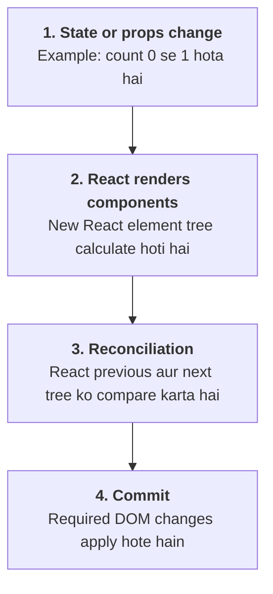
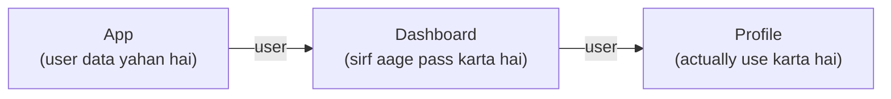
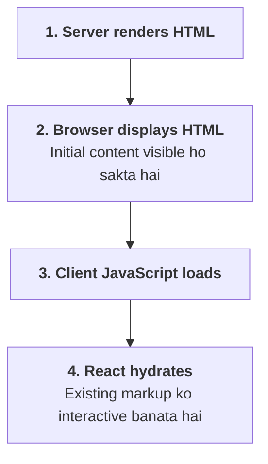

# ReactJS — 14 Advanced Interview Questions (Product-Based Companies)

Ye ReactJS ke 14 advanced interview questions hain jo product-based companies (PBCs) ke frontend interviews mein prepare karne layak hain. Har topic basic se advanced level tak hai — concept, code example, internal working, interview answer aur common follow-up questions ke saath.

# 1. Virtual DOM aur React rendering

## Q1. What is the Virtual DOM and how does React use it for rendering?

### Virtual DOM kya hai?

DOM (Document Object Model) browser ke HTML document ka object-based representation hai.

Virtual DOM React ke UI ka in-memory representation hai. React elements ke through describe karta hai ki UI kaisa dikhna chahiye.

Example:

```jsx
function App() {
  return <h1>Hello React</h1>;
}
```

Is JSX se React element create hota hai, jo UI ki desired structure describe karta hai. React is representation ko browser DOM ke saath synchronize karta hai.

### React rendering ka flow



### Example

```jsx
function Counter() {
  const [count, setCount] = useState(0);

  return (
    <div>
      <h1>Counter</h1>
      <p>{count}</p>
      <button onClick={() => setCount(c => c + 1)}>
        Increment
      </button>
    </div>
  );
}
```

Jab count `0` se `1` hota hai, React component ko dobara render karta hai aur resulting tree reconcile karta hai. Is example mein actual DOM update sirf text change ke liye ho sakta hai; poora page destroy karke dobara create nahi hota.

### Follow-up: React diffing aur batching efficiently kaise karta hai?

**Diffing/reconciliation:** React element types, positions aur keys ke basis par decide karta hai ki existing UI ko kaise update karna hai. React har case mein complete tree ka general-purpose deep comparison nahi karta.

**Batching:** Multiple state updates ko group karke rendering work reduce kar sakta hai.

```jsx
setCount(c => c + 1);
setCount(c => c + 1);
setCount(c => c + 1);
```

Yeh functional updates count ko 3 se increment karengi, aur React in updates ko batch karke ek render mein process kar sakta hai.

Interview-ready answer: Virtual DOM React ki UI representation hai. State ya props change hone par React render aur reconciliation ke through required changes identify karta hai aur commit phase mein DOM ko synchronize karta hai. Batching unnecessary repeated rendering work ko reduce kar sakti hai.

Dhyan rahe: Virtual DOM ka matlab yeh nahi ki har situation mein React direct DOM manipulation se faster hi hoga. Performance actual workload par depend karti hai.

# 2. React Rendering, Reconciliation aur Fiber

## Q2. What happens during React rendering and reconciliation?

Is question mein teen terms ko separate samajhna zaroori hai.

- **Render phase:** React components execute karke next UI tree calculate karta hai.
- **Reconciliation:** React decide karta hai ki previous aur next UI structures mein kya changes required hain.
- **Commit phase:** React necessary changes host environment, usually browser DOM, par apply karta hai aur relevant commit effects process karta hai.

Render phase mein component function execute hone ka matlab yeh nahi ki DOM immediately update ho gaya.

### React Fiber kya hai?

Fiber React ke rendering work ko represent aur schedule karne wala internal architecture hai. Har relevant unit of work ko Fiber nodes represent kar sakte hain.

Is architecture se React ko rendering work prioritize karne aur supported situations mein interruptible concurrent rendering implement karne ki flexibility milti hai.

Example: Ek page mein expensive search results hain aur user typing kar raha hai. React ke concurrent features lower-priority rendering ko defer ya interrupt karne mein help kar sakte hain, taaki urgent interactions responsive rahen.

### Important interview points

- Render phase mein side effects directly perform nahi karne chahiye.
- React render ko repeat kar sakta hai.
- Concurrent rendering mein render work abandon bhi ho sakta hai.
- DOM mutations commit phase mein hoti hain.
- `useEffect` aur `useLayoutEffect` ke execution timings alag hain.

Interview-ready answer: React rendering phase mein next UI calculate karta hai, reconciliation changes identify karta hai aur commit phase mein necessary updates apply karta hai. Fiber architecture rendering work ko schedule aur prioritize karne ki foundation hai.

# 3. `useEffect` vs `useLayoutEffect`

## Q3. How do these Hooks differ, and when should you use each?

Dono Hooks component ke rendering ke around external systems ke saath synchronize karne ke liye use hote hain, lekin unki timing different hai.

### `useEffect`

Generally browser ko updated screen paint karne ka opportunity milne ke baad execute hota hai. React exact scheduling ko situation ke according manage karta hai.

Use cases:

- API ya external system synchronization.
- Event listeners attach karna.
- Timers manage karna.
- Document title update karna.
- Subscriptions manage karna.

```jsx
useEffect(() => {
  document.title = `Count: ${count}`;
}, [count]);
```

### `useLayoutEffect`

DOM mutations commit hone ke baad, browser paint karne se pehle synchronously execute hota hai. Iska use tab hota hai jab layout measure karke immediately correction karna zaroori ho.

Example: Tooltip ki position calculate karna.

```jsx
function Tooltip() {
  const tooltipRef = useRef(null);
  const [height, setHeight] = useState(0);

  useLayoutEffect(() => {
    const element = tooltipRef.current;
    if (element) {
      setHeight(element.getBoundingClientRect().height);
    }
  }, []);

  return (
    <div ref={tooltipRef}>
      Tooltip height: {height}px
    </div>
  );
}
```

### Comparison

| Feature | `useEffect` | `useLayoutEffect` |
|---|---|---|
| Timing | Generally paint ke baad | DOM commit ke baad, paint se pehle |
| Layout measurement | Possible, but correction may flicker | Immediate measurement and correction |
| Performance | Usually preferred | Can block painting |
| Typical use | Data synchronization, subscriptions | Layout measurement, visual correction |

Interview answer: Main `useEffect` ko default rakhta hoon. `useLayoutEffect` tab use karta hoon jab DOM measure karke paint se pehle visual update karna necessary ho, jaise tooltip positioning.

SSR note: Server par browser layout available nahi hota, isliye `useLayoutEffect` ko server-rendered components mein carefully handle karna chahiye.

# 4. React `useState` internally kaise work karta hai?

## Q4. Why are state updates asynchronous, and how is batching handled?

Sabse pehle ek misconception clear karte hain: React `setState` ko simply asynchronous API kehna exact explanation nahi hai. State setters current render ke state variable ko mutate nahi karte; woh React ko next render ke liye update request karte hain.

Example:

```jsx
function Counter() {
  const [count, setCount] = useState(0);

  function handleClick() {
    console.log(count); // 0
    setCount(count + 1);
    console.log(count); // 0
  }

  return (
    <button onClick={handleClick}>
      {count}
    </button>
  );
}
```

Dono logs `0` hain, kyunki current function call us render ke `count` snapshot ko use karti hai.

### Functional updater kyun important hai?

```jsx
setCount(prev => prev + 1);
setCount(prev => prev + 1);
setCount(prev => prev + 1);
```

React updater functions ko queue mein process karta hai. Agar initial count `0` hai, to next count `3` hoga.

Conceptually:

- `0 → 1`
- `1 → 2`
- `2 → 3`

### Batching

React ek event ke andar multiple state updates ko batch kar sakta hai. Modern React automatic batching ko promises, timers aur other supported contexts tak bhi extend karta hai.

Iska benefit:

- Fewer render/commit cycles.
- Better rendering efficiency.
- Intermediate states ko unnecessarily render karne se bachav.

### Interview follow-up: Kya har setter ke baad `await` kar sakte hain?

Nahi. `setCount()` Promise return nahi karta, aur `await setCount(...)` state update complete hone ka wait karne ka correct method nahi hai.

Agar updated state ke baad effect perform karna hai, to appropriate `useEffect` ya event flow use karo.

# 5. Controlled vs Uncontrolled Forms

## Q5. What are controlled and uncontrolled components?

Yeh form inputs ki value kaun manage karta hai, usse related hai.

### Controlled input

```jsx
function EmailForm() {
  const [email, setEmail] = useState("");

  return (
    <input
      value={email}
      onChange={e => setEmail(e.target.value)}
    />
  );
}
```

React state source of truth hai. Har relevant input change state update karta hai.

Useful for:

- Live validation.
- Conditional form fields.
- Character count.
- Dependent dropdowns.
- Form data par dynamic UI.

### Uncontrolled input

```jsx
function EmailForm() {
  const emailRef = useRef(null);

  function handleSubmit(e) {
    e.preventDefault();
    console.log(emailRef.current.value);
  }

  return (
    <form onSubmit={handleSubmit}>
      <input ref={emailRef} />
      <button type="submit">Submit</button>
    </form>
  );
}
```

Input apni current value DOM mein maintain karta hai.

Useful for:

- Simple forms.
- DOM-based integrations.
- Aise cases jahan har keystroke par React state update zaroori nahi.

Interview answer: Controlled components React state se drive hote hain, jabki uncontrolled components apni value DOM mein maintain karte hain. Main requirements ke according choose karta hoon, na ki ek approach ko har situation mein mandatory maanta hoon.

# 6. Unnecessary Re-renders aur Memoization

## Q6. How can `React.memo`, `useMemo` and `useCallback` help?

Sabse pehle identify karo ki re-render actually expensive hai ya nahi. Har re-render problem nahi hota.

### `React.memo`

Component ko same props hone par re-render skip karne mein help karta hai.

```jsx
const UserCard = React.memo(function UserCard({ user }) {
  return <h2>{user.name}</h2>;
});
```

### `useMemo`

Calculation ka result memoize karta hai.

```jsx
const filteredUsers = useMemo(() => {
  return users.filter(user => user.active);
}, [users]);
```

### `useCallback`

Function reference memoize karta hai.

```jsx
const handleSelect = useCallback((id) => {
  setSelectedId(id);
}, []);
```

### Common mistakes

- Har jagah memoization add karna.
- Dependency array mein required values miss karna.
- Har render mein naya object pass karna aur phir expect karna ki `React.memo` kaam kare.
- `useMemo` ko correctness guarantee samajhna.

Interview answer: Main React Profiler se expensive renders identify karta hoon. Uske baad state placement, list optimization aur targeted memoization apply karta hoon. Memoization tab useful hai jab uska measurable benefit ho.

# 7. Context API vs Redux

## Q7. When is Context API preferable, and when is Redux preferable?

Context API React ka built-in mechanism hai jisse values component tree mein share kar sakte hain.

Redux Toolkit ek structured global state-management approach provide karta hai.

| Context API | Redux Toolkit |
|---|---|
| Built-in React feature | Separate state-management library |
| Theme, locale, simple shared values | Complex shared client state |
| Relatively simple setup | Actions, reducers, middleware ecosystem |
| Context consumers value changes par re-render kar sakte hain | Selectors se relevant state subscribe kar sakte hain |

Example:

```jsx
const ThemeContext = createContext("light");

function App() {
  return (
    <ThemeContext.Provider value="dark">
      <Page />
    </ThemeContext.Provider>
  );
}
```

Redux mein state transitions slices aur actions ke through manage kar sakte hain.

Important: Context aur Redux alternatives ho sakte hain, lekin mutually exclusive nahi. Server data caching ke liye RTK Query, TanStack Query ya Next.js data-fetching features separately consider kar sakte ho.

# 8. Prop Drilling

## Q8. What is prop drilling and how can you avoid it?

Prop drilling tab hota hai jab data ko multiple intermediate components ke through pass karna padta hai, even though un components ko khud us data ki zaroorat nahi hoti.

Example:

```jsx
function App() {
  const user = { name: "Rahul" };
  return <Dashboard user={user} />;
}

function Dashboard({ user }) {
  return <Profile user={user} />;
}

function Profile({ user }) {
  return <h2>{user.name}</h2>;
}
```



Agar hierarchy bahut deep ho jaye, to har intermediate component ko props forward karne pad sakte hain.

### Solutions

- Context API.
- Redux Toolkit ya another state-management library.
- Component composition.
- Feature-specific state management.

Har prop drilling bad practice nahi hai. Chhote component trees mein explicit props simple aur easy-to-follow hote hain.

Large applications mein feature-based architecture aur carefully scoped shared state helpful hote hain.

# 9. React Lists aur Keys

## Q9. How do keys work in lists? What happens if keys are not unique?

React key ko sibling elements ki identity track karne ke liye use karta hai.

```jsx
{users.map(user => (
  <UserCard key={user.id} user={user} />
))}
```

Stable key se React identify kar sakta hai ki item same hai, remove hua hai ya add hua hai.

### Agar keys duplicate hain?

- React warnings show kar sakta hai.
- Elements ki identity incorrectly match ho sakti hai.
- Updates unexpected behavior produce kar sakte hain.

### Index keys ka problem

Agar list reorder ya filter hoti hai, to index key same position par kisi doosre item ko represent kar sakti hai. Stateful children mein input values ya local state galat item se associate ho sakti hain.

Best practice: Stable, unique item ID use karo. Index keys tab acceptable ho sakti hain jab list static ho aur items reorder, insert ya delete na hote hon.

# 10. Custom Hooks

## Q10. How do custom Hooks work, and what are their benefits?

Custom Hook ek JavaScript function hota hai jiska naam `use` se start hota hai aur jo React Hooks use karke reusable stateful logic provide karta hai.

Maan lo multiple components ko online/offline status track karna hai.

```jsx
import { useEffect, useState } from "react";

function useOnlineStatus() {
  const [isOnline, setIsOnline] = useState(
    navigator.onLine
  );

  useEffect(() => {
    const handleOnline = () => setIsOnline(true);
    const handleOffline = () => setIsOnline(false);

    window.addEventListener("online", handleOnline);
    window.addEventListener("offline", handleOffline);

    return () => {
      window.removeEventListener("online", handleOnline);
      window.removeEventListener("offline", handleOffline);
    };
  }, []);

  return isOnline;
}
```

Component mein use:

```jsx
function Status() {
  const isOnline = useOnlineStatus();

  return (
    <p>{isOnline ? "Online" : "Offline"}</p>
  );
}
```

### Benefits

- Logic reuse hota hai.
- Components ka code clean hota hai.
- Testing aur maintenance easier ho sakti hai.
- Event listeners aur cleanup ko centralize kar sakte hain.

### Important rules

- Custom Hooks ko components ya other custom Hooks ke top level par call karo.
- Conditions, loops ya ordinary event handlers ke andar Hooks call mat karo.
- Har Hook call ka apna state hota hai; custom Hook logic share karta hai, automatically ek shared state instance nahi.

Interview follow-up: Kya tumne project mein custom Hook banaya hai? Apne actual project ka API-fetching, debounce, online-status ya pagination Hook example ready rakho.

SSR caveat: Browser APIs ko render ke waqt access karna server par fail kar sakta hai. Production implementation mein browser-specific initialization aur hydration behavior bhi handle karna chahiye.

# 11. React Concurrent Features

## Q11. What is Concurrent Mode and how does it improve UX?

Modern React documentation mein ise generally concurrent rendering aur concurrent features ke context mein discuss kiya jata hai. "Concurrent Mode" purana terminology hai; current React applications mein concurrency individual features ke through use hoti hai.

React rendering work ko prioritize kar sakta hai, taaki expensive lower-priority UI updates urgent interactions ko unnecessarily block na karein.

### Example: `useTransition`

Maan lo user search filter change karta hai aur large list update karni hai.

```jsx
const [query, setQuery] = useState("");
const [isPending, startTransition] = useTransition();

function handleChange(event) {
  const value = event.target.value;

  setQuery(value);

  startTransition(() => {
    setFilter(value);
  });
}
```

Yahan `query` urgent state hai, jabki `filter` update ko lower priority par schedule kiya ja sakta hai.

### Transitions kya hain?

Transitions aise state updates mark karte hain jo urgent user input ke comparison mein lower priority par process ho sakte hain.

Useful examples:

- Tab switching.
- Large search results update.
- Complex navigation UI.
- Heavy result lists.

Transition ke andar synchronous JavaScript computation khud automatically non-blocking nahi ho jati. React rendering work ko schedule kar sakta hai, lekin long-running JavaScript ko main thread se remove karne ke liye Web Workers jaise tools ki zaroorat ho sakti hai.

### Follow-up: `useTransition` vs `useDeferredValue`

| `useTransition` | `useDeferredValue` |
|---|---|
| State update ko transition mark karta hai | Existing value ka deferred version provide karta hai |
| `startTransition` callback use hota hai | Value ko Hook mein pass karte hain |
| `isPending` status milta hai | Built-in `isPending` return nahi karta |
| State update par control deta hai | Value consumption ko defer karne mein help karta hai |

Dono UX responsiveness improve kar sakte hain, lekin na to automatically network requests debounce karte hain aur na hi har expensive computation ko worker mein execute karte hain.

# 12. Server-Side Rendering (SSR) and Hydration

## Q12. What is hydration in SSR, and how does it work?

Server-Side Rendering mein server HTML generate karke browser ko send karta hai. Isse initial content JavaScript fully load hone se pehle bhi visible ho sakta hai.

Hydration ke dauran React existing server-rendered HTML ke saath client-side React tree ko synchronize karta hai aur interactive behavior attach karta hai.

### Flow



### Hydration mismatch kya hai?

Jab server-rendered HTML aur initial client render ka output mismatch karta hai, to hydration warnings ya errors ho sakte hain.

Common causes:

- `Date.now()` ya random values se different initial output.
- Server aur client par different data.
- Browser-only APIs ko render ke waqt use karna.
- Locale-dependent date formatting.
- Invalid HTML nesting.
- Server/client ke beech inconsistent conditional rendering.

Example of a potential issue:

```jsx
function CurrentTime() {
  return <p>{new Date().toLocaleTimeString()}</p>;
}
```

Server aur browser alag time par render kar sakte hain, jis se mismatch ho sakta hai.

Better approach: initial render deterministic rakho aur changing browser-specific values ko suitable client-side effect ya framework-supported strategy se update karo.

### Next.js ke context mein

Next.js App Router mein Server Components aur Client Components ka distinction samajhna important hai. Client Component bhi initial HTML server se receive kar sakta hai, phir client par hydrate hota hai.

Interview answer: Hydration server-generated HTML ko client React tree ke saath synchronize karke interactivity enable karti hai. Main hydration mismatches debug karte waqt server aur initial client output ko compare karta hoon aur non-deterministic rendering aur browser-only APIs ko inspect karta hoon.

# 13. Error Boundaries

## Q13. How does error handling work in React with Error Boundaries?

Error Boundary ek React component hai jo apne descendant components ke rendering lifecycle mein aane wale certain errors catch karke fallback UI display kar sakta hai.

Example:

```jsx
class ErrorBoundary extends React.Component {
  constructor(props) {
    super(props);

    this.state = { hasError: false };
  }

  static getDerivedStateFromError() {
    return { hasError: true };
  }

  componentDidCatch(error, info) {
    console.error("UI error:", error, info);
  }

  render() {
    if (this.state.hasError) {
      return <h2>Something went wrong.</h2>;
    }

    return this.props.children;
  }
}
```

Use:

```jsx
<ErrorBoundary>
  <CourseDashboard />
</ErrorBoundary>
```

Agar covered component subtree mein supported render/lifecycle error aata hai, boundary fallback UI show kar sakta hai.

### Kaunse errors generally catch nahi hote?

Error Boundaries generally in cases ko catch nahi karte:

- Event handlers ke andar errors.
- Ordinary asynchronous callbacks, jaise `setTimeout`.
- Error Boundary ke apne error.
- Server-side rendering ke errors.

Event handler mein error handle karne ke liye `try/catch` use kar sakte ho. Promise rejections aur API failures ko appropriate asynchronous error handling ke through manage karo.

React framework conventions bhi important hain: Next.js App Router mein `error.tsx` route segment ke liye error UI provide karta hai.

Interview answer: Error Boundaries rendering failures ko isolate karke fallback UI show karte hain, jisse poori application ka UI fail hone se bach sakta hai. Main unhe critical page sections ke around use karta hoon aur errors ko logging system tak report karta hoon.

# 14. `useRef` vs `createRef`

## Q14. What is the difference between `useRef` and `createRef`?

Dono ref objects create kar sakte hain, lekin functional components mein inka behavior important difference rakhta hai.

### `useRef`

```jsx
function Input() {
  const inputRef = useRef(null);

  return <input ref={inputRef} />;
}
```

`useRef` same component instance ke renders ke across ref object ko preserve karta hai.

### `createRef`

```jsx
class Input extends React.Component {
  inputRef = React.createRef();

  render() {
    return <input ref={this.inputRef} />;
  }
}
```

Class component mein `createRef()` ko instance property ke roop mein rakhna common pattern hai.

Agar functional component ke body mein har render par `createRef()` call karoge, to har render par naya ref object create hoga:

```jsx
function Input() {
  const inputRef = React.createRef();
  return <input ref={inputRef} />;
}
```

Isliye function components mein persistent refs ke liye `useRef` preferred hai.

### Refs kab avoid karne chahiye?

- Jab UI ko state ke through declaratively control kiya ja sakta ho.
- Jab ref sirf state ka duplicate ban raha ho.
- Jab direct DOM mutation React rendering se conflict kar sakti ho.
- Jab parent ko child ka internal DOM expose karna unnecessary ho.

Refs DOM focus, measurement, scrolling aur imperative integrations ke liye useful hain. Lekin ordinary UI state ke liye `useState` ya `useReducer` better choice hoti hai.
