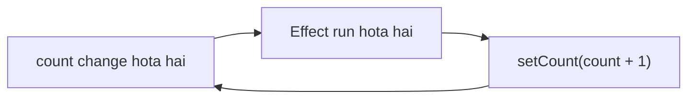

# React & JavaScript — Advanced Interview Questions

Is topic ka focus React Hooks ke internal behavior, state batching, closures, performance optimization, routing aur package versioning par hai. Har question code examples, expected outputs, interview-ready answers aur common mistakes ke saath hai.

# 1. React Concepts

## Q1. What is a React component, and how do you design reusable components?

React component UI ka ek independent, reusable piece hota hai. Component props receive kar sakta hai, state manage kar sakta hai aur UI return karta hai.

Example:

```jsx
function CourseCard({ title, price }) {
  return (
    <article className="course-card">
      <h2>{title}</h2>
      <p>₹{price}</p>
    </article>
  );
}
```

Ab isi component ko multiple courses ke liye reuse kar sakte ho:

```jsx
<CourseCard title="React" price={499} />
<CourseCard title="Node.js" price={799} />
```

### Reusable component design ke principles

- **Single responsibility:** Component ka purpose clear ho.
- **Props-driven:** Data props se receive kare, unnecessary hardcoding na ho.
- **Composition:** Bade components ko chhote components se compose karo.
- **Separation of concerns:** UI aur complex business logic ko zaroorat ke according separate rakho.
- **Predictability:** Same props aur state ke liye predictable UI produce karo.

Interview answer: Main reusable components ko clear responsibility, configurable props aur composition ke saath design karta hoon. Isse duplication kam hota hai aur testing aur maintenance easy hoti hai.

## Q2. Explain `useState` batching

Maan lo tumhare component mein `count = 0` hai:

```jsx
function Counter() {
  const [count, setCount] = useState(0);

  function handleClick() {
    setCount(count + 1);
    setCount(count + 1);
    setCount(count + 1);
  }

  return (
    <button onClick={handleClick}>
      {count}
    </button>
  );
}
```

Button ek baar click karne par expected result `3` lag sakta hai, lekin count `1` hoga.

Kyun?

Har `setCount(count + 1)` current render ke `count` ko read karta hai. Current render mein `count` ki value `0` hai. Isliye teeno updates `1` set karne ki request karte hain.

### Correct solution: Functional updates

```jsx
function handleClick() {
  setCount(previous => previous + 1);
  setCount(previous => previous + 1);
  setCount(previous => previous + 1);
}
```

Ab result `3` hoga, kyunki har updater ko previous queued update ka result milta hai.

| Code | Initial count `0` se result |
|---|---|
| `setCount(count + 1)` three times | `1` |
| `setCount(prev => prev + 1)` three times | `3` |

### Batching kya hai?

React multiple state updates ko batch karke rendering work reduce kar sakta hai. Modern React mein automatic batching event handlers ke alawa kai asynchronous contexts mein bhi supported hai.

Yaad rakho: Batching ka matlab updates ko ek saath process karna hai; iska matlab yeh nahi ki ordinary `count` variable har setter call ke baad immediately change ho jata hai.

## Q3. Explain stale closures with `setTimeout`

Yeh question closures aur React state dono test karta hai.

```jsx
function Counter() {
  const [count, setCount] = useState(0);

  function handleClick() {
    setTimeout(() => {
      console.log(count);
    }, 3000);
  }

  return (
    <>
      <p>{count}</p>
      <button onClick={handleClick}>Log count</button>
      <button onClick={() => setCount(c => c + 1)}>
        Increment
      </button>
    </>
  );
}
```

Scenario:

1. Count `0` hai.
2. `Log count` click kiya.
3. Count ko `3` tak increment kiya.
4. Teen seconds baad callback execute hua.

Output `0` hoga, kyunki callback us render ke `count` variable ko capture karta hai jisme callback create hua tha.

Is behavior ko stale closure kaha jata hai jab callback mein captured value latest value se purani ho.

### Latest value chahiye to?

Agar timeout execute hote waqt latest count read karna hai, to ref use kar sakte ho:

```jsx
const countRef = useRef(count);

useEffect(() => {
  countRef.current = count;
}, [count]);

function handleClick() {
  setTimeout(() => {
    console.log(countRef.current);
  }, 3000);
}
```

Is approach mein ref latest committed count ko track karta hai. Lekin har problem mein ref zaroori nahi hai. Agar state ke previous value ke basis par update karna hai, to functional updater aksar better solution hota hai.

## Q4. Common reasons for infinite re-renders with `useEffect`

Infinite loop tab ho sakta hai jab Effect state update kare aur woh update Effect ki dependencies ko baar-baar change kar de.

Example:

```jsx
function Example() {
  const [count, setCount] = useState(0);

  useEffect(() => {
    setCount(count + 1);
  }, [count]);

  return <p>{count}</p>;
}
```

Flow:



1. Count `0` hai.
2. Effect count ko `1` karta hai.
3. Count change hota hai, Effect dobara run hota hai.
4. Count `2`, phir `3` — loop continue karta hai.

### Common causes

- Effect ke andar state update karna jo uski dependency hai.
- Har render mein naya object ya array dependency banana.
- Effect mein unnecessary derived state calculate karna.
- Dependencies ko galat specify karna.

### Kaise prevent karein?

Agar sirf derived value chahiye, to use directly render ke time calculate karo:

```js
const total = price * quantity;
```

Iske liye unnecessary `useEffect` aur extra state ki zaroorat nahi.

Agar Effect genuinely kisi external system ko synchronize karta hai, to correct dependencies aur cleanup implement karo.

Interview answer: Main pehle identify karunga ki Effect actually required hai ya nahi. Uske baad dependency changes aur state updates inspect karunga, taaki circular update chain remove ki ja sake.

## Q5. Explain `useRef` and how to pass refs between parent and child components

`useRef` ek mutable object provide karta hai jiska `.current` property change karne se React component automatically re-render nahi hota.

Iske common use cases:

- DOM element access karna.
- Timer ID store karna.
- Previous value track karna.
- Aisi mutable information store karna jo directly UI render nahi karti.

### Example: Input ko focus karna

```jsx
function SearchBox() {
  const inputRef = useRef(null);

  function handleFocus() {
    inputRef.current?.focus();
  }

  return (
    <>
      <input ref={inputRef} />
      <button onClick={handleFocus}>
        Focus input
      </button>
    </>
  );
}
```

### Parent se child ko ref kaise pass karte hain?

React 18 aur earlier mein `forwardRef` common approach tha:

```jsx
const CustomInput = React.forwardRef(
  function CustomInput(props, ref) {
    return <input {...props} ref={ref} />;
  }
);
```

Parent:

```jsx
function Parent() {
  const inputRef = useRef(null);

  return (
    <>
      <CustomInput ref={inputRef} />
      <button onClick={() => inputRef.current?.focus()}>
        Focus
      </button>
    </>
  );
}
```

React 19 mein function components `ref` ko prop ke roop mein receive kar sakte hain, isliye `forwardRef` generally required nahi hai. Existing React 18 code mein `forwardRef` ab bhi relevant hai.

Interview point: `useState` UI ko update karne ke liye, jabki `useRef` mutable information ya DOM references ko store karne ke liye use hota hai.

## Q6. Compare `useMemo`, `useCallback` and `React.memo`

Ye teen related hain, lekin same kaam nahi karte.

| Feature | Purpose |
|---|---|
| `useMemo` | Computed value ko memoize karna |
| `useCallback` | Function reference ko memoize karna |
| `React.memo` | Same props ke saath component ka unnecessary re-render skip karne mein help karna |

Example:

```jsx
const total = useMemo(
  () => calculateTotal(items),
  [items]
);

const handleClick = useCallback(() => {
  submitOrder(items);
}, [items]);

const ProductList = React.memo(function ProductList({ items }) {
  return items.map(item => (
    <p key={item.id}>{item.title}</p>
  ));
});
```

### Inka use kab karna chahiye?

Maan lo parent component frequently render hota hai aur child component expensive hai.

- `React.memo` child ko same props par unnecessary rendering se bachane mein help kar sakta hai.
- `useCallback` callback reference stable rakh sakta hai.
- `useMemo` expensive calculation ka result reuse kar sakta hai.

Lekin agar props ke references har render par change ho rahe hain, to memoization expected benefit nahi degi.

## Q7. What is React Fiber and why was it introduced?

React Fiber React ke rendering engine ka architecture hai, jo React 16 ke saath introduce hua tha.

Purane reconciliation approach mein rendering work ko interruptible aur prioritize karna difficult tha. Fiber ne React ko rendering work ko smaller units mein organize karne ki capability di.

### Fiber ke benefits

- Work ko schedule aur prioritize karne mein flexibility.
- High-priority interactions ko responsive rakhne mein help.
- Concurrent rendering features ko support karne ki foundation.
- Rendering work ko pause, resume ya abandon karne ki capability.

### Simple example

Maan lo user input type kar raha hai aur background mein 10,000 items filter karne hain. Agar saara rendering work ek saath main thread ko block kare, to typing lag kar sakti hai.

Modern React scheduling aur concurrent features kuch rendering work ko interruptible banane mein help kar sakte hain. Lekin Fiber automatically har expensive JavaScript function ko background mein nahi chalata, aur CPU-heavy synchronous computation phir bhi main thread block kar sakti hai.

Interview answer: React Fiber rendering aur reconciliation work ko schedule karne ke liye React ka internal architecture hai. Isne interruptible rendering aur concurrent features ke liye foundation provide ki.

## Q8. Explain `useDeferredValue` and when it helps rendering performance

`useDeferredValue` kisi value ke update ko lower-priority rendering ke liye defer karne mein help karta hai.

Example: Search input ke saath large filtered list.

```jsx
function SearchPage({ items }) {
  const [query, setQuery] = useState("");
  const deferredQuery = useDeferredValue(query);

  const filteredItems = useMemo(() => {
    return items.filter(item =>
      item.name.toLowerCase().includes(
        deferredQuery.toLowerCase()
      )
    );
  }, [items, deferredQuery]);

  return (
    <>
      <input
        value={query}
        onChange={e => setQuery(e.target.value)}
      />

      <Results items={filteredItems} />
    </>
  );
}
```

Isse input ka latest value update ho sakta hai, jabki expensive results rendering deferred value ke saath thodi der baad catch up kar sakti hai.

### `useDeferredValue` vs debounce

- **`useDeferredValue`:** React rendering priorities ko manage karta hai.
- **Debounce:** Repeated function calls ko delay karta hai, jab tak calls ruk na jayein.

`useDeferredValue` network requests ko automatically debounce ya cancel nahi karta. API calls reduce karni hon to debounce ya suitable data-fetching strategy use karo.

# 2. JavaScript Fundamentals

## Q1. Explain `call()`, `apply()` and their differences

JavaScript mein `this` ki value function call ke context par depend kar sakti hai. `call()` aur `apply()` function ko invoke karte waqt `this` specify karne mein help karte hain.

```js
function introduce(city, country) {
  console.log(`${this.name} from ${city}, ${country}`);
}

const user = { name: "Rahul" };

introduce.call(user, "Delhi", "India");
// Rahul from Delhi, India

introduce.apply(user, ["Delhi", "India"]);
// Rahul from Delhi, India
```

Difference:

- `call(thisArg, arg1, arg2, ...)` — arguments individually pass hote hain.
- `apply(thisArg, [arg1, arg2, ...])` — arguments array-like collection se pass hote hain.

### Interview follow-up: Arrow function par `call()` use kar sakte hain?

Haan, lekin arrow function apna `this` create nahi karta. Isliye `call()` ya `apply()` uska lexical `this` change nahi karte.

```js
const user = { name: "Rahul" };

const show = () => console.log(this.name);

show.call(user);
```

Yahan `this` `user` se bind nahi hoga.

## Q2. What is the difference between `~` and `^` in package version ranges?

Yeh npm Semantic Versioning (SemVer) ka question hai.

Version format: `MAJOR.MINOR.PATCH`

Example: `2.4.6`

- **Major:** Breaking changes.
- **Minor:** Backward-compatible features.
- **Patch:** Backward-compatible bug fixes.

### `~` — Tilde

`~1.2.3` generally versions `>=1.2.3` aur `<1.3.0` allow karta hai.

Yaani minor version same rehta hai; patch updates allowed hote hain.

### `^` — Caret

`^1.2.3` generally versions `>=1.2.3` aur `<2.0.0` allow karta hai.

Yaani compatible minor aur patch updates allow ho sakte hain.

| Range | Meaning |
|---|---|
| `~1.2.3` | `>=1.2.3`, `<1.3.0` |
| `^1.2.3` | `>=1.2.3`, `<2.0.0` |
| `1.2.3` | Exact version range |

Pre-1.0 versions mein caret behavior stricter hota hai. For example, `^0.2.3` generally `<0.3.0` tak allow karta hai.

`package-lock.json` resolved dependency versions record karta hai, taaki installs reproducible rahen. Actual install behavior package manager, lockfile aur install command par bhi depend kar sakta hai.

# 3. Performance & Optimization

## Q1. How would you optimize a page making multiple API calls?

Maan lo dashboard load hote hi 5 APIs call hoti hain:

- User profile.
- Courses.
- Notifications.
- Progress.
- Recommendations.

Sabse pehle check karna hoga ki kaunsi requests independent hain aur kaunsi ek doosre par depend karti hain.

### Approach 1: Independent requests ko parallel run karo

```js
async function loadDashboard() {
  const [
    profileResponse,
    coursesResponse,
    notificationsResponse
  ] = await Promise.all([
    fetch("/api/profile"),
    fetch("/api/courses"),
    fetch("/api/notifications")
  ]);

  if (
    !profileResponse.ok ||
    !coursesResponse.ok ||
    !notificationsResponse.ok
  ) {
    throw new Error("Dashboard loading failed");
  }

  return {
    profile: await profileResponse.json(),
    courses: await coursesResponse.json(),
    notifications: await notificationsResponse.json()
  };
}
```

`Promise.all()` independent requests ko parallel start karta hai. Agar koi ek promise reject ho jaye, returned promise reject ho jata hai; iska matlab baaki network requests automatically cancel ho jayengi, aisa nahi hai.

### Approach 2: Har request ki importance alag ho to `Promise.allSettled()`

Agar notifications fail ho jayein, lekin courses aur profile available hon, to partial results useful ho sakte hain.

### Other optimizations

- Unnecessary duplicate requests avoid karo.
- Suitable caching use karo.
- Search requests debounce karo.
- API responses ka payload size reduce karo.
- Backend par aggregation consider karo, agar isse network round trips kam hote hon.
- Loading UI ko meaningful sections mein divide karo.

Interview answer: Main independent requests parallelize karunga, duplicate fetching reduce karunga, caching use karunga aur failure handling ko request ki importance ke according design karunga.

## Q2. How would you handle filtering when the page contains around 1,000 rows?

1,000 rows ke liye pehle simple client-side filtering measure karna chahiye. Har baar virtualization ya backend filtering zaroori nahi hai.

```js
const filteredUsers = users.filter(user =>
  user.name.toLowerCase().includes(
    search.toLowerCase()
  )
);
```

### Agar filtering slow ho rahi hai

- Search ko debounce karo.
- Expensive derived results ko `useMemo` se memoize karo, agar dependencies aur profiling justify karte hain.
- Large rendered list ko virtualize karo.
- Agar data bahut bada hai, server-side filtering aur pagination use karo.
- Har keystroke par unnecessary API request avoid karo.

Ek important difference: `useMemo` filtering computation ko har render par repeat hone se bacha sakta hai, lekin sirf tab jab dependencies unchanged hon. Yeh khud DOM rows ko reduce nahi karta; virtualization us problem ko solve karti hai.

# 4. React Architecture & Routing

## Q1. How would you implement role-based access control?

Maan lo application mein 3 roles hain:

- Admin
- Instructor
- Student

Har role ke permissions different hain.

Example:

```js
const permissions = {
  admin: ["view", "create", "delete"],
  instructor: ["view", "create"],
  student: ["view"]
};

function canAccess(role, action) {
  return permissions[role]?.includes(action) ?? false;
}

console.log(canAccess("student", "delete")); // false
console.log(canAccess("admin", "delete"));   // true
```

React mein UI ko role ke according conditionally render kar sakte ho:

```jsx
function DeleteButton({ user }) {
  if (!canAccess(user.role, "delete")) {
    return null;
  }

  return <button type="button">Delete</button>;
}
```

Lekin important security point: Frontend par button hide karna security nahi hai. Backend ko har protected API request par authentication aur authorization independently verify karna chahiye. User frontend checks bypass kar sakta hai.

Production mein permissions ko roles se map karna, least-privilege access aur server-side authorization implement karna best practice hai.

## Q2. How do you handle 404 / Page Not Found using React Router?

React Router mein unmatched routes ke liye wildcard route `*` use kar sakte hain.

```jsx
import {
  BrowserRouter,
  Routes,
  Route
} from "react-router-dom";

function NotFound() {
  return <h1>404 - Page Not Found</h1>;
}

function App() {
  return (
    <BrowserRouter>
      <Routes>
        <Route path="/" element={<h1>Home</h1>} />
        <Route path="/courses" element={<h1>Courses</h1>} />
        <Route path="*" element={<NotFound />} />
      </Routes>
    </BrowserRouter>
  );
}
```

Agar user `/unknown-page` open karta hai, to `NotFound` component render hoga.

Next.js mein routing framework ke according alag hoti hai; App Router mein route-level `not-found.tsx` aur `notFound()` use kiye ja sakte hain.

## Q3. Explain Redux Toolkit and state management approaches

Redux Toolkit Redux ko less boilerplate ke saath use karne ka recommended approach hai.

Iske common APIs:

- `configureStore()` — store configure karta hai.
- `createSlice()` — reducer logic aur action creators generate karta hai.
- `createAsyncThunk()` — common asynchronous request workflows manage karne mein help karta hai.
- RTK Query — server data fetching, caching aur invalidation ke liye.

Example:

```js
import { configureStore, createSlice } from "@reduxjs/toolkit";

const cartSlice = createSlice({
  name: "cart",
  initialState: { quantity: 0 },
  reducers: {
    addItem(state) {
      state.quantity += 1;
    }
  }
});

export const { addItem } = cartSlice.actions;

const store = configureStore({
  reducer: {
    cart: cartSlice.reducer
  }
});
```

State management choose karte waqt dekho ki state local hai, shared client state hai ya server state. Har state ke liye Redux use karna zaroori nahi hai.

## Q4. Why are proper keys important when rendering lists?

React mein list render karte waqt stable keys use karni chahiye.

```jsx
{users.map(user => (
  <UserCard key={user.id} user={user} />
))}
```

Keys React ko identify karne mein help karti hain ki kaunsa item add, remove ya move hua.

### Index as key kab problem create karta hai?

Maan lo list hai: `[A, B, C]`

Aur beginning se `A` remove kar diya: `[B, C]`

Agar index keys use ho rahi hain, to React index `0` ko pehle A aur phir B ke saath associate kar sakta hai. Isse stateful child components mein incorrect state reuse ho sakti hai.

Isliye stable IDs use karo, aur `Math.random()` se har render par nayi key generate mat karo.
