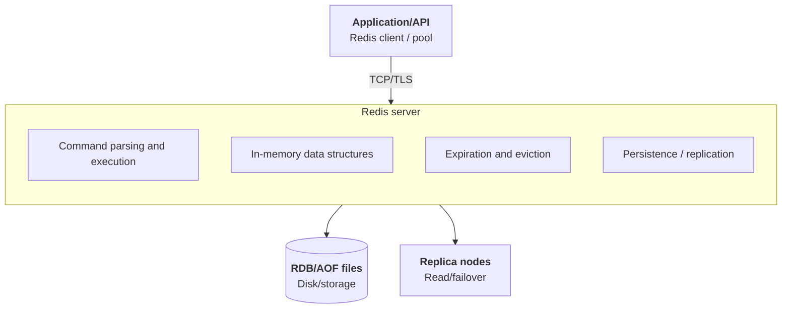
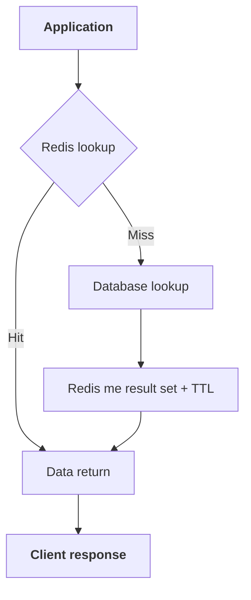
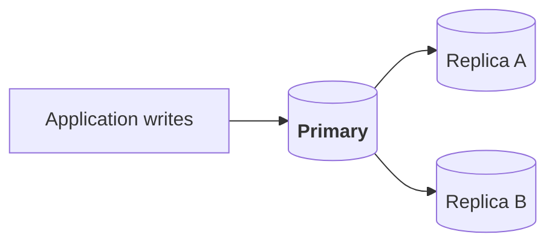
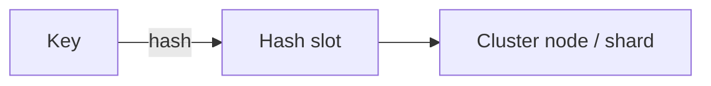
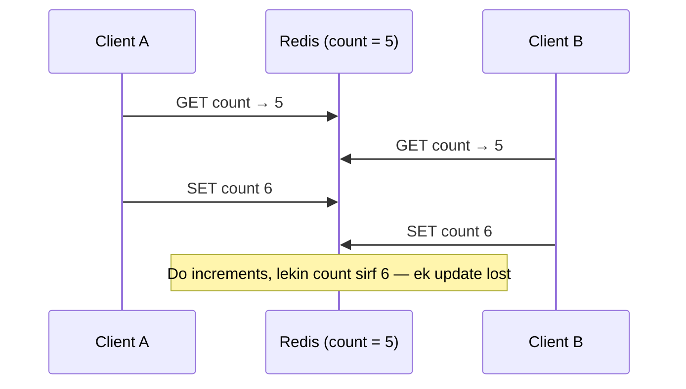
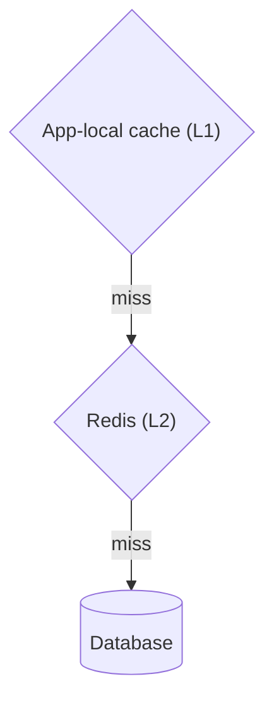
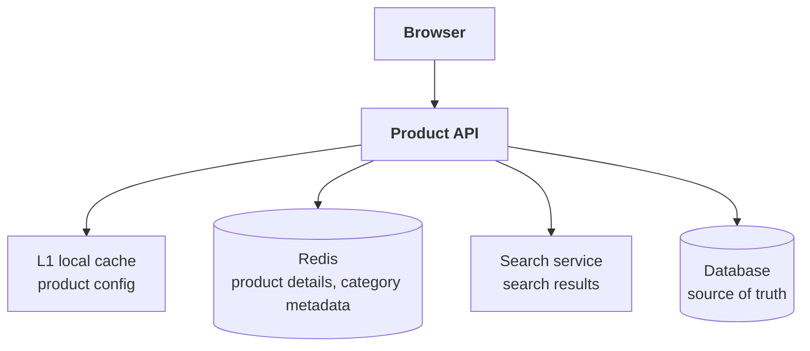

# Redis ka system architecture aur design — basics se advanced tak

Redis ko samajhne ka ek useful mental model yeh hai:

> **Redis ek fast, in-memory, network-accessible data structure server hai.**
> Application command bhejti hai, Redis data structure par operation karta hai, aur result return karta hai.

Redis ko sirf “key-value cache” kehna incomplete hai. Yeh cache, database, session store, rate limiter, queue-like workflow, leaderboards aur pub/sub messaging ke liye use ho sakta hai. Lekin har use case me durability, consistency aur failure behavior alag se design karna hota hai.

---

## 1. Redis architecture ka bird’s-eye view



Redis server aam taur par requests ko bahut efficiently process karta hai. Networking, persistence, background work aur kuch operations ke liye additional threads ya asynchronous mechanisms ho sakte hain; isliye “Redis completely single-threaded hai” kehna overly simplistic hai. Command execution aur data mutation ka core model largely serialized hai, jisse individual commands ko predictable aur atomic banana aasaan hota hai.

Client ko Redis tak network ke through pahunchna hota hai. Isliye in-memory operation fast hone ke bawajood total latency me network, serialization, connection management aur command size ka hissa hota hai.

---

## 2. Redis ke andar kya store hota hai?

Redis ka outer model key-value hai:

```text
key → value
```

Magar value simple string hi ho, zaroori nahi. Redis data types deta hai:

| Data type | Basic idea | Typical use |
|---|---|---|
| String | Text ya binary value; numbers bhi rakh sakti hai | Cache, counters, tokens |
| Hash | Ek key ke andar fields ka map | User/profile attributes |
| List | Ordered sequence | Queue-like workflows, recent items |
| Set | Unique values ka unordered collection | Tags, membership |
| Sorted set | Har member ke saath score | Leaderboard, ranking |
| Stream | Append-only records aur consumer groups | Event processing |
| Bitmap | Bits par compact operations | Daily activity flags |
| HyperLogLog | Approximate unique count | Cardinality estimation |
| Geospatial index | Location-based search operations | Nearby-place lookup |

Misaal:

```text
user:42                → Hash
  name                 → "Asha"
  plan                 → "pro"

pageviews:article:9    → String counter
leaderboard:weekly     → Sorted Set
events:orders          → Stream
```

Redis data types par commands ko server side par execute kar sakta hai. Isse client ko poora data download karke khud sort/update karne ki zaroorat nahi hoti.

Official Redis documentation data types, commands aur server capabilities ko alag-alag explain karti hai. [Redis documentation](https://redis.io/docs/latest/)

---

## 3. Ek request ka workflow

Maan lo app ko user ka profile chahiye:

1. Client Redis connection/pool se connection leta hai.
2. `GET` ya `HGETALL` command bhejta hai.
3. Redis command parse karta hai.
4. Key ko apne in-memory dataset me dhoondhta hai.
5. Result serialize karke return karta hai.
6. Client result app object me convert karta hai.

Cache-aside workflow me Redis miss hone ke baad application database se data laati hai:



Redis miss ka matlab yeh nahi ki Redis ne database ko khud call kiya. Cache-aside pattern me **application** dono systems ko coordinate karti hai.

---

## 4. Redis data memory me kaise rehta hai?

Redis ka primary data model memory-resident hai. Isliye reads aur writes fast hote hain. Lekin memory mehngi aur limited hoti hai, aur actual usable capacity sirf raw value bytes se decide nahi hoti:

- key aur value ka size
- data structure ka internal overhead
- allocator overhead aur fragmentation
- client buffers
- replication/persistence ke liye extra memory
- background save ke dauran copy-on-write memory

Isliye capacity planning me “mere paas 8 GB RAM hai, to 8 GB values store kar sakta hoon” assume nahi karna chahiye. Managed services bhi advertised RAM ka kuch hissa non-data use aur reserve ke liye rakh sakti hain. [ElastiCache memory management](https://docs.aws.amazon.com/AmazonElastiCache/latest/dg/redis-memory-management.html)

### Memory bharne par kya hota hai?

`maxmemory` limit ke saath `maxmemory-policy` decide karti hai ki Redis kya kare:

- LRU/LFU candidate evict kare
- TTL wali keys me se candidate hataye
- random key hataye
- ya `noeviction` me nayi writes reject kare

Eviction aur expiration alag concepts hain:

- **Expiration**: key ka TTL khatam hua.
- **Eviction**: memory pressure ki wajah se key hatayi gayi.

`volatile-*` policies sirf expiration/TTL wali keys ko candidate maanti hain. Agar eligible key hi nahi hai, to policy write ko accept na karne jaisa behavior de sakti hai. [Redis key eviction](https://redis.io/docs/latest/develop/reference/eviction/)

---

## 5. Redis kab use karein?

| Use case | Redis feature | Main design sawaal |
|---|---|---|
| Cache | String/Hash + TTL | Staleness, invalidation, miss par DB load |
| Sessions | Hash/String + TTL | Redis down ho to kya? Security rules? |
| Counters / rate limiting | Atomic `INCR` + expiry | Window boundary, fail-open vs fail-closed |
| Leaderboards | Sorted set | Score updates, ranking queries |
| Pub/Sub | Publish/subscribe | Durable nahi — disconnect par messages miss |
| Event processing | Streams + consumer groups | Trimming, retries, idempotent consumers |
| Locks | `SET NX` + expiry | Lease expiry, fencing tokens, failover |

### A. Cache

Database ya API se baar-baar aane wale data ki temporary copy.

```text
Key: product:981
Value: serialized product
TTL: 5 minutes
```

**Faayda:** database load aur response latency kam ho sakti hai.
**Design sawal:** stale data kitni der acceptable hai? Invalidation kaise hogi? Cache miss ke waqt database par sudden load kaise control hoga?

### B. Sessions

Login state ya short-lived session data:

```text
session:abc123 → userId, permissions, expiry
```

**Design sawal:** Redis unavailable ho to users logout honge ya session kisi aur store me rahega? Session TTL aur security rules kya hain?

### C. Counters aur rate limiting

Atomic increment jaise operations se request counters bana sakte hain:

```text
rate:user:42:minute → request count
```

**Design sawal:** counter expiry, time-window boundary, distributed clients aur fail-open/fail-closed behavior kya hoga?

### D. Leaderboards

Sorted set me member ke saath score rakh kar rank aur range-oriented queries kar sakte hain:

```text
leaderboard:season → playerId + score
```

### E. Pub/Sub aur notifications

Ek client publish kare, subscribed clients message receive karein.

**Important:** Pub/Sub traditional durable message queue ki guarantee nahi deta. Subscriber disconnect ho to beech ke messages miss ho sakte hain. Replay, acknowledgements, durable pending-work jaise needs hon to Streams ya dedicated message broker ko consider karo.

### F. Streams aur event processing

Stream records append kar sakte hain; consumer groups consumers ke beech work distribute karne aur pending messages track karne me madad karte hain.

**Design sawal:** message trimming, retries, pending entries, duplicate processing aur idempotent consumers ka behavior define karo.

### G. Locks aur coordination

Redis primitives se lock-like patterns banaye ja sakte hain, lekin correctness sirf “key par NX laga diya” se guaranteed nahi hoti. Lease expiry, clock/timeouts, process pauses, fencing tokens aur failover behavior matter karte hain.

Critical distributed coordination me failure model ko clearly analyze karo. Strong correctness chahiye to Redis-based lock ko bina review ke universal solution mat samjho.

---

## 6. Cache design: common workflows

### Cache-aside

App pehle Redis read karti hai. Miss par database se data laakar Redis me set karti hai.

**Use:** read-heavy data; simple application flow.
**Risk:** concurrent misses se database par load burst ho sakta hai.

### Write-through

Write path cache ke through source ko update karta hai, ya cache aur source ko coordinated tareeqe se update karta hai.

**Use:** reads ke liye cache ko relatively fresh rakhna.
**Risk:** write latency aur partial-failure handling zyada complex.

### Write-behind

Pehle cache update, source me write baad me.

**Use:** kuch high-throughput workflows, jahan delayed persistence acceptable ho.
**Risk:** crash, retry aur queueing ke kaaran data loss/consistency risks ko explicitly handle karna padta hai.

### Invalidation

Database update ke baad cache key delete ki ja sakti hai; agla read fresh value load karega.

**Risk:** source update ho jaye, par cache invalidation fail ho. Outbox, event delivery, versioning ya bounded TTL jaise approaches iss gap ko manage karne me madad kar sakte hain.

| Pattern | Use | Risk |
|---|---|---|
| Cache-aside | Read-heavy data, simple flow | Concurrent misses se DB par burst |
| Write-through | Reads ke liye fresh cache | Write latency, partial failures |
| Write-behind | High-throughput, delayed persistence OK | Crash par data loss/consistency risk |
| Invalidation | Update ke baad stale copy hatana | Invalidation fail ho sakti hai |

---

## 7. Data consistency aur stale cache

Redis aksar source of truth nahi hota. Agar database authoritative hai, to cache ko uski copy samjho.

Misaal:

```text
T1: App database me plan = "pro" karti hai
T2: Cache invalidation bhejne se pehle process crash ho jaata hai
T3: Redis me purana plan abhi bhi pada hai
```

Possible approaches:

- TTL se staleness ki maximum duration limit karna
- write ke baad cache invalidate/update karna
- database change event se invalidation chalana
- cache value ke saath version/timestamp rakhna
- data loss par cache ko rebuild karne layak banana

Cache ko strong consistency de dena simple nahi hota. Pehle business requirement tay karo: stale result 1 second, 1 minute ya bilkul unacceptable?

---

## 8. Hot keys, stampede aur cache penetration

| Problem | Kya hota hai | Common controls |
|---|---|---|
| **Hot key** | Ek key par disproportionate traffic, ek shard bottleneck | L1 cache, request coalescing, key partitioning |
| **Cache stampede** | Popular key expire hote hi requests DB par toot padti hain | Coalescing, TTL jitter, stale-while-revalidate |
| **Cache penetration** | Nonexistent key baar-baar, har request DB tak | Negative cache, validation, rate limit, Bloom filter |

### Hot key

Ek key par disproportionate traffic.

```text
homepage:config → har request me access
```

Yeh ek Redis shard/node ko bottleneck bana sakti hai, bhale baaki shards idle hon.

Possible responses: local L1 cache, controlled replication/read strategy, key sharding/partitioning, request coalescing, ya data model changes. Har option consistency aur complexity trade-off laata hai.

### Cache stampede

Popular key expire/miss hote hi bahut saari requests ek saath database par chali jaati hain.

Possible controls:

- per-key request coalescing: ek request load kare, baaki uska result wait karein
- TTL me random jitter, taaki bahut keys ek saath expire na hon
- stale-while-revalidate, jab stale data temporary acceptable ho
- backend concurrency limit/bulkhead
- hot values ka pre-warming

### Cache penetration

Aisi key baar-baar request hoti hai jo source me exist hi nahi karti. Cache me result na hone se har request database tak ja sakti hai.

Possible controls:

- short-lived negative cache entry
- input validation
- per-client rate limiting
- Bloom filter jaise probabilistic check, agar workload aur false-positive trade-off suit kare

Negative caching carefully karo: nonexistent result bhi baad me create ho sakta hai, isliye uska TTL aur invalidation sochna zaroori hai.

---

## 9. Persistence: Redis restart ke baad data ka kya?

Redis ke persistence mechanisms ka choice durability aur performance ke trade-off par depend karta hai.

### RDB snapshots

Dataset ka point-in-time snapshot disk par save hota hai.

- Recovery ke liye snapshot load ki ja sakti hai.
- Snapshot interval ke beech ke writes restore na ho paane ka risk hota hai.
- Background snapshot operation ke memory/CPU impact ko samajhna chahiye.

### AOF (Append Only File)

Write operations ko log ke roop me persist kiya jata hai.

- Configured fsync strategy ke hisaab se durability/latency trade-off hota hai.
- AOF replay startup par recovery ke liye time le sakta hai.
- File rewrite/maintenance ka disk aur resource impact hota hai.

| | RDB | AOF |
|---|---|---|
| Kya save hota hai | Point-in-time snapshot | Har write operation ka log |
| Data loss risk | Last snapshot ke baad ke writes | fsync setting par depend |
| Recovery | Snapshot load — usually fast | Log replay — time le sakta hai |

### Dono ya koi nahi

Redis configuration aur version ke hisaab se RDB, AOF, dono ya persistence disabled ho sakti hai. “Redis persistent hai” ya “Redis sirf cache hai” assume mat karo; actual settings check karo.

Redis persistence ko cache eviction se alag samjho:

- Persistence restart/recovery ke baare me hai.
- Eviction memory pressure ke baare me hai.
- Persistent key bhi memory policy ke tahat evict ho sakti hai, agar policy allow karti ho.

[Redis persistence documentation](https://redis.io/docs/latest/operate/oss_and_stack/management/persistence/)

---

## 10. Replication aur failover

Redis replication me primary node updates replicas ko bhejta hai. Replicas reads serve kar sakti hain, aur high-availability setup me failover ke waqt replica primary ban sakti hai.



Is architecture me yaad rakho:

- Replication topology aur mode par depend karke asynchronous ho sakti hai.
- Primary ne write acknowledge ki, iska matlab har replica ne wahi write apply kar di, yeh assume nahi karna chahiye.
- Failover ke aas-paas recent writes ka behavior durability settings/topology par depend karta hai.
- Replica reads stale ho sakti hain, agar replication lag ho.
- Failover ke baad clients ko naye primary se reconnect karna pad sakta hai.
- Client libraries me topology discovery, reconnect aur command retry behavior samjho.

High availability ka matlab automatic zero data loss nahi. Redis deployment ki guarantees uske exact replication, persistence, failover aur managed-service configuration se aati hain.

[Redis replication documentation](https://redis.io/docs/latest/operate/oss_and_stack/management/replication/)

---

## 11. Sharding aur Redis Cluster

Dataset ya throughput ek node ki capacity se bahar jaaye to sharding use ki ja sakti hai. Redis Cluster keys ko **hash slots** ke through nodes me distribute karta hai.



- Har shard slots ka subset serve karta hai.
- Client cluster topology samajhkar sahi node ko request bhej sakta hai.
- Node/slot movement ke dauran client ko redirection mil sakta hai.
- Ek hi command agar multiple keys par kaam karti hai, to keys ka slot relationship matter kar sakta hai.
- Hash tags se related keys ko same slot me rakhne me madad mil sakti hai, magar isse hot-shard risk bhi ho sakta hai.

Cluster choose karne se pehle yeh clear karo:

- Data size ek node se bada hai?
- Write throughput ek primary se aage nikal rahi hai?
- Cross-key operations kaunsi chahiye?
- Key distribution balanced hai?
- Resharding aur client support available hai?

Sharding throughput aur capacity badha sakti hai, lekin cross-shard transactions, key locality aur operations ko complex banati hai.

[Redis Cluster documentation](https://redis.io/docs/latest/operate/oss_and_stack/reference/cluster-spec/)

---

## 12. Atomicity, transactions aur Lua scripts

Redis ek command ko atomic tareeqe se execute kar sakta hai: doosri command us command ke beech interleave nahi karti.

Misaal: `INCR` ek counter increment ke liye safer hai, banisbat app me read–increment–write karne ke:

```text
GET count → app me +1 → SET count
```

Read-modify-write me do clients ek hi purani value dekhkar update lose kar sakte hain. Atomic command ise avoid karti hai.



Redis me transactions (`MULTI`/`EXEC`) commands ko ek unit ke roop me queue/execute karne ke liye hain; yeh relational database transaction ki saari semantics ke barabar nahi hote. Complex conditional logic ke liye Lua scripting server par multiple steps execute kar sakti hai, lekin script execution bhi server ko busy kar sakti hai. Scripts ko chhota aur bounded rakho.

---

## 13. Performance design

### Connection pooling

Har request par naya TCP connection banana costly ho sakta hai. Client library ka connection pooling/multiplexing model samjho; pool size ko blindly bada mat karo.

### Pipelining

Multiple independent commands ek network round trip me bhejo, jahan client/library support karti ho. Isse network overhead kam ho sakta hai.

**Trade-off:** bahut bada pipeline memory, latency aur response buffering badha sakta hai. Pipeline ko bounded rakho.

### Batching

Related operations ko batch karna round trips bachata hai, lekin command size aur server workload ko monitor karo.

### Large values aur slow commands

Bade values, expensive scans/sorts, huge keyspace operations ya bahut lambi scripts server ko busy rakh sakti hain. Redis me ek expensive operation ki latency doosri requests ko bhi affect kar sakti hai, kyunki command processing shared server resources use karti hai.

Operationally:

- large keys identify karo
- command latency monitor karo
- unbounded work se bacho
- `KEYS` jaise poore keyspace ko synchronously traverse karne wale patterns ko production me bina samjhe use mat karo; cursor-based scan ka behavior bhi samjho
- bulk deletes/large object frees ka effect samjho

### L1 + Redis L2



L1 latency kam karta hai, par har app instance ki copy alag ho sakti hai. Invalidation, staleness aur memory per instance ka design zaroori hai.

---

## 14. Security aur operations

Redis ko public network par bina protection expose nahi karna chahiye. Production design me:

- private network/access controls
- authentication aur TLS, environment ke hisaab se
- least-privilege ACL users
- secrets management
- backups aur restore testing
- version/configuration management
- patching/upgrade plan
- capacity aur failover drills
- client reconnect behavior

Metrics aur alerts me memory, evictions, latency, connections, replication lag, persistence status aur command errors shamil hon. Redis host healthy dikh raha ho, phir bhi application-level latency ya stale data issue ho sakta hai.

---

## 15. Deployment choices

| Deployment | Kab useful | Limit |
|---|---|---|
| **Single node** | Development ya small non-critical cache | Node failure se interruption; capacity ek machine tak |
| **Primary + replicas / managed HA** | Read scaling aur failover | Replica lag aur failover behavior samajhna hoga |
| **Cluster / sharded** | Capacity aur writes ko multiple shards me distribute | Client, key-slot aur cross-key complexity |
| **Managed Redis-compatible service** | Provisioning, backups, patching, failover provider handle kare | Features, defaults aur guarantees service-specific |

### Single node

Simple setup, development ya small non-critical cache ke liye.

**Limit:** node failure se service interruption; capacity ek machine tak.

### Primary + replicas / managed high availability

Read scaling aur failover options de sakta hai.

**Limit:** replica lag aur failover behavior samajhna hoga.

### Cluster/sharded deployment

Capacity aur writes ko multiple shards me distribute kar sakta hai.

**Limit:** client, key-slot aur cross-key operation complexity badhti hai.

### Managed Redis-compatible service

Provisioning, monitoring, backups, patching ya failover ke kuch hisson ko provider handle kar sakta hai.

**Limit:** supported features, defaults, failover guarantees, memory limits aur policy behavior service-specific ho sakte hain. Redis OSS docs ko managed service ke behavior ka exact substitute mat samjho.

---

## 16. Ek practical system design example

Maan lo e-commerce product page bana rahe hain:



### Read workflow

1. Product API L1 check karti hai.
2. L1 miss par Redis check karti hai.
3. Redis miss par database read.
4. Result Redis me bounded TTL ke saath set.
5. Optional high-hit result L1 me bhi cache.
6. Response return.

### Update workflow

1. Admin database me product update karta hai.
2. App cache key invalidate ya version update karti hai.
3. Invalidation fail ho to TTL staleness ko bounded rakhta hai.
4. Cache miss par fresh database value refill hoti hai.

### Failure workflow

| Failure | Response |
|---|---|
| Redis slow/down | Timeout ke baad defined fallback, jaise DB read with concurrency limit |
| DB par miss storm ka risk | Request coalescing, rate limit ya degraded response |
| Redis memory full | Policy ke mutabiq eviction ya write error; alert aur capacity action |
| Replica stale | Consistency-sensitive request primary/source se serve |
| Hot product key | L1, request coalescing ya distribution strategy evaluate |

Yeh example dikhata hai ki Redis design sirf “key set kar do” nahi. Data ownership, invalidation, overload, failover aur cost bhi architecture ka hissa hain.

---

## 17. Redis use karne se pehle design questions

- [ ] Redis cache hai, source of truth hai, ya temporary workflow store?
- [ ] Data loss/restart par kya hona chahiye?
- [ ] Kaunsi persistence aur replication guarantees chahiye?
- [ ] Cache miss par source kitna load handle kar sakta hai?
- [ ] Data kitna stale ho sakta hai?
- [ ] TTL aur eviction policy kya honi chahiye?
- [ ] Keys aur values ka size distribution kya hai?
- [ ] Hot keys ya uneven access ka risk hai?
- [ ] Ek node kaafi hai ya sharding chahiye?
- [ ] Client failover/reconnect ko sahi handle karta hai?
- [ ] Multi-key operations cluster me same slot maangti hain?
- [ ] Redis unavailable hone par app ka expected behavior kya hai?
- [ ] Monitoring, backup aur restore kaise verify honge?

---

## Short summary

- Redis ek **in-memory data structure server** hai, sirf simple key-value cache nahi.
- App client commands bhejta hai; Redis data type par operation karke result return karta hai.
- Cache, session, counters, rate limits, leaderboards aur Streams common use cases hain.
- TTL, eviction, persistence, replication aur invalidation alag responsibilities hain.
- Replication/failover availability badha sakte hain, lekin automatically zero data loss guarantee nahi karte.
- Redis Cluster capacity/throughput scale kar sakta hai, magar key-slot aur cross-key design matter karta hai.
- Production-ready Redis design me **memory, client behavior, timeouts, consistency, failover, security aur monitoring** sab shamil hain.
