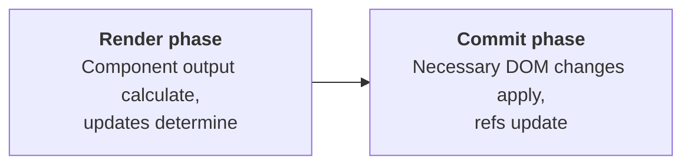
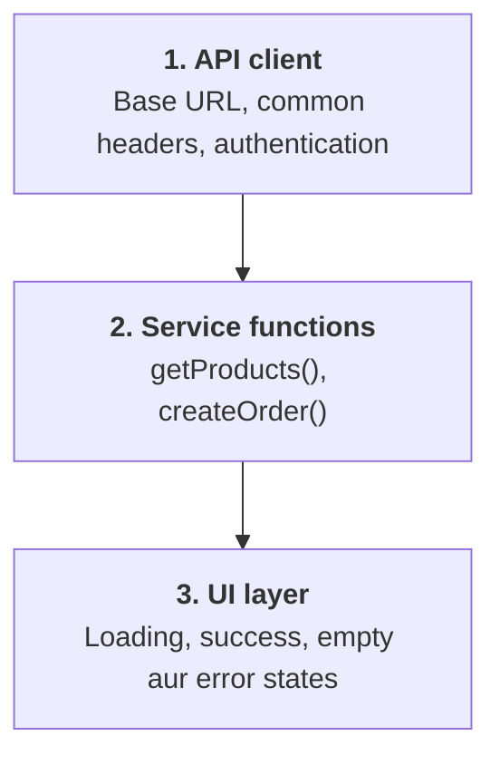

# 1. HTML Interview Questions

## Q1. What is Semantic HTML?

Semantic HTML ka matlab hai aise HTML elements use karna jo apne content ka meaning aur purpose clearly describe karte hain.

Example:

```html
<header>
  <h1>My Learning Platform</h1>
</header>

<nav>
  <a href="/courses">Courses</a>
  <a href="/about">About</a>
</nav>

<main>
  <article>
    <h2>React Tutorial</h2>
    <p>Learn React from basics to advanced.</p>
  </article>
</main>

<footer>
  <p>Copyright 2026</p>
</footer>
```

Yahan `header`, `nav`, `main`, `article` aur `footer` meaningful elements hain.

Non-semantic approach:

```html
<div class="header">...</div>
<div class="navigation">...</div>
<div class="content">...</div>
```

`div` bhi valid hai, lekin uska apna semantic meaning nahi hota.

### Semantic HTML kyun important hai?

- **Accessibility:** Screen readers ko page structure samajhne mein help milti hai.
- **SEO:** Search engines page content aur structure ko better interpret kar sakte hain.
- **Maintainability:** Developers ko code samajhna aur maintain karna easy hota hai.

Common semantic elements:

| Element | Purpose |
|---|---|
| `<header>` | Page ya section ka introductory content |
| `<nav>` | Navigation links |
| `<main>` | Page ka primary content |
| `<section>` | Thematically grouped content |
| `<article>` | Independently meaningful content |
| `<aside>` | Related supplementary content |
| `<footer>` | Page ya section ki footer information |

Interview answer: Semantic HTML meaningful tags ke through document structure define karta hai, jisse accessibility, maintainability aur search engine understanding improve hoti hai.

## Q2. Explain HTML Forms and Validations

HTML forms user se information collect karne ke liye use hote hain, jaise login, registration, search aur checkout.

Example:

```html
<form id="signupForm">
  <label for="email">Email address</label>

  <input
    id="email"
    name="email"
    type="email"
    required
  />

  <label for="password">Password</label>

  <input
    id="password"
    name="password"
    type="password"
    minlength="8"
    required
  />

  <button type="submit">Create Account</button>
</form>
```

Yahan:

- `type="email"` email-format validation provide karta hai.
- `required` field ko mandatory banata hai.
- `minlength="8"` minimum length enforce karta hai.
- `label` input ko accessible name deta hai.
- `name` form data mein field ki key define karta hai.

### Validation ke types

1. **HTML validation:** `required`, `minlength`, `max`, `pattern` jaise attributes.
2. **JavaScript validation:** Custom business rules, password matching aur conditional validation.
3. **Backend validation:** Server par data validate karna, kyunki client-side validation bypass ki ja sakti hai.

```js
const form = document.querySelector("#signupForm");

form.addEventListener("submit", (event) => {
  if (!form.checkValidity()) {
    event.preventDefault();
    form.reportValidity();
  }
});
```

Browser ki native constraint validation ko `checkValidity()` se check kiya ja sakta hai.

Interview follow-up: Kya sirf frontend validation enough hai? Nahi. Security aur data integrity ke liye backend validation bhi zaroori hai.

## Q3. What is Accessibility in HTML?

Accessibility ka matlab website ko un logon ke liye bhi usable banana hai jo keyboard, screen reader ya doosri assistive technologies ka use karte hain.

Important practices:

- Semantic HTML use karna.
- Har input ke liye proper label dena.
- Images ke liye meaningful `alt` text dena.
- Keyboard se navigation support karna.
- Focus indicator visible rakhna.
- Text aur background mein sufficient contrast rakhna.
- Errors ko clearly identify karna.

Example — accessible button:

```html
<button type="button">
  Add to Cart
</button>
```

Native button keyboard interaction aur button semantics provide karta hai.

Iske opposite:

```html
<div onclick="addToCart()">
  Add to Cart
</div>
```

Yeh by default keyboard-accessible button ki tarah behave nahi karta.

Agar custom interactive element banana unavoidable ho, to keyboard support, focusability aur appropriate semantics implement karne honge. Lekin native `<button>` generally better choice hai.

## Q4. Explain SEO basics in HTML

SEO ka full form Search Engine Optimization hai. HTML search engines ko page ke content aur structure ko samajhne mein help karta hai.

Example:

```html
<head>
  <title>React Interview Preparation Guide</title>

  <meta
    name="description"
    content="Prepare for React interviews with practical examples."
  />

  <meta
    name="viewport"
    content="width=device-width, initial-scale=1.0"
  />
</head>

<body>
  <main>
    <h1>React Interview Preparation</h1>
    <h2>React Fundamentals</h2>
  </main>
</body>
```

Important SEO practices:

- Descriptive page title.
- Relevant meta description.
- Logical heading hierarchy.
- Descriptive links.
- Images ke liye appropriate `alt` text.
- Crawlable navigation aur meaningful URLs.
- Performance aur mobile usability.
- JavaScript-heavy applications mein correct rendering aur indexing strategy.

Important: Semantic HTML SEO mein help karta hai, lekin sirf semantic tags use karne se high ranking guarantee nahi hoti.

# 2. CSS Interview Questions

## Q5. Flexbox vs Grid

Flexbox primarily one-dimensional layout ke liye aur Grid two-dimensional layout ke liye design kiya gaya hai.

```text
Flexbox — items ko ek row ya column mein align karna:

  [ A ] [ B ] [ C ]

Grid — rows aur columns ko ek saath control karna:

  [ A ] [ B ]
  [ C ] [ D ]
```

Example:

```css
/* Flexbox */
.navbar {
  display: flex;
  justify-content: space-between;
  align-items: center;
}

/* Grid */
.products {
  display: grid;
  grid-template-columns: repeat(3, 1fr);
  gap: 20px;
}
```

E-commerce website mein product listing ke liye Grid aur navbar ke liye Flexbox use karna common approach hai.

## Q6. Explain CSS position properties

CSS `position` decide karta hai ki element normal document flow mein kaise place hoga ya uski positioning kaise control hogi.

| Property | Behavior |
|---|---|
| `static` | Default; normal flow |
| `relative` | Normal position se offset; original layout space maintained |
| `absolute` | Normal flow se removed; containing block ke according positioned |
| `fixed` | Usually viewport ke relative positioned |
| `sticky` | Scroll threshold par sticky behavior, containing scroll constraints ke andar |

Example:

```css
.card {
  position: relative;
}

.badge {
  position: absolute;
  top: 10px;
  right: 10px;
}
```

Yahan badge nearest positioned ancestor `.card` ke according position hoga.

`position: fixed` ko bhi blindly viewport-relative mat samajhna: kuch ancestor properties, jaise `transform`, containing block ko change kar sakti hain.

## Q7. What is responsive design?

Responsive design ka goal hai ki website different screen sizes aur device capabilities par achhe se work kare.

```css
.container {
  width: min(100% - 32px, 1200px);
  margin-inline: auto;
}

.grid {
  display: grid;
  grid-template-columns: 1fr;
  gap: 16px;
}

@media (min-width: 768px) {
  .grid {
    grid-template-columns: repeat(2, minmax(0, 1fr));
  }
}

@media (min-width: 1200px) {
  .grid {
    grid-template-columns: repeat(4, minmax(0, 1fr));
  }
}
```

Yahan mobile par one column, medium screens par two columns aur wide screens par four columns hain.

Responsive design mein flexible layouts, suitable breakpoints, responsive images, readable typography aur touch-friendly controls important hain.

## Q8. What is CSS specificity?

Specificity ek scoring mechanism hai jisse browser decide karta hai ki same element ko target karne wali conflicting CSS declarations mein kaunsi declaration apply hogi, jab higher-priority cascade rules ka result same ho.

```css
p {
  color: blue;
}

.text {
  color: green;
}

#title {
  color: red;
}
```

```html
<p id="title" class="text">Hello World</p>
```

Text red hoga, kyunki ID selector ki specificity class aur element selectors se higher hai.

Specificity ko commonly is order mein samajh sakte ho:

1. Inline styles.
2. ID selectors.
3. Class, attribute aur pseudo-class selectors.
4. Element aur pseudo-element selectors.

Example:

```css
/* 0-0-1 */
p { color: blue; }

/* 0-1-0 */
.text { color: green; }

/* 1-0-0 */
#title { color: red; }
```

`!important`, cascade layers, origin aur other cascade rules bhi result ko affect karte hain. Isliye specificity ko poore cascade se alag nahi samajhna chahiye.

Interview tip: Unnecessary IDs aur `!important` avoid karo, taaki CSS maintainable rahe.

## Q9. What are CSS media queries?

Media queries screen size, device characteristics ya user preferences ke basis par CSS apply karne deti hain.

```css
.card {
  padding: 24px;
}

@media (max-width: 600px) {
  .card {
    padding: 12px;
  }
}

@media (prefers-reduced-motion: reduce) {
  .animated-element {
    animation: none;
    transition: none;
  }
}
```

Pehli query small screens ke liye padding change karti hai. Doosri query un users ke liye motion reduce karti hai jinhone apne system mein reduced-motion preference set ki hai.

Common media queries:

- `min-width` aur `max-width`.
- `orientation`.
- `prefers-color-scheme`.
- `prefers-reduced-motion`.

Breakpoints device names ke basis par blindly choose nahi karne chahiye; content ko jahan layout break hota hai, wahan breakpoint choose karna better hai.

# 3. JavaScript Interview Questions

## Q10. What are closures?

Closure tab hota hai jab function apne outer lexical scope ke variables ko access kar sakta hai, even after outer function execute ho chuka ho.

```js
function createCounter() {
  let count = 0;

  return function increment() {
    count++;
    return count;
  };
}

const counter = createCounter();

console.log(counter()); // 1
console.log(counter()); // 2
console.log(counter()); // 3
```

`createCounter()` execute hone ke baad bhi returned function `count` ko access kar pata hai.

Aisa isliye hota hai kyunki function apne lexical environment se associated references retain karta hai.

### Real-world use cases

- Data privacy aur encapsulation.
- Function factories.
- Event handlers.
- Memoization.
- Debouncing aur throttling.
- React event handlers aur state-related callbacks.

Interview follow-up: Closure aur global variable mein kya difference hai? Closure mein variable ek particular lexical scope se associated hota hai; global variable application ke global scope ka part hota hai.

## Q11. What is hoisting?

JavaScript execution ke dauran declarations aur bindings ko process karne ka behavior commonly hoisting ke naam se explain kiya jata hai.

Example:

```js
console.log(a); // undefined
var a = 10;
```

Yeh roughly is tarah behave karta hai:

```js
var a;
console.log(a);
a = 10;
```

Lekin `let` aur `const` ke saath behavior different hai:

```js
console.log(value); // ReferenceError
let value = 10;
```

`let` aur `const` bindings scope ke beginning se exist karte hain, lekin initialization se pehle Temporal Dead Zone (TDZ) mein hote hain.

Function declaration ka example:

```js
sayHello();

function sayHello() {
  console.log("Hello");
}
```

Yeh work karta hai, kyunki function declaration apne scope mein pehle se available hoti hai.

Lekin function expression ke liye:

```js
sayHello(); // TypeError

var sayHello = function () {
  console.log("Hello");
};
```

Yahan `var` variable initially `undefined` hota hai, isliye usse function ki tarah call karne par error aata hai.

### Quick summary

| Declaration | Declaration se pehle access karne par |
|---|---|
| `var` | `undefined` |
| `let` / `const` | `ReferenceError` (TDZ) |
| Function declaration | Kaam karta hai |
| `var` function expression | `TypeError` (`undefined` is not a function) |

## Q12. Explain the Event Loop

JavaScript ka Event Loop asynchronous operations ke callbacks ko execute hone ka mauka deta hai jab call stack available hota hai.

Important components:

- **Call stack:** Currently execute ho raha synchronous JavaScript.
- **Task queues:** Timers aur doosre queued tasks.
- **Microtask queue:** Promise reactions aur `queueMicrotask()` jaise callbacks.
- **Host APIs:** Browser ya Node.js ke mechanisms jo timers, networking aur I/O handle karte hain.

Example:

```js
console.log("A");

setTimeout(() => {
  console.log("B");
}, 0);

Promise.resolve().then(() => {
  console.log("C");
});

console.log("D");
```

Output:

```text
A
D
C
B
```

Reason:

1. `A` synchronously print hota hai.
2. Timer callback schedule hota hai.
3. Promise callback microtask queue mein aata hai.
4. `D` synchronously print hota hai.
5. Current synchronous execution complete hone par Promise microtask execute hota hai.
6. Uske baad timer callback execute hota hai, assuming no other scheduling complications.

Important: `setTimeout(fn, 0)` ka matlab immediate execution nahi hai; callback ko eligible hone mein minimum delay aur scheduling constraints lag sakte hain.

## Q13. Explain Promises and async/await

Promise ek object hai jo asynchronous operation ka future result ya failure represent karta hai.

Promise ke teen states hote hain:

- `pending`
- `fulfilled`
- `rejected`

Example:

```js
function fetchUser() {
  return fetch("/api/user")
    .then(response => {
      if (!response.ok) {
        throw new Error("Request failed");
      }

      return response.json();
    });
}
```

Same logic ko `async/await` se readable bana sakte hain:

```js
async function getUser() {
  try {
    const response = await fetch("/api/user");

    if (!response.ok) {
      throw new Error("Request failed");
    }

    const user = await response.json();

    return user;
  } catch (error) {
    console.error(error);
    throw error;
  }
}
```

`async` function hamesha Promise return karta hai. `await` Promise settle hone tak us async function ki execution ko suspend karta hai; poora JavaScript thread block nahi hota.

### Parallel vs sequential API calls

Sequential:

```js
const user = await fetchUser();
const orders = await fetchOrders(user.id);
```

Jab second request ko first request ka result chahiye, tab sequential execution appropriate hai.

Parallel:

```js
const [users, products] = await Promise.all([
  fetchUsers(),
  fetchProducts()
]);
```

Jab requests independent hon, `Promise.all()` latency reduce kar sakta hai. Agar koi ek Promise reject ho, to returned Promise reject ho jata hai.

## Q14. Debouncing vs throttling

Dono techniques frequently triggered events ko control karti hain.

| | Debouncing | Throttling |
|---|---|---|
| Kab chalta hai | Event rukne ke kuch samay baad; har naya event timer reset karta hai | Specified time interval mein maximum ek baar |
| Use cases | Search suggestions, autocomplete, input validation | Scroll handlers, resize calculations, frequent event processing |

### Debouncing

Event rukne ke kuch samay baad function execute hota hai. Har naya event timer reset karta hai.

Debounce implementation:

```js
function debounce(fn, delay) {
  let timerId;

  return function (...args) {
    const context = this;

    clearTimeout(timerId);

    timerId = setTimeout(() => {
      fn.apply(context, args);
    }, delay);
  };
}
```

Usage:

```js
const handleSearch = debounce((query) => {
  console.log("Search API:", query);
}, 300);
```

Yeh implementation most recent call ke arguments aur `this` context ko preserve karta hai.

### Throttling

Function ko specified time interval mein maximum ek baar execute karne tak limit karta hai, implementation ke according leading/trailing calls ke saath.

Simple timestamp-based implementation:

```js
function throttle(fn, delay) {
  let lastRun = 0;

  return function (...args) {
    const now = Date.now();

    if (now - lastRun >= delay) {
      lastRun = now;
      return fn.apply(this, args);
    }
  };
}
```

Yeh leading-only throttle hai; trailing execution implement nahi karta.

## Q15. Explain `call()`, `apply()` and `bind()`

Ye methods functions ke `this` context ko control karne ke liye use hote hain.

```js
function introduce(city, country) {
  return `${this.name} lives in ${city}, ${country}`;
}

const user = { name: "Aman" };
```

### `call()`

Arguments individually pass hote hain.

```js
introduce.call(user, "Delhi", "India");
```

### `apply()`

Arguments array-like collection mein pass hote hain.

```js
introduce.apply(user, ["Delhi", "India"]);
```

### `bind()`

Naya function return karta hai jiska `this` bound hota hai.

```js
const boundIntroduce = introduce.bind(
  user,
  "Delhi",
  "India"
);

boundIntroduce();
```

| Method | Function immediately execute? | Result |
|---|---|---|
| `call()` | Haan | Function ka return value |
| `apply()` | Haan | Function ka return value |
| `bind()` | Nahi | Bound function |

Important: Arrow functions ka apna `this` nahi hota; woh enclosing lexical scope se `this` lete hain. Isliye `call`, `apply` ya `bind` arrow function ka `this` change nahi karte.

## Q16. Explain `map()`, `filter()` and `reduce()`

Example data:

```js
const numbers = [1, 2, 3, 4, 5];
```

### `map()` — transform every item

```js
const doubled = numbers.map(n => n * 2);

console.log(doubled);
// [2, 4, 6, 8, 10]
```

Output array mein har input element ka transformed result hota hai.

### `filter()` — select matching items

```js
const even = numbers.filter(n => n % 2 === 0);

console.log(even);
// [2, 4]
```

Sirf condition pass karne wale items return hote hain.

### `reduce()` — accumulate a result

```js
const total = numbers.reduce(
  (sum, n) => sum + n,
  0
);

console.log(total);
// 15
```

Yahan `0` initial accumulator value hai.

Real-world cart total:

```js
const cart = [
  { price: 500, quantity: 2 },
  { price: 300, quantity: 3 }
];

const totalPrice = cart.reduce(
  (total, item) => total + item.price * item.quantity,
  0
);

console.log(totalPrice); // 1900
```

Complex cases mein `reduce()` ke bajay readable loops ya specialized methods use karna bhi bilkul valid hai.

| Method | Kya return karta hai |
|---|---|
| `map()` | Same length ka naya array, har item transformed |
| `filter()` | Naya array, sirf condition pass karne wale items |
| `reduce()` | Ek single value (number, object, array — kuch bhi) |

# 4. React.js Interview Questions

## Q17. What is the Virtual DOM?

Virtual DOM React ke UI representation ko samjhane ke liye commonly used term hai. React elements aur Fiber structures ke through desired UI ko represent aur reconcile karta hai.

Jab state ya props change hote hain, React nayi UI description calculate karta hai aur previous rendered output ke saath differences reconcile karta hai.

Example:

```jsx
function Counter() {
  const [count, setCount] = useState(0);

  return (
    <div>
      <h1>Count: {count}</h1>
      <button onClick={() => setCount(c => c + 1)}>
        Increment
      </button>
    </div>
  );
}
```

Button click par state update hoti hai. React component ko render karta hai, resulting UI changes reconcile karta hai aur necessary DOM updates commit karta hai.

Important interview clarification: React har update par poore real DOM ko blindly replace nahi karta. Reconciliation ka purpose required changes determine karna hai. Virtual DOM ko inherently faster than every manual DOM operation kehna bhi technically accurate nahi hai.

## Q18. What is reconciliation?

Reconciliation React ka process hai jisme previous aur next render ke output ko compare karke determine kiya jata hai ki UI ko kaise update karna hai.

Example:

```jsx
function Profile({ name }) {
  return <h1>{name}</h1>;
}
```

Agar `name` `"Aman"` se `"Riya"` ho jata hai, to React same element type ke existing DOM node ka text update kar sakta hai.

### Keys kyun important hain?

```jsx
{users.map(user => (
  <UserCard key={user.id} user={user} />
))}
```

Stable, unique keys React ko list items ki identity track karne mein help karti hain.

Array index ko key banane se reorder ya insertion ke time state incorrect item se associate ho sakti hai. Static lists mein index acceptable ho sakta hai, lekin changing lists mein stable IDs prefer karo.

## Q19. Explain `useEffect` behavior

`useEffect` React component ko external systems ke saath synchronize karne ke liye use hota hai, jaise subscriptions, timers, browser APIs aur network connections.

```jsx
useEffect(() => {
  const id = setInterval(() => {
    console.log("Running");
  }, 1000);

  return () => {
    clearInterval(id);
  };
}, []);
```

Is example mein Effect interval start karta hai aur cleanup mein interval clear karta hai.

### Dependency array

```jsx
useEffect(() => {
  console.log("Query changed:", query);
}, [query]);
```

Effect initial mount ke baad aur `query` change hone par run hoga.

| Dependency array | Effect kab run hota hai |
|---|---|
| Nahi diya | Har committed render ke baad |
| `[]` | Sirf initial mount par |
| `[a, b]` | Initial mount aur `a` ya `b` change hone par |

React Strict Mode development mein extra setup/cleanup cycle run kar sakta hai, taaki cleanup-related bugs identify ho sakein.

Interview tip: Har state update ko `useEffect` mein rakhna zaroori nahi. Derived values ko render ke during calculate karna often better hota hai.

## Q20. `useMemo` vs `useCallback`

Dono performance optimization ke liye hain, lekin purpose different hai.

`useMemo` calculation ka result memoize karta hai:

```jsx
const filteredUsers = useMemo(() => {
  return users.filter(user => user.active);
}, [users]);
```

`useCallback` function reference memoize karta hai:

```jsx
const handleSelect = useCallback((id) => {
  setSelectedId(id);
}, []);
```

| Hook | Memoized value |
|---|---|
| `useMemo` | Calculated result |
| `useCallback` | Function reference |

In hooks ko har jagah use karna necessary nahi. Inka overhead aur complexity bhi hoti hai. Actual performance issue ya reference-stability requirement ho tab use karo.

## Q21. Props vs State

| Props | State |
|---|---|
| Parent se component ko input milta hai | Component ya state owner data manage karta hai |
| Child ko props directly mutate nahi karne chahiye | State setter ke through update hoti hai |
| Parent ke changes se props update ho sakte hain | State update se relevant component render schedule ho sakta hai |

Example:

```jsx
function Welcome({ name }) {
  const [count, setCount] = useState(0);

  return (
    <>
      <h2>Hello, {name}</h2>
      <p>Count: {count}</p>
      <button onClick={() => setCount(c => c + 1)}>
        Increase
      </button>
    </>
  );
}
```

`name` prop hai aur `count` state hai.

## Q22. Explain React rendering

React rendering ka matlab components ko call karke determine karna ki UI kaisa dikhna chahiye.

Conceptually, do broad stages samjho:



1. **Render phase:** React component output calculate karta hai aur updates determine karta hai.
2. **Commit phase:** React necessary DOM changes apply karta hai aur relevant refs update karta hai.

Browser ke paint se pehle ya baad Effects run hone ka behavior Effect type aur scheduling par depend karta hai.

State update ka matlab hamesha actual DOM change nahi hota. React render kar sakta hai, lekin agar output mein relevant change nahi hai, to DOM mutation ki zaroorat nahi ho sakti.

## Q23. How do you optimize React performance?

Interview mein yeh practical checklist explain kar sakte ho:

- React Profiler se unnecessary renders identify karna.
- `React.memo` se suitable components memoize karna.
- `useMemo` aur `useCallback` judiciously use karna.
- Stable keys ke saath lists render karna.
- Large lists virtualize karna.
- Route-based code splitting aur lazy loading.
- API caching aur unnecessary requests avoid karna.
- Expensive computations optimize karna.
- Production build aur Core Web Vitals measure karna.

Optimization se pehle baseline measure karo, phir same workload par result compare karo.

## Q24. Explain API integration in React

API integration frontend ko backend se data retrieve aur send karne deti hai.

```jsx
function Users() {
  const [users, setUsers] = useState([]);
  const [loading, setLoading] = useState(true);
  const [error, setError] = useState(null);

  useEffect(() => {
    const controller = new AbortController();

    async function loadUsers() {
      try {
        const response = await fetch("/api/users", {
          signal: controller.signal
        });

        if (!response.ok) {
          throw new Error("Failed to fetch users");
        }

        const data = await response.json();
        setUsers(data);
      } catch (err) {
        if (err.name !== "AbortError") {
          setError(err.message);
        }
      } finally {
        if (!controller.signal.aborted) {
          setLoading(false);
        }
      }
    }

    loadUsers();

    return () => controller.abort();
  }, []);

  if (loading) return <p>Loading...</p>;
  if (error) return <p role="alert">{error}</p>;

  return (
    <ul>
      {users.map(user => (
        <li key={user.id}>{user.name}</li>
      ))}
    </ul>
  );
}
```

Production applications mein authentication, request retries, caching, pagination, empty states aur error recovery bhi consider karne chahiye.

# 5. Coding Round — Practical Questions

Coding round mein interviewer tumhari problem-solving ability, edge cases aur code quality check karta hai.

## Q25. Array manipulation

Question: Array mein se sirf active users ki age 18 se zyada wale users return karo.

```js
const users = [
  { name: "Aman", age: 22, active: true },
  { name: "Riya", age: 17, active: true },
  { name: "Raj", age: 25, active: false },
  { name: "Neha", age: 21, active: true }
];

const result = users.filter(
  user => user.active && user.age > 18
);

console.log(result);
```

Output mein Aman aur Neha aayenge.

Complexity: `O(n)` time, kyunki har user ko ek baar check kiya jata hai. Result array ke liye worst case mein `O(n)` extra space lagegi.

Follow-up practice:

- Array se duplicates remove karna.
- Array flatten karna.
- Objects ko kisi property ke basis par sort karna.
- Do arrays ka intersection nikalna.
- Frequency counter banana.

## Q26. String-based questions

Example: String ko reverse karna.

```js
function reverseString(str) {
  return Array.from(str).reverse().join("");
}

console.log(reverseString("hello")); // olleh
```

`Array.from()` Unicode code points ko handle karne mein simple spread syntax jaisa behavior deta hai, lekin complex emoji sequences ko ek visible character ki tarah reverse karne ki guarantee nahi deta.

Palindrome check:

```js
function isPalindrome(str) {
  const normalized = str
    .toLowerCase()
    .replace(/[^a-z0-9]/g, "");

  return normalized ===
    Array.from(normalized).reverse().join("");
}

console.log(isPalindrome("Madam")); // true
```

Follow-up mein interviewer pooch sakta hai:

- Time complexity kya hai?
- Empty string ka output kya hoga?
- Case-sensitive comparison chahiye ya nahi?
- Spaces aur punctuation ignore karne hain ya nahi?

## Q27. Logic-building questions

Example: Array mein duplicate numbers find karna.

```js
function findDuplicates(arr) {
  const seen = new Set();
  const duplicates = new Set();

  for (const value of arr) {
    if (seen.has(value)) {
      duplicates.add(value);
    } else {
      seen.add(value);
    }
  }

  return [...duplicates];
}

console.log(findDuplicates([1, 2, 3, 2, 4, 1]));
// [2, 1]
```

Complexity: Expected `O(n)` time aur `O(n)` extra space.

Yahan `Set` repeated values ko automatically unique rakhta hai.

## Q28. How do you debug existing code?

Interviewer tumhe broken code de sakta hai aur usmein bug find karne ko bol sakta hai.

Example:

```js
const numbers = [1, 2, 3, 4];

const result = numbers.map(n => {
  n * 2;
});

console.log(result);
```

Expected output `[2, 4, 6, 8]` hai, lekin actual output `[undefined, undefined, undefined, undefined]` hoga.

Reason: Arrow function ke block body mein explicit `return` missing hai.

Correct code:

```js
const result = numbers.map(n => {
  return n * 2;
});
```

Ya:

```js
const result = numbers.map(n => n * 2);
```

Debugging approach:

1. Expected aur actual behavior compare karo.
2. Problem ko smallest reproducible example mein isolate karo.
3. Breakpoints aur console inspection use karo.
4. Root cause identify karo.
5. Fix ke baad regression test likho.

# 6. Project Discussion — Interview ka important section

Is section mein interviewer yeh jaanana chahta hai ki tumne real projects mein architecture, API integration aur performance decisions kaise liye.

## Q29. Explain your component architecture

Maan lo tum ek e-commerce application bana rahe ho.

```text
src/
├── components/
│   ├── ui/
│   │   ├── Button.jsx
│   │   ├── Modal.jsx
│   │   └── Loader.jsx
│   └── layout/
│       ├── Navbar.jsx
│       └── Footer.jsx
├── features/
│   ├── products/
│   │   ├── ProductList.jsx
│   │   ├── ProductCard.jsx
│   │   └── productService.js
│   └── cart/
│       ├── CartPage.jsx
│       ├── cartSlice.js
│       └── cartService.js
├── hooks/
├── services/
└── utils/
```

Is structure mein:

- `components/ui/` mein generic reusable components.
- `features/products/` mein product-related UI aur logic.
- `features/cart/` mein cart-related functionality.
- `services/` mein shared API configuration.
- `hooks/` mein reusable React hooks.
- `utils/` mein pure helper functions.

Har chhote project mein itni folders ki zaroorat nahi. Structure ko project size aur team ki requirements ke according grow karna chahiye.

## Q30. How do you create reusable components?

Reusable component ka purpose common UI aur behavior ko multiple places par consistently use karna hai.

```jsx
function Button({
  children,
  variant = "primary",
  disabled = false,
  onClick
}) {
  return (
    <button
      type="button"
      className={`btn btn-${variant}`}
      disabled={disabled}
      onClick={onClick}
    >
      {children}
    </button>
  );
}
```

Usage:

```jsx
<Button onClick={handleSave}>
  Save
</Button>

<Button
  variant="secondary"
  onClick={handleCancel}
>
  Cancel
</Button>
```

Achhe reusable component mein:

- Clear props API.
- Predictable behavior.
- Accessibility.
- Appropriate defaults.
- Unnecessary dependencies se separation.
- Relevant tests.

Follow-up: Har component ko generic banana zaroori nahi. Over-abstraction code ko difficult bhi bana sakti hai.

## Q31. How do you handle APIs in a project?

Main API handling ko generally teen layers mein organize karunga:



1. **API client:** Base URL, common headers aur authentication configuration.
2. **Service functions:** `getProducts()`, `createOrder()` jaise endpoint-specific functions.
3. **UI layer:** Loading, success, empty aur error states.

Example:

```js
async function getProducts(signal) {
  const response = await fetch("/api/products", {
    signal
  });

  if (!response.ok) {
    throw new Error("Unable to load products");
  }

  return response.json();
}
```

React component is function ko call karke returned data render kar sakta hai.

Large projects mein React Query/TanStack Query jaise tools caching, request deduplication aur background refetching simplify kar sakte hain.

## Q32. What performance improvements have you made?

Is question ka answer apne actual project ke basis par dena chahiye. Agar interviewer poochhe ki improvement kitni hui, to measured numbers hi share karna.

Ek strong answer ka structure:

- **Problem:** Page load ya interaction slow tha.
- **Investigation:** Profiler, Network panel ya performance traces se root cause identify kiya.
- **Solution:** Bundle size reduce ki, unnecessary requests remove kiye, virtualization ya memoization use ki.
- **Validation:** Before/after measurements compare kiye.
- **Result:** Actual observed improvement explain ki.

Example: Agar product listing mein thousands of rows render ho rahe the, to virtualization aur server-side pagination consider kar sakte ho. Agar initial page load slow hai, to code splitting aur image optimization relevant ho sakte hain.

## Q33. What challenges have you faced in your projects?

Ek real example choose karo. Challenge chhota ho sakta hai, lekin tumhara reasoning clear hona chahiye.

Example structure:

> "Ek project mein users page par rapidly search kar rahe the aur har keystroke par API request fire ho rahi thi. Isse unnecessary requests generate ho rahi thi. Maine debounce implement kiya, previous requests cancel karne ke liye `AbortController` use kiya aur loading/error states handle ki. Isse request behavior improve hua aur stale responses se incorrect results show hone ka risk reduce hua."

Is example ko tabhi apna experience kehna jab tumne waqai aisa kaam kiya ho. Warna ise hypothetical solution ke roop mein explain karna.
