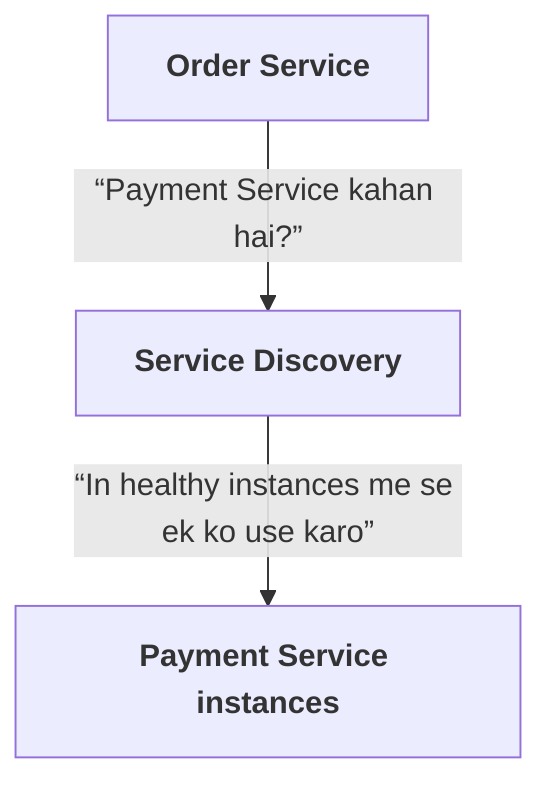
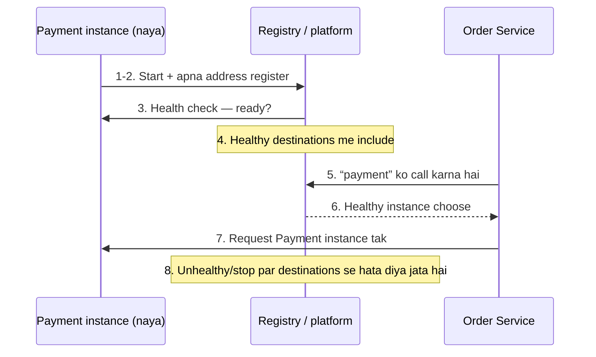
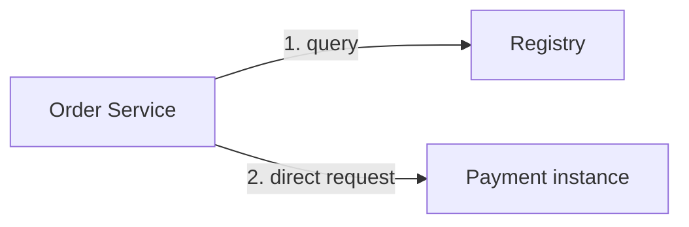
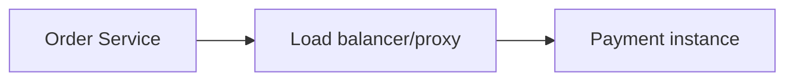
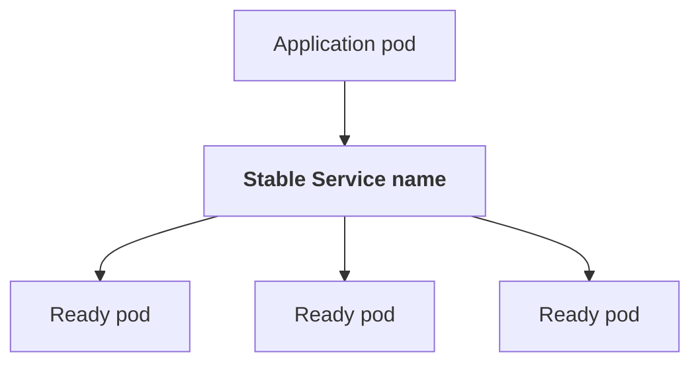
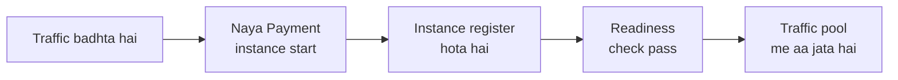

# Service discovery kya hota hai?

Maan lo tumhari application ko `Payment Service` ko request bhejni hai. Local development me uska address fixed ho sakta hai:

```text
http://localhost:8080
```

Lekin production me Payment Service ke kai instances ho sakte hain. Woh alag machines, containers ya zones par chal rahe ho sakte hain; autoscaling, deployment ya failure ki wajah se unke IP addresses badal bhi sakte hain.

**Service discovery** woh mechanism hai jisse ek service doosri service ke current, reachable instances aur unke addresses dhoondh sakti hai.



Iska goal services ko hard-coded IP addresses aur ports par depend karne se bachana hai.

---

## Service discovery ki zaroorat kyun hoti hai?

Distributed system me services:

- alag hosts aur containers par chalti hain
- scale out/in hoti hain
- restart ya fail ho sakti hain
- deploy ke waqt replace hoti hain
- multiple regions ya availability zones me ho sakti hain

Agar `Order Service` me Payment Service ka ek fixed IP hard-code ho, to instance replace hone par Order Service purane address ko call karti rahegi.

Service discovery system current instances ka record rakhta ya expose karta hai, aur caller ko usable destination dhoondhne me madad karta hai.

---

## Core components

| Component | Kaam |
|---|---|
| **Service instances** | Actual running processes (address + port) |
| **Service registry** | Instances ka record: name, address, health, metadata |
| **Registration** | Instance batata hai “main available hoon” |
| **Health checks** | Instance ko traffic dena chahiye ya nahi |
| **Lookup aur routing** | Usable instance dhoondh kar request wahan bhejna |

### 1. Service instances

Actual running processes, jaise:

```text
payment-1 → 10.0.1.12:8080
payment-2 → 10.0.2.19:8080
payment-3 → 10.0.3.15:8080
```

### 2. Service registry

Registry me service instances ki information hoti hai:

```text
service name
instance address and port
health/status
metadata, jaise zone/version
```

Registry centralized system ho sakti hai, ya platform khud yeh information manage kar sakta hai.

### 3. Registration

Service instance registry ya platform ko batati hai: “Main available hoon, mera address yeh hai.”

Registration ho sakti hai:

- **Self-registration:** service khud registry me register/deregister karti hai.
- **Platform-managed registration:** orchestration platform ya infrastructure layer service instances track karti hai.

### 4. Health checks

Sirf register hona kaafi nahi. Instance process alive ho sakta hai, lekin requests serve karne ke liye ready na ho.

Health checks yeh pata karne me madad karte hain ki instance ko traffic dena chahiye ya nahi. Check service, load balancer, orchestrator ya registry kar sakta hai.

### 5. Lookup aur routing

Consumer ko service ke ek ya zyada usable instances milte hain. Phir load balancer, client library ya network proxy request ko kisi instance tak route karta hai.

---

## Ek request ka end-to-end workflow



1. Payment Service ka naya instance start hota hai.
2. Instance apna address platform/registry ko deta hai.
3. Health check verify karta hai ki instance ready hai.
4. Instance healthy destinations me include hota hai.
5. Order Service “payment” ko call karti hai.
6. Discovery/routing layer healthy instance choose karti hai.
7. Request Payment instance tak pahunchti hai.
8. Instance unhealthy/stop ho jaaye to usse destinations se hata diya jata hai.

Yeh process deployment aur autoscaling ke saath continuously chal sakta hai.

---

## Client-side aur server-side discovery

### Client-side discovery

Client registry ko query karta hai, instance choose karta hai, aur seedha usse connect karta hai.



Client-side components:

- registry client/library
- address selection/load-balancing logic
- health/staleness handling

**Faayda:** routing layer kam ho sakti hai; client destination par direct request bhejta hai.
**Trade-off:** har client ko discovery aur load balancing samajhna padta hai.

### Server-side discovery

Client ek stable endpoint ko call karta hai. Load balancer, proxy ya gateway destination instance choose karta hai.



**Faayda:** clients ko instance selection logic kam implement karni padti hai.
**Trade-off:** routing layer ko operate aur monitor karna hota hai.

| | Client-side | Server-side |
|---|---|---|
| Instance kaun choose karta hai | Client khud | Load balancer / proxy / gateway |
| Faayda | Routing layer kam; direct request | Clients simple rehte hain |
| Trade-off | Har client me discovery logic | Routing layer operate aur monitor karna |

Kuch systems me ye roles service mesh sidecars aur control plane ke beech bantte hain.

---

## DNS-based discovery

DNS service name ko address me resolve kar sakta hai:

```text
payment.internal.example
```

Client ko IP hard-code karne ki zaroorat nahi. Platform DNS records ko instances ke hisaab se update ya manage kar sakta hai.

**Important:** DNS caching hoti hai. Client, operating system, runtime ya network resolver answer ko TTL ke baad tak cache kar sakte hain. Isliye unhealthy instance hatane ke baad bhi kuch clients purana address use kar sakte hain. DNS-based discovery me TTL, client behavior aur connection reuse samajhna zaroori hai.

DNS service name aur per-instance service discovery ka exact behavior platform par depend karta hai.

---

## Kubernetes me service discovery

Kubernetes me application aam taur par pod IP directly use nahi karti, kyunki pods replace hote waqt IP badal sakte hain.

Common model:



Kubernetes Service ek stable name/virtual endpoint provide kar sakti hai aur traffic ko selected ready pods tak route kar sakti hai. Cluster DNS se services ko naam se discover kiya ja sakta hai.

Yeh Kubernetes-specific discovery model hai; doosre platforms me service registry, DNS, load balancer ya mesh ka design alag ho sakta hai.

---

## Registry vs load balancer: dono same nahi

- **Registry/discovery** batata hai ki kaunse instances available hain aur unke addresses kya hain.
- **Load balancer/routing layer** decide karta hai ki particular request kis instance ko bhejni hai.

Kuch products dono ka kaam ek saath kar sakte hain, lekin design me concepts alag hain.

---

## Health checks aur readiness

Health check ka matlab hamesha “process chal raha hai?” nahi hona chahiye.

| Check | Sawaal | Fail hone par |
|---|---|---|
| **Liveness** | Process zinda hai? | Restart ki zaroorat ho sakti hai |
| **Readiness** | Instance traffic serve karne ke liye ready hai? | Traffic pool se bahar |
| **Dependency health** | Database ya doosri dependency available hai? | Carefully decide karo (neeche dekho) |

Dependency check ko readiness se jodne me care chahiye. Agar ek optional dependency down hone par saare instances “unready” ho jaayen, to service khud hi traffic se poori tarah cut ho sakti hai. Checks ko service ke real ability-to-serve ke mutabiq design karo.

---

## Stale discovery aur failure handling

Discovery information hamesha instant update nahi hoti. Kuch failure cases:

- registry me dead instance abhi bhi healthy listed hai
- registry temporarily unreachable hai
- client ne purana address cache kiya hua hai
- service start hui, magar ready hone se pehle traffic mil gaya
- sab instances ek hi zone me hain aur zone fail ho gaya

Isliye robust clients me yeh cheezein bhi chahiye:

- connection timeout aur request deadline
- failed instance ko temporarily avoid karne ka behavior
- bounded retry, sahi conditions me
- circuit breaker ya bulkhead, jab dependency repeatedly fail ho
- discovery refresh/backoff behavior
- observability: instance, zone aur service ke hisaab se failures

Service discovery khud service failure ko solve nahi karta. Yeh reachable candidates dhoondhta hai; caller ko timeouts aur failure behavior phir bhi handle karna hota hai.

---

## Scaling aur deployment me discovery

Autoscaling example:



Scale-in example:


Agar instance ko pehle stop kar diya aur baad me discovery se hataya, to callers us dead address ko use kar sakte hain. Orderly deregistration aur draining important hain.

---

## Advanced design points

### Metadata aur version-aware routing

Registry me zone, version ya capabilities ka metadata ho sakta hai. Isse yeh possible ho sakta hai:

- same-zone routing
- canary traffic
- version-specific routing
- latency/cost-aware selection

Lekin metadata-based routing ko stale ya incorrect hone ke risk ke saath design karo.

### Multi-region discovery

Client ko nearest healthy region choose karna pad sakta hai, ya failover region par jana ho sakta hai. Yahan latency ke alawa data residency, consistency, failover policy aur regional capacity bhi matter karte hain.

### Connection pooling

Discovery ke baad client connections reuse karta hai. Agar instance list badal gayi, purane pooled connections ko kaise drain/refresh karna hai, yeh client implementation ka important part hai.

### Discovery as a critical dependency

Agar har request par registry ko synchronous call karna zaroori ho, registry outage se sab services impact ho sakti hain. Aksar clients discovery results ko local cache me rakhte hain, lekin isse stale data ka trade-off aata hai. Exact behavior system ke consistency aur availability goals par depend karta hai.

---

## Common misunderstandings

| Galat soch | Sach |
|---|---|
| “Service discovery load balancing hai.” | Related hain, par alag responsibilities hain. |
| “Healthy registry entry ka matlab request successful hogi.” | Instance health badal sakti hai; request-level failures phir bhi possible hain. |
| “DNS update hote hi sab clients naye address par aa jayenge.” | Caching aur existing connections purana destination rakh sakte hain. |
| “Discovery se retries ki zaroorat nahi.” | Discovery destination dhoondhta hai; network aur service failures phir bhi honge. |
| “Har microservice ko alag registry chahiye.” | Zaroori nahi. Orchestrator, DNS, load balancer ya service mesh ye kaam de sakte hain. |

---

## Quick mental model

```text
Registration = “Main available hoon”
Health check = “Kya main ab traffic le sakta hoon?”
Discovery    = “Service ke instances kahan hain?”
Routing      = “Is request ko kis instance ko bhejna hai?”
```

System design me service discovery ka sahi choice tumhare platform aur scale par depend karta hai. Chhote setup me stable DNS/service name kaafi ho sakta hai; dynamic distributed systems me registry, orchestration platform, load balancer ya service mesh ka combination use hota hai.
